# Contributors by core area

<!-- Generated by `python -m tools.contributors`. Do not edit by hand. -->

Who has worked on each core area of graphify, from the git history at `92741d1`. A core contributor has at least 10 commits that change the package (`graphify/`) or the skill generator (`tools/skillgen/`); tests, docs and release files are not counted. A commit counts once for each area its files belong to. The areas and the files in each are listed in `tools/contributors.py`.

## Graph

Each line joins a contributor to an area they have at least 3 commits in (their 4 largest), labelled with the number of commits.

```mermaid
flowchart LR
    a0["Detection"]
    a1["Extraction"]
    a2["Graph build"]
    a3["Export"]
    a4["Cache and updates"]
    a5["MCP server"]
    a6["Agent skills"]
    a7["CLI and install"]
    p0("safishamsi")
    p1("ayushcodes10")
    p2("rajatnagda45")
    p3("abhay-codes07")
    p4("oleksii-tumanov")
    p5("rohit-jsfreaky")
    p6("hopstreax")
    p7("Mpasha17")
    p8("TPAteeq")
    p9("Synvoya")
    p10("xiongjianxu")
    p11("bercedev")
    p12("Deepjyoti-Sarmah")
    p13("Yyunozor")
    p14("ousamabenyounes")
    p15("rajarshidattapy")
    p16("nothariharan")
    p17("nikhilsaxena04")
    p18("Rishet11")
    p19("SrijanSriv")
    p0 -- 236 --> a1
    p0 -- 193 --> a7
    p0 -- 120 --> a4
    p0 -- 110 --> a6
    p1 -- 31 --> a1
    p1 -- 17 --> a4
    p1 -- 17 --> a7
    p1 -- 9 --> a0
    p2 -- 57 --> a1
    p3 -- 26 --> a1
    p3 -- 7 --> a7
    p3 -- 6 --> a0
    p3 -- 6 --> a2
    p4 -- 33 --> a1
    p4 -- 9 --> a4
    p4 -- 7 --> a7
    p4 -- 3 --> a0
    p5 -- 33 --> a1
    p5 -- 15 --> a4
    p5 -- 9 --> a7
    p6 -- 23 --> a1
    p6 -- 5 --> a2
    p6 -- 5 --> a4
    p6 -- 5 --> a7
    p7 -- 15 --> a1
    p7 -- 3 --> a0
    p7 -- 3 --> a2
    p7 -- 3 --> a5
    p8 -- 11 --> a7
    p8 -- 10 --> a1
    p8 -- 5 --> a3
    p9 -- 23 --> a1
    p10 -- 19 --> a1
    p11 -- 8 --> a1
    p11 -- 6 --> a7
    p11 -- 3 --> a4
    p12 -- 6 --> a1
    p12 -- 5 --> a4
    p12 -- 4 --> a2
    p12 -- 3 --> a6
    p13 -- 12 --> a1
    p14 -- 7 --> a1
    p15 -- 8 --> a1
    p16 -- 6 --> a1
    p16 -- 3 --> a7
    p17 -- 13 --> a1
    p18 -- 5 --> a4
    p18 -- 3 --> a1
    p19 -- 6 --> a2
    p19 -- 3 --> a1
    p19 -- 3 --> a4
    p19 -- 3 --> a7
```

## Titles

Each contributor's title is the area of their first core commit: the area with the most files in it. The author of the repository's first commit is its Creator.

| Contributor | Title | First core commit | Core commits | Areas (commits) |
|---|---|---|---:|---|
| [safishamsi](https://github.com/safishamsi) | Creator | 2026-04-03 `ce47198` feat: Claude Code skill, Obsidian vault, install, tests | 579 | Extraction 236, CLI and install 193, Cache and updates 120, Agent skills 110, Detection 101, Graph build 85, Export 67, MCP server 48, Analysis 43, Reports 27, Ingest 26, Clustering 14, Security 12 |
| [ayushcodes10](https://github.com/ayushcodes10) | Extraction | 2026-09-03 `7492061` Fix module docstring extraction when a leading comment precedes it | 91 | Extraction 31, Cache and updates 17, CLI and install 17, Detection 9, Graph build 7, Reports 4, MCP server 4, Export 3, Agent skills 2, Ingest 1 |
| [rajatnagda45](https://github.com/rajatnagda45) | Extraction | 2026-08-24 `6930e4f` fix(zig): extract methods declared on enums and unions | 57 | Extraction 57 |
| [abhay-codes07](https://github.com/abhay-codes07) | Reports | 2026-08-14 `fc00f67` fix(wiki): make a link target the article filename verbatim, not its percent-encoded twin (#2597) | 50 | Extraction 26, CLI and install 7, Detection 6, Graph build 6, Reports 5, Export 5, Cache and updates 5, Analysis 2, MCP server 2, Agent skills 1 |
| [oleksii-tumanov](https://github.com/oleksii-tumanov) | Analysis | 2026-06-26 `75a5e6d` fix(reflect): include analysis/labels sidecars in --if-stale freshness check (#1470) | 47 | Extraction 33, Cache and updates 9, CLI and install 7, Detection 3, Ingest 2, Analysis 1, Export 1 |
| [rohit-jsfreaky](https://github.com/rohit-jsfreaky) | Detection | 2026-08-09 `3c843bd` fix: skip Obsidian vault metadata directories | 44 | Extraction 33, Cache and updates 15, CLI and install 9, Detection 2, Graph build 2, Analysis 2, MCP server 2, Reports 1 |
| [hopstreax](https://github.com/hopstreax) | Cache and updates | 2026-07-28 `3bac3df` fix(hooks): replace DETACHED_PROCESS with CREATE_NO_WINDOW on Windows | 42 | Extraction 23, Graph build 5, Cache and updates 5, CLI and install 5, Detection 4, Analysis 2, Export 2, Agent skills 2, MCP server 1, Security 1 |
| [Mpasha17](https://github.com/Mpasha17) | Detection | 2026-10-04 `c75bc16` fix(detect): skip graphify's own installed skill folder when scanning | 25 | Extraction 15, Detection 3, Graph build 3, MCP server 3, Analysis 1, Export 1, Cache and updates 1, Agent skills 1 |
| [TPAteeq](https://github.com/TPAteeq) | Agent skills | 2026-06-23 `ad6cb75` feat(install): add cross-framework `agents` platform (+ `skills` alias) | 25 | CLI and install 11, Extraction 10, Export 5, Graph build 2, Reports 2, Cache and updates 2, Agent skills 2, Detection 1 |
| [Synvoya](https://github.com/Synvoya) | Extraction | 2026-07-01 `f2ea6a6` fix(elixir): expand multi-alias brace form into per-module imports edges | 24 | Extraction 23, Graph build 1, Analysis 1 |
| [xiongjianxu](https://github.com/xiongjianxu) | Extraction | 2026-09-02 `c604f48` feat(merge): finish member calls across a repo boundary (#3152) | 19 | Extraction 19, CLI and install 2, Detection 1, Graph build 1 |
| [bercedev](https://github.com/bercedev) | Extraction | 2026-09-28 `452e7b7` fix(sql): walk block nodes so DDL before a DO block is extracted | 17 | Extraction 8, CLI and install 6, Cache and updates 3, Export 1, MCP server 1, Agent skills 1 |
| [Deepjyoti-Sarmah](https://github.com/Deepjyoti-Sarmah) | Graph build | 2026-10-11 `f905db7` fix(dedup): rank a relative source_file against the scan root, not the CWD (#4281) | 17 | Extraction 6, Cache and updates 5, Graph build 4, Agent skills 3, Analysis 1, MCP server 1, CLI and install 1 |
| [Yyunozor](https://github.com/Yyunozor) | MCP server | 2026-07-21 `4ace951` fix: preserve calls edge direction in graphify query output | 16 | Extraction 12, Graph build 2, CLI and install 2, Detection 1, Analysis 1, Export 1, MCP server 1 |
| [ousamabenyounes](https://github.com/ousamabenyounes) | Detection | 2026-08-11 `638d9e2` fix(ingest): recognize Cargo.toml as a package manifest (#2434) | 15 | Extraction 7, Cache and updates 2, CLI and install 2, Detection 1, Ingest 1, Analysis 1, Reports 1, Export 1, MCP server 1 |
| [rajarshidattapy](https://github.com/rajarshidattapy) | Cache and updates | 2026-08-11 `26245b0` fix(cache): implement racily-clean guard for file hashing; enhance stat signature checks | 15 | Extraction 8, Detection 2, Cache and updates 2, CLI and install 2, Graph build 1, Reports 1 |
| [nothariharan](https://github.com/nothariharan) | Extraction | 2026-09-29 `af153f8` fix(kotlin): keep annotated inferred properties in the graph | 14 | Extraction 6, CLI and install 3, Cache and updates 2, Detection 1, Graph build 1, Analysis 1, Reports 1, MCP server 1, Agent skills 1 |
| [nikhilsaxena04](https://github.com/nikhilsaxena04) | Extraction | 2026-09-10 `cd3fd94` feat(extract): support PHP closures (#3409) | 13 | Extraction 13, Detection 1 |
| [Rishet11](https://github.com/Rishet11) | Extraction | 2026-07-24 `f6742bb` fix(extract): exclude class refs from indirect_call edges (#2137) | 11 | Cache and updates 5, Extraction 3, Graph build 2, MCP server 1 |
| [SrijanSriv](https://github.com/SrijanSriv) | Graph build | 2026-10-03 `daee93f` fix(extract): refuse a dedup shrink unless the user accepts it | 11 | Graph build 6, Extraction 3, Cache and updates 3, CLI and install 3, Export 2, Detection 1, Clustering 1 |
