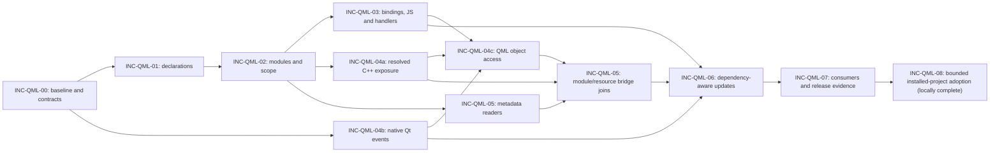

# Qt and QML feature increment plan

Use `INC-QML-` for delivery increments and `REQ-QML-` for requirements/criteria.
The [identifier catalog](IDENTIFIERS.md) retains every prior ID as a permanent alias.

Shared installer, shell-fixture, filesystem-profile and Terraform verification
continues separately under [INC-CORE-01–03](../COMPATIBILITY.md). These contribution
gate corrections do not expand the Qt/QML language profile or advance its counter.

Current delivery: INC-QML-61–129 implements the bounded Qt6.12 source audit,
accepted-link export correction, ordinary caller compatibility and projection
recovery on [PR #10](https://github.com/SlinkyRamey/graphify-with-qt-and-qml-support/pull/10).
The current local gate has751 related passes, including163 focused cases:
58 accepted-frame,75 legacy compatibility and30 version/recovery cases.
Earlier27/596 recovery evidence retains its own version1 source binding.
Final raw-wheel/full-source/installed/corpus/native/cleanup gates are individually
revision-bound in PR #10's current evidence table. Source43ac's20 hosted passes
and source9ac's failed installed consumers are historical, separate evidence.
Unsupported/unverified SDK forms remain in the mechanism matrix; source-corpus
declarations and every possible native binding are distinct claims.

The following introduction preserves historical delivery checkpoints. Its old
failure counts, PR identities and then-current statements do not replace the
current summary above or the final source-bound records in traceability.

Status: **INC-QML-11, INC-QML-15 and INC-QML-08a/b/c are implemented and locally
complete for the bounded Windows x64/Python 3.12 profile**. INC-QML-28–38 close
additional reproduced defects discovered during that development. The final
reviewed installed wheel passes 3,024 selected tests with 36 existing skips;
actual CMake/qmake whole-root and safe-subroot CLI profiles pass initial and repeat
updates. All seven REQ-QML-018 criteria have individual local acceptance evidence.
See [final validation](VALIDATION.md#final-adoption-delivery) and
[traceability](../../tests/TRACEABILITY.md#final-adoption-delivery).

The earlier full source run has 8,630 passes, 59 failures and 178 skips. Its exact failure
identities equal the pre-work baseline; no new failures were added. Full typing
also retains baseline errors with no added diagnostic identities. These are
failed contribution gates, not passing release evidence. At that checkpoint,
changes had not been published or run through the twelve hosted OS/Python lanes. Local
completion does not fill those cells or establish native browser/device, live
database or Qt runtime proof.

The later [Windows dependency follow-up](VALIDATION.md#windows-shell-and-optional-dependency-follow-up--2026-10-04)
installs portable Bash and locked optional packages without product changes.
Its selective rerun clears 40 of the original 59 failures, retains 19, and exposes
two previously skipped hook path assertions. No full-suite gate is inferred.

The historical [native compatibility evidence](../../tests/TRACEABILITY.md#current-native-source-and-artifact-evidence--2026-10-05)
at `463ca322` has 8,818 passes and no pytest failures, with separate setup replays.
[Draft PR 6](https://github.com/SlinkyRamey/graphify/pull/6) publishes the adoption
branch against the reviewed INC-QML-07 base. Its first hosted revision passes
four Ubuntu wheel lanes but rejects CI configuration before job admission and
fails eight Windows/macOS installed-smoke lanes. INC-CORE-06 corrects workflow
admission; INC-QML-39 corrects the reproduced canonical input-alias mismatch.
Those failures were unmet hosted gates at that checkpoint until corrected evidence existed.

At hosted head `f95366d`, all twelve isolated QML/core wheel smoke profiles pass,
and the four macOS QML source profiles pass. Ubuntu source jobs expose two
discovered-symlink provenance failures; Windows QML source jobs expose seven
nearby-alias fixture setup errors, and the native compatibility job rejects its
duplicate Node application selection before pytest. INC-CORE-07 and INC-QML-42/43
have passing local source/installed checkpoint evidence for those corrections.
Plan exit review reproduces shared-content watch invalidation and actual Windows
short-leaf identity gaps, assigned to INC-QML-44/45. The next normal PR revision
owns corrected hosted proof; no current full hosted pass is claimed.

INC-QML-00–07 hosted results remain evidence for their recorded original profile.
INC-QML-09/13/16 implement community presentation and middle mouse navigation;
emitted-script/installed contracts pass, with native interaction still unverified.
INC-QML-10/12/14 and INC-QML-17–27 correction records retain their original
revision boundaries. The [API mechanism matrix](QT_API_COVERAGE.md) identifies
supported forms, conservative exclusions and generic-only extraction. It does
not promise individual whole-SDK semantics.

Sections below preserve planning contracts and chronological checkpoint reviews.
Earlier pending statements and epochs describe those checkpoints; the current
delivery state is the opening current-delivery paragraph and the final source-bound
exit records in traceability. Commands marked
proposed are suggestions, not executed evidence. Increment identities remain
distinct from requirements and their acceptance criteria.

This plan extends Graphify's existing Python pipeline and contribution workflow.
It does not propose a Qt application rewrite. Read [REQUIREMENTS.md](../REQUIREMENTS.md),
[ARCHITECTURE.md](ARCHITECTURE.md), [DESIGN.md](DESIGN.md), [AUDIT.md](AUDIT.md),
and the upstream [contribution guide](../../CONTRIBUTING.md) before
implementation. The approved baseline is the imported upstream `v8` state recorded
by the foundation audit; recheck upstream changes before starting each PR.

Upstream already tracks this feature in [issue #1716](https://github.com/Graphify-Labs/graphify/issues/1716)
and [PR #1748](https://github.com/Graphify-Labs/graphify/pull/1748). The PR was open
when inspected for this foundation and includes QML extraction and a C++ bridge.
Its page contains older dependency notes superseded by later commits. INC-QML-00
must review its current head, tests, dependencies, maintainer feedback and overlap
before deciding what to reuse, supplement or replace. Do not create a duplicate
issue or assume unmerged code is present in the imported baseline.

## Sequence and working contract

| Increment | Outcome | Prerequisites | Requirement references |
| --- | --- | --- | --- |
| INC-QML-00 | Existing-PR review, reproducible baseline and accepted parser decision | Foundation review | REQ-QML-001, REQ-QML-010, REQ-QML-012, REQ-QML-014, REQ-QML-015 |
| INC-QML-01 | Discover `.qml` and extract minimal source-backed declarations | INC-QML-00 | REQ-QML-001, REQ-QML-002, REQ-QML-003, REQ-QML-010, REQ-QML-011, REQ-QML-012, REQ-QML-013, REQ-QML-014, REQ-QML-015 |
| INC-QML-02 | Resolve explicit QML modules, local components and scoped names | INC-QML-01 | REQ-QML-002, REQ-QML-004, REQ-QML-005, REQ-QML-010, REQ-QML-012, REQ-QML-014, REQ-QML-015 |
| INC-QML-03 | Model bindings, aliases, JavaScript and signal relationships | INC-QML-02 | REQ-QML-006, REQ-QML-007, REQ-QML-010, REQ-QML-012, REQ-QML-014, REQ-QML-015 |
| INC-QML-04 | C++ exposure into QML, Qt signal connections and C++ access to QML APIs | INC-QML-04b after INC-QML-00; resolved INC-QML-04a joins after INC-QML-02; INC-QML-04c after INC-QML-03, INC-QML-04a and INC-QML-04b; metadata joins finish with INC-QML-05 | REQ-QML-008, REQ-QML-016, REQ-QML-017, REQ-QML-010, REQ-QML-012, REQ-QML-014, REQ-QML-015 |
| INC-QML-05 | Enrich modules and resources from static Qt project metadata | INC-QML-02; enrich INC-QML-04 when available | REQ-QML-002, REQ-QML-004, REQ-QML-008, REQ-QML-009, REQ-QML-017, REQ-QML-010, REQ-QML-012, REQ-QML-014, REQ-QML-015 |
| INC-QML-06 | Guarantee dependency-aware update/watch/cache parity | INC-QML-03, INC-QML-04, INC-QML-05 | REQ-QML-002, REQ-QML-011, REQ-QML-016, REQ-QML-017, REQ-QML-010, REQ-QML-012, REQ-QML-014, REQ-QML-015 |
| INC-QML-07 | Verify consumers, publish support matrix and prepare upstream release | INC-QML-00 through INC-QML-06 | REQ-QML-013, REQ-QML-014, REQ-QML-015; regression of initial REQ-QML-001–REQ-QML-017 |
| INC-QML-08 | Harden installed-project adoption with evidenced source forms and typed context chains | INC-QML-07; public reproductions and bounded contract review | REQ-QML-018; reverify affected REQ-QML-004/REQ-QML-007/REQ-QML-008/REQ-QML-009/REQ-QML-011/REQ-QML-012/REQ-QML-013/REQ-QML-014/REQ-QML-015/REQ-QML-017 |

Keep the existing increment numbers as stable scope identifiers; they do not
require independent work to wait for every lower number. The QML lane follows
INC-QML-00, INC-QML-01, INC-QML-02 and INC-QML-03. Native Qt C++ events in INC-QML-04b can proceed
after INC-QML-00 establishes C++ identity and event-site projection contracts, without
waiting for QML parsing or JavaScript integration. Raw C++ exposure/access facts
can also be developed early against those agreed interfaces; resolved joins have
the prerequisites in the table.

After INC-QML-02 establishes the module-index contract, INC-QML-05's independent metadata
readers may proceed alongside INC-QML-03 and the C++ work. Their bridge integration
waits for INC-QML-04a/INC-QML-04c facts. Minimal `qmldir` discovery belongs to INC-QML-02. Simple
literal-file access in INC-QML-04c can precede INC-QML-05; module-loaded components and qrc
aliases finish with INC-QML-05's index. This separates reader readiness from completed
bridge integration and avoids a circular prerequisite.



## Reviewable work packages

These are slices within existing increments, not new requirement or increment IDs.
Each slice has one owner and a focused diff. Internal adapters/facts may land before
admission, but public dispatch is enabled only with its complete extraction,
packaging, diagnostics, persistence and safe-update gate. Combine slices when a
separate PR would expose a broken path or have no independently useful outcome.

| Increment | Work packages | Demonstrable result |
| --- | --- | --- |
| INC-QML-00 | Baseline/upstream overlap review; parser and syntax probe; fact/graph/update contracts | Reproducible parser choice and hand-checked corpus; no production admission |
| INC-QML-01 | Parser adapter and declarations; discovery/dispatch/packaging integration | A small QML file yields exact scoped declarations and spans, with safe failures and updates |
| INC-QML-02 | `qmldir` facts; URI/version/alias lookup; component/member scope | Equal names in different modules/components resolve correctly or remain ambiguous |
| INC-QML-03 | Bindings/aliases; embedded/imported JS; handlers and `Connections` | Property, call and signal dependencies preserve scope, source evidence and mechanism |
| INC-QML-04a | Meta-object/member overlay; literal procedural registration; declarative exports | QML references reach evidenced C++ APIs; build-derived module joins finish in INC-QML-05 |
| INC-QML-04b | Declarations/emissions; typed/overloaded/lambda connections; legacy signatures/private slots/disconnect | Native C++ events remain distinct from direct calls, including ordinary compatible receivers |
| INC-QML-04c | Loader/root provenance; objectName/member access; context/initial providers and signal joins | C++ accesses the evidenced QML object/member; unknown or duplicate targets remain unresolved |
| INC-QML-05 | CMake/qmake module readers; `.qmltypes`; `.qrc`; bridge integration | Equivalent Qt 6 project forms resolve modules/resources and both bridge directions without execution |
| INC-QML-06 | Invalidation/reconstruction; watch integration; mutation/parity corpus | Updates equal clean rebuilds after QML, C++, resource and metadata changes |
| INC-QML-07 | Query/affected; export/MCP/callflow; install/release evidence and generated guidance | Users can inspect the verified dependency graph through advertised consumers |
| INC-QML-08 | Public adoption reproductions; project/native source compatibility; typed context chains; installed/update safety | Newly accepted ordinary project forms work through the installed CLI with accurate uncertainty and preserved prior data |

One integration owner controls shared discovery, dispatch, registry, graph,
cache/watch and resolver contracts. Parser, metadata, event and access contributors
own disjoint modules and fixture/test files against agreed interfaces. Give the
C++ overlay one owner; event/access slices supply focused modules rather than
concurrently editing its central integration file. Record ownership before work,
review commits at handoff, and coordinate every Git mutation.

The first useful QML slice is INC-QML-01. Native Qt event analysis is a separate useful
slice in INC-QML-04b. Project-level mixed-language analysis needs INC-QML-02/INC-QML-03/INC-QML-04/INC-QML-05;
the release candidate also needs INC-QML-06/INC-QML-07. Estimate elapsed effort after INC-QML-00
resolves parser packaging and reuse uncertainty, using those measured findings.

## Increment readiness and completion

An increment is ready when its reviewed source base, prerequisites, owner, affected
acceptance IDs, proposed fact/interface changes, hand-checked fixture expectations,
failure cases and verification commands are recorded. Inspect overlapping upstream
work before committing to a production approach. Tests/fixtures named below are
proposed and must exist before running their acceptance command.

An increment is complete only when its implemented subset passes the common gate,
each due criterion has exact evidence, new failures have faithful regressions,
safe update/persistence behavior is exercised, and requirements/design/diagnostics/
comments/traceability match the delivered result. Record modularity ceilings or
justified exceptions for touched source files. Partial implementation is a valid
checkpoint, not a completed criterion. Baseline failures, skips and missing lanes
remain explicit limitations rather than passing evidence.

At each handoff, the integration owner reviews a versioned record of exact base,
head and tested SHAs, affected acceptance IDs with partial/passed/gap evidence,
interface/schema decisions, commands/results/platforms, file ownership, outstanding
risks, and the next owner. A future work package must not infer completion from a
previous contributor's summary alone.

When publication is authorized, use one focused branch and one PR validation run
for the reviewed revision; preserve separate required post-merge checks. Record
source, tested integration and resulting SHAs with workflow results. Follow
[AGENTS.md](../../AGENTS.md) for guarded merging, retries and any future protected
proof. Upstream acceptance depends on maintainer review; it is not an automatic
result of finishing local implementation.

## Acceptance completion ownership

Every acceptance criterion has one planned completion increment in
[tests/TRACEABILITY.md](../../tests/TRACEABILITY.md). Earlier increments provide
partial evidence and later ones reverify affected contracts. This is a delivery
assignment, not a change to the criterion or a claim that it passed. Cross-cutting
criteria remain obligations in every affected PR, even when their complete
mixed-language evidence is assigned to INC-QML-06 or INC-QML-07.

| Requirement | Planned criterion completion |
| --- | --- |
| REQ-QML-001 | AC01/AC03/AC04: INC-QML-01; AC02 complete supported-source corpus: INC-QML-03 |
| REQ-QML-002 | AC02/AC03 metadata/corpus boundaries: INC-QML-05; AC01/AC04 entry-point parity: INC-QML-06 |
| REQ-QML-003 | AC01–AC04: INC-QML-01 |
| REQ-QML-004 | AC01–AC04: INC-QML-02 |
| REQ-QML-005 | AC01–AC04: INC-QML-02; reverify added metadata visibility in INC-QML-05 |
| REQ-QML-006 | AC01–AC04: INC-QML-03 |
| REQ-QML-007 | AC01–AC04: INC-QML-03; reverify C++ signal joins in INC-QML-04/INC-QML-05 |
| REQ-QML-008 | AC01–AC04: INC-QML-05, following INC-QML-04a source exposure |
| REQ-QML-009 | AC01–AC04: INC-QML-05 |
| REQ-QML-010 | AC01–AC04: INC-QML-07; graph correctness gates apply when each fact lands |
| REQ-QML-011 | AC01–AC04: INC-QML-06 |
| REQ-QML-012 | AC01–AC04: INC-QML-06; safe failure/persistence gates apply from INC-QML-01 |
| REQ-QML-013 | AC01–AC04: INC-QML-07 |
| REQ-QML-014 | AC01–AC04: INC-QML-07; install/platform evidence starts in INC-QML-00/INC-QML-01 |
| REQ-QML-015 | AC01–AC04: INC-QML-07; documentation/evidence gates apply in every PR |
| REQ-QML-016 | AC01–AC03: INC-QML-04b; AC04 full parity/consumer evidence: INC-QML-07 |
| REQ-QML-017 | AC01–AC03: INC-QML-05 after INC-QML-04c; AC04 full parity/consumer evidence: INC-QML-07 |
| REQ-QML-018 | AC01/AC02/AC07: INC-QML-08a; AC03/AC04: INC-QML-08b; AC05/AC06: INC-QML-08c; safety gates apply to every slice |

The parser spike informs REQ-QML-001; production install/failure acceptance closes in
INC-QML-01 and the complete supported syntax/declaration corpus in INC-QML-03. Parsing
success alone cannot replace those production-boundary assertions.
All named metadata and their corpus boundaries close in INC-QML-05. Exposure and
resource/module-backed access close in INC-QML-05 after the INC-QML-04 source slices.
Native event syntax closes in INC-QML-04b, while REQ-QML-016-AC04 and REQ-QML-017-AC04 need
incremental and consumer evidence before closing in INC-QML-07. The final release gate
rechecks all sixty-eight initial-profile criteria for the advertised matrix.
INC-QML-08 now has seven separately assigned criteria and reverifies affected original
contracts; existing passes do not establish the expanded adoption profile.

The primary acceptance profiles are ordinary Qt 6.5 and Qt 6.8 source/metadata,
as specified in ARCHITECTURE. Both CMake and qmake project forms are required for
the first Qt 6 target. Literal procedural registration is also part of Qt 6 bridge
support; neither qmake nor procedural registration is restricted to legacy Qt.
Qt 5.15 is a separate legacy compatibility profile with separately reviewed PRs
within INC-QML-02, INC-QML-04 and INC-QML-05. Parsing common versioned-import syntax earlier
does not establish that profile's semantic support. Record module import versions
separately from the Qt release used to define a fixture.

Each increment is a cohesive feature branch and one or more small PRs. A PR may
merge independently only when it delivers a truthful subset, preserves existing
behavior, and satisfies its exit gate. Broad schema migrations, graph-class
changes, unrelated refactoring, and new runtime integrations require separate
review. An upstream-ready PR is not an upstream-accepted PR; approval and merge
remain separate recorded events.

Use existing `file_type="code"`, required source provenance, confidence values,
canonical ID helpers, ignore rules, and graph consumers. New QML detail belongs in
versioned metadata and focused resolver facts, with meanings defined in DESIGN.
Do not globally group QML/JavaScript with C++ to defeat cross-language call guards.
Do not activate a MultiDiGraph migration as an incidental language-support change.
Represent distinct bindings or handlers with their own source-backed nodes where
needed so the current simple graph does not silently overwrite relationships.

## Common verification gate

All paths below are relative to the repository root. Proposed new test files and
fixture directories are deliberately named so work can start without inventing
the test layout. Adapt names to an upstream-reviewed convention while retaining
the acceptance-criterion mapping. Every requirement has individually assigned
criterion IDs in REQUIREMENTS, such as `REQ-QML-003-AC01` through `REQ-QML-003-AC04`.
Before starting an increment, list all affected criterion IDs and map each one to
a concrete fixture/action/observable result and an exact automated test, or to an
explicit manual/system verification gap. Dedicated tests should use criterion
metadata or names such as `test_QML_003_AC01`; existing tests may map through
`tests/TRACEABILITY.md` without renaming unrelated tests.

Every increment's exit gate requires criterion-level evidence in traceability:
test identity, command, result, supported profile/platform, and remaining gap.
Record applicability explicitly. All applicable assigned criteria must pass
individually before a requirement becomes `Verified`. A skipped test, unexecuted
manual check, aggregate test count, or one passing happy-path test does not verify
the other criteria. Retain `Planned`, `Implemented` or partial/unverified status
until the criterion-level evidence supports promotion; document any criterion
scope change in the requirement rather than silently treating it as a pass.

Establish a pinned development environment with `uv sync --frozen`. If a PR changes
dependencies, deliberately regenerate and review `uv.lock` first; a frozen command
must not be used to pretend that an old lock covers a new dependency. Use the
selected QML extra after INC-QML-00 accepts its packaging contract. Do not substitute
live Qt execution or model calls for deterministic offline parser tests.

Before handoff, execute the increment's focused tests and the following applicable
upstream checks. Capture failures, skips and unavailable optional dependencies.
The proposed pytest commands use Python's module runner and UTF-8 mode because
this project is developed on Windows. Existing POSIX CI may retain its equivalent
pytest entrypoint. The foundation's two remaining Windows-invalid deleted-working-
directory fixture failures are documented in VALIDATION; reproduce and classify
baseline failures instead of treating them as new Qt/QML regressions or claiming
the complete baseline is green.

```text
uv run --frozen python -X utf8 -m pytest tests/ -q --tb=short
uv run --frozen ruff check .
uv run --frozen pyright
uv run --frozen python -m tools.skillgen --check
```

When optional dependencies are involved, reproduce the upstream CI environment
with `uv sync --all-extras --frozen` in a suitable clean job, or use an explicitly
documented extra selection for the focused job. A platform-specific dependency
failure is a finding to resolve or report, not permission to claim full coverage.
When code changes, follow the repository's instruction to run `graphify update .`
and check its result. Generated local graph/build outputs remain uncommitted.

For every increment, review the full diff, canonical documents, test quality,
dependency provenance, and safe diagnostics. Record the actual commands and
results in `tests/TRACEABILITY.md`. Demonstrate regression tests fail against the
old behavior where applicable. Full-suite or cross-platform failures must be
explained before completion; unchanged aggregate coverage does not settle them.

Every new fact shape must pass extraction, graph-build and JSON reload assertions
when introduced. Event/access packages also demonstrate their minimal query and
affected behavior before claiming usability. INC-QML-07 expands that coverage to the
complete advertised consumer matrix; it does not defer basic graph correctness.

Before enabling an update/watch path, implement and test its conservative full-
project resolution/rebuild fallback or reject the unsupported operation before
mutating graph/cache state. Test deletion, failed extraction and stale-edge removal
at each newly enabled boundary. A warning or support note cannot justify leaving
an enabled path known to produce stale results. INC-QML-06 improves invalidation and
establishes full parity after this safety baseline.

<a name="qml-00--baseline-and-parser-decision"></a>

## INC-QML-00 — Baseline and parser decision

**Status: complete for optional parser selection (3 October 2026).** See the
[parser decision and executed evidence](PARSER_DECISION.md). Linux/macOS lanes
remain unverified; this does not authorize default-installed parser promotion.
INC-QML-01 includes **INC-QML-01a** (write/cache safety) and **INC-QML-01b** (declarations,
admission and installation) as required INC-QML-01 work packages. A dedicated semantic
qmldir parser and nonlossy, immutable fact transport are mandatory in INC-QML-02.
Production acceptance criteria remain open until exercised through production.

**Scope and code paths.** First inspect the current exact head of PR #1748 without
changing this workspace to its branch. Review its extractor, C++ modifications,
dependency metadata, tests, graph-family policy and mergeability against the
current upstream base. Map its existing coverage to the requirements in this plan.
Record a reuse/supplement decision and preserve attribution and license notices
for any later adopted code. Read-only inspection does not authorize posting review
comments or messages to other contributors.

The source audit identifies review cases around flat scope/name tables, discarded
import alias/version context, partial-parse reporting, C++-only resolver activation,
and compatibility of C++ changes with current upstream normalization. Reproduce
these against the recorded candidate head rather than assuming its tests exclude
them. Include the valid identifier form `QML_NAMED_ELEMENT(Backend)`;
[Qt 6.8's macro documentation](https://doc.qt.io/qt-6.8/qqmlintegration-h.html#QML_NAMED_ELEMENT)
shows an identifier argument. A test built only around quoted macro syntax does
not validate the real contract. Also test macro-like text in comments/literals.

Create public, synthetic fixtures under
`tests/fixtures/qml/parser_probe/` and a focused `tests/test_qml_parser_probe.py`
or equivalent nonshipping probe. Record the baseline commit, environment, current
language behavior, and parser ADR in the Qt/QML architecture/design documents.
Inspect `pyproject.toml`, `uv.lock`, `.github/workflows/ci.yml`,
`graphify/extractors/models.py`, `graphify/extractors/engine.py`, `graphify/ids.py`,
and `graphify/validate.py`. Keep experimental adapters out of production dispatch.

Evaluate the direct QML grammar binding and the pinned language-pack option
identified by the architecture audit. Do not choose a package from its name or
advertised grammar list alone. Verify its license, grammar revision, Tree-sitter
API/ABI compatibility, actual installed parser availability, source ranges,
error recovery, distribution size, and offline behavior. A required dynamic
grammar download fails the offline installation/extraction gate.

Start the comparison with the audited `tree-sitter-language-pack==0.11.0` candidate,
already optional upstream, and verify its actual installed `qmljs`/`qmldir`
entry points against the locked runtime. Treat the standalone
`tree-sitter-qmljs==0.3.1` as an alternative with explicit source-build and older-
binding risks. Record selection or rejection in existing decision D2. Prefer an
optional `qml` extra for initial adoption unless evidence supports a different
reviewed packaging decision; a package name/range intersection is not API proof.

**Acceptance cases.** Parse imports with and without versions and aliases, objects,
nested objects, properties and modifiers, aliases, signals, methods, inline
components, JavaScript expressions, handlers, and deliberately incomplete files.
Probe `qmldir` independently; a small dedicated metadata parser is an acceptable
decision if its syntax and failure behavior are explicit. Unicode identifiers,
CRLF, comments containing braces, strings containing punctuation, and malformed
input must preserve useful ranges without a crash. The probe must never execute
QML or JavaScript. Missing grammar must yield a safe explicit limitation.

Verify installation and parser invocation on Python 3.10, 3.12, 3.13, and 3.14,
matching upstream's current Python CI matrix; include Windows x64, Linux, and
macOS compatibility evidence or record each unsupported/unverified combination.
Build a syntax matrix using version-tagged source fixtures rather than claiming
runtime support for all Qt releases. Pin the supported syntax subset before INC-QML-01.

Use focused packaging/probe jobs for additional platforms; the audited workflow
currently covers Ubuntu and does not prove Windows/macOS support. Advertise only
tested lanes and record architecture where relevant. Keep source/grammar/license
fingerprints and an explicit reused-file/test ledger at the reviewed PR head.
Retain the known Windows deleted-cwd fixture failures and type-check baseline as
separate findings; any portability correction is a focused change, not a weakened
parser gate or an unrelated bulk rewrite.

**Proposed commands.** The probe test is introduced by this increment; it must not
be entirely skipped in the job used to accept the parser.

```text
uv run --frozen python -X utf8 -m pytest tests/test_qml_parser_probe.py -q --tb=short
uv run --frozen python -X utf8 -m pytest tests/test_languages.py tests/test_multilang.py tests/test_extractors_registry.py tests/test_id_normalization_contract.py tests/test_validate.py -q --tb=short
```

**Exit gate and PR boundary.** Accepted parser ADR, dependency/license decision,
install matrix, synthetic corpus, meaningful recovery tests, baseline evidence,
and the existing-PR reuse/overlap decision. Accept the C++ declaration identity,
source-fact ownership, nonlossy event-site projection and safe-update fallback
design contracts required by the first production slices. Runtime implementation
of that fallback belongs to the first enabled update path, not to the probe.
No release language-support claim. Keep the parser choice/fixture PR separate from
production extraction if that makes review clearer. A missing cross-platform
wheel or incompatible ABI blocks promotion to default-installed support; document
an optional extra or defer instead of silently adding a compiler requirement.

<a name="qml-01--discovery-and-minimal-declarations"></a>

## INC-QML-01 — Discovery and minimal declarations

**Status: INC-QML-01a/INC-QML-01b complete for the declared Windows optional profile.** See
[implementation evidence](IMPLEMENTATION.md). INC-QML-02/INC-QML-03 require semantic
validation, immutable context and independent use sites. No new top-level
increment is needed; INC-QML-06 still owns cache optimization.

**Scope and code paths.** Add `graphify/extractors/qml.py` with an isolated parser
adapter and QML facts as necessary. Integrate `graphify/detect.py`, the public
facade and `_DISPATCH` in `graphify/extract.py`, and
`graphify/extractors/__init__.py`; registry entry alone is insufficient. Add the
accepted dependency/extra to `pyproject.toml` and `uv.lock`. Use
`graphify/ids.py`, `graphify/cache.py`, and `graphify/diagnostics.py` through their
existing contracts. Add `tests/test_qml_extract.py` and
`tests/fixtures/qml/declarations/`; update upstream language and detection tests.

Extract file/component declarations, nested object scopes, `id` declarations,
properties, signal declarations, and method declarations with source ranges.
Record imports as raw facts or import records without guessing a target. Method
bodies and bindings remain opaque source facts until INC-QML-03. A declared property
alias may be recognized here while its target relationship remains unsupported.
Keep QML semantic information in `metadata.qml` and the versioned fact contract
specified in DESIGN. Represent `id` as component-local identity, not an ordinary
globally exported property. Preserve the full filename and component/symbol scope
when deriving canonical IDs; prove exact-case/punctuation collision handling.

**Acceptance cases.** Directory and single-file scans discover `.qml` and
`.ui.qml`, obey `.gitignore`/`.graphifyignore`, and leave existing classifications
unchanged. Valid declarations retain source-backed fields and correct ranges;
two files with the same stem, `.qml`/`.js` stem collisions, case-distinct names,
nested identical IDs, and relocation to a different absolute checkout do not merge
unrelated declarations. Malformed or unsupported input yields bounded diagnostics
and a partial/failed status that cannot replace valid persisted state. Missing
optional grammar does not make an unrelated Python/C++ scan fail. Repeated scans
preserve IDs, confidence and order after canonical comparison.

**Proposed focused commands.**

```text
uv run --frozen python -X utf8 -m pytest tests/test_qml_extract.py tests/test_detect.py tests/test_extractors_registry.py tests/test_languages.py tests/test_extract_cli.py tests/test_extract_code_only_cli.py tests/test_validate.py tests/test_node_id_canonical.py tests/test_partial_extraction_warning.py tests/test_zero_node_no_cache.py -q --tb=short
```

**Exit gate and PR boundary.** One PR delivers discovery plus a minimal extractor,
public fixtures, dependency packaging, extraction validation, a cold/warm smoke
test, and an honest declarations-only support note. Do not ship discovery alone
that routes QML into an unusable extractor. Existing zero-node/shrink/cache guards
must apply. Until INC-QML-06, resolver-changing input must use a tested safe full
project resolution/rebuild path or be rejected before writes. Include admission,
edit, deletion and forced parser/write failure evidence for the enabled update and
watch paths; a known stale-graph path must not remain enabled with only a warning.

REQ-QML-001-AC01 also requires a clean built-wheel installation with the selected QML
extra and production parser invocation on every declared lane. Extend the existing
wheel-packaging coverage and use isolated install/probe jobs; source-tree imports
or INC-QML-00's experimental adapter are insufficient. Test a core-only installation
without that extra. REQ-QML-001-AC02 stays open until INC-QML-03's production adapter passes
the complete declared syntax/declaration/span corpus, including embedded JS forms.

<a name="qml-02--modules-and-component-scope"></a>

## INC-QML-02 — Modules and component scope

**Status: complete for the documented static profile.** Work packages cover **INC-QML-02a** semantic
qmldir, **INC-QML-02b** immutable module/member indexes and **INC-QML-02c** transport,
producer provenance and provider-only refresh parity. These follow the existing
letter-suffix numbering; all must pass to close INC-QML-02. No new top-level increment.

**Scope and code paths.** Add `graphify/qml_resolution.py` and focused
`graphify/extractors/qml_metadata.py`, with registry integration through
`graphify/resolver_registry.py` and `graphify/extract.py`. Introduce shared
named-file discovery for `qmldir` in the existing corpus-boundary path; update
`collect_files()` and watcher recognition without creating a separate ignore
policy. Add `tests/test_qml_resolution.py`, `tests/test_qml_metadata.py`, and
`tests/fixtures/qml/modules/`. Use a per-project module/scope index with explicit
inputs and lifetime; retain raw facts separately from resolved graph edges.

Resolve directory imports, module URI imports, aliases, local QML components,
version declarations, `qmldir` type entries, inline-component scopes, and singleton
metadata according to the accepted static policy. Record unresolved or conflicting
imports rather than searching every basename in the repository. Preserve scope
boundaries for IDs, component members, and inline components; do not infer dynamic
delegate/context objects from lexical proximity alone.

**Acceptance cases.** Two modules both export `Button`; an aliased import resolves
only the intended module, while an ambiguous unqualified use has no guessed
concrete target. Imported versions, versionless imports, relative directory imports,
missing components, missing/duplicate module metadata, singleton declarations and
inline components have documented positive and rejection cases. Identical IDs in
separate component scopes stay distinct. An ignored or out-of-corpus `qmldir` does
not grant access to its files. Metadata-only changes trigger the conservative
resolution path even when QML text is unchanged. Synthetic Qt built-in references
remain external/unresolved unless a source-backed type inventory is supplied.

**Proposed focused commands.**

```text
uv run --frozen python -X utf8 -m pytest tests/test_qml_resolution.py tests/test_qml_metadata.py tests/test_qml_extract.py tests/test_language_resolvers.py tests/test_case_sensitive_resolution.py tests/test_import_self_loops.py tests/test_phantom_cross_package_call.py -q --tb=short
```

**Exit gate and PR boundary.** Module lookup/scope rules and ambiguity evidence are
documented and exercised through full extraction. A small named-file discovery
PR may precede the resolver when independently useful and tested. Module resolution
is a separate PR from later binding/call semantics. Keep the module-index contract
small enough for C++ and project metadata enrichment without a generic resolver
rewrite. No global same-name fallback or implicit Qt SDK scan.

<a name="qml-03--bindings-aliases-javascript-and-signals"></a>

## INC-QML-03 — Bindings, aliases, JavaScript and signals

**Status: complete for the documented static profile.** REQ-QML-001-AC02 and all
REQ-QML-006/REQ-QML-007 criteria pass production fixtures. Actual tests are in
test_qml_syntax_profile.py, test_qml_expressions.py, test_qml_handlers.py,
test_qml_scripts.py, test_qml_adversarial.py and the graph/persistence suites.
See [implementation evidence](IMPLEMENTATION.md); proposed names below describe
the initial planning contract and are superseded by those actual owners.

INC-QML-03 comprises **INC-QML-03a** held-object/array/template declarations, **INC-QML-03b**
lexical expressions/aliases/handlers and **INC-QML-03c** accepted-script overlays,
generic-JS isolation, typed cross-family proof and durable edge direction. All
three work packages are delivered. Regression discoveries include lexical-list
truncation, duplicate anonymous Connections, inherited signal parameters,
mixed Connections handler styles, alias cycles, module export roles and missing
script-file endpoint proof. Separate source sites retain repeated relationships.

No new top-level increment is needed. Add **INC-QML-06a** source/metadata/script/C++
mutation parity and **INC-QML-06b** bounded parser/config/import-root cache contracts;
add **INC-QML-07a** direction/evidence across every advertised consumer and **INC-QML-07b**
hosted installation/profile evidence and upstream review. These refine existing
increments, preserving INC-QML-00 through INC-QML-07 and INC-QML-04a/INC-QML-04b/INC-QML-04c numbering.
Runtime contexts, framework members, reexports and name-based template barriers
remain documented conservative limits. Native C++ work advances in INC-QML-04 next;
build/resource/type-description enrichment remains INC-QML-05.

**Scope and code paths.** Extend focused QML extraction/resolution modules, reusing
existing JavaScript AST helpers only through a narrow adapter that preserves QML
lexical scope and original source offsets. Add
`tests/test_qml_bindings.py`, `tests/test_qml_javascript.py`,
`tests/test_qml_signals.py`, and `tests/fixtures/qml/interactions/`. Map relations
through existing `references`, `uses`, and validated `calls` semantics with QML
context metadata. Binding and handler nodes retain distinct source evidence and
avoid same-endpoint relation loss in the current simple graph.

**Acceptance cases.** Property binding reads link to the correct local ID/member;
property aliases retain the target and alias distinction; scoped local variables
shadow component members; inline-component and imported-JavaScript scopes do not
leak. Test expressions, blocks, functions, closures, `.js` imports, `.pragma
library` where accepted by the syntax matrix, signal declarations/emissions,
`onSignal` handlers and `Connections`. A handler's reference to a signal is not
proof of a runtime call. Dynamic `Connections.target`, computed property names,
runtime object creation and unresolved context values stay visibly unresolved or
qualified as inference. Two relationships between the same logical objects must
retain distinct evidence after build/merge/JSON round trip.

**Proposed focused commands.**

```text
uv run --frozen python -X utf8 -m pytest tests/test_qml_bindings.py tests/test_qml_javascript.py tests/test_qml_signals.py tests/test_js_import_resolution.py tests/test_js_callback_calls.py tests/test_indirect_call_block_scoped_shadow.py tests/test_build_merge_hyperedges_and_prune.py tests/test_relation_collapse_precedence.py -q --tb=short
```

**Exit gate and PR boundary.** Split bindings/aliases and JS/signals into separately
reviewable PRs if necessary. Each PR must preserve source ranges, scope, uncertainty,
and relation meaning, with cold/warm output parity. Update diagnostics and the
support matrix for dynamic limitations. No execution of user expressions, no
wholesale reuse of JavaScript resolution without QML scope context, and no claim
of complete runtime signal tracing.

<a name="qml-04--qtc-exposure-signals-and-access-to-qml"></a>

## INC-QML-04 — Qt/C++ exposure, signals and access to QML

**Scope and code paths.** Add a source-overlay module such as
`graphify/extractors/qt_cpp.py`, enriching existing C++ declarations rather than
replacing the C++ extractor. Extend QML project resolution with explicit type
registration and member evidence. Inspect `graphify/extractors/engine.py`, C++
preprocessing, `graphify/build.py` cross-family call guards, and canonical IDs.
Add `tests/test_qt_cpp_bridge.py`, `tests/test_qt_signals_slots.py`,
`tests/test_qml_cpp_access.py`, and synthetic fixtures under
`tests/fixtures/qml/cpp_bridge/`, `qt_connections/`, and `cpp_access/`.

Keep three focused PR boundaries without renumbering the surrounding increments:

- **INC-QML-04a:** C++ types/members exposed into QML, advancing REQ-QML-008 with
  registration/member evidence; complete module-derived acceptance in INC-QML-05.
- **INC-QML-04b:** Qt C++ signal declarations, emissions and explicit connections,
  completing `REQ-QML-016-AC01` through `REQ-QML-016-AC03` and the source/graph part of
  `REQ-QML-016-AC04`; its full incremental/consumer criterion closes in INC-QML-07.
- **INC-QML-04c:** C++ consumers of QML objects, functions, properties and signals,
  advancing all REQ-QML-017 criteria; complete module/resource-backed AC01–AC03 in
  INC-QML-05 and full incremental/consumer AC04 in INC-QML-07.

Each sub-PR must map every affected criterion to its own observable assertions and
traceability evidence. Later INC-QML-06 verifies invalidation of these facts, and
INC-QML-07 verifies their query/export/MCP projection. Criterion-level status remains
unverified for those later obligations until their evidence exists.

Begin with statically identifiable `Q_OBJECT`, `Q_PROPERTY`, signals/slots,
`Q_INVOKABLE`, QML registration macros, and literal `qmlRegisterType`/singleton
registration calls supported by the accepted design. Treat literal
`setContextProperty` names and known instance types as evidence with their engine
and scope limits; uncertain ownership must remain inferred/unresolved. Use
`uses`/`references` and `qml_cpp_member` context first. Concrete cross-language
`calls` require narrowly validated registration/member evidence and dedicated
negative tests before extending a guard. QML_ELEMENT module URI enrichment that
requires build metadata remains pending until INC-QML-05.

**Acceptance cases.** A QML property or method reference links only to the registered
class/member in the correct URI/version/registration scope. Test declaration and
implementation separation, getters/setters/NOTIFY evidence, overloaded members,
namespace-qualified C++ types, header/source duplicates, nonliteral registration,
conflicting registrations and unknown context-property types. A same-named member
in an unrelated C++ module must not acquire an edge. Macros inside comments or
strings are not registrations. Valid identifier-based `QML_NAMED_ELEMENT(Backend)`
must work; malformed or quoted forms must not substitute for that positive case.
Missing generated metadata or plugin binaries does
not trigger execution, an SDK scan or a guessed linkage. Removing or renaming a
registration on a C++-only change must reach the safe rebuild path.

**Qt signal/connect/slot acceptance cases (REQ-QML-016).** Retain signal and slot
declarations/signatures and distinguish an emission from an ordinary method call.
Cover `signals`, `Q_SIGNALS`, `Q_SIGNAL`, slot access sections, `Q_SLOTS`, `Q_SLOT`,
and both `emit` and `Q_EMIT` forms with original source spans.
Extract source-backed `QObject::connect` sites for member-pointer syntax, legacy
`SIGNAL`/`SLOT` signatures, signal-to-signal connections and lambda/functor receivers.
Typed connections may target a compatible ordinary member; do not require a slot
annotation when the typed connection form supplies sufficient member evidence.
Resolve explicitly selected
overloads, including supported `qOverload` or cast forms, only when the declaring
type and signature identify a unique member. Lambda connections retain the lambda
body's ordinary direct calls separately from the signal-to-lambda relationship.
Preserve sender, signal, receiver/context, slot/lambda, source span, conditional
registration evidence and a declared connection type/flags where present.
Record `Qt::AutoConnection`, direct, queued or
blocking declarations as configuration facts without predicting runtime scheduling,
delivery order, thread affinity or whether a connection is successfully established.
In particular, retaining `Qt::UniqueConnection` on a lambda/functor connection
does not establish effective uniqueness or deduplication; test that the graph
preserves the declared flag without asserting that runtime effect.

Test header/implementation pairs, namespaced classes, inherited members, duplicate
method names in unrelated classes, overload disambiguation, unavailable receiver
types, malformed legacy signatures, macro-like text in comments/literals, dynamic
targets and anonymous-lambda scope. Include supported private-slot meta-object
connections without confusing ordinary C++ call visibility with the meta-object
connection contract. A typed callable remains distinct from a same-named global
function; validate the actual endpoint/signature rather than its label.
Unresolved endpoints yield bounded diagnostic
evidence instead of guessed links. Connection sites and emissions retain their own
identity/context through graph construction; they must not become an ordinary
`calls` edge implying execution of the connected slot. Preserve supported
`QObject::disconnect` source statements as separate facts; a disconnect declaration
does not prove execution or justify erasing a prior connection from the source
graph. Ordinary direct slot calls, emit sites, connect sites and disconnect sites
must remain distinguishable after build/export/query/affected and incremental
updates.

INC-QML-04b must also pass on a Qt C++-only corpus with no `.qml` files and no optional
QML parser installed. Activation cannot depend on a QML suffix or parser presence.
Unrelated APIs named `connect` or `emit` must not acquire Qt event relationships.
This independent acceptance case enables useful native Qt support in parallel
with the QML lane.

**C++ access to QML acceptance cases (REQ-QML-017).** Collect literal `load` and
`loadFromModule` requests and `QQmlComponent` creation as access/creation facts with
the owning engine/component. Include the common Qt Quick `QQuickView::setSource`
and `rootObject` loader/access profile with its owning view. Track bounded
source-backed object flow from creation, `rootObjects()` or `rootObject()` to a
known QML root without assuming every engine/view uses the first same-named file.
Resolve literal `objectName`/`findChild` lookups only against the
identified object tree; a QML `id` alone does not establish the runtime lookup name.
Model `QMetaObject::invokeMethod` against declared QML function/signature evidence,
property reads/writes against the declared member, and C++ connections to declared
QML signals separately from ordinary direct calls. Also preserve exposed C++ signal
to QML-handler relationships in the appropriate receiver scope. Supported literal
`setContextProperty`, `setContextObject` and initial-property exposure carry their
provider, engine/component and provenance facts; reuse INC-QML-04a's exposure model
instead of creating competing definitions. Conditional or dynamic exposure remains
visibly uncertain. Annotate static access intent
without claiming object creation, lookup, mutation, invocation or signal delivery
occurred successfully at runtime.

Test separate engines loading equal component names, multiple/unknown root objects,
module-loaded and URL-loaded components, separate QQuickView instances and their
setSource/rootObject provenance, objectName versus id, nested objects,
duplicate/dynamic object names, literal and computed method/property names,
overloads, read-only/unknown members, and QML signal-to-C++ slot connections.
Include C++ signal-to-QML handler cases and literal/dynamic context-property,
context-object and initial-property exposure variants.
Uncertain loader paths or receiver provenance remain unresolved. Resource aliases
and module URI/export mappings consume INC-QML-05's index instead of a global basename
search. Never instantiate an engine, create a component or load a plugin to resolve
these source relationships.
Qt Quick Widgets loaders remain an explicitly deferred, separately reviewed
extension; the QQuickView source profile does not imply widget integration support.

Use the established `uses`/`references` projection plus namespaced connection,
emission, loading and member-access context defined in DESIGN. Dedicated site nodes
preserve distinct evidence when the simple graph would collapse endpoint pairs.
Use proposed contexts `qt_signal_emit`, `qt_connect_signal`,
`qt_connect_receiver`, `qt_disconnect`, `qt_cpp_qml_load`,
`qt_cpp_qml_find_child`, `qt_cpp_qml_property_read`,
`qt_cpp_qml_property_write`, `qt_cpp_qml_invoke`, `qt_context_exposure` and
`qt_initial_property`, with `metadata.qt.bridge_direction` and scoped
engine/component/root provenance. These are planned metadata contracts, not
already implemented graph fields. Reserve ordinary `calls` for evidenced direct
C++/JavaScript calls, including direct slot calls. A reflective QML invocation site
records access intent and its member evidence without implying an ordinary direct
call or runtime execution. Connecting a signal, emitting it and invoking a method
remain different source actions even when they mention the same member name.

**Proposed focused commands.**

```text
uv run --frozen python -X utf8 -m pytest tests/test_qt_cpp_bridge.py tests/test_qt_signals_slots.py tests/test_qml_cpp_access.py tests/test_qml_resolution.py tests/test_cpp_preprocess.py tests/test_cpp_method_declarations.py tests/test_cpp_objc_cross_file_calls.py tests/test_cross_language_call_resolution.py tests/test_cross_repo_external_call_guards.py -q --tb=short
```

**Exit gate and PR boundary.** Ship a narrow metadata overlay/registration PR before
broader bridge behavior if appropriate. Preserve existing C++ extraction and guards.
Every concrete exposure bridge edge has source-backed registration and member
evidence; connection/access edges have source-backed endpoint and object-flow
evidence. Confidence matches the actual claim. Review REQ-QML-016/REQ-QML-017 criteria
individually, including negative paths and distinct relation preservation. No
unrestricted name-based bridge or runtime event scheduling inference. Runtime
contexts, plugins and dynamic registrations remain documented gaps. Metadata-only
or C++-only changes use the conservative safe rebuild path until INC-QML-06 proves
targeted invalidation; metadata-backed access cases finish with INC-QML-05 integration.

<a name="qml-05--build-module-and-resource-metadata"></a>

## INC-QML-05 — Build, module and resource metadata

**Scope and code paths.** Extend `qml_metadata.py` or separate focused Qt project
readers for `CMakeLists.txt`/`.cmake`, `.pro`/`.pri`, `.qrc`, `qmldir` and
`.qmltypes`. Reuse discovery and ignore boundaries from INC-QML-02; inspect existing
`graphify/manifest.py`, `graphify/manifest_ingest.py`, `graphify/detect.py`,
`graphify/extract.py`, and watch recognition. Add
`tests/test_qt_project_metadata.py`, `tests/test_qt_resource_resolution.py`, and
`tests/fixtures/qml/project_metadata/`. Generated files remain distinguishable from
authoritative handwritten sources and do not silently override stronger evidence.

Parse a declared static subset of `qt_add_qml_module`, module URI/version,
`QML_FILES`, related C++ source lists, supported qmake statements, and resource
prefix/alias/file mappings. Use `.qmltypes` only within its documented evidence
limits. Resolve resource URLs through `.qrc` mappings; preserve both logical URL
and canonical source path. Do not run CMake, qmake, Qt tooling or project scripts.
Unsupported expansion, conditionals, generators or binary plugin metadata must
remain explicit limitations rather than evaluated code.

**Acceptance cases.** A literal resource alias maps to the intended in-corpus QML
file, including case-sensitive filenames and portable separators. Compare CMake
and qmake fixtures declaring the same simple module in both initial Qt 6 profiles;
both build forms are required for the first target. Test conflicting URIs,
overlapping qrc aliases, missing files, duplicate entries, relative paths, malformed
XML/metadata, conditional build statements, unknown variable expansion, and
resource paths escaping the approved corpus. XML readers must not resolve external
entities. A project with no Qt commands must not gain fabricated Qt modules.
Generated `.qmltypes` cannot overwrite real source provenance. `.qrc` or build
metadata-only changes trigger safe resolution before optimized invalidation exists.
Loader/access facts from INC-QML-04c must resolve the same intended component through
literal file/resource URLs and accepted `loadFromModule` URI/type mappings; missing
or conflicting metadata must not select an unrelated equal-name component.

**Proposed focused commands.**

```text
uv run --frozen python -X utf8 -m pytest tests/test_qt_project_metadata.py tests/test_qt_resource_resolution.py tests/test_qml_metadata.py tests/test_qt_cpp_bridge.py tests/test_qml_cpp_access.py tests/test_detect.py tests/test_manifest_ingest.py tests/test_non_regular_files.py tests/test_security.py -q --tb=short
```

**Exit gate and PR boundary.** Prefer one PR for static CMake/qmake module records
and one for qrc/resource resolution. Named-file discovery is shared and tested.
Every supported construct has an explicit static policy and unresolved fallback.
No implicit build execution, external traversal or unconditional generated-source
indexing. Metadata enriches QML/C++ indexes without redefining Graphify's build.

<a name="qml-06--incremental-updates-watch-and-caches"></a>

## INC-QML-06 — Incremental updates, watch and caches

**Scope and code paths.** Integrate accepted fact/index contracts with
`graphify/cache.py`, `graphify/manifest.py`, `graphify/watch.py`, the CLI's incremental
extraction path, `graphify/resolver_registry.py`, and the language resolver. Add
`tests/test_qml_incremental.py`, `tests/test_qt_watch_metadata.py`, and
`tests/fixtures/qml/incremental/`. Keep per-file syntax caching distinct from
project-dependent resolution; parser/fact-contract changes invalidate compatible
namespaces, while module/resource/registration changes invalidate their dependents.

Record explicit dependencies from a file's raw imports/references to relevant
module, registration, resource and build metadata. Re-resolve the dependent closure
for changed, added, moved and deleted inputs. If the closure is uncertain, fall back
to a safe full project resolution. Avoid reparsing unchanged source solely because
resolved facts changed, while preserving correctness ahead of optimization.
Resolver activation cannot depend solely on changed `.qml` suffixes. Named metadata
files and C++-only changes must update unchanged QML consumers.
The reverse direction also applies: QML declaration/objectName/signal edits must
re-resolve unchanged C++ loader, lookup, property, invocation and connection sites.
Keep context/initial-property providers and connection/disconnect site ownership
in the dependency index instead of treating them as anonymous global name facts.

**Acceptance cases.** Cold extraction, warm cached extraction, forced rebuild and
incremental update produce equivalent canonical nodes/edges/provenance for the
same final corpus. Test QML-only edits, imported-component deletion, qmldir-only
version/export changes, C++ registration-only edits, qrc alias renames, CMake/qmake
membership changes, same-mtime content changes, parser/fact schema upgrades,
checkout relocation and custom output directories. Watch batches recognize named
files and preserve existing debounce/locking/retry rules. Unsupported or partial
re-extraction cannot erase valid prior graph state or poison caches. Edge removal
and repointing are verified even when total node count remains unchanged.
For `REQ-QML-016-AC04` and `REQ-QML-017-AC04`, mutate a signal/slot signature, connection or
disconnect declaration, QML `objectName`/function/property, loader URL/module,
resource mapping and C++ context/initial-property provider. Verify both integration
directions equal a clean rebuild, while preserving distinct direct-call, emission,
connection and access facts and removing only source-backed stale results.

**Proposed focused commands.**

```text
uv run --frozen python -X utf8 -m pytest tests/test_qml_incremental.py tests/test_qt_watch_metadata.py tests/test_qt_signals_slots.py tests/test_qml_cpp_access.py tests/test_incremental.py tests/test_incremental_mtime_collision.py tests/test_watch.py tests/test_watch_manifest_location.py tests/test_cache.py tests/test_partial_cache.py tests/test_stale_prune.py tests/test_incomplete_build_guard.py tests/test_stat_index_portability.py -q --tb=short
```

**Exit gate and PR boundary.** A dependency-invalidation PR and a watcher integration
PR are acceptable when each has faithful parity tests and a safe fallback. Preserve
atomic writes, shrink guards, retained semantic layers and unresolved pending work.
Record invalidation cost and cache-hit/reparse evidence on the public fixture
corpus; do not invent a performance target before measuring the baseline. Remove
the earlier conservative full-rebuild limitation only after these cases pass.

<a name="qml-07--consumers-support-matrix-and-upstream-delivery"></a>

## INC-QML-07 — Consumers, support matrix and upstream delivery

**Scope and code paths.** Audit and extend only the consumers that need explicit
Qt/QML behavior: `graphify/cli.py`, `graphify/affected.py`, `graphify/analyze.py`,
`graphify/export.py`, `graphify/exporters/`, `graphify/callflow_html.py`,
`graphify/serve.py`, and `graphify/report.py`. Use source fragments under
`tools/skillgen/fragments/` for generated assistant guidance; never hand-edit the
generated skill bodies. Delivered consumer tests are the focused
`tests/test_qt_*consumers.py`, `test_qt_graph_html_payload.py`,
`test_qt_export_matrix.py`, `test_qt_source_coverage_report.py` and
`test_qt_qml_search.py` suites, with actual HTTP/stdio MCP tests and real
incremental regression fixtures. Their exact assignments are in TRACEABILITY.md.

**Acceptance cases.** A public mixed Qt/C++/QML/JavaScript fixture can be indexed,
queried, traversed by affected/path tools, exported and served via the offline MCP
test transport. Source locations, scope, ambiguity, relation direction and QML
context survive supported format round trips. Binding dependencies appear in
affected analysis under the declared policy; signal relationships are not mislabeled
as runtime calls in callflow. Existing non-QML queries and exports stay equivalent.
Test JSON, HTML and supported knowledge/document exports; test optional graph-DB
serialization with isolated transports, not production services. Queries and
generated guidance describe the feature subset actually present.
Include questions about a C++ signal's declared receivers and emission sites,
QML signal-to-C++ slot paths, C++ signal-to-QML handlers, and C++ lookup/invocation
of QML members. Query/affected, JSON/export reload and MCP must preserve source
direction, `metadata.qt.bridge_direction` and scoped object provenance, and
distinguish direct calls from emitted signals, declared connections,
disconnect statements and property access. Explicitly exercise the consumer parts
of `REQ-QML-016-AC04` and `REQ-QML-017-AC04`; diagram visibility alone is insufficient.

Publish a matrix with syntax/version fixtures, module forms, build/resource forms,
bridge evidence, incremental behavior, consumer formats and installation platforms.
Mark each cell verified, partial, unsupported or unverified with its exact test
evidence. Dynamic runtime lookup, plugin loading, uncertain context objects and Qt SDK types
remain explicit limitations unless separately implemented and verified. Document
CLI examples, dependency installation, diagnostic meanings and update migration.

**Proposed focused and artifact commands.** MCP coverage must execute in a job with
the optional MCP dependency, not pass solely through skipped tests.

```text
uv run --frozen python -X utf8 -m pytest tests/test_qml_consumers.py tests/test_qml_end_to_end.py tests/test_qt_signals_slots.py tests/test_qml_cpp_access.py tests/test_query_cli.py tests/test_query_mcp_direction.py tests/test_affected_cli.py tests/test_export.py tests/test_cli_export.py tests/test_callflow_html.py tests/test_serve.py tests/test_serve_http.py tests/test_wheel_packaging.py -q --tb=short
uv run --frozen python -m tools.skillgen --bless
uv run --frozen python -m tools.skillgen --check
uv run --frozen python -m tools.skillgen --audit-coverage
uv run --frozen python -m tools.skillgen --schema-singleton
uv run --frozen python -m tools.skillgen --monolith-roundtrip
uv run --frozen python -m tools.skillgen --always-on-roundtrip
```

**Exit gate and PR boundary.** Split consumer corrections from docs/generated
guidance when useful; each fixes a proven gap with regression evidence. Run the
complete upstream suite and relevant install/platform jobs on the final reviewed
SHA. Prepare small upstream PRs with the problem, supported subset, invariants,
test results and remaining gaps. Rebase or merge current upstream under repository
policy, rerun affected verification, and obtain maintainer review. Release only
with truthful capability and dependency notes; do not equate this plan's completion
with unrestricted QML runtime understanding or accepted upstream integration.

## First executable task and rollout

Start with INC-QML-00 on a focused branch from an agreed base containing the reviewed
foundation documents and current upstream `v8` changes. Preserve predecessor work
and record both the foundation revision and upstream source SHA. Keep foundation
policy/documentation changes distinct from parser production changes when preparing
review diffs; do not silently lose the instructions by branching only from a base
that lacks them. Its ready specification is:

1. Review PR #1748 at its current recorded head and decide which portions can be
   reused or supplemented without duplicating upstream work. Record gaps and
   license/attribution implications; an open PR's own success claims are inputs to
   verification, not local proof. If it merges meanwhile, refresh the upstream
   baseline and turn later increments into focused gap PRs.
2. Reproduce the recorded baseline and inventory the existing extraction/ID/cache
   contracts. Record the actual source SHA and environment instead of relying on
   a floating version name.
3. Add a public synthetic parser corpus with a `Main.qml` containing a root object,
   `id`, one property, signal and method, plus a nested object. Separate fixtures
   cover aliases, inline components, import forms, JS scopes, CRLF/Unicode,
   unfinished braces, and metadata. Keep expected facts and limitations explicit;
   no private project sources.
4. Probe candidate parsers in isolated environments and record AST node/range and
   recovery evidence. Test installed/offline invocation and unavailable-parser
   behavior. Document the selected parser version, license, optional/default
   dependency policy, API/ABI compatibility and supported platform evidence.
   Accept source-fact ownership, stable identity, nonlossy event-site projection,
   and the safe-update fallback design before production slices consume them.
   These are reviewed design contracts; the fallback itself must be implemented
   and tested with the first enabled update path.
5. Commit the parser ADR, fixture coverage and requirement/traceability updates as
   a reviewable PR. No production dispatch changes are required to accept the
   spike. Failed packaging or syntax gates return to the decision; they do not
   become undocumented extraction heuristics.
6. After review, implement INC-QML-01 as the next PR with minimal declaration extraction
   and an explicitly bounded support claim. Expand the subset one increment at a
   time. Keep each later capability disabled, unresolved or accurately documented
   until its acceptance cases and consumer behavior are verified.

For every release candidate, validate a fresh install and an existing graph/cache
upgrade. An incompatible fact or parser contract requires a reviewed cache
invalidation/migration note. Keep prior valid graphs recoverable and preserve the
upstream semantic layer. A feature is ready for wider rollout when its advertised
matrix has evidence; remaining unsupported runtime behavior is part of the public
contract, not a reason to fabricate relationships.

INC-QML-00 through INC-QML-07 are complete within the accepted static profile.
Implementation and validation evidence are recorded in IMPLEMENTATION.md and
VALIDATION.md. Upstream submission/maintainer acceptance is a separate action.


<a name="qml-04-review-and-continuation"></a>

## INC-QML-04 review and continuation

Retain INC-QML-00..INC-QML-07 and all existing acceptance IDs. INC-QML-04a includes original-byte
annotation normalization and final canonical ID lookup, after a production fixture
exposed an omitted invokable. INC-QML-04c includes exact loader/owner scope and supplied
provider evidence; QML id/objectName, dynamic URLs, duplicate providers, revised
members and unsupported foreign mappings remain explicit boundaries. Reader/index
foundations may ship internally in INC-QML-04; public admission is still INC-QML-05.

Within the initial profile, INC-QML-05 activates
literal metadata and bridge joins; INC-QML-06a proves mutation parity and INC-QML-06b proves
parser/configuration/ignore compatibility. INC-QML-07a covers consumer proof and
INC-QML-07b covers hosted packaging/documentation evidence.
INC-QML-07 is the intended completion of this documented static scope. If a promised
criterion cannot close there, record its gap and a required follow-on increment;
dynamic runtime/plugin/widget extensions are separate future scope.


<a name="qml-05-review"></a>

## INC-QML-05 review

Public discovery, dispatch and root forwarding now admit exact CMakeLists.txt,
.cmake, .pro/.pri, .qrc and .qmltypes. Module membership joins declarative native
providers; source/generated conflict diagnostics retain both origins. Public
facade regressions exposed generic namespace canonicalization merging independent
metadata declarations and resource occurrences; versioned Qt/QML source facts now
retain their original identities. Duplicate providers/aliases remain ambiguous.

INC-QML-06 retains ignore/configuration refresh and last-provider cleanup obligations.
No extra top-level increment is needed. INC-QML-07 remains the final documented static
scope gate, with runtime behavior explicitly outside the supported profile.


<a name="qml-06-review"></a>

## INC-QML-06 review

Accepted Qt source/provider/configuration changes conservatively refresh the live
accepted code corpus. Ordered import roots reach both production QML resolver
passes; parser/fact/policy and ignore configuration stamps commit only after
successful graph and manifest publication. Last-provider deletion clears stale
facts and checkpoints the remaining non-Qt corpus. Watch reloads ignore rules
and schedules their changes. Explicit native worker cache policy avoids obsolete
Qt canonical declarations without changing ordinary C++ portable caching. Native
Qt subfolder updates reject unsafe scope-ID rebasing before publication.

All remaining consumer/export/MCP, guidance and fresh hosted proof obligations
fit INC-QML-07a/INC-QML-07b. No additional top-level increment is currently required. A bounded
static analysis profile is the completion claim; runtime-generated behavior stays
explicitly unsupported rather than acquiring guessed links.


<a name="qml-07-implementation-review"></a>

## INC-QML-07 implementation review

INC-QML-07a propagates affected
Qt occurrence dependencies to their proven owners (including canonical C++ header/
implementation pairs), retains source/event evidence in HTML and path output, and
keeps decoded semantic search bounded and identical through CLI and optional MCP.
Database transports retain exact metadata and logical endpoints; reserved field
collisions reject before file publication or driver creation. Export omissions
and report source-coverage limits are explicit in EXPORT_MATRIX.md.

INC-QML-07b updates the authoritative assistant fragments and all generated artifacts,
executes real rendered publication safety/configuration examples, and adds installed
native CMake/resource bridge smoke. Production regression coverage includes
normal-QML-edit/manual/watch parity and no-change preservation evidence for the
existing REQ-QML-011 criteria. All work fits the existing INC-QML-07a/INC-QML-07b packages.

INC-QML-07 is the completion gate for the initial static profile; each applicable
gate must pass before closure. Runtime-created registrations/objects, computed lookup,
framework/plugin internals, arbitrary build execution, legacy Qt profiles and
additional platform architectures would require separate agreed increments.
Completion here prepares reviewable fork PRs; upstream maintainer acceptance and
an actual upstream merge remain separate delivery actions.


<a name="final-qml-07-acceptance-review"></a>

## Final INC-QML-07 acceptance review

All68 existing acceptance criteria have executed evidence for the declared bounded
profile. Real manual/watch edits cover native event changes/removal and reverse
QML member/objectName changes used by unchanged C++; no-change updates retain
accepted facts. Clean installed optional/core wheel smoke and the twelve hosted
OS/Python artifact lanes pass, alongside four full Ubuntu source lanes. Source
policy checks retain their frozen Git history and all generated guidance guards.

No additional increment was required to close the agreed initial Qt6/QML scope.
INC-QML-07 completes the fork implementation and reviewable delivery preparation.
Runtime-generated registrations/objects, computed targets, arbitrary build/plugin
execution, additional Qt/platform profiles and live database systems remain
explicit limits or separately agreed future work. Upstream Graphify acquires this
implementation when its maintainers accept and merge the change; no upstream
merge, package publication or Qt application execution is claimed here.

<a name="qml-08--installed-project-adoption-hardening"></a>

## INC-QML-08 — Installed-project adoption hardening

**Status: Implemented; locally complete for the bounded Windows source and
installed profile.** Owner: Qt/QML integration maintainer. All three work packages
have passing local acceptance evidence. Wider hosted-platform delivery remains
unverified; baseline full-suite/type exceptions are recorded separately.
Disjoint source ownership and one integration owner govern concurrent work.
Prerequisite: the saved INC-QML-07 implementation and its revision-specific proof.
Adoption trials found source forms not represented by the accepted public corpus:
project-relative qmake expansion and conditional/irrelevant build statements,
native declaration/macro parse failures, typed factory/member context providers,
and context-provider signal/child-service chains. A passing installed synthetic
fixture does not establish whole-project compatibility. Record only generic public
reproductions and redacted conclusions; retain project evidence outside the public
repository. Local syntax proof does not establish the full adoption profile.

| Package | Scope and acceptance | Dependency and exit |
| --- | --- | --- |
| INC-QML-08a | Minimize source/build failures; support agreed valid declaration/macro forms and bounded qmake path facts; REQ-QML-018-AC01/AC02, safety portions of AC06 | After INC-QML-07. Exit with public hand-checked success/malformed/uncertain fixtures, original-byte spans and agreed diagnostic/publication policy |
| INC-QML-08b | Resolve statically typed factory/member context providers and typed child-service API/signal chains; REQ-QML-018-AC03/AC04, safety portions of AC06 | Reproductions may proceed alongside 08a; resolved joins depend on its accepted declaration/type contracts. Exit with canonical scoped endpoints and persisted consumer evidence, including negative controls |
| INC-QML-08c | Exercise the combined profile through a clean installed optional wheel and production updates; REQ-QML-018-AC05/AC06 | After 08a/08b. Exit with whole-project/safe-subroot source/artifact parity, failure retention/recovery, mutation/idempotency and affected platform/consumer evidence |

INC-QML-08a's qmake/header checkpoint used AST schema 11 / Qt policy 16.
The final combined profile uses AST schema 12 / Qt policy 18. INC-QML-08b and
INC-QML-29–38 complete declared-provider, consumer and publication corrections;
INC-QML-08c verifies the frozen source payload in a fresh installed wheel and
through the actual CLI. Exact evidence and platform limits belong to
[final validation](VALIDATION.md#final-adoption-delivery). REQ-QML-018 is locally
verified for this profile; it is not Verified across the full declared matrix.

Before code changes, make each suspected product failure a public minimal
reproduction at its lowest faithful parser, reader or resolver boundary. Separate
valid syntax unsupported by the adapter from malformed input and unresolved
relationships. Do not bypass syntax or publication guards to obtain a graph.
For native failures record the smallest declaration/macro shape, parser version,
expected AST/facts and original byte ranges; do not presume file size is the cause.
Initial focused cases are empty-brace parameter defaults and `Q_UNUSED` use without
a caller semicolon. Those cases and numeric digit separators now retain original
byte spans and later signal ownership through the source parser/facade, with
malformed controls rejected. The focused local run has 63 passed. Same-package
cache/schema and analysis-epoch upgrade regressions pass, and the reviewed optional
wheel retains the bounded native source facts through installed consumers; exact
commands and artifact identity are in [validation](VALIDATION.md#inc-qml-08a-native-source-compatibility). Other
adoption patterns retain their own planned or unverified status.
Add regression coverage before the correction, then exercise the actual facade,
installed CLI and persistence boundary. Root/import and scope ownership remain
explicit; scanning a subfolder cannot invent missing project context or rebase
canonical identities unsafely.

Native-header classification is implemented under REQ-QML-018-AC07 within
INC-QML-08a. The following discovery contract guided its characterization. A header selected as C can omit valid C++ references or declarations
even when direct C++ parsing succeeds. Before changing admission, define a stable
requirement and a bounded classifier contract with public C++ header positives,
plain-C and ambiguous-header controls, original-byte spans, actual facade and
installed-update evidence, and diagnostic/failure preservation. This assessment
does not enlarge the locally verified syntax criterion or claim a classifier fix.

The qmake extension is bounded path interpretation, not a qmake interpreter.
For example, `QML_IMPORT_PATH += $$PWD/ui/qml` is a generic source shape to cover.
Use the current parsed file's directory for an accepted `$$PWD` prefix, preserve
ordered literal entries and accepted-root/ignore limits, and never expand arbitrary
variables, conditions, functions or includes by running qmake. Classify statements
by whether they can affect required analysis facts: recognized unrelated build
options can retain a coverage note; an unknown branch changing module, source or
provider facts stays uncertain/incomplete under the reviewed publication policy.

Qt 6.8 distinguishes [Qt Creator `QML_IMPORT_PATH` hints from build-time `QMLPATHS`](https://doc.qt.io/qt-6.8/qmake-variable-reference.html#qml-import-path);
neither automatically establishes an application's runtime search path. Preserve
those roles and [current-file `PWD` provenance](https://doc.qt.io/qt-6.8/qmake-variable-reference.html#pwd).
Before enabling lookup, document precedence and the explicit accepted analysis-root
policy; do not silently promote a tool hint into engine evidence or expand the corpus.

Context-provider support follows declared API types and accepted canonical owners.
Generic cases include `setContextProperty("backend", factory.makeBackend())`,
`backend.service.refresh()` and `backend.service.ready.connect(handler)`.
Accept a factory/member chain only with bounded unambiguous return/property type,
context and source evidence. Type evidence identifies a declared API; it does not
prove a runtime allocation, concrete subclass, getter result or delivery order.
Test duplicate providers, unresolved returns, conditional setup, shadowing, cycles
and chain limits; all retain uncertainty rather than acquiring guessed links.
Preserve distinct source sites for calls, subscriptions and handlers through
serialization, search, path and affected consumers. Fact/API/cache policy changes
need the architecture/design/error/assistant documentation impact review before
public admission, with original INC-QML-00–INC-QML-07 contracts preserved.

The proposed verification matrix comprises direct extractor/reader/resolver tests,
facade build/JSON reload and consumers, installed optional/core behavior, whole
project and configured application subroot, metadata/provider/child-member/signal
mutation and removal, cold/warm/manual/watch parity, and actual failure at each
changed persistence boundary. Include a corrected retry and no-change repetition.
Record exact commands and new head/base/tested-checkout evidence when executed;
no proposed test path or previous hosted lane counts as new acceptance evidence.
Reverify the declared OS/Python installation lanes and affected generic C++/JS
regressions proportionately to changed parser/package/shared contracts.

REQ-QML-018 has seven individually assigned locally verified criteria in
[traceability](../../tests/TRACEABILITY.md#planned-adoption-criteria). INC-QML-08 is
complete only after each independently passes and public support limits match the
expanded installed profile. It does not authorize project execution, arbitrary
runtime dataflow, an unrestricted build interpreter, upstream merging or package
publication. Newly observed cases require the same review and a versioned plan
update rather than a silent widening of verified support.

A qualified application-subroot result may establish only its explicitly accepted
facts while whole-project build forms or factory/service relationships remain
unsupported. Record that scope and its remaining coverage; do not close REQ-QML-018 or
claim completed adoption from the successful subset or the focused native fix.

The native correction preserves source authority through parser-only compatibility
normalization. AST cache schema 6 retires pre-correction syntax records even when
the package version is unchanged; Qt policy epoch 2 refreshes unchanged native
inputs under the updated analysis contract. Executed upgrade regressions prove
stale syntax/epoch retirement, failure retention and ordinary-C++ warm-cache
preservation for this native slice. The combined adoption safety gates still need
their metadata/provider/service and installed-update evidence.
The remaining qmake/provider/service and combined installed-profile work belongs
to INC-QML-08a/INC-QML-08b/INC-QML-08c. INC-QML-09 independently corrects HTML view
preparation; it does not expand or close the adoption scope.

## INC-QML-09 — Readable large-graph HTML export

**Status: Locally verified; reviewed installed artifact checked.** Owner: HTML export
maintainer, coordinated with the Qt/QML integration maintainer. Acceptance:
REQ-QML-019-AC01–AC04. Prerequisite: the accepted canonical graph and existing
HTML/community/export contracts; this increment does not depend on unfinished
INC-QML-08 metadata or provider work.

The reported artifact can render successfully while presenting an unreadable
full graph. The default large-graph aggregate path also cannot construct a useful
view from missing communities, and an incomplete partition can discard members.
Missing labels leave the legend empty. Correct the owning view-preparation path
rather than increasing the node limit to force a full graph into the browser.

Keep the correction HTML-specific. Validate that a supplied large-graph partition
covers every accepted graph node once with no foreign/duplicate members. For a
missing or invalid partition, invoke the existing local clustering interface on
a view copy; preserve the canonical graph and analysis files. Preserve applicable
supplied labels, fill absent labels through the existing hub-based labeling, and
discard labels attached to a replaced partition. The aggregate artifact must
show consistent group labels/counts and state which source details it omits.
No API, build hook or corpus code runs during this preparation.

Select All starts checked. Construct visualization datasets with all exported
view nodes and edges active before network layout. For large source graphs,
these are the complete labeled aggregate communities within the supported cap,
not a forced full-source view. INC-QML-16 removes the former optional top-ten
Overview selection. Community labels describe inferred graph structure without
asserting authoritative architectural modules. Keep the complete exported metadata in
RAW and retain community filters, search, Select All and Select None. View choices
remain temporary; saved camera/filter persistence is outside this increment.

The CLI honors actual written/skipped/failed results and selects analysis metadata
next to an explicitly chosen graph. Unrecoverable grouping reports
`HTML_GROUPING_INVALID`, a skipped/unusable aggregate reports
`HTML_VIEW_UNAVAILABLE`, and publication failure reports `HTML_VIEW_FAILED`.
Each returns a nonzero outcome, retains prior valid files and omits the
written-file success message. Many isolated groups can still exceed the supported
aggregate limit; retain a bounded failure with focused-graph guidance rather than
inventing group membership or bypassing the cap. Corrected retry and
unchanged-input repetition are acceptance gates.

Use public minimal graphs to cover above-limit exports with missing/empty,
partial, duplicate and foreign-node partitions; supplied/missing/stale labels;
direct exporter and actual CLI entry points; graph immutability; many isolated
groups; and forced clustering/publication/skip failure. Exercise emitted HTML payload and script with
the existing DOM-harness style and preserve unrelated-language, escaping and
Qt/QML source-detail regressions. Initial-view tests must verify a checked Select
All and complete exported-view datasets before layout, community filters,
search/all/none controls and preservation of
the complete RAW payload. Record executed harness coverage accurately;
it does not establish a browser visit. A browser inspection that cannot run is
an explicit gap rather than inferred from static payload or screenshot context.

Exit only when every REQ-QML-019 criterion has exact production regression
evidence, the complete diff preserves graph/persistence contracts, affected
documentation and traceability agree, and modularity/compatibility checks pass.
New installed-artifact or hosted evidence must identify the reviewed source,
artifact and checkout revisions; previous INC-QML-07 lanes do not verify this
consumer correction. No speculative dependency-loader or unrelated renderer
enhancement is part of this increment.

REQ-QML-019 retains its first three acceptance IDs and adds AC04, bringing the
canonical catalog to nineteen requirements and seventy-eight criteria. The
current selection policy updates the existing AC04 without adding an ID.
INC-QML-16 owns the later Overview removal and camera interaction. The unfinished
qmake, provider and header-classification work remains
within the separately recorded INC-QML-08 adoption scope.

The INC-QML-09 review retains the remaining INC-QML-08 source/metadata/provider
work. No additional top-level increment is needed for the bounded HTML grouping
contract at its recorded revision. Personal saved views are separate future work; current
camera, filters and search remain temporary. Executed exporter/script evidence
belongs to traceability and validation, with new browser/platform runs explicit.

## INC-QML-10 — Native Qt source ownership correction

**Status: Locally verified source/context correction and reviewed installed artifact.** Owner: Qt native
integration maintainer. This focused source
correction is separate from INC-QML-09's HTML grouping and selection policy.
Affected acceptance: REQ-QML-008-AC02, REQ-QML-016-AC01/AC04 and, where the same
source-owner boundary applies, REQ-QML-017-AC02/AC04. Existing identifiers remain
authoritative; this correction does not introduce a competing requirement scheme.

An accepted canonical method can carry its declaration in a header and its
definition-file/location in an implementation. Native Qt mapping must consume
that exact provenance and accepted class ownership rather than leaving the
implementation's member/emission facts disconnected or choosing a class by name.
The corrected lookup separates forward class declarations from distinct complete
class definitions. Retain forward facts and IDs, but authorize
binding only from a uniquely evidenced complete definition. Add the bounded
`is_definition` class field from AST body presence; duplicate complete definitions
remain ambiguous, and missing authority does not become a guessed endpoint.
Public paired-source regressions must reproduce the missing ownership and check
ambiguous, wrong-file/line and unsupported-owner controls. Graph construction,
serialization/reload and aggregation retain established source-owned edges;
genuinely unresolved endpoints retain their uncertainty.

Disjoint owners are canonical mapping in `qt_cpp_mapping.py`, class transport
and enrichment in `qt_cpp_exposure.py`, and complete-class endpoint eligibility in
`qt_event_index.py`. Scratch orchestration, source facts and graph/cache writers
retain their existing ownership; no generic IDs are replaced or borrowed nodes
mutated. Exact `definition_file`/`definition_location`, callable identity and
accepted class containment jointly authorize cross-file method binding. A name
match or a complete-class flag alone is insufficient.

Accepted unchanged contexts preserve the class producer's exact source file and
original span alongside ID/name/definition authority. Dropping those fields gave
a borrowed representation a different deduplication key from a fresh record of
the same complete body, falsely creating competing definitions. Preserve the
body identity through borrowing and count identical accepted bodies once without
mutating context inputs. Distinct bodies and unsupported provenance retain their
ambiguity/unavailable status. The current direct/pipeline/build/reload context
regressions, final broad suite and reviewed installed-wheel proof pass locally.

The correction requires same-version Qt policy epoch 3 invalidation while AST
cache schema 6 remains unchanged. Prove cold/warm and full/incremental parity,
stale-fact removal and prior-graph retention on failure. Include actual member,
emission, reverse-access and affected/serialized ownership paths; controls cover
forward-only classes, duplicate complete definitions, wrong definition file/line,
namespace/signature collisions and missing canonical evidence. Preserve generic
C++ and unchanged plain-C++ cache behavior. A successful fix does not imply that
all isolated Qt nodes can or should be connected.
Earlier proof includes 78 focused ownership/upgrade cases, 944 broad cases and
an intermediate same-version installed artifact. Current focused context/
ownership/upgrade proof passes 88 cases; the final broad suite passes 954 cases,
with seven skips and one existing warning. Exact commands, skips, source tree
and wheel identity are in [validation](VALIDATION.md#inc-qml-10-native-source-ownership).
The bounded ordinary-method and accepted-context correction is locally complete;
remaining INC-QML-08 metadata/provider/header-admission gaps remain separate.
Review the plan after the source audit and record any additional independently
owned defect before adding implementation scope.

## INC-QML-11 — Inherited Qt signal endpoint lookup

**Status: Implemented; locally complete for the bounded source/update and reviewed installed profile.** Owner: Qt native event
maintainer. Acceptance: existing REQ-QML-016-AC01/AC04. Dependency: INC-QML-10's
complete-class authority and canonical member ownership. No requirement or
acceptance ID is added.

Before INC-QML-11, `QtEventIndex.inherits()` traversed declared ancestors recursively,
while `member()` searched only the immediate bases when a class lacked its own member.
A source-established grandparent signal could pass type compatibility
without supplying its declared endpoint. That endpoint lookup defect was
separate from canonical method ownership and from genuinely dynamic or
unsupported types.

First reproduce a public three-level class fixture at the actual event resolver
and facade/build/reload boundary. Then extend ancestor member lookup through
accepted complete-class evidence with bounded, cycle-safe traversal, preserving
canonical declaration IDs and existing role, signature, visibility and ambiguity
rules. Check direct-base regressions, missing/ambiguous complete classes,
conflicting ancestor signals and repeated paths to the same declaration. Do not
infer compiler conversions, unknown inheritance, runtime delivery or links merely
because nodes are isolated.

Exit requires the declared grandparent endpoint and source emission/connection
mechanisms to survive export/reload/query/affected, with no invented direct
receiver call. Verify base/signal edits and removal across cold/full/incremental
results, stale-edge cleanup, retained prior products on failure and corrected
retry. Review compatibility-fingerprint impact before admission and use a
reviewed installed artifact for production proof. Keep exact unresolved cases
and broader runtime/platform limitations visible. The new inherited suites supply
their own endpoint and lifecycle evidence; INC-QML-10 counts do not verify this
expanded profile. Source-owned base access also gates external member-pointer
lookup. Legacy meta-object lookup and emission retain their own access mechanism;
compiler conversions or friend/protected context are not inferred. Qt policy 13
invalidates prior derived facts.

Exit review found the distinct explicit-emission admission gap now assigned to
INC-QML-28. Its correction follows without enlarging this endpoint traversal scope.

## INC-QML-12 — Out-of-line constructor canonical ownership

**Status: Locally complete for the bounded singleton profile.** Owner: generic C++ extraction/
canonicalization maintainer, coordinated with the Qt native integration
maintainer. Acceptance: existing REQ-QML-008-AC02, REQ-QML-016-AC01/AC04 and
REQ-QML-017-AC02/AC04. Dependency: INC-QML-10's exact native ownership guard.
INC-QML-11's inherited endpoint lookup remains independently owned.

A public source shape such as `Backend::Backend(QObject *parent) : QObject(parent)
{ emit changed(); }` retains an accepted generic callable ID and definition
file/line, but its containment can point to an implicit generic placeholder class
instead of the accepted complete header class. The strict Qt mapper therefore
leaves emission/access ownership unresolved. This is a generic constructor
canonicalization gap, not permission for native mapping to invent a class owner
or a regression of the proven ordinary-method correction.

Characterize the actual generic producer and canonicalization boundary before
changing it. Establish the correct constructor-to-complete-class containment
using accepted source/provenance and preserve callable IDs, original spans and
unrelated generic relationships. Then exercise the existing strict native mapper
against the corrected evidence. Scope public fixtures to ordinary and
parameterized out-of-line constructors, with unsupported delegation/overload controls and paired namespace,
duplicate-class, conflicting-parent and missing/foreign-proof controls. A
constructor name, initializer expression or matching label alone is insufficient.

Exit requires source-owned emission and supported QML-access sites to retain the
canonical constructor/class through actual facade, publication/reload, query and
affected paths, without inferred runtime delivery. Test constructor/parameter/
base/ownership edits and removal, cold/full/incremental parity, stale-edge cleanup,
failure preservation and corrected retry. Review generic C++ compatibility and
analysis-epoch/cache impact before admission, then record a reviewed installed
artifact and exact commands. AST schema 7 and Qt policy 5 retire stale same-version
producer and derived facts. Preserve genuinely unsupported
constructors and dynamic QML targets as explicit unresolved cases.
Final related verification passes 1,044 cases with seven documented skips;
reviewed installed source/artifact and failure/recovery proof are recorded in
[validation](VALIDATION.md). Exact generic overload identity remains INC-QML-15;
browser appearance, other-platform and new hosted evidence remain separate gaps.

## INC-QML-13 — Source-site links and community edge counts

Status: **Locally complete for the recorded source and emitted-script boundaries**. Acceptance: REQ-QML-008-AC02,
REQ-QML-010-AC02/AC04, REQ-QML-011-AC03/AC04, REQ-QML-012-AC02 and
REQ-QML-019-AC02. Dependency: INC-QML-10 canonical source-provenance mapping.
INC-QML-12 independently corrects constructor containment; INC-QML-11 remains
planned. No new requirement or criterion identity is introduced.

A Qt-admitted implementation can belong to an ordinary utility class whose
header has no Qt markers. Its accepted canonical callable already identifies
the member occurrence, while absent Qt class authority leaves the overlay
without containment. Preserve a source-site link to that unique callable
without admitting unrelated headers, establishing QObject roles, guessing a
class or inventing runtime calls. Missing, conflicting and foreign callable
evidence remains unlinked. Canonical class containment remains preferred.
When a callable owner is unavailable, retain actual file-to-occurrence containment
only from a unique accepted in-corpus source file. Do not populate a callable or
class owner from that file link. Explicit fresh AST identities and persisted
context provenance authorize the file role; conflicting, foreign or incorrectly
typed candidates cannot create an edge.

Community aggregation omits internal source edges from its plotted meta-graph.
A community can therefore show zero neighboring communities while its members
have many internal links. Publish internal and external source-edge counts and
label neighboring-community degree explicitly. Distinguish that closed group
from a truly unlinked source group; never fabricate inter-community edges.

Ownership: the integration maintainer owns native member/source ownership, policy invalidation,
requirements, documentation and installed proof; the viewer owner changes only
aggregate projection and inspector regression tests; the constructor owner
changes generic canonicalization and its tests independently.

Acceptance matrix: exact canonical utility-method mapping and reload; absent
class authority without exposure; wrong/ambiguous callable rejection; unchanged
unresolved metadata with truthful file context; actual file IDs, fresh/context
provenance, missing/foreign/ambiguous/non-file rejection; unchanged
borrowed inputs; source spans and stable unrelated identities; cold/warm and
manual-update parity with stale-link removal; failed refresh retaining graph,
manifest and analysis state. Viewer fixtures cover closed connected groups,
true isolates, external weighted links and internal self-loops, full payload
counts, emitted inspector behavior, escaping and source-graph immutability.
Successful analysis adds no new diagnostic; unresolved semantic targets retain
the existing status/reason. Parser/transport/publication failures use existing
rejection and retention contracts; there is no new persistence boundary.

Exit: focused production regressions fail before and pass after correction,
required related compatibility checks pass, a reviewed wheel reproduces the
source behavior, and the installed code-only consumer retains truthful counts
and links. Record commands, skipped lanes and remaining source-adoption gaps
without publishing private corpus content. Review the plan after completion.
The six focused production suites pass 90 cases; the final related suite passes
1,044 cases. The reviewed installed artifact reproduces file containment,
zero isolated Qt facts in the accepted adoption scope, truthful aggregate counts,
malformed-input retention and corrected retry. These facts do not establish
native runtime targets or close INC-QML-08/11/14/15. See
[validation](VALIDATION.md) for exact artifact identity, commands and exclusions.

## INC-QML-14 — Explicit project membership relationships

Status: **Locally complete; Verified within the bounded static source profile**.
Acceptance: REQ-QML-020-AC01–AC03,
with compatibility checks under REQ-QML-009-AC01/AC03, REQ-QML-010-AC02/AC03 and
REQ-QML-013-AC01/AC03. Dependencies: accepted QtProjectIndex module/resource lookup
and source endpoint identities. The current source-ownership correction does
not depend on this projection enhancement.

Plan review identifies a separate display boundary: metadata source/resource
facts can resolve their targets in the per-run index while their only published
relationship is containment by the metadata file. A closed metadata community
therefore has true internal links but no displayed route to the declared source
files. Project accepted membership evidence through a focused resolver seam,
retaining literal scope, canonical identity and uncertainty. This is static source
membership; a source package declaration does not establish a runtime import,
architectural dependency or an evaluated build branch.

**Scope and ownership.** `graphify/qt_project_membership.py` owns
`resolve_project_memberships(results, nodes, edges, *, root, project_index,
fresh_ast_ids=())` and
`tests/test_qt_project_membership.py` owns its public production regressions.
Keep each new handwritten file below 300 physical lines. The integration owner
owns the narrow hook in `qt_qml_pipeline.py`, policy-epoch/lifecycle handling and
actual CLI/watch/artifact checks. Existing parsers, indexes and persistence owners
retain their responsibilities. Comments explain accepted endpoint authority,
read-only borrowed input and uncertainty; they do not infer Qt execution.

**Projection contract.** Each accepted declaration gets an independent
`membership_resolution` site with its original source/span, declaration identity,
source kind, module/alias context, bounded evidence/candidates and status/reason.
Declaration-to-site `contains` uses `qt_membership_site`. A uniquely resolved site
uses `references`, confidence `EXTRACTED`, and context `qt_project_source` for build
source membership or `qt_resource_membership` for a resource alias. The endpoint
is the actual accepted canonical file/component, never a reconstructed filename
ID. Separate sites retain repeated declarations and parallel mechanisms. No
target edge is emitted for missing, competing, conditional, generated or unsafe
targets. Raw declarations, borrowed dictionaries and existing lookup results stay
unchanged. Qt policy 6 refreshes prior same-version analysis; AST schema 7 and the
graph/manifest/checkpoint publication sequence stay unchanged.

**Acceptance matrix; each criterion is locally verified in its bounded profile.**
Exact test assignments and executed outcomes are in
[traceability](../../tests/TRACEABILITY.md#project-membership-projection) and
[validation](VALIDATION.md#inc-qml-14-membership-projection).

| Criterion | Success and boundary evidence | Rejection, state and failure evidence |
| --- | --- | --- |
| REQ-QML-020-AC01 | Actual CMake/qmake literals and qrc aliases reach unique canonical file/component targets through independent sites; direction, context, spans and confidence survive build/JSON/query; existing module/loader results agree | Same-name accepted paths and repeated declarations stay distinct; source/context inputs remain immutable and lookup results are not changed by projection |
| REQ-QML-020-AC02 | Explicit site status/reason and bounded evidence expose unavailable membership | Missing, duplicate, conditional, generated and out-of-root targets add no target edge or read; malformed transport/metadata and forced join failures reach existing diagnostics/publication guards and retain prior products |
| REQ-QML-020-AC03 | Actual cold/warm, manual update and watch match clean builds after source/resource edit, rename, deletion and ambiguity; no-change repeat is idempotent | Stale edges retire, unrelated accepted identities remain stable, HTML reflects persisted memberships, policy-6 upgrade refreshes unchanged prior inputs, and failed refresh/repair/repeat preserve the normal lifecycle |

Use public CMake, qmake and qrc fixtures with duplicate names, conditional paths,
generated/out-of-root targets, root relocation, parser/transport failure and
metadata-only/source removal updates. Verify actual build/JSON reload/query/HTML
output, cold/warm/manual parity, stale-edge cleanup and prior-output retention.
No corpus expansion, engine/build execution, synthetic architectural grouping
or guessed endpoint is permitted. Ordinary unresolved sites use existing
`QML-RESOLVE-001` coverage semantics without becoming parser errors. Unexpected
join/transport failures reach the existing `QML_RESOLUTION_FAILED` guard; no new
parser or graph writer is introduced. Policy 6 and unchanged AST schema 7 have
current source and reviewed installed-artifact evidence.

The completed exit gate has exact production evidence for all three criteria,
related metadata/loader/native and unrelated-language regressions, and reviewed
installed-artifact confirmation. The final reviewed-wheel selection passes
1081 cases with seven documented skips and one existing warning in 135.53 seconds;
its 37 new membership cases include 26 source and 11 lifecycle/consumer cases.
The later focused direction expansion passes 39 cases in 9.50 seconds; its two
additional variants do not retroactively change that broad-run count.
The installed public CMake/qmake/qrc fixture has six resolved memberships, preserves
four durable products after forced malformed metadata, then repairs and repeats
successfully. These outcomes are scoped to the local static profile; no browser,
new hosted, other-platform or Qt runtime proof is claimed. No additional increment
was required by this review. INC-QML-08 remains partial and INC-QML-11/15 planned.

## INC-QML-15 — Exact constructor-overload identity and location parity

Status: **Implemented; locally complete for the bounded source/update and reviewed installed profile**. Acceptance: existing
REQ-QML-008-AC02/AC03 and REQ-QML-011-AC01/AC04. Owner: generic C++ producer and
canonicalization maintainer. Dependency: characterized baseline overload IDs,
source locations, relationships and compatibility rules. No new requirement ID.

Multiple constructor overloads can share one generic name-based ID. Baseline
node deduplication retains the first definition while ordinary containment edges
can retain different occurrence locations in cold and watch graphs. Added header
prototypes can invoke existing collision remapping; neither path proves exact
overload identity. Conservative native guards reject contradictory proof and
source-file links remain truthful. This limitation is separate from singleton
constructor ownership and the INC-QML-13 correction.

Characterize overload declarations/definitions, inline and out-of-line forms,
delegation, signature changes and same-named namespace classes through production
facade/build/reload/manual/watch. Define stable identity, declaration merge,
original-span authority, dependency queries and existing-graph compatibility before
changing the producer. Preserve ambiguity when type/alias evidence is insufficient.
Do not assign one overload's callable or class to another source occurrence.

Exit requires exact accepted overloads and their locations to agree across
cold/warm/full/incremental graphs, stale-edge removal, failure retention and
corrected retry, with generic call and unrelated-language regressions. Record
schema/policy migration, reviewed artifact proof and remaining unsupported forms.
The producer now assigns signature IDs before graph collapse. Supported builtin,
self and evidenced QObject signatures keep their identity when overload neighbors,
parameter names or defaults change. Unsupported type forms keep occurrence IDs;
they cannot authorize declaration/body joins. Source-size and containing-class
proof reject corrupted ranges. AST schema 10 and Qt policy 14 retire earlier IDs;
[D20](ARCHITECTURE.md#d20--constructor-signatures-authorize-identity-and-joins)
defines migration and recovery. Local exact-owner, lifecycle and peer regression
results are recorded in validation. Final reviewed installed proof passes for the bounded Windows profile.

The exit review found a separate generic function-name omission for reference
returns. INC-QML-29 owns that producer correction; constructor signature admission
does not silently widen to arbitrary C++ type equivalence.

## INC-QML-16 — Middle mouse navigation and Overview removal

Status: **Locally complete for the emitted/installed HTML consumer profile**.
Native browser/device/platform interaction remains unverified. Acceptance: revised REQ-QML-019-AC04 and
REQ-QML-021-AC01–AC03. Dependency: the existing HTML viewer, its source-community
projection and pinned vis-network camera API. Owner: HTML exporter maintainer.

The viewer starts with every exported community selected. The Overview button,
top-ten selection calculation and reset function are removed. Community filters,
Select All/None, search and inspector behavior remain available. Select All reflects the
actual loaded dataset, including nodes without community metadata; a partially
visible dataset is indeterminate even when every named community is checked.

`graphify/exporters/html_navigation.py` owns a private middle mouse gesture
injected after network construction. Holding the middle button and dragging pans
the camera in both axes using each movement's current zoom scale. Native wheel
zoom remains available. Pointer capture and window listeners keep outside moves
and release safe; release, cancellation, capture loss, blur and page exit restore
prior cursor/selection styles. Invalid input or camera failure ends the gesture
without publishing an invalid camera position. No graph, node position, filter,
selection, cache or persistent view state belongs to this controller.

| Criterion | Success and boundary evidence | Rejection, state and failure evidence |
| --- | --- | --- |
| REQ-QML-019-AC04 | Full initial dataset; filters, Select All/None and hidden-result search; no Overview control or reset path | Partial and ungrouped selections report accurate checkbox state; graph and raw payload retain their identities |
| REQ-QML-021-AC01 | Actual emitted source/community script pans horizontally, vertically and diagonally at multiple scales; repeated/outside moves and visible instructions | Middle autoscroll and selection are suppressed; camera movement changes no nodes, edges or zoom |
| REQ-QML-021-AC02 | Release/cancel/capture loss/blur/page exit restore style and permit retry | Unrelated pointers, missing/failed capture, invalid coordinates/camera, overflow and API errors cannot leave an active or invalid gesture |
| REQ-QML-021-AC03 | Left/right/touch and native wheel paths, community filters, search and inspection remain available | Camera-only changes preserve raw/source graph bytes and filter/selection state; unavailable browser/platform proof stays explicit |

Production-interface JavaScript regressions use a DOM/network boundary harness;
the production controller supplies the coordinate calculation. Run related
exporter/CLI regressions, lint/type checks, a reviewed wheel installation and the
installed HTML export. Bind proof to the exact source tree and wheel digest.
Regenerate the existing application HTML without re-extracting its unchanged
source graph. Browser appearance and other-platform interaction remain separate
system gaps unless actually executed.

Diagnostic impact is ephemeral camera cleanup or a no-op on rejected input; no
new parser, writer, persistence boundary or diagnostic code is introduced. The
existing HTML publication failure policy continues to apply. The new module and
tests retain the 300-line ceiling; the existing HTML template's documented
810-line exception allows its narrow injection and removal. Plan review must
record any evidenced new follow-up without treating pending INC-QML-08/11/15 as
completed by this consumer increment.

The exit review finds no additional increment necessary for this control change.
Sixty focused selection/navigation cases pass; the final exporter/CLI/membership
selection passes 231 cases, and seven additional consumer/reviewed-wheel cases
pass. Exact outcomes, reviewed source tree, wheel identity and installed-view
proof belong to [validation](VALIDATION.md#inc-qml-16-middle-mouse-navigation-and-overview-removal)
and traceability. No source schema or analysis policy changes. INC-QML-08 remains
partial and INC-QML-11/15 planned; camera persistence is outside this contract.

## INC-QML-17 — Receiver-owned reflection and child lookup

Status: **Implemented; bounded local source/artifact evidence, baseline contribution-gate failures retained**. Acceptance:
REQ-QML-017-AC02/AC04. Owner: reverse-access resolver maintainer. Dependency:
the current access index and public A10/A11 probes in the follow-up audit.

Separate C++ QObject member lookup from QML lexical name lookup. Resolve reads,
writes and reflective calls only against the evidenced receiving object and
accepted type/inherited members. Restrict findChild to accepted receiver-relative
QObject parenting evidence, honoring recursive/direct-only options. Unknown
parenting, dynamic names/options and ambiguous trees remain unresolved.

The acceptance matrix includes own/inherited/root members, absent child members,
sibling rejection, recursive grandchildren, direct-only rejection, duplicate names,
unsupported/reparented trees and original spans. Promote A10/A11 probes into normal
regressions. Verify directed/undirected reload, query/affected, cold/warm/manual/watch
parity and stale-edge removal after receiver/member/tree changes. Force a real
analysis/publication failure, preserve prior products and prove repair/retry.

Exit requires all affected cases passing through production and reviewed installed
artifacts, existing QML lexical-expression behavior preserved, unrelated-language
regressions and current full contribution gates. Record diagnostic reasons and any
schema/policy invalidation before retaining old overlays. Review the plan again
after implementation; this increment does not close INC-QML-08/11/15/18/19.

The implementation separates receiver member lookup from lexical lookup and
retains source construction evidence independently of visual-parent semantics.
Known QtQml/QtQuick QObject types and accepted source/native QObject base chains
authorize the bounded tree; unknown/custom parenting and templates do not.
Recursive/direct-only options, duplicate names, source proof corruption and
readonly writes have ordinary collected regressions. Real manual/watch member
and tree edits, policy refresh, parse/join/replacement retention and retry pass
eight lifecycle cases. Exact final source/artifact evidence remains in validation.
Exit review adds no new increment: broader API, provider, ancestor and overload
gaps already have separate recorded scope. INC-QML-18 follows without a pause.

## INC-QML-18 — Lexical engine and provider identity

Status: **Implemented; bounded local source/artifact evidence, baseline contribution-gate failures retained**. Acceptance:
REQ-QML-017-AC03/AC04, with REQ-QML-008 provider regressions. Owner: context-provider
integration maintainer. Dependency: characterize existing source-local declaration,
handle and assignment facts before changing transport or lookup ownership.

Bind loads and context/initial-property providers to the exact engine/component
declaration and supported lexical lifetime. Same spelling in disjoint/nested blocks
must not merge engines. Preserve assignment, conditional and unknown-provider
uncertainty; do not execute source to determine runtime identity.

The matrix includes one-engine success, disjoint/reused names, nested shadowing,
reassignment, conditional exposure, context aliases, multiple loads and unknown
ownership. Promote the A12 probe into ordinary regression collection. Verify
provider/load edits and deletion through cold/warm/full/manual/watch, JSON reload,
query and affected, with stale-edge removal, forced failure retention and retry.

Exit includes exact spans and stable identities, compatibility/cache migration
where needed, diagnostic ownership, reviewed installed-wheel proof and full
contribution gates. Factory/member provider admission remains INC-QML-08; this
correction must not guess a provider merely to increase coverage. Review and update
the plan at exit; INC-QML-17 and INC-QML-19 have independent owners.

The declaration index now owns engine, component, provider and handle identity.
Exact source declarations and bounded lexical lifetime replace function/name keys;
event endpoints transport the selected handle declaration independently. Missing,
reassigned, conditional or ambiguous identities cannot supply a binding. Provider
expiry and mixed initial-property rejection have collected source regressions.
Policy 8 invalidates prior derived Qt results at the same package version.

Exit review assigns a further INC-QML-17 construction guard to INC-QML-19
integration, where canonical native base identities become available: registered
native types require a proven non-widget QObject ancestry. Qt widget creation has a
different parent policy, so a Q_OBJECT marker alone cannot prove a child tree.
This remains the existing receiver acceptance scope. Included-header alias shadows
extend INC-QML-19's matrix; no new increment is required by these corrections.
Factory/member identity, inherited endpoints and generic overloads remain in
INC-QML-08/11/15. Exact artifact and lifecycle outcomes belong to validation.

## INC-QML-19 — Native endpoint type and alias scope

Status: **Implemented; bounded local source/artifact evidence, baseline contribution-gate failures retained**. Acceptance:
REQ-QML-008-AC01/AC03 and REQ-QML-016-AC01–AC04. Owners: native type/registration
integration and endpoint maintainers. Dependency: accepted
canonical declaration/type spelling and lexical alias characterization.

Resolve member-pointer/emission endpoints and QML registrations using evidenced
type/alias declaration identity.
A local alias cannot select the shadowed global class. Support only proved alias
forms; rejected, cyclic, conditional, conflicting or unsupported aliases remain
unresolved. Characterize same-namespace unqualified types alongside qualified
controls without conflating conservative misses with false-positive targets.

The matrix includes direct class and native-to-QML controls, local and namespace aliases, nested
shadowing, conflicting/cyclic aliases, ordinary functions, overloaded signals and
receiver compatibility. Promote A13 into normal regression collection. Preserve
emission/connect/disconnect distinctions, original spans and canonical endpoints
through build/reload/query/affected and cold/warm/manual/watch edits/removal.

Exit requires failure retention/retry, policy/cache compatibility as applicable,
reviewed installed artifact and current full-suite/lint/type gates. Keep inherited
ancestor lookup in INC-QML-11 and overload identity in INC-QML-15. Review the plan
after completion; passing an alias fixture alone does not establish complete C++
type analysis or Qt runtime equivalence.

Source-local simple using/typedef and namespace aliases now bind to canonical
accepted classes in lexical scope. Comma-separated typedefs retain every shadow.
Explicit accepted-header include closure blocks an unavailable alias target from
falling back to a global class; it does not preprocess or resolve header targets.
Alias-only accepted headers participate in shared Qt invalidation. Conditional,
cyclic, conflicting, corrupted and unsupported forms keep no guessed endpoint.

Canonical base names also complete the continuing INC-QML-17 construction guard:
only proven non-widget QObject ancestry can authorize a native child tree.
Source-defined QObject shadows and unknown/widget bases remain unavailable.
The bounded findChild QObject* filter likewise rejects lexical/native shadows.
Policy 9 refreshes derived facts; AST schema 7 and graph relationships remain
compatible. Exit review adds INC-QML-21 for reproduced same-file qualified class
identity collisions. Accepted-header positive type resolution
is explicitly excluded, and broader inheritance/overload/adoption scope remains
INC-QML-08/11/15. INC-QML-20 follows without a pause.

## INC-QML-20 — Literal loader provenance coverage

Status: **Implemented; bounded local source/artifact evidence, baseline contribution-gate failures retained**. Acceptance:
REQ-QML-017-AC01/AC04. Owner: native loader collector/integration maintainer.
Dependency: lexical engine identity contract from INC-QML-18 and current loader,
resource/module and root-handle interfaces. Characterization may proceed earlier.

Admit literal QQmlApplicationEngine URL construction and QQmlComponent::loadUrl
followed by create through the same evidenced component/root provenance as the
existing engine.load and literal component-constructor paths. Preserve constructor
overload distinctions; nonliteral/unsupported URL/base arguments, conditional
loads, multiple/reassigned engines and unresolved creation remain uncertain.

The matrix pairs both accepted routes with engine.load controls, computed URLs,
conflicting sources, ignored/out-of-root paths, malformed input and constructor/
load argument boundaries. Promote the public loader probe into ordinary test
collection. Verify source spans, source/class/engine ownership and distinct loader
facts through build/reload/query/affected and cold/warm/manual/watch edits/removal.

Exit includes stale-edge cleanup, actual failure retention and retry, existing
loader/module/resource regressions, reviewed installed artifact and current full
contribution gates. Document policy/cache invalidation as applicable. loadData,
setData, staged creation and other omitted families in the mechanism matrix are
outside this bounded increment until explicitly accepted. Review the plan at exit;
passing these two routes does not close all Qt/QML API gaps.

Literal engine URL constructors and component loadUrl/create now retain
source-owned load facts. An engine-only component constructor supplies its exact
engine association without creating a second load. Loader/root overload, URL
wrapper, conditional and source-defined SDK-name rejection have collected tests;
context providers join only that established engine. Policy 10 refreshes derived
Qt facts; AST schema 7 and the persistence owner remain unchanged.

Exit review retains INC-QML-21 and adds INC-QML-22 for static reflection shadows,
plus INC-QML-23 for the pre-existing Windows read-only replacement defect found
by full contribution testing. Exact local/package results and unchanged baseline
gate failures are recorded in validation. No hosted or other-platform proof is
claimed, and INC-QML-08/11/15 remain open.

## INC-QML-21 — Qualified native class identities

Status: **Complete for the locally verified bounded profile; full repository/system limitations remain explicit**. Acceptance:
REQ-QML-008-AC02, REQ-QML-016-AC01/AC04 and REQ-QML-017-AC02/AC04.
Owner: generic C++ identity/canonicalization maintainer. Dependency: characterize
the existing generic producer, native mapping and sanitation/export ID contracts.

Distinct qualified classes with the same basename in one accepted source file
must retain separate canonical identities. A global Base and Public::Base
collide at the audited baseline, causing accepted class proof to become ambiguous. Preserve
forward/definition/header matching and reject actually conflicting definitions;
never reconstruct an identity in a downstream Qt resolver to bypass the producer.

The matrix includes global/namespaced/nested same-basename definitions, references
before/after definitions, repeated forward declarations, separate-file controls,
unrelated C++/language regressions and original BOM/CRLF/Unicode spans. Verify
source/native containment, aliases, registration, event endpoints and construction
through build/sanitation/export/reload/query/affected and cold/warm/manual/watch.
Require stale-node/edge removal, compatibility/migration policy, actual failed
publication retention/retry and reviewed installed artifact evidence.

At the INC-QML-20 checkpoint, colliding producer identities remained unresolved.
INC-QML-21 separates accepted qualified declarations at the producer and retains
conservative rejection for conflicting or insufficient declaration evidence.

## INC-QML-22 — Static reflection API identity

Status: **Complete for the locally verified bounded profile; full repository/system limitations remain explicit**. Acceptance:
REQ-QML-017-AC02/AC04. Owner: native access collector/type-authority maintainer.
Dependency: the source-local declaration/type authority introduced by INC-QML-18/19.

Apply SDK class identity to QMetaObject::invokeMethod, QQmlProperty::read/write
and QQmlProperty handles. A local alias, global source class or namespace class
with the SDK name creates a wrong persisted QML target at the audited baseline. Preserve the
unshadowed SDK controls and exact receiver-owned access semantics.

The original opt-in probe recorded twelve failing rejection cases and two passing
controls. The correction promotes those cases into ordinary regression collection.
Verify original spans, SDK-qualified and source-shadowed forms, handle lifetime,
directed/undirected reload, query/affected, cold/warm/manual/watch stale-edge
removal and failed publication/retry. Preserve unrelated C++ and native-event
contracts, refresh policy if necessary and prove a reviewed installed artifact.

INC-QML-17 established receiver ownership. INC-QML-22 separately verifies static
API authority, including source declarations that shadow SDK spellings.

## INC-QML-23 — Failed Windows replacement retention

Status: **Complete for the locally verified bounded profile; full repository/system limitations remain explicit**. Acceptance:
REQ-QML-018-AC06, with REQ-QML-011-AC04 and REQ-QML-013-AC03 regression review.
Owner: shared atomic-write/persistence maintainer. Dependency: characterize the
existing rename/replace/cleanup ordering and caller-owned product publication.

At the audited Windows baseline, replacing an existing read-only destination could
publish new bytes and then fail while deleting the displaced file. A reported failure
must preserve the prior accepted destination and leave no leaked temporary file.
Preserve the existing public writer interface and product publication ownership.

The existing strict atomic-write test failed on the baseline and INC-QML-20
revisions. Verify this shared boundary separately, using actual OS read-only
files, supported replace/rename fallback paths, cleanup failure and permission
recovery. Exercise manual/watch graph, manifest, stamp and cache retention,
corrected retry and repeat idempotency; include unrelated writer/platform
regressions and installed-artifact evidence. Document diagnostic and rollback
ordering and any unavoidable multi-product atomicity limits.

At the INC-QML-20 checkpoint, injected loader replacement failures passed while
the real read-only OS boundary remained open. INC-QML-23 verifies individual
replacement retention; INC-QML-25 verifies coordinated product publication.

## INC-QML-24 — Loader SDK declaration authority

Status: **Complete for the locally verified bounded profile; full repository/system limitations remain explicit**.
Acceptance: REQ-QML-017-AC01/AC04. Owner: loader collector/type-authority maintainer.
Dependency: INC-QML-22's explicit external-SDK versus source-declaration lookup.

An incomplete source declaration with a Qt SDK name must not authorize loader,
engine, URL-wrapper or root semantics merely because no canonical complete class
was admitted. At the audited baseline, engine constructor/load, component
constructor/loadUrl, engine association, view and QUrl/QString wrapper cases
retained false targets. The initial reproduction recorded eight passing external
SDK controls and eight failing source-forward controls at persisted target assertions.

Apply the shared SDK authority contract at source positions. Preserve explicit
global SDK controls, accepted literal source provenance and conservative alias/
forward uncertainty. Verify original spans, build/reload/query/affected, real
manual/watch forward-declaration edits/restoration/removal, failed publication
retention/retry and reviewed installed artifact. Refresh derived policy as needed.
Review plan at exit; source declarations are inputs, not automatically SDK proof.

Included-header forward declarations are part of the same SDK-authority boundary.
Literal accepted include/provenance evidence must retain their shadows separately
from complete native target identity. Header-only edits require the same update
invalidation and restoration/removal tests; imported target support is not implied.

## INC-QML-25 — Product publication completion and rollback

Status: **Complete for the locally verified bounded profile; full repository/system limitations remain explicit**.
Acceptance: REQ-QML-018-AC06, REQ-QML-012-AC02 and REQ-QML-011-AC04.
Owner: CLI/watch publication integration maintainer. Dependency: INC-QML-23
individual atomic replacement retention and existing product persistence owners.

At the audited baseline, real read-only manifest or Qt analysis-stamp writes could
fail after graph bytes advanced while watch returned success. A successful update must complete every
required publication product. A rejected/failed publication must retain the prior
accepted graph and state, report failure, and permit corrected retry. Distinguish
successful source-cache facts from accepted published graph/state and document
that boundary precisely.

Characterize manual/watch graph, manifest, root and Qt stamp ordering. Use actual
read-only destinations and injected staged-write, replacement, cleanup and rollback
failures; assert durable bytes, explicit caller results, diagnostics and owned
temporary cleanup. Preserve safe-root/symlink behavior and unrelated consumers.
Require repaired retry, repeat idempotency, cold rebuild agreement and reviewed
installed artifact. Define recovery evidence for a second OS failure during
rollback without hiding the integrity failure. Coordinate shared watch ownership
with INC-QML-26 and review the plan at exit.

## INC-QML-26 — Watch removal of orphan reference nodes

Status: **Complete for the locally verified bounded profile; full repository/system limitations remain explicit**.
Acceptance: REQ-QML-011-AC02/AC04 and REQ-QML-017-AC04.
Owner: incremental graph cleanup maintainer. Dependency: accepted source-node,
derived-edge and synthetic-reference ownership; publication integration INC-QML-25.

At the audited baseline, changing SDK reflection to a source alias and restoring
it left an orphan generic QObject reference after watch that a clean graph lacked.
The accepted Qt targets agreed; full graph parity must also remove stale synthetic nodes.
Keep exact node identity/provenance and preserve references owned by unchanged
sources or other graph origins.

Retain the strict SDK→alias→SDK lifecycle assertion. Characterize multiple source
owners, remaining live references, source deletion and generic-language controls
at the smallest faithful production boundary. Verify no stale node/edge after
manual/watch edits/restoration/removal, JSON reload, query/affected and normalized
cold/warm parity. Force publication failure/retry through the shared guards,
document migration if needed and prove a reviewed installed artifact. Review the
plan after correction; do not weaken parity to ignore unattributed nodes.

## INC-QML-27 — Native property notification handlers

Status: **Complete for the locally verified bounded profile; full repository/system limitations remain explicit**.
Acceptance: REQ-QML-007-AC01/AC03, REQ-QML-008-AC02/AC03 and
REQ-QML-017-AC03/AC04. Owner: QML/native member and expression-binding maintainers.
Dependency: accepted property/provider/accessor identity and existing signal joins.

A registered native property must connect `on<Property>Changed` to its actual
accepted NOTIFY signal even when that signal has a different name. Bind only an
established property provider and unique accepted signal; absent, CONSTANT,
non-signal, conflicting or unavailable notification evidence supplies no target.
Retain original source spans, canonical native IDs and subscription direction.

Explicit function/arrow handlers bind only their declared parameters. Legacy
block handlers retain their implicit signal-parameter behavior. An omitted formal
parameter must not hide a visible native property merely because it shares a
NOTIFY signal parameter's name. This adjacent binding correction belongs to the
same notification/parameter scope; it is not an unrelated refactoring.

Characterize direct and Connections handlers, conventional/custom/shared NOTIFY,
multiple providers, parameter shadowing, unavailable modules and invalid accessor
evidence. Verify actual facade/build/JSON/query/affected behavior, cold/warm/manual/
watch edits/restoration/removal, publication failure/retry and installed artifact.
Invalidate cached QML handler facts when their parameter-authority contract changes.
The [chapter review](EXPOSURE_CHAPTER_REVIEW.md) records the official semantic
checklist and conservative runtime exclusions. Review the plan at exit.

## Follow-up exit review (INC-QML-21–27)

All seven correction sources have local passing production regressions. Peer
review corrected capped namespace ambiguity, included SDK-name forwards,
non-OS rollback loss and unguarded publication setup diagnostics within their
owning increment scopes. No separate increment is needed for those corrections;
the shared acceptance obligations already cover them. No additional concrete gap
is confirmed at this checkpoint. Final reviewed wheel, contribution-gate limitations and graph
refresh results are recorded in validation; the bounded local exit is complete. INC-QML-08/11/15 retain their
separate broader adoption, inherited-signal and overload scope; runtime SDK
behavior, other-platform/native-device and new hosted proof remain unverified.

## Remaining adoption delivery

This delivery matrix was established before implementation. INC-QML-11 and
INC-QML-15 were reviewed and committed first, then INC-QML-08a. The accepted
provider/consumer corrections and INC-QML-08c evidence now complete the local
profile. Each reproduced defect generated a distinct correction increment;
INC-QML-28–38 are included in the final reviewed source and installed validation.

| Scope / acceptance | Success and boundary matrix | Failure and recovery matrix | Ownership |
| --- | --- | --- | --- |
| INC-QML-11; REQ-QML-016-AC01/AC04 | Three-level and diamond signal inheritance, exact declaring member, shadowing, conflicting ancestors, cycles, unavailable classes, original spans; export/query/affected and full/update parity | Real publication failure preserves accepted products; signal/base edits, removal, repaired retry and repeat update | Native event agent: event index/resolution and new inherited-signal tests; integration owner: docs, epochs and publication integration |
| INC-QML-15; REQ-QML-008-AC02/AC03, REQ-QML-011-AC01/AC04 | Distinct constructor signatures; declaration/definition merge, inline/out-of-line/delegating and namespaced forms; exact original locations, rejected ambiguous type evidence and generic language controls | Signature edit/removal, cold/warm/manual/watch parity, failed publication and repaired retry; explicit identity migration | Generic C++ agent: constructor/producer identity and new overload tests; integration owner: shared cache/graph hooks and docs |
| INC-QML-08a; REQ-QML-018-AC01/AC02/AC06/AC07 | Current-file literal PWD prefixes, relevant versus unrelated qmake statements, separate import-hint/build/analysis roles; header classification assessment; source spans and no project execution | Conditional required facts, unsupported expansion, missing/corrupt metadata, root escape, retained products and retry | Metadata agent: qmake reader and new metadata tests; integration owner: discovery classification, admission and docs |
| INC-QML-08b; REQ-QML-018-AC03/AC04/AC06 | Declared factory return/member types, context providers and bounded child-service calls/subscriptions; exact scoped endpoints, lexical shadows, duplicate/conditional/unresolved/cyclic evidence | Metadata-only, C++-only and QML-only invalidation, transport rejection, failed resolution/publication and corrected retry | Integration owner: provider/member join scope until assigned disjoint modules |
| INC-QML-08c; REQ-QML-018-AC05/AC06 | Public combined Qt 6 CMake/qmake corpus through source and reviewed installed wheel, whole root and configured safe subroot, cold/warm/manual/watch consumers | Actual parser/resolver/publication failures; prior graph/checkpoint/cache retention, missing optional parser, bounded safe diagnostics, recovery and idempotency | Integration owner: installed acceptance, shared state, graph refresh, documentation, staging and commits |
| INC-QML-28; REQ-QML-016-AC01/AC04 | Explicit emit/Q_EMIT source occurrences survive a missing, renamed or removed declaration; only proven declarations supply signal endpoints | Header-only removal/restoration, full/watch equality, failed publication and retry; no fabricated delivery call | Native event agent after INC-QML-11 freezes: emission collector and new admission tests; integration owner: epochs and docs |

Scoped Graphify queries locate owners and callers. Source bytes, production
interfaces and durable outputs establish correctness. No corpus code, Qt engine,
project build hook or plugin executes during analysis. New handwritten helpers
and tests retain the 300-line ceiling; touched legacy growth needs a measured
ownership and extraction rationale. Each exit reviews this plan and records any
confirmed additional gap without silently widening verified support.

## INC-QML-28 — Explicit emission source admission

Status: **Implemented; locally complete for the bounded source/update and reviewed installed profile**.
Acceptance: REQ-QML-016-AC01/AC04. Owner: native event collector maintainer.
Dependency: accepted source-site ownership and INC-QML-11 inherited endpoint lookup.

An explicit `emit` or `Q_EMIT` occurrence remains a source-backed event site when
its declared signal is unavailable. Renaming or removing the declaration removes
the prior endpoint edge and retains an unresolved reason at the occurrence. The
collector cannot use the current declaration inventory as permission to observe
the explicit source syntax. Ordinary bare calls still require existing signal
evidence; comments and strings cannot create event sites.

The initial header-rename reproduction loses the unchanged emission occurrence
while connections become unavailable. Verify direct collector/facade/build/reload,
exact original bytes and canonical callable ownership, positive inherited signals,
missing/private/ambiguous targets, and both emission spellings. Exercise C++-only
and header-only edits, removal/restoration, cold/warm/manual/watch parity, failed
publication and corrected retry through installed consumers. Preserve ordinary
call behavior and do not infer immediate receiver delivery. Review the plan at exit.

The final scanner uses accepted standalone executable AST call ranges, masked
original bytes and annotation override order. Annotation authority precedes a
same-spelled connect/disconnect API; rejected tokens cannot regain authority from
a textual prefix. Computed receivers retain the full annotated outer occurrence
and an unavailable endpoint, without misclassifying their nested factory calls.
Local regressions exclude each reproduced failure. Qt policy 15 refreshes derived
facts with AST schema 10 unchanged. Exit review adds no further scanner increment;
INC-QML-29 and the adoption consumer corrections remain separately assigned.

## INC-QML-29 — Reference-return callable admission

Status: **Implemented; locally complete for the bounded source/update and reviewed installed profile**.
Acceptance: REQ-QML-008-AC02/AC03, REQ-QML-018-AC02/AC03/AC06 and
REQ-QML-011-AC01/AC04. Owner: generic C++ declarator producer maintainer.
Dependency: accepted C++ grammar, original source spans and canonical member join.

A valid reference-return callable retains its generic declaration or definition
identity. The grammar's reference declarator contains a function declarator without
a named `declarator` field; the current name walker omits that callable. Qt member
facts then lack a canonical generic endpoint and correctly remain unresolved.
Follow the actual declarator structure with a bounded fallback; do not infer names
from unrelated children or broaden unsupported pointer, alias or runtime forms.

Promote the public opt-in reproduction into ordinary regression coverage with the
correction. Verify lvalue/rvalue and qualified reference returns, ordinary value
and pointer controls, malformed/name-ambiguous rejection, exact BOM/CRLF/Unicode
spans, direct producer/facade/JSON/query/affected and typed-provider consumers.
Exercise C++-only edits, cold/warm/manual/watch parity, stale-edge removal, real
publication failure, retained products and repaired retry. Refresh producer and
derived cache epochs and prove the reviewed installed artifact. Review the plan
at exit and retain conservative unsupported API shapes.

The eight-line producer fallback admits only a sole actual function declarator
beneath the reference wrapper. Ordinary value/pointer and qualified names remain
compatible; rvalue references remain generic callables but unsupported provider
shapes. Original const lvalue-reference spelling remains static API evidence,
without runtime conversion or invocation proof. Its new source tests and the
08b typed-provider tests are integrated together because their positive reference
profile shares the canonical endpoint boundary. AST schema 12 / Qt policy 17
invalidate both new producer contracts in that same change. Exit review found the
independent affected-query omission assigned to INC-QML-30; no additional generic
callable increment is confirmed.

## INC-QML-30 — Affected-query logical edge direction

Status: **Implemented; locally complete for the bounded source/update and reviewed installed profile**.
Acceptance: REQ-QML-018-AC04/AC06, REQ-QML-017-AC04 and REQ-QML-011-AC01/AC04.
Owner: dependency consumer maintainer. Dependency: persisted canonical source
occurrences and direction attributes, with existing Qt source-owner promotion.

Affected queries follow accepted logical dependency direction in both directed and
undirected graphs. An undirected NetworkX tuple may place the callee first merely
because it was inserted first; valid `_src`/`_tgt` evidence governs the reverse
walk and outward member seeding. Missing direction retains documented legacy
orientation. Partial, foreign or contradictory direction grants no guessed link,
including through source-owner promotion. No new dependency edge is invented.

The original pointer-factory and direct-provider production probes each missed an
accepted context access after JSON reload. Promote those failures into ordinary
regressions. Verify insertion-order reversal, relation/depth/site provenance,
class/member seeding, corrupt transport, default/directed reload and actual CLI
queries. Preserve legacy generic results and graph bytes. Source/update parity
and existing publication failure/retry remain applicable because this is a read-only
consumer correction. Record measured legacy growth and reviewed artifact proof;
no AST or Qt policy change is required. Review the plan at exit.

## INC-QML-31 — JSON direction integrity before publication

Status: **Implemented; locally complete for the bounded source/update and reviewed installed profile**.
Acceptance: REQ-QML-013-AC01/AC03, REQ-QML-018-AC04/AC06 and REQ-QML-011-AC04.
Owner: serialization/persistence boundary maintainer. Dependency: INC-QML-30's
shared logical pair validator and existing publication completion contract.

JSON serialization must not convert corrupted direction markers into new graph
endpoints. At the reproduced baseline, a source-backed Qt edge with a foreign
`_src` publishes that foreign source; reload then presents a valid-looking pair.
Partial markers are silently removed. Reject invalid pairs before writing under
the existing QT_EXPORT_DIRECTION contract, preserving previous output and reporting
failure. Force cannot authorize corrupt direction. Valid full pairs and unmarked
legacy graphs retain their supported serialization behavior.

Promote a real production graph/export/reload/affected reproduction. Cover partial,
foreign, wrong-type, contradictory directed and valid undirected pairs, parallel
mechanisms, exact retained graph/edge metadata, existing-file bytes and repaired
repeat output. Exercise actual manual/watch publication failure/recovery at this
serialization seam and unrelated export regressions. Use the shared validator
without duplicating direction ownership or changing source facts/runtime ordering.
Record any affected database preflight implication, measured legacy size and
installed artifact proof. No AST/Qt epoch is needed; review the plan at exit.

## Adoption integration scope

INC-QML-08b and INC-QML-29 supply one accepted declared API path. INC-QML-30–38
correct its persisted consumers, source-role compatibility, comparison guards,
cleanup authority, mechanism proof, per-occurrence transport and first-publication
origin. Their source changes and ordinary regressions form one reviewed adoption
integration change set so those contracts remain coherent at the saved revision.
Each correction retains its distinct scope, acceptance IDs and exit review.
INC-QML-08c closes bounded installed acceptance for that exact source payload.
Producer schema 12 and derived Qt policy 18 are the final epochs; consumer and
publication-only corrections do not add separate schema epochs.

## INC-QML-32 — First-update repeat stability

Status: **Implemented; locally complete for the bounded source/update and reviewed installed profile**.
Acceptance: REQ-QML-011-AC01/AC04 and REQ-QML-018-AC05/AC06.
Owner: update comparison maintainer. Dependency: actual cold extraction and the
existing raw no-cluster publication contract; no producer or policy change.

An unchanged second update preserves accepted source graph bytes and modification
time. Cold extraction's transient extracted-source list and absent-versus-empty
diagnostic/failure/hyperedge lists cannot alone trigger a graph rewrite. Nonempty
diagnostics, wrong-type transport, unknown graph metadata and changed source facts
still affect the comparison. The stored first output remains intact; normalization
belongs only to the read-only comparison, without changing writers or discarding
meaningful metadata. Clustered topology comparison retains its existing contract.

Promote real manual/watch first-cold and repeat cases for both CMake/qmake,
whole-root/safe-subroot and generic Python controls. Verify bytes and mtime,
actual source edits, replacement failure retention, repaired retry and repeated
output. Update installed external CLI proof, full compatibility evidence and
measured legacy ceiling; review the plan at exit.

## INC-QML-33 — C++ file provenance compatibility

Status: **Implemented; locally complete for the bounded source/update and reviewed installed profile**.
Acceptance: REQ-QML-008-AC02/AC03, REQ-QML-020-AC01–AC03,
REQ-QML-011-AC01/AC04 and REQ-QML-018-AC05/AC06.
Owner: canonical source-file projection maintainer. Dependency: INC-QML-15's
accepted source-size/include/shadow provenance; no new producer schema.

Canonical C++ file nodes remain valid project-membership/source-containment
endpoints when their exact bounded constructor-type provenance is present.
That file role grants neither constructor nor Qt SDK type authority. Callable,
class, foreign, duplicate, non-AST, malformed or unrelated semantic metadata
cannot borrow file identity. One shared accepted-file role owns both projections.

The original positive membership cases fail because the old guard requires all
metadata to be absent. Source-containment fixtures also assumed valid constructor
overloads lose ownership; exact overload admission supersedes that assumption.
Equivalent duplicate bodies preserve real ambiguity for those unchanged
containment/rejection assertions. Retain their source/edge corruption controls,
add exact producer-transport rejection cases, and verify production reload,
manual/watch membership edits/removal, failures and corrected retry. Rebuild the
reviewed installed wheel and rerun affected contribution gates before closure.
Record responsibility boundaries and review the plan at exit.

## INC-QML-34 — Integrity before unchanged-topology acceptance

Status: **Implemented; locally complete for the bounded source/update and reviewed installed profile**.
Acceptance: REQ-QML-013-AC03, REQ-QML-011-AC04 and REQ-QML-018-AC06.
Owner: update publication maintainer. Dependency: the accepted-pair validator and
INC-QML-31's rejection contract; no source producer or epoch change.

Candidate direction must pass integrity checks before an unchanged-topology
shortcut accepts its checkpoint. Removing one marker from a real containment edge
can leave the old topology comparison equal and skip the serializer entirely;
the reproduced run returns success without QT_EXPORT_DIRECTION. Retained old
graph bytes do not make that accepted candidate valid. Raw no-cluster publication
must uphold the same pair contract independently of JSON export.

Validate complete candidate pairs using the existing shared validator before
comparison/publication, with native directed identity and safe bounded rejection.
Force cannot bypass integrity. Keep valid legacy/default/directed graphs,
topology semantics, accepted state and writer ownership unchanged. Promote actual
build/extraction-seam manual/watch raw/clustered regressions, meaningful corruption
and valid controls, prior cohort/cache retention, corrected retry and repeated
completion. Reverify serializer/query/first-repeat compatibility and the installed
artifact; record measured legacy growth and review the plan at exit.

## INC-QML-35 — Deleted C++ include stub retention

Status: **Implemented; locally complete for the bounded source/update and reviewed installed profile**.
Acceptance: REQ-QML-011-AC01/AC04 and REQ-QML-018-AC05/AC06.
Owner: incremental node-retention maintainer. Dependency: accepted source ownership
and existing orphan-reference cleanup; no producer schema change.

Deleting the final C++ source that imports an unavailable quoted header removes
its unreferenced generic include stub. A clean extraction omits that node; manual
and watch updates must produce the same result. Source-backed definitions,
still-referenced external nodes and unrelated semantic data retain their existing
ownership and preservation contracts. Text labels cannot authorize broad removal.

The production fixture leaves an isolated `missing` node after deleting
`backend.cpp`, while membership correctly becomes unavailable and loses its file
endpoint. Promote that regression into ordinary manual/watch deletion, restoration
and repeated-update parity checks. Characterize shared references and unrelated
source controls before correction, retain publication failure/recovery protection,
and reverify the reviewed installed wheel. Record cleanup responsibility and
measured legacy size, then review the plan for further reproduced gaps.

## INC-QML-36 — Source-backed bridge mechanism integrity

Status: **Implemented; locally complete for the bounded source/update and reviewed installed profile**.
Acceptance: REQ-QML-018-AC04/AC06, with affected original bridge/provenance
criteria reverified. Owner: Qt/QML graph projection maintainer. Dependency:
accepted occurrence, endpoint and callback proofs; no producer schema change.

Changing a property-read edge to `calls` cannot borrow otherwise-valid context
proof. Source kind, scope, span and endpoint role authorize each projected
relationship and context. Preserve accepted calls, property reads, imports,
loads, access, handlers and signal subscriptions as separate mechanisms. A
resolved endpoint alone cannot authorize a different source occurrence or edge
mechanism, and no runtime delivery or ordering is inferred.

Promote actual raw/build/JSON-reload counterexamples into ordinary regressions.
Cover relation/context substitution and original owner, kind, span, status and
lexical authority, plus valid property/call/NOTIFY/subscription and unrelated
language controls. Exercise affected persisted consumers and retain graph/fact
payloads. Validate the focused owner and reviewed installed wheel, update
acceptance/traceability and review the plan at exit.

## INC-QML-37 — Per-occurrence cross-language event transport

Status: **Implemented; locally complete for the bounded source/update and reviewed installed profile**.
Acceptance: REQ-QML-016-AC02/AC04, REQ-QML-017-AC02/AC04,
REQ-QML-011-AC03/AC04 and REQ-QML-018-AC06.
Owner: cross-language event resolver maintainer. Dependency: source-owned native
event roles and established literal QML handles.

Each accepted connect/disconnect occurrence annotates its own endpoint nodes and
edges once. Repeated source sites cannot re-encode earlier literal transport,
rewrite their operation or replace their QML/C++ direction. Existing partial
native role facts retain canonical identity and receive the final accepted bridge
annotation. Their same-occurrence edge context is upgraded before raw pair
deduplication; distinct occurrences and relationship mechanisms remain separate.

The production reproduction fails metadata decoding for two sites and extraction
for three or more. Ordinary raw/facade/build/JSON/reload tests cover 1–16 sites,
both directions and mixed connect/disconnect operations, exact spans and bounded
literal transport. Manual/watch C++/QML edits, stale endpoint retirement,
restoration, unrelated Python preservation, policy-only refresh and actual Windows
publication rejection/repaired repeat pass. Qt policy 18 retires derived event
facts with AST schema 12 unchanged. Review final installed evidence and the plan
at exit; runtime delivery and ordering remain unproven.

## INC-QML-38 — External stub provenance at first raw publication

Status: **Implemented; locally complete for the bounded source/update and reviewed installed profile**.
Acceptance: REQ-QML-011-AC01/AC04 and REQ-QML-018-AC05/AC06.
Owner: raw publication maintainer. Dependency: the canonical external-stub mint
boundary and accepted node-origin compatibility; no producer schema change.

An external placeholder receives its established publication origin when first
minted. The second unchanged update cannot rewrite accepted bytes merely to
backfill that origin. Only newly appended builder-created nodes are stamped;
existing AST, source-backed, manual and semantic nodes retain their provenance.
Do not strip node origins from comparison or broaden deletion authority.

The C++ missing-include fixture first published no origin and gained semantic
origin on repeat. Promote exact cold/manual/watch first-repeat bytes/mtime,
generic import controls, genuine edits/deletion/restoration and actual publication
failure/repaired retry. Reverify the INC-QML-35 ownership matrix and installed
external CLI. Record measured legacy size and review the plan at exit.

## Final adoption exit review

INC-QML-11/15/08 and INC-QML-28–38 have implemented contracts, ordinary regression
coverage, reviewed source and installed proof for the documented Windows profile.
The reviewed index tree is `9f0ae4ea75f47539df8ec8a66f1493b9e7f52b2f`; all 179 Python
modules match the wheel and installation exactly. Final documentation closure
changes only documentation. The full source comparison adds no failure identity;
the retained baseline failures and unexecuted hosted lanes prevent an all-green
release claim. Source/installed commands and artifact digest are recorded in
[validation](VALIDATION.md#final-adoption-delivery).

At the recorded local adoption checkpoint, no further reproduced implementation
defect remained open. The subsequent hosted run reproduces the path-alias gap
allocated to INC-QML-39 below. Publication must recheck upstream/PR overlap,
run the affected hosted matrix and retain or resolve documented contribution-gate
exceptions. Native interaction, live service proof and excluded dynamic Qt forms
remain explicit evidence or scope limitations, not silently completed increments.

## INC-QML-39 — Canonical accepted-input identity

Status: **Verified for the recorded source, installed and hosted input-alias profiles**.

Acceptance: REQ-QML-020-AC01–AC03, with existing corpus/failure guards
REQ-QML-004-AC04 and REQ-QML-012-AC01/AC02. Dependency: the implemented project
membership projection and reviewed installed-wheel profile.

Accepted input paths can name the same file through a Windows short path or a
parent-directory alias. Membership admission must compare canonical contained
input identity against its source declaration while retaining the existing
lexical provenance and literal lookup contracts. No file-content reader, corpus
discovery, facade/cache/persistence owner or second runtime changes. Existing
conflict/outside-root rejection and publication diagnostics remain authoritative.

The first hosted installed-module smoke fails on Windows and macOS. A real
Windows short-path reproduction fails
the unchanged installed smoke assertion; canonical spelling succeeds. Correct
the owning comparison, then retain real alias/canonical success, foreign/conflict
rejection, cold/warm/full/update equality, stale membership removal and prior-
product retention evidence. A real parent-directory symlink supplies the portable
alias fixture where the platform permits it; unavailable capability remains an
explicit exclusion with hosted platform proof still required.
The same alias mechanism is a hypothesis for macOS until corrected hosted proof
confirms it. Focused source tests pass 48 cases with seven symlink-capability
skips; the broader frozen Qt/QML source selection passes 2,259 with nine skips.
A fresh source-identical wheel passes ordinary QML/core smoke, but a near-root
Windows temporary-directory alias exposes the separate facade provenance gap
assigned to INC-QML-40. Complete installed/hosted alias acceptance remains open.

Exit: ordinary regressions reject the original defect and pass the correction;
fresh installed smoke passes without relaxed assertions or fixture normalization;
the affected Qt/QML and unrelated-language boundaries pass; all applicable hosted
lanes execute and retain current revision, source/dependency and cleanup evidence.
Preserve Qt policy 18 and AST schema 12 because accepted fact/graph contracts and
refresh ownership are unchanged. The installed proof and failure review reproduce
the separate INC-QML-40/41 gaps below; no speculative increment is allocated.

## INC-QML-40 — Canonical facade source provenance

Status: **Verified for the recorded source, installed and hosted facade-alias profiles**.

Acceptance: REQ-QML-020-AC01/AC03 and REQ-QML-004-AC04. Dependency: INC-QML-39.
Owner: existing extractor-facade source-file normalization boundary.

The facade compares an absolute source path lexically against its canonical
root before applying the external-file policy. A real near-root short alias
therefore publishes traversal provenance for contained C++ sources; the native
type validator correctly rejects it. Canonicalize input identity before the
containment decision, keeping true external-file policy, endpoint remapping,
source spans, lexical facts and native provenance rejection intact. Reuse the
existing per-source resolution cache; add no corpus reader or alternate owner.

Cover a real near-root Windows short path and portable parent symlink, canonical
versus alias generic/Python/C++/QML IDs, edges and source ranges, unchanged native
smoke, actual cold/warm and update parity, and true external controls. Do not
relax traversal guards or depend on the external helper's basename fallback.
The facade is oversized legacy code (8,993 physical lines before this correction,
8,997 after), within its documented 9,010-line ceiling. Preserve facade ownership
and the separate characterized migration playbook.
Compatibility decision D23 uses policy 19 to refresh older policy-18 native/Qt
products at unchanged package/source versions; AST schema 12 remains because
cached facts precede normalization. Cover actual no-change upgrade, failed-refresh
retention, repaired retry and repeat. Generic-only prior API outputs require an
explicit forced rebuild for repair.

Exit: focused shared-boundary and alias regressions, fresh installed consumption
and applicable hosted lanes pass without fixture normalization. Record artifact
identity and review the plan again. Policy 19/schema 12 preserve existing
cache/product owners under the documented compatibility decision.

Local evidence: nearby-alias/definition-file, policy-upgrade, existing membership
and six unrelated source-remapping/portability modules pass 65 cases with fourteen
symlink-capability skips. Fresh installed QML/core and real near-root short-alias
smoke pass without changing their assertions. The original facade selection fails
four cases before correction; four mixed/C++-only writer upgrade cases fail under
policy 18 and pass under 19. INC-QML-41 below closes the separately reproduced
diagnostic gap; no further reproduced gap is allocated at this checkpoint.

## INC-QML-41 — Failure-safe join diagnostics

Status: **Verified for the recorded source, installed and hosted join-failure profiles**.

Acceptance: REQ-QML-012-AC01/AC02 and REQ-QML-020-AC02. Dependency: the existing
Qt/QML join/publication guards. Owner: `qt_qml_pipeline` diagnostic construction.

If an accepted input's filesystem identity fails persistently, membership rejects
it, but diagnostic construction resolves it again and can rethrow the raw backend
exception. Direct joins stop with partial diagnostics; manual/watch reject and
retain durable products but print that exception body. Diagnostic construction
must remain bounded, annotate all affected sources with `QML_RESOLUTION_FAILED`,
retain safe relative context where available, and use an explicit unavailable
context when necessary. No new diagnostic code, lookup authority, graph-write
ordering or persistence owner is introduced.

Cover OSError and alias-loop RuntimeError at the real accepted input after facts
and index exist, through direct joins and manual/watch writers. Assert bounded
diagnostics, no raw body, complete failure annotation, unchanged prior graph,
manifest, analysis stamp and root marker, corrected retry and repeat. Include
normal contained context and alias/outside-root fallback without private paths.

Exit: ordinary regressions fail before and pass after the correction; source,
installed and current hosted boundaries retain accurate failure/cleanup evidence.
Review the plan and allocate further work only for another reproduced gap.

Local evidence: nineteen failing diagnostic cases before the correction become
22 passes with three symlink-capability exclusions. Existing failure/membership/
update compatibility passes 136 cases with ten symlink skips. The changed helper's
seven statements and two measured branches are covered; legacy uncovered paths
remain unchanged. Complete diagnostics, four prior products, repair and byte-stable
repeat pass through direct/manual/watch boundaries. Fresh source-identical wheel
smoke and real Windows near-root alias pass. The installed alias, policy-upgrade
and diagnostic selection passes 33 cases with ten symlink-capability exclusions;
all loaded production modules originate in that artifact. The plan review finds no further
reproduced implementation gap at this checkpoint; INC-QML-42 is unallocated.
Current hosted execution and the pre-existing whole-project typing failure remain
open evidence/gate limitations, not passing acceptance.

## INC-QML-42 — Distinct discovered symlink provenance

Status: **Verified for the recorded source, installed and hosted discovered-source profiles**.
Owner: extractor-facade source normalization. Acceptance: REQ-QML-020-AC01/AC02/AC03
and the existing unrelated-language provenance contract. Dependency: INC-QML-40.

Physical containment distinguishes accepted inputs from external sources. It
must not erase distinct walked source identities inside that accepted corpus.
The first corrected hosted head collapses a target and its leaf symlink into
one source label, and changes a followed-directory watch rename from its lexical
source path to the physical target. Keep both existing upstream regressions and
restore their observed contract while retaining contained parent/short aliases.

Preserve source_file/definition_file, stable IDs, topology, cold/warm cache groups,
full/manual/watch rename/deletion/repeat and real failure retention. External
targets must retain their existing policy and grant no native authority. Bound
per-run root-alias work, document ownership and any required derived-policy
refresh, and preserve the existing facade ceiling. Generic-only old outputs need
an explicit repair procedure if the existing refresh owner does not admit them.

Exit: original Linux regressions and ordinary new shared-boundary coverage pass;
fresh installed aliases, native rejection, cache/update and current hosted profiles
retain individual passing evidence. Review the plan after the correction.

Local correction evidence: nine ordinary cases pass, one actual file-symlink
capability case is skipped. Real Windows junctions exercise double aliases,
disjoint file/symbol/call identities and writer transitions; the unchanged shared
compatibility selection passes 405 cases with 31 capability exclusions. The helper
covers all fifteen measured statements and four branches. The fresh 181-module
artifact checkpoint passes 43 installed cases with eleven symlink skips across
overlapping alias/upgrade/diagnostic/fixture selections. Original Linux failures
remain assigned to corrected hosted execution. The plan review adds INC-QML-44
for a separately reproduced single-alias watch notification and INC-QML-45 for
actual NTFS short-leaf spelling; those contracts are not closed by this checkpoint.

## INC-QML-43 — Nearby Windows alias fixture portability

Status: **Verified for the recorded local, installed and hosted native fixture profiles**.
Owner: facade-alias acceptance fixture. Acceptance: REQ-QML-020-AC01/AC02/AC03.
Dependency: INC-QML-40. No Graphify runtime or analysis epoch change.

GetShortPathNameW can shorten multiple Windows temporary-directory ancestors.
Its full returned spelling then violates the fixture's deliberate nearby-path
precondition before any product assertion runs. Use the real returned short
basename with its canonical existing parent. Preserve distinct real filesystem
identity, canonical-target equality and the three-ancestor maximum; do not weaken
or skip these checks. Full short-path input remains separately tested.

Exit: a real multi-ancestor short-path setup fails before and passes after the
fixture correction; all existing production/source/definition/native/update
assertions remain intact and the Windows hosted profile executes them. Review
the plan again and allocate further work only for another reproduced gap.

The real five-long-ancestor fixture fails its original precondition with ten
ancestor hops before correction; the corrected real short basename uses one hop
and passes production cold/warm source/edge checks. Existing/new facade selection
passes eight cases with seven actual file-symlink capability skips. The same new
case passes in the reviewed installed artifact. All original production assertions
are retained; full-path short-input and unchanged installed smoke remain separate
coverage. INC-QML-44/45 capture the adjacent gaps discovered in the exit review.

## INC-QML-44 — Shared physical-source watch invalidation

Status: **Verified for the recorded source, installed and hosted co-owner profiles**.
Owner: watch accepted-input invalidation. Acceptance: REQ-QML-011-AC01/AC03/AC04,
REQ-QML-020-AC03 and relevant REQ-QML-012 diagnostic/retention criteria.

Two accepted walked paths can share physical content. The earlier selector
refreshes only the notified owner and retains stale functions under the other.
Expand invalidation only over already
accepted nonsemantic regular-file owners with verified contained physical
identity, including supported real hardlinks. Preserve distinct walked names,
ordinary rename/deletion, unrelated inputs and full/incremental topology.

Keep per-call identity grouping separate from discovery, durable state and cohort
publication. Unexpected identity failure must reject boundedly, retain prior
products/cache and omit backend bodies; repair and no-change repeat must succeed.
Document derived refresh and generic-only full-rebuild recovery. Exit with real
alias/hardlink notifications, metadata/native controls, stale removal, actual
failure/retention and source/installed/hosted evidence. Review the plan again.

## INC-QML-45 — Canonical NTFS short-leaf input spelling

Status: **Verified for the recorded source, installed and hosted native spelling profiles**.
Owner: extractor input spelling. Acceptance: REQ-QML-020-AC01/AC02/AC03 and
relevant REQ-QML-011/012 update/diagnostic criteria.

An actual NTFS 8.3 short header spelling identifies the same directory entry as
its long name. The earlier input conversion changes native member identities
and silently loses its accepted CMake membership. This is distinct from separately
discovered symbolic/junction aliases, whose walked identities must remain separate.

Normalize supported alternate file spelling without resolving discovered reparse
aliases into their targets or expanding the corpus. Preserve parser dispatch,
original bytes/spans, literal metadata, cache ownership, source/definition roles,
native external/traversal rejection and cold/warm/full/incremental parity. SDK
execution and new runtime dependencies are excluded. Cover real short files and
failure/absence handling, version refresh and retained-product recovery before
source/installed/hosted acceptance. Review the plan after the correction.

Three ordinary INC-QML-45 modules pass 38 cases without skips in the native
Windows source profile. Actual short header/build metadata, both discovered
junction owners, foreign-root rejection and supplementary Unicode retain exact
facts/IDs/spans and cold/warm/reload. Native API zero/oversized/empty/wrong-length/
changed-target/backend failures reject before work and retain actual manual/watch
products and cache bytes; repair/full parity/repeat pass. Canonical-first/last
absolute/relative inputs preserve primary source ownership; ambiguous import
forms retain ordinary non-authoritative builder stubs without choosing an alias.
Source helper/facade measure 125/9,005 within their 300/9,010 limits. Combined
policy 21 retains AST schema 12.

### Combined exit review — INC-QML-44/45

The final fifteen-module source profile passes **640 cases, zero failures,
21 capability/profile skips**; all 59 new cases pass without skips. The reviewed
182-module wheel passes unchanged QML/core/full-TEMP short-alias smoke and
**102 installed cases, eleven file-symlink skips, zero failures/errors/warnings**.
All loaded Graphify code originates in that source-identical artifact. Failure
checks preserve actual cache/cohort bytes, and owned temporary fixtures are removed.
Helper statement/branch coverage is complete; Ruff and 134 generated-artifact
checks pass. Full typing retains 604 exact baseline errors, with zero added or
removed, and remains a failed gate.

The source/installed exit review finds no further reproduced gap in this scope;
INC-QML-46 was unallocated at this local checkpoint. The corrected normal PR run owns real POSIX,
hosted Windows and optional-wheel matrix proof. New runner failures create a
focused regression/correction obligation; local completion does not pass an
unexecuted hosted check, typing gate or native device/system procedure.

## INC-QML-46 — Explicit followed-directory upgrade fixture profile

Status: **Verified for the recorded source, installed and hosted discovery profiles**.
Owner: manual discovery option and Qt policy-upgrade acceptance fixture.
Acceptance: REQ-QML-020-AC03 and REQ-QML-011-AC01/AC03/AC04.
Dependency: INC-QML-42/44/45.

Hosted Linux source `38bf8cc` fails both manual/watch policy-upgrade cases because
their directory alias is a POSIX symlink, but their shared runner and cold/full
comparison use default discovery, which excludes followed directory symlinks.
The native Windows junction fixture is traversed under that default and concealed
the mismatched profile. The manual update parser additionally rejects the
discovery option supported by the watch rebuild API. Add the explicit manual
option and align the fixture; default discovery continues to exclude links.

Acceptance matrix: the real CLI, watch update, initial older-policy publication,
failed staging, repaired retry, full/cold comparison and repeat must use the same
explicit followed-directory profile through `graphify update --follow-symlinks`
and the existing watch API. Preserve exact alias source and
topology assertions, prior stamp/cache/product retention and recovery. Default
discovery still excludes a POSIX directory symlink; no fixture can broaden the
analyzed corpus by changing a production default. Windows junction and real
POSIX profiles retain their distinct capability evidence.

Keep shared helper options default-compatible. The CLI owns option admission
and forwards discovery to the existing rebuild owner; no source parser, Qt
policy/schema, dependency or durable-product format changes. Unknown flags and
multiple roots still reject before publication. Diagnostics are unchanged: forced
publication failure retains its existing owner and recovery assertions. Exit
with focused unchanged assertions, default-exclusion controls and corrected
hosted Linux execution. Review the plan after the run and allocate another
increment only for a separately reproduced gap.

## INC-QML-47 — Native entry-spelling fixture expectation

Status: **Verified for the recorded source, installed and hosted native fixture profiles**.
Owner: membership alias warm-cache fixture. Acceptance: REQ-QML-020-AC01/AC02/AC03.
Dependency: INC-QML-45.

Hosted Windows optional-wheel source checks fail the warm-parser input spy for
the real short-parent fixture. INC-QML-45 expands alternate NTFS entry spellings
before parser dispatch. The spy still expects the unexpanded short parent even
though smoke, cold/warm facts and membership identity pass. Require the exact
long spelling for this native fixture and keep exact lexical spelling for a
distinct symlink owner. Do not replace the assertion with physical equivalence
that could hide a collapsed discovered owner.

Retain all cached-Python exclusion, fresh native/QML/metadata input, source/ID,
graph/membership parity, foreign/conflicting input, publication retention and
recovery assertions. Production and diagnostic contracts do not change. Exit
with the old expectation failing the unchanged accepted normalization, the
corrected exact-path contract passing, and corrected hosted native evidence.
Review all source lanes for another independently reproduced gap.

### Combined exit review — INC-QML-46/47 and INC-CORE-08

The source profile passes 70 cohort/discovery cases with two native capability/
profile skips; broader CLI/watch compatibility passes 253 with five such skips.
All seven new CLI cases and both corrected upgrade cases pass. Native shell
consumer selection passes 161 with eight established platform exclusions; all
eighteen helper cases pass. Membership source checks pass nine with seven actual
file-symlink capability skips, one existing Hypothesis warning. These profiles
overlap and do not form a full-suite total.

The fresh 182-payload source-identical wheel passes unchanged QML/core/full-TEMP
short-alias smoke and 118 installed cases with nineteen explicit capability/
profile skips. The new CLI contracts, older-policy refresh, native short-parent
warm inputs and all 59 prior co-owner/spelling cases pass individually. Loaded
Graphify modules come from the artifact; dependencies, source and original
coverage stay unchanged. Source/installed writer failures retain cache/products
and repaired retry. Owned temporary fixtures are removed.

Ruff, workflow syntax and actual Python shell/consumer admission pass. Current
Pyright retains 604 exact baseline errors with zero added or removed; this is a
failed gate. AST-only graph refresh completes. No further reproduced gap appears
in the local exit review; INC-QML-48 remains unallocated. The next normal PR event
owns corrected four-lane Linux, native Windows and twelve-lane optional-wheel
proof. Existing physical device/system and advisory security limits remain
explicit; no merge is performed by this increment.

The subsequent hosted native profile passes 836 cases with 21 explicit skips,
but omits its generated shell-consumer report from the uploaded artifact. The
shared [INC-CORE-09](../COMPATIBILITY.md#native-consumer-evidence-retention--inc-core-09)
corrects that evidence publication gap. It changes neither Qt/QML source behavior
nor Qt increment numbering. The subsequent Python 3.10 fixture correction owns
INC-QML-48 below.

At source `f699b0f`, all twelve optional Qt/QML lanes and all assigned Linux
co-owner/remap/discovery/CLI cases pass. Three full Linux suites pass, while
Python 3.10 exposes a separately reproduced cleanup-fault fixture seam. The
complete [hosted checkpoint](../../tests/TRACEABILITY.md#hosted-source-and-optional-wheel-checkpoint--f699b0f)
retains source/base/actual checkout, individual outcomes, artifact/source
identity, service cleanup, exclusions and remaining delivery limits.

## INC-QML-48 — Portable partial-setup cleanup fault injection

Status: **Verified for the recorded four-version native and hosted cleanup profiles**.
Acceptance: REQ-QML-012-AC02 and REQ-QML-018-AC06. Owner: product-publication test
maintainer. Dependency: INC-QML-25; hosted discovery follows INC-QML-46/47.

The actual Python 3.10 source job passes 9,007 cases but fails the partial-setup
cleanup scenario. Its fixture patches `os.unlink`; Python 3.10 `Path.unlink`
invokes a cached accessor that bypasses that patch. Cleanup therefore succeeds
and the original snapshot-copy rejection correctly reports
`GRAPH_PUBLICATION_FAILED`. Python 3.12 reaches the patched function and exercises
the intended second failure. This is a test injection gap, not evidence that
production failed to retain an accepted cohort.

Patch the actual `Path.unlink` method used by production, delegating the saved
method for every unrelated target. Record the injected owned target so the test
cannot pass merely because any setup error produces a cleanup code. Preserve
the exact diagnostic, redaction, original-product and durable recovery-copy
assertions. Production publication, transaction ownership, ordering, errors,
policy/schema, packaging and dependency contracts remain unchanged. Existing
architecture/error-catalog ownership therefore needs no new decision or code.

| Acceptance scenario | Executed boundary and required outcome |
| --- | --- |
| Existing fixture on Python 3.10 | Reproduce the missing second fault and mismatched code before correction |
| Partial setup then cleanup rejection | Real snapshot preparation fails; exactly the owned old graph unlink rejects; `GRAPH_PUBLICATION_CLEANUP` preserves all accepted bytes and its recovery copy |
| Unrelated cleanup and diagnostic safety | Delegate the real method for other targets; no private path/backend body in the public message; existing preparation/rollback/cleanup controls pass |
| Supported interpreter/platform regression | Ordinary collected publication tests pass on available native Python profiles; next normal four-lane Linux PR evidence includes this exact case without a skip |

Test corrections remain below the 300-line source ceiling. Verify the prior red
case, corrected native Python 3.10 and 3.12 cases, adjacent production publication
tests and unchanged source/dependency/coverage identities. Refresh the graph after
the test edit. Publish together with the prepared INC-CORE-09 correction so one
normal PR event owns their reviewed revision; prior runs are already terminal.
Exit only with exact corrected hosted outcomes and review all jobs for another
reproduced gap. INC-QML-49 remains unallocated.

Local exit review: native Python 3.10.21/3.12.14/3.13.15/3.14.7 each pass 82
publication cases with one actual file-symlink capability skip and zero failures.
The corrected ordinary cleanup case passes individually in every profile; the
byte-exact earlier fixture still fails its 3.10 replay. All original four
assertions remain, with two owning-fault assertions added. Targeted Ruff/Pyright
report zero diagnostics; whole-project typing's 604 baseline errors remain.
Production, dependencies and original coverage bytes are unchanged. Graph refresh,
requirements/links/references and 297-line test ceiling checks pass. No further
reproduced local gap appears; corrected hosted proof remains the exit condition.

Hosted exit review at source `10cb15a`: all four full Linux jobs, focused native
Windows and all twelve optional-wheel jobs pass on actual checkout `6974373`.
Every assigned co-owner/remap/discovery case plus the exact corrected cleanup
case and five live-service/wheel cases passes individually on all four Linux
versions. Native shell admission and uploaded-report retention pass, with actual
API archive integrity and unchanged source/dependency proof. Installed QML/core
smokes pass in every optional-wheel lane; that workflow's platform suites remain
source profiles without per-case JUnit or retained wheel-digest artifacts.
The [verified checkpoint](../../tests/TRACEABILITY.md#verified-hosted-runner-checkpoint--10cb15a)
owns exact identities, outcomes and limits. The configuration/runtime/test content
is unchanged by this documentation completion. Earlier pending-hosted checkpoint
descriptions are historical; their assigned corrected profiles now pass. No new
reproduced defect is found, so INC-QML-49 remains unallocated. Baseline typing,
advisory security and physical application/device procedures remain explicit
gaps; no merge or deployment is performed.

## INC-QML-49 — Current-upstream integration

Status: **Completed for the recorded source/native/installed hosted profiles at 8b6c9d2**.
Owner: upstream integration maintainer. Verified source `65103f8` remains on
`codex/qml-08-adoption-planning`; integration uses the same workspace on
`codex/qml-upstream-integration`. Dependency: INC-QML-00–48 and INC-CORE-01–09.
Target: upstream `v8` at `35adf432b9d50f6f3d530ab5d7ec316819ef081c`, package
0.9.76. Preserve the 62 incoming commits and all accepted Qt/QML contracts;
resolve four content conflicts without rewriting published history.

Scope decision: this increment integrates the current upstream implementation,
not a parser rewrite or an upstream publication. Existing QML PR #1748 is an
explicit overlap to reconcile before a later focused upstream contribution.
The previous four-Linux/native/twelve-wheel proof tested a different base; it
remains historical evidence rather than acceptance of this integration.

| Acceptance IDs | Scenario and required observable result |
| --- | --- |
| REQ-QML-002-AC02/AC03/AC04; REQ-QML-020-AC01 | Detection and collection admit exact Qt metadata while excluding installed Graphify copies in default/contained-follow profiles; ignore, foreign-root and named-file rejection remain effective |
| REQ-QML-003-AC04; REQ-QML-011-AC03/AC04 | AST schema 13 invalidates old schema 5/12 entries, retaining both Qt producer facts and upstream receiver-shadow facts; semantic-cache ownership and original source identities remain unchanged |
| REQ-QML-010-AC02/AC03; REQ-QML-018-AC04/AC06 | Cluster-only/label serialization retains all accepted original parallel edges with logical Qt direction; malformed markers preserve prior output; qualified path/node-ID lookup uses the accepted endpoint and directed traversal |
| REQ-QML-018-AC02/AC05/AC06 | Upstream C++ unions, Python import/receiver changes, shrink accounting and package 0.9.76 coexist with Qt parser, bridge, installed-wheel and publication contracts |
| REQ-CORE-004-AC01/AC02/AC03/AC04 | Normal fork PR validation binds complete Linux/native/optional-wheel outcomes, required cases, artifacts, integrity and cleanup to the integrated source/base/checkout without a duplicate dispatch |

Diagnostic impact: stale cache entries miss under the existing cache owner;
malformed direction still reports QT_EXPORT_DIRECTION before publication.
Corpus exclusion and unresolved path lookup retain existing rejection behaviour.
No new diagnostic or persistence owner is introduced. Failed export/publication
retains accepted graph products under the existing contracts; source analysis
executes no corpus code. D26 records the combined cache compatibility decision.

Exit: resolve every conflict with source review, add joint-boundary regressions
and retain pre-correction failure evidence, run focused shared/Qt checks plus
proportionate lint/type/generated/package checks, refresh the AST graph, then
publish one integration revision for normal PR proof. Record exact test/skip
identity and remaining baseline/manual gaps. Review the plan after verification;
allocate another increment only for a reproduced separate defect.

## INC-QML-50 — Followed Qt metadata source provenance

Status: **Corrected; recorded native and POSIX hosted profiles verified at 8b6c9d2**.
Owner: Qt metadata producer maintainer. Dependency: INC-QML-49's integrated
discovery/cache contracts. The prior 65103f8 producer and the pre-correction integration
both admit a contained followed directory alias but emit only canonical metadata
source paths. The direct qmldir reader already canonicalizes the path before the
facade receives its facts. This contradicts REQ-QML-020-AC02's separately
discovered lexical-source contract; collector admission alone does not prove it.

Scope decision: preserve canonical physical admission and cache identity while
retaining each accepted lexical fact owner, original-byte spans and nested
references through direct readers, facade, persisted graph and actual manual/
watch updates. Correct the owning producer/transport boundary without broadening
containment or rewriting unrelated analyzer mechanisms. The integration maintainer owns integration
and documentation; the metadata maintainer owns disjoint producer/regression files.

| Acceptance IDs | Scenario and required observable result |
| --- | --- |
| REQ-QML-020-AC02; REQ-QML-003-AC04 | A real contained followed directory supplies separate canonical and lexical qmldir/qmake/QML source owners with exact locations and stable cold/warm facts |
| REQ-QML-020-AC01/AC02/AC03; REQ-QML-012-AC01/AC04 | Default exclusion, foreign aliases, ignore rules, cycles and nonregular inputs retain their established admission/rejection behaviour; native spelling rejection keeps its safe stage-specific code |
| REQ-QML-011-AC03/AC04; REQ-QML-018-AC05/AC06 | Real metadata edits and manual/watch rebuilds match a clean build, remove stale facts, preserve accepted products on failure, and recover/repeat safely |

Diagnostic impact: accepted aliases must not disappear as a successful empty
producer result. Existing source/context and publication errors retain their
owners and safe wording. Unsupported/foreign paths remain rejected without
executing corpus code. Cache/schema impact follows inspection of the fact
contract before correction. Native junction and POSIX link evidence are distinct
profiles; unavailable capabilities remain explicit rather than passes.

Exit: retain the full frozen-producer counterexample, promote real alias assertions
into ordinary regressions, correct the producer, verify direct/full/warm/manual/
watch/export and relevant failure controls, document any necessary epoch change,
refresh the AST graph and include the correction in one normal integration PR run.
Review the plan for further reproduced gaps.

Local exit review: the combined integration selection passes 83 cases; sixteen
POSIX link/`..` controls are explicitly inapplicable to the native Windows
profile and assigned to hosted POSIX lanes. All 43 real alias cases and all six
native-code/context/failure/recovery cases execute without skips. Existing
membership/alias/short-name compatibility passes 133 cases with 23 explicit
platform/capability exclusions before the final missing-context correction;
the six corrected native cases pass again afterward. The independent final
profile and distributable proof are recorded in traceability. No additional
reproduced implementation gap remains at this local checkpoint. The first
integrated runner subsequently exposes INC-QML-51/52 below; its failed result
is retained and does not establish the integrated hosted exit gate.

## INC-QML-51 — Platform selection guard integration

Status: **Corrected; local and recorded hosted source profiles verified at 8b6c9d2**.
Owner: optional-wheel validation maintainer. Dependency: INC-QML-49.
At source dbc4859 the native runner correctly includes `test_upstream_qt_`
alongside QML/Qt source tests, but its existing guard requires the previous
literal two-prefix expression. macOS and Windows lanes report this exact
assertion failure; isolated installed QML/core smokes succeed.

| Acceptance IDs | Scenario and required observable result |
| --- | --- |
| REQ-QML-001-AC01/AC03; REQ-QML-014-AC01/AC03 | Execute the actual trusted runner selection against temporary files: native selection includes QML/Qt/joint tests, sorts them and excludes unrelated files; artifact-only mode selects its one artifact module |
| REQ-QML-014-AC04; REQ-CORE-004-AC03 | Preserve optional/core, isolated offline and no-skip/xfail assertions; retain the original failed guard and exact corrected test and hosted lane results |

Scope/diagnostics: correct the guard, preserving runner behaviour and the
install/smoke boundaries. No runtime, dependency, cache, schema, persisted graph
or diagnostic contract changes. This test reads trusted repository code and
executes only its selection expression; corpus files remain inert empty inputs.
Local reproduction is one passed/one failed platform test. The corrected
platform tests both pass, with Ruff/Pyright reporting zero diagnostics. The
fixture reverses actual file enumeration only at its owned glob boundary,
requiring production sorting even on a host whose directory is already sorted.
Separate
artifact tests require their reviewed wheel input; an absent input is a skip,
not artifact acceptance. Exit with corrected normal-PR lane evidence and review
the plan for further reproduced failures.

## INC-QML-52 — Native metadata-growth fixture identity

Status: **Corrected; local and recorded hosted source profiles verified at 8b6c9d2**.
Owner: metadata regression maintainer. Dependency: INC-QML-50's actual native
source identity admission. Windows source lanes report a second failure in
`test_cmake_scope_limit_and_source_file_growth_are_rejected`: its fake stat
retains only size, so native admission rejects missing identity before the
oversized-byte read it intends to test. POSIX does not use that native boundary.

| Acceptance IDs | Scenario and required observable result |
| --- | --- |
| REQ-QML-002-AC03; REQ-QML-012-AC01/AC04 | Preserve actual regular-file identity while understating reported size; real oversized bytes still produce metadata_size_limit after native admission, and deep syntax still produces cmake_scope_limit |
| REQ-QML-014-AC02/AC03/AC04 | Retain both original rejection assertions, reproduce the native fixture failure before correction and run corrected native versions plus normal hosted source profiles |

Scope/diagnostics: fix only the stat fixture seam; retain production identity,
containment, bounded-read and safe diagnostic contracts. No bypass or relaxed
expected diagnostic is permitted. The integration maintainer owns documentation and Git integration;
the metadata regression maintainer owns the one disjoint test file. Exit with
individual corrected hosted outcomes and unchanged runtime/dependency/coverage
identities. Native Python 3.10.21/3.12.14/3.13.15/3.14.7 each pass all 35 metadata
boundary cases with zero failures or skips after the actual native 3.14 failure
is retained. Original scope/read-size assertions remain unchanged; actual
non-size stat and same-file witnesses prove native admission reaches that boundary.
The changed fixture is 99 lines, below the 300-line ceiling. No runtime or
dependency change is required. At that recorded checkpoint INC-QML-53 remained
unallocated; the subsequent bounded repair is specified below.

### Integrated exit review — INC-QML-49–52 / INC-CORE-10

The [verified integrated checkpoint](../../tests/TRACEABILITY.md#verified-integrated-hosted-checkpoint--8b6c9d2)
records passing normal-PR validation of source 8b6c9d2 against exact upstream
35adf43: four full Linux suites, native Windows and twelve optional-wheel lanes.
All assigned applicable joint, alias, native/POSIX, guard, metadata and subprocess
cases pass individually where JUnit evidence is retained. Installed QML/core
smokes pass in every wheel lane; platform source counts retain their separate
log-only evidence limitations. Input/dependency integrity, archive digests and
required disposable-service cleanup are verified.

The failed dbc4859 checkpoint remains visible. Corrections preserve source
authority, retention, original assertions and all declared lane assignments.
That checkpoint's plan review found no additional reproduced integration defect;
INC-QML-53 was then unallocated. The subsequent repair below allocates that
increment; REQ-QML-022 remains unallocated. Baseline full typing, advisory security,
physical browser/device/application procedures and upstream publication remain
separate gaps. This evidence completion changes documentation only; its later
head receives normal PR validation and does not inherit a fictitious tested SHA.

## INC-QML-53 — Bounded parser recovery and literal CMake additions

Status: **Policy-25 local source and isolated artifact/install profiles verified;
per-user installation verified; hosted proof and team adoption pending**.
Dependencies: INC-QML-49–52 combined source/identity/publication boundaries.
Owners: C++ compatibility maintainer; literal CMake maintainer; integration owner
for policy, installed package and guarded application refresh. This correction
uses existing requirement IDs and public synthetic fixtures only.

| Acceptance IDs | Scenario and required observable result |
| --- | --- |
| REQ-QML-001-AC04; REQ-QML-008-AC02/AC04; REQ-QML-018-AC02 | Empty template defaults retain exact callable/native-member identity and byte/newline spans; AST-validated declaration ownership rejects expression/storage/callback ambiguity and malformed neighboring syntax |
| REQ-QML-009-AC01/AC04; REQ-QML-020-AC01/AC02 | Flat private literal C/C++ additions attach to one preceding local module; native HEADER_FILE_ONLY inputs retain source membership while explicit nonnative tooling remains separately source-owned; native RC-only inputs cannot become QML providers |
| REQ-QML-009-AC03; REQ-QML-010-AC02/AC04 | Source-property aliases and literal target-form PREFIX/FILES resources retain original provenance and bounded paths; alias overrides replace physical resource URLs; malformed/conflicting targets remain unresolved |
| REQ-QML-010-AC01/AC03; REQ-QML-011-AC01–AC04 | Source cold/warm identities and metadata-only retarget/removal equal a clean accepted-corpus rebuild; policy 25 refreshes prior policy-22/23/24 products at unchanged package/source identity |
| REQ-QML-012-AC01/AC02/AC04; REQ-QML-018-AC06 | Runtime-relevant dynamic/scoped/late or malformed mutations retain explicit diagnostics and the prior published graph/manifest/report; force does not bypass the incomplete-extraction guard |

Boundaries: no CMake execution, arbitrary variable expansion, unknown module-target
guess, bare QML target-source registration, generated runtime admission or Qt SDK
execution. Runtime-affecting source properties must precede metadata use. Resource support is the
literal target/name/PREFIX/FILES form; BASE, inferred prefixes, output-variable
forms and extra options including discarded file contents remain unsupported.
Source-property DIRECTORY/TARGET_DIRECTORY selectors reject before local state
mutation or an exemption. The only scoped exemption is
provably irrelevant native `.rc` membership and RC include/prerequisite properties. Existing
metadata size/token/fact/depth limits remain in force.

Compatibility: Qt policy 25 changes analysis invalidation only; schema 13,
packaging dependencies, semantic cache lifetime and persistence owners stay
unchanged. Existing diagnostic codes remain authoritative. Successful source
admission is not a new log outcome or runtime Qt availability claim.

Exit: require focused old/new regression proof, the complete local suite and
scoped lint/type evidence; build and validate the actual wheel, install the tested
artifact and complete a bounded guarded corpus refresh without omitted inputs or
force bypass. Record source/artifact/install/corpus evidence separately. The
policy-23 wheel/install checkpoint is historical and cannot verify the corrected
source. The initial full local run completed with 45 shell-environment failures;
all 45 individually pass after the bounded process-local shell correction, but
that three-module rerun is not a new complete-suite result. Earlier policy-24
compatibility and isolated-install evidence remain historical for the RC change.
Current policy-25 focused/broad Qt source and isolated artifact/install cases pass,
with 35 explicit platform skips in the broad selection. Complete all-language
and hosted validation and team adoption remain pending. Per-user installation
and its actual installed-runtime regression selection pass. The guarded
application refresh is separately owned and pending; upstream delivery remains separate from
this fork-integration repair.

### Pre-publication review corrections — 2026-10-18

The independent review found four additional rejection/membership defects inside
this increment's literal CMake contract. They remain part of INC-QML-53; no new
requirement or increment identity is allocated. The correction matrix is recorded
before implementation, and earlier policy-23 artifact/install evidence remains a
historical checkpoint rather than evidence for the corrected source.

| Acceptance IDs | Required regression outcome |
| --- | --- |
| REQ-QML-009-AC03; REQ-QML-012-AC01/AC02 | `DIRECTORY` and `TARGET_DIRECTORY` source-property selectors reject before local property mutation or the native-resource exemption; local aliases/providers and published products retain prior valid state |
| REQ-QML-009-AC03; REQ-QML-010-AC02/AC04 | Explicit resource and module-generated URL providers are considered together; distinct provider declarations remain ambiguous even when they name the same endpoint, repeated copies of the exact same declaration identity coalesce, and provider order cannot choose a winner |
| REQ-QML-010-AC02/AC04; unrelated-language compatibility | Conflicting copies of one source-owned Qt declaration identity reject explicitly, while real C# namespace records shared across files retain their generic identity/provenance contract |
| REQ-QML-009-AC03; REQ-QML-012-AC01/AC02 | `DISCARD_FILE_CONTENTS` rejects in every argument position; an empty resource cannot become a QML source endpoint or an invented filename |
| REQ-QML-009-AC01/AC04; REQ-QML-020-AC01/AC02 | `HEADER_FILE_ONLY` is a compilation property, not proof of excluded Qt header processing; native source membership is retained, while explicitly declared nonnative tooling stays separate and cannot become a QML/native provider |
| REQ-QML-010-AC01/AC03; REQ-QML-011-AC01–AC04; REQ-QML-018-AC06 | The corrected analysis policy invalidates earlier policy-23 products; cold/warm and update/removal paths preserve uncertainty, source ownership, and durable-output retention |

The semantic references are CMake's
[source-property scope selectors](https://cmake.org/cmake/help/v3.30/command/set_source_files_properties.html),
[HEADER_FILE_ONLY compilation property](https://cmake.org/cmake/help/v3.30/prop_sf/HEADER_FILE_ONLY.html)
and [AUTOMOC header scan](https://cmake.org/cmake/help/v3.30/prop_tgt/AUTOMOC.html#header-file-processing),
plus Qt's [discarded-content resource option](https://doc.qt.io/qt-6.12/qt-add-resources.html#arguments-of-the-target-based-variant).
The earlier native-header exclusion expectation confused object compilation
with Qt header processing; the corrected contract retains source membership.
Runtime analysis remains Python/AST-only; no project CMake, QML component, or
application code is executed.
The guarded application refresh remains separately owned and pending; local
parser and package checks do not establish completed application adoption.

Delivery targets the existing full-feature `codex/qml-upstream-integration` line
through a focused repair PR; it does not replace that profile with the narrower
upstream contribution. That branch has no automatic push validation trigger, so
the integration owner must obtain deliberate validation of the exact merged SHA
after the normal pre-merge PR workflows finish. The external upstream proposal
and any future default-branch integration remain separate reviewed operations.
Advancing the integration branch also synchronizes its existing parent PR #7
against `codex/qml-upstream-base`. Its normal checks must be preserved, but a
synthetic PR checkout is separate evidence from the actual merge SHA. Where that
identity differs, one deliberate existing CI dispatch is bound to and read back
against the resulting merged SHA; no additional workflow or duplicate full
feature-branch run is introduced.

The earlier policy-24 committed local checkpoint is `7e29b34a`: compatibility reports 297
passes with seven unavailable Windows alias profiles, and the fresh isolated
wheel reports 191 passes with no skips. Source and installed profiles, artifact
digest, AST-only graph refresh and remaining delivery gaps are recorded in
[traceability](../../tests/TRACEABILITY.md#committed-local-package-checkpoint--7e29b34a).
The global tool and team artifact release remain separate from this isolated
installation proof.

### RC compilation-prerequisite correction — preimplementation matrix

Status: **Implemented; policy-25 local source and isolated artifact/install
profiles verified; hosted proof pending**.
This remains the cohesive literal-metadata correction in INC-QML-53 under the
existing requirement and acceptance identities. The policy-24 `7e29b34a` wheel
is a historical checkpoint for this changed boundary, not proof of the proposed
RC exemption. The matrix was recorded before implementation; current source
execution is assigned in traceability.

| Acceptance IDs | Required observable outcome |
| --- | --- |
| REQ-QML-009-AC01/AC04; REQ-QML-010-AC02/AC04 | A complete literal native `.rc` source list accepts only `INCLUDE_DIRECTORIES`, `OBJECT_DEPENDS`, or both in either order as build-only declarations, including repeated allowed names. Scoped commands and computed include/prerequisite values remain uninterpreted; no value is read, expanded or projected to a QML/C++ provider or runtime QRC URL. |
| REQ-QML-009-AC04; REQ-QML-012-AC01/AC04; REQ-QML-020-AC02 | DIRECTORY/TARGET_DIRECTORY selectors reject before the RC exemption. Dynamic source paths, mixed non-RC sources, runtime-affecting/unknown properties and malformed property syntax retain explicit rejection and existing bounds. Repeated names within an entirely compile-only RC property set do not introduce a rejection. |
| REQ-QML-009-AC01; REQ-QML-018-AC02; REQ-QML-020-AC01/AC02 | Native HEADER_FILE_ONLY source membership remains unchanged. Out-of-root source declarations remain explicitly unavailable and create no target edge, additional read or corpus expansion; build-only RC evidence cannot authorize them. |
| REQ-QML-011-AC01–AC04; REQ-QML-012-AC02; REQ-QML-018-AC06 | RC-property-only updates match clean cold/warm rebuilds; no stale provider/resource edge appears. Rejected mixed/scoped-selector/runtime metadata retains graph, manifest, report, analysis state and successful cache ownership; repair and unchanged repeat remain safe. |
| REQ-QML-011-AC03/AC04; REQ-QML-018-AC02/AC06 | Policy 25 invalidates accepted prior policy-23/24 products at unchanged package/source identity. Rejected refresh retains prior products; corrected retry and repeat commit the current policy without changing AST schema 13. |

The exemption proves irrelevance only for native RC object compilation: its
include search and prerequisite scheduling cannot create the QML/C++ or runtime
QRC facts this reader models. It must not become a generic property ignore rule,
evaluate CMake variables, read prerequisite files, execute build hooks, or expand
the accepted corpus. Public synthetic tests must cover each matrix row before
claiming verification. Source, frozen-wheel/isolated-install, hosted and separately
owned application-adoption evidence remain distinct.

The current committed local checkpoint is `84f5eef7`: all 148 tracked QML/Qt/
upstream-Qt test modules execute with 2,709 passes and 35 explicit platform skips;
the isolated installed wheel passes 342 cases with no skips. Artifact identity,
source retention, AST-only graph refresh and remaining delivery boundaries belong
to [traceability](../../tests/TRACEABILITY.md#committed-policy-25-local-checkpoint--84f5eef7).
This source selection is not the complete all-language suite or hosted evidence.

The per-user tool now uses the reviewed policy-25 wheel. All 322 installed files
and 66 runtime distributions retain the frozen identity; the actual installed
runtime passes the same 342 cases with no skips. Team artifact release, application
graph refresh and hosted/merged-SHA validation remain pending. The
[local-adoption checkpoint](../../tests/TRACEABILITY.md#policy-25-per-user-tool-adoption)
records this separately from the earlier isolated installation.

## INC-QML-54 — Upstream 0.9.92 integration

Status: **Corrected source67 complete local suite and isolated installed profiles pass; seven-module native gate passes 76 cases with four platform skips/all 29 critical cases passing; hosted/review/merge gates pending**.
Owner: upstream integration maintainer. Dependencies: INC-QML-49–53 and the
existing shared compatibility gates. Integrate upstream `v8` at
`86c57be8204673c2a1b9849a3292a7dd3ab373d8` into repair head `dd8cc3d0`, preserving
the 322 incoming commits since `35adf432`. The resulting local merge is
`90578033`, with plan head `88010d0b` and upstream `86c57be8` as its parents.
The package advances from 0.9.76 to 0.9.92; its manifest and frozen lock agree.
Historical policy-25 source,
isolated-install and per-user adoption receipts remain evidence for their
recorded production tree, not for this integration.

Scope decision: reconcile upstream extraction, graph direction, cache,
incremental updates, assistant generation, packaging and CI with the accepted
Qt/QML contracts. Preserve public engineering standards, parser extras, native
signals/slots/connections and bidirectional bridge evidence. This increment does
not install the new revision into the per-user tool, refresh an application
graph, merge a pull request or publish an upstream contribution. Existing
requirement and acceptance identities remain unchanged.

### Native CI coverage correction: acceptance before implementation

The complete corrected source run at `67bb2022` passes, with explicit platform
skips and preservation evidence recorded in the
[committed checkpoint](../../tests/TRACEABILITY.md#committed-corrected-integration-checkpoint--67bb2022).
That run does not verify a later workflow/test change. Review of the existing
Windows array found 34 unique literal entries but omitted six non-Qt-prefixed
modules; the dynamic QML wheel lane selects only QML/Qt/upstream-Qt names.
Existing Ubuntu source ownership cannot replace native Windows acceptance.

Scope: add exactly `test_atomic_writes.py`, `test_atomic_replace_retention.py`,
`test_owned_readonly_replacement.py`, `test_graphml_owned_replacement.py`,
`test_skillgen_interpreter_identity.py` and `test_native_newline_cli.py` to the
existing Windows selection. Reuse `test_ci_windows_tools.py` for portable
inventory and actual-PowerShell guards. Preserve all current selections, jobs,
dependencies, triggers, permissions, concurrency and runtime/package bytes.
Source-only converter, Part A and all-host modules retain Ubuntu ownership;
this change makes no new hosted-native claim for them. No new increment or
acceptance identifier is allocated. The matrix was saved before implementation;
status is now **Implemented and locally verified; the final seven-module gate
passes 76 cases with four platform skips, including all 23 strengthened guard
cases and all 29 critical native cases. Hosted gates remain pending**.

| Acceptance IDs | Success, rejection, failure and evidence boundary |
| --- | --- |
| REQ-CORE-004-AC02/AC03; REQ-CORE-001-AC03; REQ-QML-012-AC02; REQ-QML-018-AC06 | Native raw owned-copy replacement, guarded atomic rejection, original read-only regression, bytes/modes, real cleanup failure and repaired retry must individually pass. Module collection or an off-platform skip cannot establish acceptance. |
| REQ-CORE-004-AC02/AC03; REQ-QML-013-AC03; REQ-QML-018-AC06 | GraphML rejection/serialization/replacement/directory/retry retains prior output and input graph. The real-symlink capability case keeps a separate assignment; no skip is passing target-protection proof. |
| REQ-CORE-001-AC01; REQ-CORE-004-AC02/AC03 | Six actual shipped-resource tests execute admitted Bash with a spaced selected interpreter, active split/PATH decoys and empty/missing/failing no-fallback cases. Source-only strict conversion retains its source profile. |
| REQ-QML-003-AC02/AC04; REQ-QML-010-AC01; REQ-QML-013-AC03; REQ-QML-014-AC02/AC03/AC04 | Eight actual native LF/CRLF CLI/oracle cases retain original-byte spans, mandatory facts, duplicate-provider uncertainty and seven corruption controls. |
| REQ-CORE-004-AC02/AC03 | A portable parser reads the actual unique Windows literal array; the real PowerShell result agrees in exact order. Missing/duplicate/dynamic/malformed tokens or comment decoys reject. Preserve existing native tool tests behind their native fixture while the portable guard runs on Ubuntu. |
| REQ-CORE-004-AC03 | The integrity stage requires 29 exact critical native case identities to be present and pass. Write native-case and preservation reports before combined failure, retain pytest failure and explicit skip reasons, and exercise the actual PowerShell failure tail. Locally produced reports do not prove artifact upload. |
| REQ-CORE-004-AC04; REQ-QML-015-AC01/AC03 | Normal PR validation owns the new workflow/test head. Record head/base/checkout/event/run; no duplicate full dispatch or new infrastructure. Runtime tree stays unchanged and source67 full-suite proof remains separately bound. |

The bounded verification gate is the six added modules plus the existing guard
module under admitted native tools, with individual JUnit outcomes, preserved
source/dependencies and exact commands. Hosted Windows/source/service proof and
eventual merged-SHA validation remain separate exit conditions.

### Preimplementation acceptance matrix

| Acceptance IDs | Required integrated outcome and verification |
| --- | --- |
| REQ-QML-001-AC01–AC04; REQ-QML-014-AC01/AC02; REQ-QML-018-AC02/AC05 | The frozen manifest/lock resolves the upstream runtime floor and retained QML extra; fresh source and installed-wheel profiles exercise production parser entry points, optional-parser absence and offline/no-Qt-SDK behavior. Include upstream Pi package resources and its declared Bun guard; record unavailable platform/dependency cases explicitly. |
| REQ-QML-002-AC01–AC04; REQ-QML-003-AC01–AC04; REQ-QML-009-AC01–AC04; REQ-QML-016-AC01–AC04; REQ-QML-017-AC01–AC04 | Incoming generic extraction and resolution retain accepted Qt discovery, original-byte spans, identity, literal metadata and native/bridge relationships. Same-name ambiguity, dynamic or malformed input and ignored/out-of-root inputs cannot acquire guessed endpoint or corpus authority. Run joint-boundary regressions and unrelated-language compatibility cases. |
| REQ-QML-003-AC02/AC04; REQ-QML-010-AC01/AC02; REQ-QML-011-AC03/AC04 | An actual admitted contained directory alias with an `.mjs` variable and neighboring same-stem `.sql` file retains separate file/declaration IDs and accepted walked provenance through final contested-ID remapping. Cold/warm and clean/update profiles agree; excluded/foreign aliases retain existing rejection. Physical identity cannot replace the authoritative walked-source key at this join. |
| REQ-QML-003-AC02/AC04; REQ-QML-011-AC03/AC04; REQ-QML-012-AC01/AC02 | Before incremental context/extraction, expand current targets only to the collision cohort already present in accepted code files under the explicit root/canonical-ID policy. Optional `retired=()` seeds come only from already-recorded deleted source identities, derive lexical keys without reads and are never returned/resurrected; selected remains a subset of accepted and outputs contain only surviving accepted peers. Retain walked/physical co-owners, deterministic targets and clean-build IDs after edit/remove/repair/repeat; no outside discovery/reads or whole-codebase refresh. Unchanged unrelated files remain cached/unparsed due to this expansion. Selection/publication failure preserves prior products and uses safe existing identity diagnostics. D31 owns the boundary; helper and real watch/full regressions are required. |
| REQ-QML-003-AC04; REQ-QML-011-AC03/AC04; REQ-QML-012-AC02 | Compose existing Terraform refresh, physical co-owner expansion and filename selection to deterministic monotone closure before context, bounded by `len(admitted) + 1` passes. Recorded deletion keys reach walked/physical peers without reads/resurrection; Terraform fanout and filename-collision peers must converge in both directions. Require actual target spies, unrelated-source exclusion and clean-full/restoration/repeat parity. Final conditional Qt full-refresh remains afterward. Planned composition cases: `tests/test_upstream_qt_refresh_order.py`. |
| REQ-QML-002-AC04; REQ-QML-003-AC04; REQ-QML-011-AC03/AC04; REQ-QML-012-AC01/AC02 | A scan-root junction uses the same `watch_root` domain already established by discovery and accepted/retired bookkeeping. Preserve walked child aliases without per-source resolve/filter/remap or wider admission. Real mutation/removal/restoration/full/repeat parity must pass; the current wrong-root rejection cannot be bypassed by loosening the helper's admitted-input guard. |
| REQ-QML-002-AC01/AC04; REQ-QML-010-AC02/AC04; REQ-QML-011-AC03/AC04; REQ-QML-012-AC01; REQ-QML-018-AC02/AC07 | Explicit supported language overrides of physical native Qt extensions away from C++ retain the selected language before the facade invokes Qt resolution and its native collectors. Valid PHP in a `.h` fixture cannot acquire `QT_CPP_SYNTAX`, failed-source status or native providers from suffix-only reclassification. Cold/warm and actual watch/full override-transition updates remove stale Qt authority and equal clean rebuilds; unsupported/ambiguous targets remain conservative. A physical `.h` explicitly selected as C++ retains its existing Qt profile; `.inc` remapped to C++ retains upstream generic parsing without native provider authority. Planned cases: `tests/test_upstream_qt_language_overrides.py`; arbitrary-extension Qt enrichment and remapped-QML end-to-end support remain outside this increment. |
| REQ-QML-010-AC01–AC04; REQ-QML-013-AC01–AC04; REQ-QML-018-AC04 | Generic and Qt graph assembly, query and JSON/HTML reload preserve logical direction, provenance and distinct mechanisms, including parallel edges. Rejected direction/metadata transport cannot become successful publication. |
| REQ-QML-010-AC02/AC04; REQ-QML-011-AC04; REQ-QML-012-AC02; REQ-QML-018-AC06 | Tierless import placeholders follow the canonical minted shape and D30's explicit legacy-shape convention, including a historical semantic stamp and validated finite numeric presentation coordinates. Preserve metadata even when empty, source locations, unknown attributes, other origins and noncanonical records; prior-import cleanup also requires existing prior-ID/source proof. Any declared external role must pass this predicate; code classification or generic isolated pruning cannot bypass protection. Raw/reload/removal/retry/repeat retain accepted graph/failure behavior. Exact-shape authored legacy records remain indistinguishable and may receive automatic treatment under the stated convention; this is not authorship proof. |
| REQ-QML-010-AC02/AC03; REQ-QML-012-AC01/AC02; REQ-QML-013-AC03; REQ-QML-018-AC06 | The shared graph loader preserves complete direction markers and normal legacy unmarked inference, but cannot repair partial/corrupt explicit markers into accepted authority. Existing malformed-marker rejection and prior-output retention tests must pass through the actual loader/export boundary. |
| REQ-QML-010-AC01/AC03; REQ-QML-013-AC03; REQ-QML-018-AC06 | JSON output retains upstream `schema_version`/`graphify_version` fields by stamping copied serialized graph metadata. Success and rejection leave caller-owned graph metadata/nodes/edges unchanged, including original parallel-link evidence. Existing input-preservation regressions must fail before the correction and pass afterward. |
| REQ-QML-010-AC02/AC03/AC04; REQ-QML-012-AC01/AC02; REQ-QML-013-AC01/AC02/AC04 | Upstream override caller lookup may follow accepted inherited same-named members only through owner/supertype/member edges validated by the existing logical-endpoint policy. Partial, foreign or reversed direction transport cannot add callers. The MCP consumer renders every accepted parallel relation in stable semantic order with its original direction/site metadata; equivalent CLI/MCP traversal agrees. Planned production regressions: `tests/test_upstream_qt_query_direction.py`. |
| REQ-QML-011-AC01–AC04; REQ-QML-012-AC01–AC04; REQ-QML-018-AC06 | Cold/warm, full/manual/watch and repeated updates agree after QML-only, C++-only and metadata-only changes; stale edges disappear. Parser/resolver/real publication failures retain accepted graph, manifest, report and Qt state; recovery and repeat succeed. Combined AST schema 18 retires upstream 17 and published combined 13, retaining the grammar fingerprint and language overrides. Explicitly test override/native-bypass interaction; preserve policy-25 semantics and independent semantic-cache ownership. |
| REQ-QML-011-AC04; REQ-QML-012-AC02/AC04; REQ-QML-018-AC06 | Consuming pending community labels requests bounded deletion within the existing product transaction. An absent product and repeated deletion are no-ops; unsafe or undeclared names reject before mutation. Actual deletion failure or a later replacement/commit failure restores every prior cohort member, including deleted bytes; repaired retry succeeds. Rollback failure retains recovery copies and reports the existing integrity failure. No unguarded post-commit unlink may consume labels. |
| REQ-QML-014-AC01–AC04; REQ-QML-015-AC01–AC04 | Review every conflict; regenerate assistant artifacts from authoritative fragments and run their validators, applicable source suites, lint/types and fresh wheel/isolated-install checks. Retain Python/OS native profiles, existing full fork CI gates and the upstream Pi job. Record exact source/base/checkout, commands, failures, skips and baseline differences; old totals do not verify the merged inputs. |
| REQ-CORE-001-AC05 | Reinstall/uninstall recognizes the generated encoded Windows Codex hook through exact outer PowerShell options, bounded valid base64/UTF-16, exact static Graphify hook-check wrapper and exact status marker, allowing only trailing ASCII space/tab after the token. Accepted space/tab copies remain owned under the established native contract; leading/other whitespace, ordinary/unmarked/foreign/malformed commands or altered options/payload/wrapper/marker remain authored. Recognition performs no execution, filesystem lookup or configuration mutation; actual reinstall/uninstall preserves authored siblings. Planned cross-platform tests: `tests/test_codex_hook_identity.py`. |

### Post-905 full-suite findings: acceptance before correction

Status: **Implemented; corrected source67 full-suite and isolated installed profiles pass; new hosted gates pending**. The frozen
`90578033` complete source run exposed the following integration boundaries.
The run is now terminal and the approved production/test corrections are active;
their final bounded source selections pass as recorded in traceability;
its source, wheel and installed receipts remain bound to the unchanged revision.
Any corrected source requires a fresh artifact and applicable source/install
proof. The changes retain existing acceptance identities and belong to this
integration increment.

| Acceptance IDs | Success, rejection and failure matrix | Owner and evidence boundary |
| --- | --- | --- |
| REQ-CORE-001-AC03; REQ-QML-012-AC02; REQ-QML-013-AC03; REQ-QML-018-AC06 | The low-level replacement helper may consume caller-owned read-only installer/cache copies; directory destinations still reject. Generic atomic writers and `ProductPublication` retain their read-only preflight and graph-cohort retention. Before removing the low-level blanket guard, GraphML must independently reject a Windows regular read-only destination using `lstat`, retaining output/input graph and cleaning owned temporary files. Preserve symlink-entry replacement and target bytes/permissions. Force real source/backup cleanup and restoration failures; require original bytes and source/destination modes, repaired retry and retained recovery evidence on failed restoration. | Shared paths/replacement owner and GraphML exporter owner. D32 reconciles the raw-helper variant of `test_req_qml018_ac06_readonly_rejects_without_displacing_destination` with upstream `test_os_replace_with_fallback_still_replaces_a_readonly_destination`; retain atomic-write and real product-rejection assertions. Planned `tests/test_graphml_owned_replacement.py` covers native read-only rejection, retry/repeat, graph nonmutation, owned temp cleanup and supported real symlink controls. The former blanket raw-helper rejection conflicts with caller-owned replacement semantics, rather than establishing a universal output policy. |
| REQ-CORE-001-AC01; REQ-CORE-004-AC02; REQ-QML-014-AC03/AC04 | Quote the complete recorded Python substitution for each POSIX `-c`/`-m` executable head, keeping arguments, working directory, Python bodies and Part A/B/C/merge ordering unchanged. Execute actual emitted commands with a spaced selected interpreter, split-prefix/PATH Python/Graphify decoys and literal arguments; empty/missing/failing selection must fail without fallback. A quote-removal negative control must expose substitution. | Authoritative skill fragments and generator owner. Inventory: 105 executable heads across eight fragments, plus three prose samples; regenerate all 134 artifacts. New `tests/test_skillgen_interpreter_identity.py` must exercise rendered commands. Preserve accepted legacy bare generator input and canonical quoted input producing identical PowerShell; unknown/malformed input and argument/path drift still reject. Monolith normalization allows only the exact paired quote transformation, never a whole-line exemption. |
| REQ-QML-014-AC03/AC04; REQ-QML-019; REQ-QML-021 | Supply the upstream tooltip's `window.addEventListener` surface in the four external DOM harnesses. Preserve every tooltip, camera, pan/filter and event assertion and all production viewer behavior. | Viewer-test owner; fixture-only correction. This completes neither native browser/device interaction nor visual system acceptance. |
| REQ-QML-014-AC02/AC03/AC04 | Warm the absolute memo key before measuring the promised no-`getcwd` cache-hit behavior. Retain cold absolute-path correctness and relative-path/current-directory checks. | Integration maintainer owns `tests/test_resolve_memoization.py::test_absolute_path_lookup_skips_getcwd`. Current Windows stdlib observation: the first absolute-key miss reaches `ntpath.realpath` through `Path.resolve` and calls `getcwd` once; the repeated absolute-key hit calls it zero times. This test-observation correction adds no production resolver workaround or cache change. |
| REQ-QML-001-AC02/AC04; REQ-QML-012-AC01/AC02; REQ-QML-014-AC03/AC04 | The successful aggregate invariance corpus excludes only `qml/parser_probe/Incomplete.qml` and `qml/parser_probe/Malformed.qml`, both deliberate rejection fixtures. A membership guard proves exactly those two omissions; retain every valid Qt input, the original twelve clustered/raw cases, six invariance assertions, LF/CRLF profiles and greater-than-500 node/edge guards. Each excluded fixture also runs through the real CLI with `--force --no-cluster`: exit 1, `QML_GRAPH_PRESERVED`, no accepted graph/manifest. | `tests/test_graph_invariance.py` owner; test-only, path-aware immutable exclusion set in fixture copying, retaining the existing `graphify-out` exclusion. Existing parser/manual/watch negative controls remain. The twelve setup errors arise because successful-corpus admission included deliberate rejection inputs; no production parser/publication gate is relaxed. Failure output may retain bounded stdout/stderr so the owning diagnostic is visible. |
| REQ-QML-010-AC04; REQ-QML-011-AC04; REQ-QML-012-AC01/AC02/AC04; REQ-QML-013-AC03; REQ-QML-018-AC06 | D30's canonical placeholder shape cannot bypass exact source-owned prior import proof. Keep all eighteen original manual/watch rejection assertions and sixteen authored/node-role controls. D33's `graph.qt_import_retention` schema 1 uses exact keys/types and sorted unique existing canonical-placeholder IDs, at most 100,000 entries/4,096 UTF-8 bytes each; no truncation. Raw/clustered merge, reload, repeat and last-Qt removal retain restrictions; accepted new proof or legitimate producer removal/role transition clears them. Malformed/foreign/over-limit transport rejects with safe `QT_IMPORT_RETENTION_INVALID`; real product failure retains graph/context together with repair/retry. Generic legacy orphan healing and referenced nodes remain intact. | Planned `qt_import_retention` strict reader/pure copied producer; optional caller-owned `_load_existing_graph` sink retains four-value return and computes once before backfill. Explicit immutable policy reaches build/raw merge/reconciliation/finalizer; export/persistence maintainer owns JSON/shared-loader validation. Raw native source-backed incidence preserves only, accepted prior proof subtracts; no ID/label authority guessing. Same graph transaction is the sole durable owner. Planned modules: `test_qt_import_retention.py`, `test_qt_import_retention_updates.py`; exact corruption/lifecycle/persistence assertions required before acceptance. |

D32, recorded-interpreter and external-fixture corrections add no operational
diagnostic identity: successful authorized replacement or command transport
remains silent; directory/read-only owner rejection and
actual OS write/recovery failures retain their existing distinctions. Missing or
failing recorded interpreters retain nonzero command failure without fallback.
The invariance fixture negatives must still report `QML_GRAPH_PRESERVED`.
External DOM harness setup has no product diagnostic or persistence contract.
D33 separately adds the planned safe `QT_IMPORT_RETENTION_INVALID` rejection for
its versioned retained graph transport; the error catalog owns recovery.
These refinements do not introduce a new parser, cache epoch or graph writer.

Additional approved observation/admission refinements, still **Planned**:

| Acceptance IDs | Required preserved behavior and correction |
| --- | --- |
| REQ-QML-010-AC01; REQ-QML-011-AC01/AC04; REQ-QML-012-AC01/AC02; REQ-QML-018-AC06 | Reconciliation returns current extraction metadata together with its merged structural/token fields. Real cold/warm success retains exact empty `diagnostics`, `qml_failures` and `qt_failures` keys; changed current diagnostics replace old observations. Never copy prior graph failure metadata into the current result or bypass existing source-integrity guards. New focused `tests/test_qt_reconcile_diagnostics.py` covers actual reconciliation/persistence; raw invariance remains exact without global attribute exclusions. |
| REQ-QML-014-AC02/AC03/AC04 | The identical absolute-key warmup applies to `tests/test_source_key_memoization.py::test_absolute_path_lookup_skips_getcwd`; both memo fixtures retain cold correctness and relative-CWD assertions, with no production change. |
| REQ-QML-003-AC02/AC04; REQ-QML-011-AC03/AC04; REQ-QML-012-AC01/AC02; REQ-QML-014-AC03/AC04 | The generated code-only fixture establishes the real Step 1 trusted-root marker before actual Part A, retaining every changed/deleted/unchanged-node, edge and semantic-cache assertion. New missing-marker coverage rejects before AST/cache/output acceptance, retains prior graph bytes and recovers only after correct setup. Part A tests inspect the actual emitted multiline call structurally, retaining fourteen-host explicit-root guards; execute its real body twice changing only `cache_root`, requiring equal nonempty IDs and portable source paths. No production root/cache fallback is introduced. Owners: `test_skill_code_only_incremental_update.py` and `test_skill_part_a_explicit_root.py`. |
| REQ-QML-018-AC04; REQ-QML-013-AC01; REQ-QML-014-AC03/AC04 | `test_upstream_qt_path_integration.py::test_req_qml_018_ac04_duplicate_qualified_target_refuses_guess` migrates its generic exit-1 expectation to the imported typed ambiguity status `EXIT_AMBIGUOUS = 3`. Preserve candidate identities, exact-ID successful selection, ambiguity rejection and graph-byte nonmutation. No guessed target, production fallback or generic exit-code override is introduced. |

D34 newline-profile refinement (REQ-QML-003-AC02/AC04, REQ-QML-010-AC01,
REQ-QML-011-AC01/AC04, REQ-QML-013-AC03, REQ-QML-014-AC03/AC04): all twelve
aggregate cases retain full valid membership and exact IDs/attributes, preserving
the owning `tests/fixtures/qml` tree byte-for-byte in the CRLF copy while exactly
converting every other text input. Assert full copied membership, all native
bytes unchanged, every other text's exact conversion and nonempty populations.
New `tests/test_native_newline_cli.py` executes the five-source native metadata
fixture through the real CLI in LF/CRLF forms; validate every original-byte span/
source size/type position, uniquely asserted semantic anchors, required class/
property/signal/QML-binding facts and equivalent roles/status/references/edge
direction. Require byte-derived site-ID changes and oracle corruption controls
for spans, endpoints, roles and relations. No generalized hash remapper,
production normalization or global attribute exclusion; existing CRLF
producer/export cases stay mandatory. **Implemented; strengthened eight-case
CLI/oracle selection, corrected source67 full-suite and isolated installed
proof pass; new hosted proof pending**.
Strengthening before final acceptance: each LF/CRLF profile must independently
contain the `status` QML binding to `service.status`, native `status` property
and `statusChanged` signal, with source-token ownership. Compare edge family and
the declared semantic metadata as well as anchored direction/role. Symmetric
removal from both graphs must still fail the mandatory-fact oracle. The
strengthened eight-case run passes without skips and rejects the same three
saved corruptions that the initial oracle accepted. The QML read intentionally
retains ambiguous `duplicate_provider` from dual CMake/qmake declarations;
no resolved provider is claimed. The first 139-pass/one-symlink-skip selection
remains a separate earlier profile.

D33 ordering refinement: actual fresh source import proof must clear obsolete
retention in the same accepted update, separately from raw prior-edge evidence
and before legacy backfill can manufacture AST authority. The loader's deferred
canonical-role predicate import occurs only inside semantic loading after
structural checks; no top-level paths/build cycle or helper/facade dependency.
Require both fresh-process import orders and valid/corrupt context loads. A
shared pure role extraction is a later characterized ownership change.

D33 early-preflight refinement (REQ-QML-011-AC04, REQ-QML-012-AC01/AC02/AC04,
REQ-QML-018-AC06), **Planned before correction**: twelve new corrupt-context
manual/watch and raw/clustered rejection/retry cases expose candidate AST cache
writes before late graph-context validation, although accepted outputs survive.
Use one build-owned capped raw graph loader shared with `_load_existing_graph`,
preserving its four-value return, default exception behavior and byte cap. Watch
owns one raw snapshot, validates reserved retention context before extraction/
cache writes and passes that snapshot to reconciliation without a second read
or ambient state. Plan prior proof before legacy backfill; copy borrowed item
dictionaries before origin stamping. Require loader binding/read-order/single-read
controls, no force bypass, exact prior cache/product retention and repaired retry.
This does not forbid a valid AST cache surviving an unrelated later publication
failure. Record exact new helper signature and results before acceptance.
Recorded interface: `build._read_existing_graph_data(Path) -> dict | None` under
the existing cap/default `RuntimeError`; reconciliation uses
`prior_graph_data: dict | None` plus `preflight_done: bool = False` to distinguish
direct validation from an already owned supplied/missing baseline. Reuse that
baseline for semantic/resolution context and clone top item dictionaries before
stamping/rebasing. Existing late output/concurrent-change/publication reads stay
mandatory; the no-reread rule concerns the raw semantic baseline only.
Backward-compatibility control before correction: legacy node-link graph attrs
`null`, `false`, `0`, `[]` and `""` retain exact `(graph or {})` absent/empty
semantics, confirmed against `90578033` across direct/combined/shared loading.
These five reserved-free forms grant no context authority. Parametrize all five
across three boundaries (fifteen controls); truthy unsupported scalars and every
present malformed `qt_import_retention` remain strict. This is a bounded legacy
absence rule, not permission to normalize invalid reserved values or other
unsupported graph shapes. The final focused reserved-context/compatibility suite
must pass after the one-line refinement; do not count the earlier three-case
null-only check as all fifteen controls.
Four existing watch refusal regressions also require the early loader to retain
the established `(RuntimeError, ValueError)` `error:` stderr channel. Rejection
and retained bytes already occur; restore that owning diagnostic route rather
than sending errors through the generic stdout catch. Keep all original tests
and cap/read/malformed-graph contracts unchanged.
Final test-only integrity closure before source freeze: with reserved context
absent, duplicated canonical placeholder records incident to a source-backed
native endpoint must reject with `QT_IMPORT_RETENTION_INVALID` through actual
build/raw merge, preserving prior bytes; removing one copy permits retry.
Paired ordinary-Python duplicate controls retain upstream generic behavior.
Four new boundary/profile cases exercise the already implemented rejection
branch without a production change: four pass, 106 are deselected, in 1.43 seconds.
That source receipt remains separate from the earlier 132-case execution.
The corrected source67 complete suite and installed four-module 136-case subset
now execute these controls successfully; they do not retroactively combine the
earlier source receipts. The [corrected checkpoint](../../tests/TRACEABILITY.md#committed-corrected-integration-checkpoint--67bb2022)
records exact commands, artifact identity, skips and unchanged whole-project
type debt. New hosted proof remains pending.

Relative-root anchoring matrix refinement (REQ-QML-002-AC04,
REQ-QML-003-AC04, REQ-QML-011-AC04, REQ-QML-012-AC02): when the saved relative
scan marker resolves to the same verified `watch_root`, recognize both its alias
prefix and contained canonical root prefix as project-relative. Preserve
invocation-directory root, external fallback, containment and untouched nodes;
neighboring `real2` cannot match `real`. Real relative-root update/full/repeat
parity and the direct negative-prefix control are required, without per-source
resolution or label/ID inference. The earlier combined 31-case source selection
retains two platform skips. Corrected source67 full-suite and isolated installed/
add-on proof now pass; new hosted gates remain pending.

Diagnostic impact: successful integration adds no diagnostic success claim.
Existing unsupported/ambiguous input rejection, parser-unavailable, resolution
failure and retained-product recovery contracts remain mandatory. Any changed
diagnostic or persistence behavior requires its requirement, error-catalog and
regression update before implementation; no second writer or corpus evaluator is
introduced. Upstream's metadata-only PR-management workflow must not check out or
execute untrusted PR code with its write token.

Integration finding: upstream consumes `.graphify_labels.pending.json`, while the
Qt product transaction initially supports replacements only. Extend that same
owner with a bounded deletion request rather than deleting accepted data after
commit. Success is silent; invalid inventory uses `GRAPH_PUBLICATION_FAILED`,
recoverable deletion/commit failure retains prior products, and failed restoration
uses `GRAPH_PUBLICATION_RECOVERY` with retained owned snapshots. Existing
`GRAPH_PUBLICATION_CLEANUP` distinctions still apply. Fourteen source and selected
installed cases verify this refinement under the existing criteria; broader
integration and hosted evidence remain separate gates.

Override finding: `.graphifyrc` selecting `language.h=php` initially produces
generic PHP facts for valid `adapter.h`, then a suffix-only Qt overlay reports
`QT_CPP_SYNTAX` and a failed source. The effective supported language selection
must govern all native overlays and provider collectors. Source review must
establish each affected boundary; a classifier-only correction does not prove
that no later index reclassifies the same bytes. Existing physical-extension
support limits remain in force. Seven focused source cases pass after five
before-fix failures and two controls. Corrected source67 full-suite and all seven
installed cases now pass; new hosted proof remains separate in
[traceability](../../tests/TRACEABILITY.md#committed-corrected-integration-checkpoint--67bb2022).

Export finding: upstream JSON publication initially stamps graph metadata in
place. Four existing Qt JSON direction variants and an original-parallel-links
integration case reject that side effect. Preserve the new serialized version
fields on a copied metadata dictionary without changing the source graph. The
emitted-viewer harness also needs the real `document.body` surface now used by an
upstream sidebar tooltip; supplying that external DOM fixture cannot weaken the
existing pan, filter or event assertions. Corrected source67 complete-source and
assigned isolated installed cases pass; new hosted results remain pending.

Installer finding: upstream entry-scoped cleanup initially cannot identify the
generated encoded Windows Codex hook, leaving owned entries on reinstall or
uninstall. Extend ownership recognition at the existing command serializer;
neither status text alone nor general whitespace-normalized matching establishes
ownership. Only trailing ASCII space/tab after an otherwise exact encoded token
is accepted, preserving the existing native regression. Unsupported/malformed entries remain authored with no mutation during
recognition. Successful install/uninstall retains existing diagnostic behavior;
actual configuration-write failure retains its existing bounded failure/recovery
contract. No script execution, filesystem lookup or new operational diagnostic
is introduced by this recognition change. The earlier 55-case source selection
passes; corrected source67 full-suite and assigned installed cases now pass,
with new hosted evidence pending.

Exit: complete conflict review and source/package verification, refresh this
repository's AST graph, and publish the explicit branch for normal PR validation.
Hosted proof, any subsequent authorized integration merge and validation of its
actual resulting SHA are separate gates. Preserve the installed policy-25 tool
and existing application graph. Review the plan after verification; allocate a
further increment only for a reproduced separate defect.

The historical [committed integration checkpoint](../../tests/TRACEABILITY.md#committed-upstream-integration-checkpoint--90578033)
binds source/tree/wheel identity, all 326 shipped package files and two separate
offline installed profiles: 495 cases under the original 71-distribution stage,
and six cases after adding only the locked HCL grammar. Both have zero failures/
errors/skips. The AST-only repository graph update succeeds without API calls or
clustering. The complete source run fails with 44 failures and twelve setup errors;
172 skips retain their individual profiles. Whole typing fails with 651 diagnostics. No complete
suite, hosted pass, PR merge, per-user tool upgrade or application refresh is
established by these local profiles.

The corrected [67bb2022 checkpoint](../../tests/TRACEABILITY.md#committed-corrected-integration-checkpoint--67bb2022)
supersedes those source/artifact gaps for its recorded local profile: all 11,949
source cases complete with 11,776 passes, 173 explicit skips and zero failures/
errors; pytest and wrapper exit 0, with all four preservation checks true. All
56 prior source905 failure/error identities pass. The reviewed 327-file wheel
passes 715 installed cases with one GraphML symlink skip; a separate HCL-only
add-on passes six cases. Whole typing retains the same 651 diagnostics. New
Windows CI selection/guard execution now passes its bounded final gate: 76
passes, four platform skips, all 29 critical cases and all four preservation
checks passing. Hosted revision/artifact/service proof, review/merge and exact
merged-SHA validation remain separate gates. The native
CI follow-up changes workflow/tests/docs only and does not alter the production
tree, active per-user tool or application graph.

The final repository AST-only refresh succeeds with 27,243 nodes/63,884 edges,
48 uncached inputs, one known partial Luau fixture and 26 no-symbol inputs
(`graph-update-final-ci.log`). It uses no API/LLM work and refreshes neither the
per-user tool nor an application graph. Whole Ruff passes with the final
287-line guard. The remaining delivery gate is publication and applicable
hosted/review/merge evidence, not another local full suite for this CI-only change.

## INC-QML-55 — Admit native Terraform test dependencies after clean smokes

Status: **Implemented; five launcher cases and real two-case installed recovery
pass locally; new hosted proof pending**. Owner: installed-wheel
CI launcher maintainer; the integration maintainer owns Git and hosted publication. Dependency:
INC-QML-54 at source `5876f0a4`, with pinned upstream 0.9.92 unchanged. INC-QML-55
is allocated here; no new requirement or acceptance identity is needed.

Finding: the Windows Python3.12 QML wheel source profile reports 2,960 passes,
19 skips and two failures in `test_upstream_qt_refresh_order.py`. Its clean
QML/watch and core-only smokes pass; the subsequent native prefix suite reaches
Terraform composition without the optional HCL grammar. This is a test-profile
dependency gap, not evidence of a parser regression. That failed hosted source `5876f0a4`
checkpoint remains historical after correction; it is not converted to pass.

Scope: only `tests/qml_ci.py` and focused `tests/test_qml_ci_profiles.py` plus
requirement/design/evidence updates. Keep both original installs and neutral
`-I` smokes unchanged. Only after both smokes pass, the non-artifact native source
profile installs the same built wheel with `[terraform]` into its QML/watch
environment, then runs the existing prefix-selected suite. The core environment
and Ubuntu `--artifact-only` profile receive no add-on. No product parser,
dependency manifest/lock, optional-extra definition, workflow trigger/job or
new runner infrastructure changes. Security-advisory cleanup and newer upstream
integration are outside this increment.

| Acceptance IDs | Required success, rejection/failure and evidence |
| --- | --- |
| REQ-QML-001-AC01/AC03; REQ-QML-014-AC01; REQ-QML-018-AC05 | Both original QML/watch and core installs run actual neutral isolated smokes before any Terraform admission. Clean parser-presence/absence evidence cannot be contaminated by the add-on. |
| REQ-QML-014-AC01/AC03; REQ-CORE-004-AC02/AC03 | Non-artifact native profile installs `[terraform]` from the exact same built wheel into only its extra environment after both smokes, before the full prefix pytest selection. Preserve selected test identities and actual two-case optional-HCL absence→admission proof. |
| REQ-QML-001-AC03; REQ-QML-014-AC01/AC04 | `--artifact-only` never installs Terraform and retains its original artifact-contract selection. QML-smoke or core-smoke failure stops before add-on and source pytest. |
| REQ-QML-014-AC01/AC04; REQ-CORE-004-AC03 | Real `qml_ci.main` ordering/failure regressions isolate only subprocess execution: add-on failure propagates and prevents pytest, with no alternate wheel/interpreter/environment fallback. |
| REQ-QML-014-AC03/AC04; REQ-QML-015-AC01/AC03/AC04 | Capture old-launcher regression failures and controls before correction, then focused launcher tests and actual exact two-case installed proof. Retain old hosted failures, current head/base/checkout, dependency delta and clean-smoke limits. New head uses normal PR synchronization; source `5876f0a4` or a local selective pass is not the new hosted proof. |

Implemented main-boundary tests cover native order/same-wheel admission, unchanged
artifact-only behavior, add-on failure before pytest and each clean-smoke failure
before admission. The integration maintainer separately owns the real missing-HCL reproduction and
same-wheel Terraform-extra recovery. No fake parser result substitutes for that
installed production proof. The launcher five-case selection passes without
skips after two failures/three controls on the old launcher. The real clean
QML/watch profile fails the exact two Terraform cases without HCL and passes
both after the same-wheel extra adds only `tree-sitter-hcl==1.2.0`. Exact
identities/commands are assigned in
[traceability](../../tests/TRACEABILITY.md#native-terraform-test-profile-admission--inc-qml-55).

Diagnostic impact: the existing checked subprocess failure remains the launcher
failure; no new runtime Qt code is introduced. Success adds no diagnostic.
Unavailable add-on or failed clean smoke must fail the profile, not skip its
regressions. No accepted application graph/cache is written by admission, so no
new product rollback boundary applies; existing source tests retain their own
publication failure coverage. New head/wheel/hosted evidence must be recorded
before this increment is called Verified.

## INC-QML-56 — Preserve native byte owners and current source-case evidence

Status: **Implemented; 79 focused local cases and all twelve committed-LF
aggregate cases pass in separate selections; new hosted verification pending**. Owners: aggregate/native
validation maintainer for newline fixtures; the integration maintainer for source-workflow evidence and
`tests/test_ci_source_cases.py`. Dependency: source `5876f0a4` / INC-QML-54; independent
of INC-QML-55's optional Terraform environment correction. No runtime/parser,
package/dependency or new workflow infrastructure change is planned.

The Linux source checkpoint reports 11,826 passes, 134 skips and exactly two
aggregate line-ending failures (`raw`, `clustered`). Native C++ metadata outside
`tests/fixtures/qml`, including `sample.cpp` and `cpp_logger` sources/headers,
still owns original-byte spans/source sizes. Transforming those bytes changes
the expected metadata (observed end-byte20→21/source-size43→46). D34's prior
directory-only fixture rule is incomplete; location cannot remove byte ownership.
Retain the failed checkpoint, the valid corpus, all twelve aggregate cases and
every graph attribute/identity assertion.

Separately, an inherited source evidence gate expects six cache cases while all
fourteen current cache cases pass (twelve old-schema/version combinations plus
two other cases). Its other integrity/service-cleanup flags pass. Match the
actual forty-two joint source-case identities through the existing inline gate;
do not merely change a count or weaken its outcome checks. The integration maintainer preserves
both corrections as reviewable changes and publishes one normal PR synchronization
after local proof, avoiding equivalent duplicate full runs.

| Acceptance IDs | Success, rejection and failure matrix before implementation |
| --- | --- |
| REQ-QML-003-AC02/AC04; REQ-QML-010-AC01; REQ-QML-013-AC03; REQ-QML-014-AC02/AC03/AC04 | Aggregate LF/CRLF fixtures retain exact bytes of every admitted native byte-owning input wherever located, including non-Qt C++ source/header/include examples. Preserve complete valid membership and all twelve strict raw/clustered graph assertions. Existing QML-owned JS/MJS cohort bytes remain exact; ordinary outside JS/MJS still converts. A fixture-growth guard rejects QML/script imports escaping that explicit cohort before misleading invariance acceptance, requiring a reviewed profile extension rather than source omission. Other text receives exact newline transformation, with nonempty preserved/converted populations and a guard rejecting an omitted or incorrectly transformed input. |
| REQ-QML-003-AC02/AC04; REQ-QML-013-AC03; REQ-QML-014-AC02/AC03/AC04; REQ-QML-018-AC02 | Extend the dedicated real native LF/CRLF CLI oracle to generic C++ include/header byte owners outside the QML fixture tree. Validate original-byte spans/source sizes, include endpoints and metadata coordinates as emitted, mandatory facts, exact stable-ID-to-unique-anchor ownership and anchored semantic topology; deliberate ownership/span/role/endpoint/consistent-ID-permutation corruption still rejects. The separate existing Qt oracle retains API type-position coverage. Retain before/after oracle controls on the saved actual graphs. No production newline normalization, generalized ID remapper or global attribute exclusion. |
| REQ-CORE-004-AC01/AC03; REQ-QML-014-AC03/AC04; REQ-QML-015-AC01/AC03 | Compare actual pytest collection of all forty-two assigned joint source-case identities with the production inline evidence gate. Fourteen cache cases are required as individual outcomes, not six presumed cases or an invented aggregate. |
| REQ-CORE-004-AC03; REQ-QML-014-AC04 | Execute the actual inline gate with faithful JUnit inputs. Missing/duplicate/skipped/failed/error identities, unknown names, same-count foreign swaps and unreviewed inventory growth reject; valid exact individually passing evidence succeeds. Preserve actual source/dependency/checkout and service-cleanup audit behavior and report failed pytest independently. |
| REQ-QML-014-AC03/AC04; REQ-QML-015-AC01/AC03/AC04 | Capture old fixture/gate failures and unchanged controls, then focused production-boundary regressions and real Linux/new-head hosted evidence. Earlier local Windows full/source67 proof stays revision/platform-bound; no new acceptance ID, weakened assertion or security-advisory waiver is introduced. |

Success adds no runtime diagnostic. Fixture/gate rejection remains an explicit
test or evidence failure; retain existing analyzer/publication diagnostics and
accepted-data guards. These are validation owners, with no new application
persistence/rollback boundary. Exact local test names, commands, results and
module sizes are recorded in traceability; new hosted verification is pending.

The source audit is implemented locally: the initial eight-control version
produces one failure/seven passes against the old 34-case gate in 4.97 seconds.
The strengthened ten-control version passes in 4.55 seconds against exact 42
identities (cache 14, discovery 11, export 10, path 3, shared 4). Current workflow
size is 632 lines under the scoped 650 ceiling; `test_ci_source_cases.py` is 112
lines. Focused Ruff/Pyright pass. The native fixture/oracle selection passes 41
cases without skips; the separate raw committed-LF aggregate passes all twelve
original cases. Final combined launcher, CI and native controls pass 79 cases
without skips in 34.66 seconds. These overlapping selections are not summed.
New-head hosted evidence remains pending; the old failures remain historical.

Script-fixture applicability refinement: the real aggregate corpus has a literal
QML reference to an intentionally absent helper, but no existing QML-owned JS/MJS
target. It cannot prove execution of an owned script's byte contract. The guard
requires nonempty inspected QML/literal references; valid and transitive-escape
ownership is proved by synthetic JS/MJS controls. Every forced-LF copy case also
checks ordinary outside JS/MJS receives exact CRLF conversion. A new guard's
initial expectation of an existing accepted script target was incorrect; its
forty-pass/one-failure result is a test-fixture assumption discrepancy, not a new
production failure or valid before-fix product control.

Final local handoff: aggregate/admission/C++ oracle owners measure 175/169/227
physical lines; the launcher/profile/source-gate tests measure 53/135/112.
All are below 300. Whole Ruff and all five generated checks pass. Whole explicit
Pyright remains a failing baseline of 651 diagnostics across 837 files, with no
added or removed diagnostic identities against the prior 651/834 profile.
The AST-only repository graph refresh exits zero with 27,325 nodes and 64,066
edges. Runtime/package production tree, active per-user tool and application
graph are unchanged. Normal PR synchronization must establish hosted evidence
for the new head; review, merge and exact merged-SHA proof remain separate.

## INC-QML-57 — Isolate the watch test-event clock

Status: **Implemented; 31 local cases pass, with actual POSIX timed waiting
unexecuted on Windows; new-head hosted proof pending**. Owner: watch-harness
test maintainer. Dependency: source `c7386ad0`; no runtime, package, workflow,
parser, persistence or architecture change is authorized by this increment.

The Linux Python 3.14 source lane fails the existing ignored-root override case
before its graph appears. A read-only deterministic probe reproduces that
failure when a nested real clock call consumes the synthetic event pump:
`drive_watch` currently changes `watch_mod.time.sleep` on the shared standard
library module. POSIX timed subprocess waits can use that same module. The
hosted nested caller was not captured, so the faithful reproduction establishes
the harness-contamination mechanism without claiming its exact hosted stack.

| Acceptance IDs | Success, rejection, state and failure checks before implementation |
| --- | --- |
| REQ-QML-014-AC03; REQ-CORE-004-AC03 | Replace only the watch module's test clock reference with a scoped delegating proxy. The process-wide `time` module and `time.sleep` identity stay unchanged before, during and after the helper. Preserve the real event actions, rebuilds, assertions and teardown. |
| REQ-QML-014-AC03; REQ-CORE-004-AC03 | Only a direct call from the watch loop advances the synthetic pump, with an assertion that its delay remains 0.5 seconds. A changed polling contract fails explicitly instead of hanging silently. Other callers, including the lock retry even if its delay later equals 0.5, delegate to captured real sleep; `monotonic` retains its original callable. Lock-retry and changed-poll controls protect these adjacent boundaries. |
| REQ-QML-014-AC03/AC04; REQ-CORE-004-AC03 | A nested real standard-library sleep during rebuild does not consume a watch event or terminate the watch loop. Exercise actual POSIX timed subprocess waiting where supported and report any platform boundary explicitly. Capture failure before correction and passing regression afterward. |
| REQ-QML-014-AC03/AC04; REQ-CORE-004-AC04; REQ-QML-015-AC01/AC03/AC04 | Retain original override lifecycle assertions and exact failed hosted case. Do not increase polling deadlines, weaken assertions or add acceptance skips. Run focused helper/lifecycle cases, required static checks and the normal new-head PR synchronization; cancelled lanes are not passes. |

Diagnostic impact: successful test control adds no runtime diagnostic. Synthetic
watch stop and genuine nested failures retain their existing behavior; a nested
real clock call must not fabricate event exhaustion. Graph/cache rollback and
runtime error contracts do not change. Exact new test names, commands and results
are recorded in [traceability](../../tests/TRACEABILITY.md#watch-test-clock-isolation--inc-qml-57). The earlier Linux 3.14 failure, cancelled Python 3.13 job with
passing JUnit, and other cancelled lanes remain revision-bound evidence.

The original five clock cases fail four/skip the POSIX boundary before the
correction. The later caller/poll-contract controls fail two/pass one against
the interval-only proxy. Final helper, original PR10 and lifecycle selection
passes 31 cases, skips only the actual POSIX child wait, and reports 22 warnings
in 8.00 seconds. No original assertion or deadline changes. The helper measures
307/320 physical lines and the new test module 129/300. Both files pass Ruff;
the new module passes typing, while the helper retains its known pre-existing
optional-handler diagnostic. Runtime/package, active tool and application graph
are unchanged; this local profile does not establish a future hosted pass.


## INC-QML-58 — Literal CMake resource-output pairs

Status: **Implemented and locally verified for the bounded source/installed
profile; 223 focused passes, zero skips. Combined full-suite/replay evidence has
11,904 unique passing cases and 171 remaining skips; new-head hosted and
non-Windows proof remain unverified**.
Owner: Qt metadata maintainer. Depends on source `e4623d63`; delivered on a focused
branch without merging the pending upstream integration. Qt 6.11 documents both
resource forms: [qt_add_resources](https://doc.qt.io/qt-6.11/qt-add-resources.html).
The existing target-form reader rejects a literal variable-output QRC declaration
and its subsequent generated-source use. Do not alter analyzed application syntax
or bypass `QML_GRAPH_PRESERVED`.

| Acceptance IDs | Preimplementation acceptance and boundary matrix |
| --- | --- |
| REQ-QML-009-AC01/AC03; REQ-QML-020-AC01 | An unscoped literal QRC-output command immediately followed by an exact private target-source use can attach its literal QRC inputs to exactly one preceding local QML module. Preserve original UTF-8/BOM/CRLF spans and stable IDs. Emit existing `qt_source`/`qrc` membership and an explicit generated-resource use, never invented generated C++ filenames/providers or duplicated XML aliases. |
| REQ-QML-009-AC04; REQ-QML-012-AC01/AC04 | Require exactly two lexical output-identifier mentions, producer and adjacent consumer, and a bounded known declaration-prefix allowlist. Unknown prefix commands, explicit variable writers, includes, control/function scopes, preexisting/reused names, nonadjacent/forward/unpaired/duplicate producers, mixed consumers, unsupported RCC options, input properties, expressions and escaping QRC paths remain incomplete. This is a source-local lexical profile, not evaluation or proof of empty inherited CMake/cache/environment values. The generated-use fact records known QRC additions only. |
| REQ-QML-011-AC01/AC02/AC04; REQ-QML-012-AC02 | Direct, facade, graph/JSON and actual code-only CLI tests prove accepted QRC membership and no corpus expansion. Metadata/QRC-only changes, repeated/full/warm runs agree; unsupported mutations under force preserve prior graph, manifest, report and Qt-state bytes, then recover without deleting products. Qt policy 26 invalidates prior context through its existing owner; AST schema remains 18 because metadata bypasses the syntax cache. |
| REQ-QML-014-AC03/AC04 | Keep all existing unsupported-form assertions, including an unpaired variable-output command. Run surrounding CMake/qmake/resource and integrity regressions plus appropriate static checks; retain baseline typing debt and any unexecuted platform/system boundary. |

The pair reader owns only bounded source-local lexical eligibility and explicit
QRC input/use facts. The existing project index, XML reader and membership resolver
retain their owners. It reads no referenced files and never executes CMake/rcc.
A bounded command inventory must reject before unsafe growth. Successful parsing
adds no diagnostic; unsupported forms retain `QML_PROJECT_UNSUPPORTED`, malformed
input retains its syntax diagnostic, and rejected publication retains the existing
integrity/recovery policy. Test failure-before-fix, exact commands, results and
remaining profile limitations belong in traceability before completion.

Exit review: the reported literal resource-output form is supported without a new
runtime, dependency, resolver or persistence owner. No additional product increment
is needed for this bounded correction. General CMake evaluation and richer RCC
options remain outside the accepted profile; they need distinct acceptance/design
before expansion. No analyzed project was rewritten or built.

The initial full Windows run has 11,836 passes, 49 failures and 190 skips. All 49
failures belong to shell/generated-script consumers selecting an inaccessible WSL
alias or lacking `sh`; exact replay under the existing CI-style explicit Git
Bash/Python profile passes all 49. A separate 78-case shell-skip replay passes 16
and retains 62 platform-guarded skips; all three wheel cases separately pass.
These are distinct receipts, not one successful full-suite invocation. Their
union is 12,075 exact case identities: 11,904 pass and 171 remain skipped, with no
unresolved executed failure. Source, head, dependency versions and original
coverage bytes remain identical across both environment replays. No assertions,
platform guards or dependency contracts were altered to obtain those passes.

Remaining skips include native Windows symlink privileges, POSIX filesystem and
shell guards, optional C preprocessor/oracle availability, service availability
and profile-specific cases. They do not establish release acceptance or current
Linux/macOS execution. Existing 651 type diagnostics remain unresolved. Exact
commands, source-matched wheel evidence and limitations are in
[traceability](../../tests/TRACEABILITY.md#literal-cmake-resource-output-pairs--inc-qml-58).
The repository-only AST graph refresh exits zero with 27,394 nodes and 64,252
edges; application installation/graph refresh, hosted validation and merging
remain separate delivery steps.

## INC-QML-59 — Upstream 0.9.94 contribution integration

Status: **Implemented and locally checked; upstream review/hosted acceptance pending**.
Earlier 0.9.92 validation remains historical evidence only.
Owner: integration maintainer. Source: validated fork merge `f7430ac9`.
Reviewed incoming upstream base: `c588b72d936927790a87ad009955078ed40562a3`
(`v8`, 0.9.94). The new contribution uses a separate feature branch in the
canonical workspace; the earlier upstream request and fork stack retain their
identities. Repository rename preserves the fork identity and protection.

| Acceptance IDs | Preimplementation acceptance and boundary matrix |
| --- | --- |
| REQ-QML-014-AC03; REQ-QML-015-AC03 | Resolve the six overlapping cache, CLI, extraction-engine and installer files by retaining both upstream generic-language corrections and Qt/QML provenance, guarded publication and native interpreter contracts. Inspect automatically merged shared boundaries; do not restore older upstream function bodies wholesale. |
| REQ-QML-011-AC01/AC03/AC04; REQ-QML-014-AC03 | Retire incompatible cached facts from both predecessors through the authoritative AST schema owner. Characterize an old-schema rejection, successful current cache reuse and actual mixed-language cold/warm/update outcomes. Qt metadata policy retains its separate owner. |
| REQ-QML-014-AC02/AC03/AC04; REQ-CORE-004-AC02 | Preserve upstream no-auto-refresh help/version behavior, complete platform help inventory and spaced executable handling alongside actual Windows shell/interpreter evidence. Do not weaken retained assertions or platform selection. |
| REQ-QML-015-AC01/AC02/AC03/AC04 | Requirements, design and traceability name the new base and exact commands. Regenerate assistant artifacts from fragments, run focused shared/Qt regressions and proportionate full/static/packaging checks, then open a fresh upstream PR. Prior PR #4111 and proposal #1748 remain explicit overlap; no automatic upstream merge or reviewer messaging. New upstream-event validation remains separate from old fork/synthetic/exact-merge proof. |

Diagnostic impact: successful integration adds no new runtime diagnostic. Parser,
unsupported-source, cache, publication and rollback failures retain their owning
contracts. Prior graph/cache products and unrelated local evidence remain intact.
Any newly exposed failure creates a focused regression obligation before its
correction. Baseline type/security findings and platform skips remain visible.

Exit review must record exact resolved owners, schema compatibility, focused and
full outcomes, generated artifacts, the new PR head/base and remaining hosted
approval or execution gaps. General CMake evaluation and unverified Qt runtime
behavior remain outside scope.

Integration characterization exposed two corrections within this scope: visible
C++ linkage in headers must retain lexical false-positive rejection and Objective-C
priority; the new generated coverage command must quote the recorded interpreter
path and retain the existing lean-core size bound. The authoritative fragment
owns the generated correction. A separate mixed-source CLI regression proves
that declined-source manifest evidence persists before accepted Qt context, and
that a real manifest-write failure retains the previous context until recovery.

Local focused results and exact acceptance mappings are recorded in
[traceability](../../tests/TRACEABILITY.md#upstream-094-integration--inc-qml-59).
The initial full Windows suite ends with 12,090 passes, eight failures and 175
skips. Seven failures concern stale shipped guidance; after authoritative
generation, the 93-case resource replay passes with one inapplicable fallback
skip, and all five separately invoked validators pass. The watcher failure passes
alone and in an ordered 199-case replay, but a traced ordered replay reproduces
the sibling failure and reports a surviving earlier watcher consuming a later
fixture's event pump. Two native tests lack shutdown/join. Their scoped lifetime
correction must preserve original real-event assertions, prove cleanup through
success and assertion failure, and pass the ordered watcher/clock selection.
This extends REQ-QML-014-AC03's acceptance matrix; it adds no product stop API or
process-wide clock replacement. The two original acceptance cases fail the new
live-frame audit before correction. After a scoped stop/join owner replaces
unmanaged daemon lifetime, the ordered watcher/clock/lifecycle run passes 203
cases with seven platform skips. A separate lifecycle/clock run passes ten with
one POSIX skip. Existing Linux/Windows gates require all four lifecycle identities;
their actual collection/native proof controls pass 33 cases. The source-matched
0.9.94 wheel and fresh offline QML-only consumer pass raw/installed identity,
smoke and public rejected-write/recovery/no-change checks. All three built-wheel
tests pass. Exact-case union across the full run and corrected replays is 12,277
identities: 12,105 passed, 172 skipped, no unresolved executed failure. This is
combined evidence, not one green full invocation. New-source hosted validation
and upstream acceptance remain pending.
Whole-repository Ruff passes. Pyright reports 666 errors: the earlier 651 plus
15 diagnostics at unchanged incoming upstream sites. This is a source comparison,
not an independently executed pristine-upstream type run or a clean type check.

The AST-only repository graph refresh succeeds after the new watcher/CI sources,
with 27,747 nodes and 63,702 edges; the previous graph is backed up. No application
installation or graph is refreshed. Exit produces a fresh upstream contribution
from the reviewed 0.9.94 integration; earlier requests remain separate and no
automatic upstream merge is authorized by this increment.

## INC-QML-60 — Current upstream integration and fork-default delivery

Status: **Locally complete; fork-default and upstream review acceptance pending**. Owner: integration
maintainer. Accepted source is `9ccfb44c25d52e743cf7fb03fdd098a8e649e0ed`;
incoming upstream 0.9.99 is `a0946f962af31b19bff941b453f6dae9a7077c7a`.
The fork-default target currently remains
`0b60d47e6cd9338c51143f39f35b6c45c8453385` on `v8`. Continue the owned
contribution branch, preserving shared history and the existing upstream review;
deliver a new fork-default PR without merging or changing protection.

| Acceptance IDs | Preimplementation acceptance and boundary matrix |
| --- | --- |
| REQ-QML-011-AC01/AC03/AC04; REQ-QML-014-AC03 | Preserve both predecessor producers, source-owned failures and independent semantic lifetime. Review schema 23/31 incompatibility and use a new combined AST schema rather than admitting stale predecessor facts. Characterize mixed cold/warm and upgrade behavior; retain separate Qt policy ownership. |
| REQ-QML-003-AC04; REQ-QML-010-AC02/AC03/AC04; REQ-QML-018-AC04/AC06 | Combine upstream declaration/file identity collision fixes, endpoint and confidence output with Qt/QML direction, logical endpoints and multiple relationship evidence. Malformed endpoints must reject; intentional generic ID corrections need explicit compatibility evidence through actual serialization/reload. |
| REQ-QML-011-AC04; REQ-QML-012-AC02; REQ-QML-014-AC03 | Retain discovery/configuration ownership, manual/watch update parity, no-change saved semantic facts and accepted-product failure/rollback boundaries. Do not infer publication success from extraction or replace a guarded Qt product with a partial graph. |
| REQ-CORE-001-AC01/AC03/AC05; REQ-CORE-004-AC02/AC03/AC04; REQ-QML-015-AC02 | Preserve native interpreter/installer ownership and joined watcher test lifetimes alongside incoming fixes. Regenerate changed assistant resources from fragments and execute each validator separately. Retain required cases, platform/dependency contracts and ordinary PR-owned validation. |
| REQ-QML-015-AC01/AC03/AC04 | Keep requirements, design, traceability and cohesion allowances aligned with the resolved source. Run proportionate focused/full/static/packaging checks, refresh the repository graph and disclose skips/baseline findings. The fork-default PR and updated upstream review have distinct bases/checkouts; earlier 0.9.94 proof is historical only. |

Diagnostic impact: no new runtime diagnostic is planned for a semantic merge.
Existing parse/unsupported/ambiguity, cache, publication and recovery owners
retain their contracts. Newly reproduced defects require faithful regressions
before correction. Rejected/failed operations must retain prior accepted data;
unexecuted or skipped infrastructure cannot establish acceptance. A recurring
maintenance check prepares reviewed PRs and never silently merges a default or
shared branch. Its local schedule is operational configuration, not a new
Graphify runtime or publicly shipped scheduler.

The full invocation adds REQ-CORE-001-AC02/AC03/AC04 and REQ-QML-013-AC04 to
this matrix: incoming Gemini/agents ownership replaces obsolete Windows shared-
directory fixtures, and MCP's SDK attribute rename must not change its wire
error/rejection contract. Preserve the original 16 failed identities and replay
them at their actual interfaces. C++ cyclic-path limits and union visibility need
separate production diagnosis before changing their expectations.

That diagnosis identifies one producer regression: complete-body span replacement
consults a marker stamped only after the walk. The engine's existing callable
allocation-role set must own the decision instead. Add red-before direct producer
forward/collision coverage and retain exact Qt proof rejection for wrong spans;
do not loosen `QT_CPP_LIMIT`. Four union cases instead need sourced typedef-alias
acceptance with explicit no-native-authority checks. These corrections retain
REQ-QML-003-AC02/AC04, REQ-QML-018-AC03/AC04 and REQ-QML-014-AC03 and stay in this
integration increment rather than introducing an unrelated refactor.

Final frozen source selections pass 219 native/cache/provider/shared, 227 generic
with one unsupported fixture skip, 119 consumers, 56 exact source/gate cases and
97 installer/refresh/scope with four skips. All 16 initial full-run failures pass
corrections. The exact-case union is 12,759 passed, 184 skipped and one inherited
expected failure over 12,944 identities; this is not one green full invocation.
Ruff and every individual generated-resource validator pass. Pyright 1.1.414
reports 689 inherited errors and no new merge-owned diagnostic relative to both
independently executed parent baselines. All three built-wheel cases and the
source-built wheel (329 package files, including 192 Python files) and isolated
consumer pass. The final union becomes
12,762 passed/181 skipped/one expected failure over the same 12,944 identities.
The AST-only repository graph refresh exits 0 at integration `147eee15` with 29,177
nodes/67,041 edges/1,298 communities and retained backup; labeling/API work is
not invoked. Exact source `147eee15758ac2b49c661be56ecc21cc6710b1c1` and unchanged
final package identity belong to the local proof; new PR source/base/checkouts
and hosted conclusions remain separate review evidence.

The first new macOS QML run executes on all four assigned Python versions and
finds one fixture setup failure per lane (3,042 passes/69 skips). The unrelated
optional SQL parser is absent, correctly preventing initial Qt acceptance before
the manifest-write fault is armed. REQ-QML-012-AC02/REQ-QML-011-AC04 and
REQ-QML-014-AC03 require a controlled declined-source fixture plus retained
missing-parser rejection coverage. Reproduce that profile locally, retain all
four hosted failures, correct the test boundary without production/dependency/
platform changes, and let the new source synchronization own fresh validation.

## INC-QML-61 — Pinned Qt 6.12 inventory and reference-corpus audit

Status: **In progress; findings are not implemented support**. Owner: integration
maintainer. Baseline is `a0926ef84a26e9f3cb46f0b982ac495c21fc2255` (Graphify
0.9.99, AST32/Qt26). Qt's released 6.12.0 documentation is the initial API
snapshot; moving documentation and separate module versions require their own
provenance. The completed upstream-sync PR remains unchanged while this work uses
a separate feature branch in the same canonical workspace.

REQ-QML-022-AC01/AC06 govern an exhaustive inventory-accounting ledger, not a
claim of semantic completeness. Preserve class/type owners, overload/member
anchors, qualified conversion names, source hashes and missing/external pages.
Use official tagged generator source where generated tooling contracts are not
fully described by prose. Keep explicit semantic support, generic source support,
conservative exclusions and unverified forms distinct.

A private reference application's committed main is audited through exact Git
blobs and a frozen installed baseline. No dirty application files, branches,
watchers, global tools or existing graphs change. Detached temporary input data
is not another working checkout; actual detector paths define the code-only
audit, and private evidence never enters this repository. Corpus/source/tool
identities and exclusions are retained privately. Neutral fixtures reproduce
each finding before a public correction is implemented.

| Increment / criteria | Preimplementation acceptance, rejection and persistence matrix |
| --- | --- |
| INC-QML-62; REQ-QML-003/014; REQ-QML-022-AC02/AC06 | Retain scoped C++ reference/pointer/callback member declarations and destructor prototypes through direct/facade/export/reload. Preserve constructor/method distinction, overloads, access, original-byte spans and callable rejection for data fields. Characterize all nested declarator shapes before changing shared traversal. |
| INC-QML-63; REQ-QML-008/014/016; REQ-QML-022-AC03/AC06 | Preserve ordinary identifiers sharing annotation names; apply actual Q_OBJECT/Q_GADGET access resets and later explicit labels. Admit supported export/namespace/new compiler annotations without inventing QObject/registration authority; comments/strings, malformed forms, BOM/CRLF and false-positive controls remain required. |
| INC-QML-64; REQ-QML-003/005/006/010; REQ-QML-022-AC02/AC06 | Emit QML enum member/value facts and resolve legal type-qualified enum reads using accepted lexical/component identity. Preserve implicit/explicit values, ambiguity, same-named owners, source ranges, repeated relations and static-type rejection for ordinary instance properties/methods. |
| INC-QML-65; REQ-QML-009/012/014; REQ-QML-022-AC04/AC06 | Admit every verified Qt6.12 qmltyperegistrar field with typed bounded validation. Opaque/type-only and file/line hints remain tooling facts, never creation/native ownership/cross-root read authority. Unknown, duplicate, malformed and contradictory descriptions still reject with prior-output retention/recovery. |
| INC-QML-66; REQ-QML-006/008; REQ-QML-022-AC04/AC06 | Preserve Qt6.12 C++ VIRTUAL/OVERRIDE and QML virtual/override/final modifiers without swallowing accessor/member names or simulating engine/moc runtime enforcement. Validate combinations and false-positive identifier contexts; retain read/write/notify links and rejection evidence. |
| INC-QML-67; REQ-QML-004/009/020; REQ-QML-022-AC05/AC06 | Analyze literal QML source type-name/version/internal CMake properties with their actual exported-name semantics, independent from filename/resource aliases. Scope, dynamic/unknown values, cross-root paths, conflicting metadata, metadata-only updates, stale-edge retirement and recovery need production regressions. |
| INC-QML-68; REQ-QML-008/017/018; REQ-QML-022-AC05/AC06 | Record source-proven engine-specific external-singleton setup. Canonical type/module/instance and actual lexical engine govern joins; another engine, unregistered/unknown type, dynamic text/callback and ambiguous lifetime cannot authorize a guessed provider. |
| INC-QML-69; REQ-QML-014/015; REQ-QML-022-AC01/AC06 | Recheck the complete inventory ledger and private admitted corpus with the corrected tool. Close each demonstrated gap with a neutral regression or explicit unresolved acceptance; run full compatibility, generation, lint/type, packaging/consumer and normal PR validation. Refresh the repository graph; keep upstream review, application adoption and runtime guarantees separate. |

Diagnostic impact: existing parser/unsupported/ambiguity/cache/publication owners
remain authoritative. New supported syntax must remove false diagnostics without
masking real rejection or fabricating certainty. New codes or persisted fact
contracts need their catalog, version, failure-retention and recovery evidence.
Root owns shared cache/schema changes and generation; delegated owners have
disjoint producer/test files. Further findings extend this sequence through new
stable increments; they are not silently dismissed as covered by the inventory.


### Additional declaration gaps found by INC-QML-61

The reference-corpus and neutral AST audit expose adjacent declaration boundaries.
They extend this authorized development rather than being hidden by aggregate
name counts. These increments remain separate from mechanical migrations.

| Increment / criteria | Preimplementation acceptance and compatibility matrix |
| --- | --- |
| INC-QML-70; REQ-QML-003/014; REQ-QML-022-AC02/AC06 | Admit source-proven C++ reference-only headers and free/namespace function prototypes with scoped identities, overloads, source ranges and prototype/definition distinction. Preserve C/Objective-C admission, function-pointer data, template/partial syntax, declaration roles and existing canonical joins. Test direct/facade/export/reload and cold/warm/full/incremental removal; unsupported headers must not be silently relabeled by spelling alone. |
| INC-QML-71; REQ-QML-014; REQ-QML-022-AC02/AC06 | Investigate omitted C# class fields in the admitted mixed-language corpus and preserve source-owned class/member facts if confirmed at the production boundary. Do not infer function-local variable graph behavior from this class/member requirement. Record neutral failures before a scoped correction, retaining existing properties/methods/interface roles and all unrelated-language evidence. |
| INC-QML-72; REQ-QML-003/014/018; REQ-QML-022-AC02/AC03/AC06 | Characterize valid C++ pointer-to-member data/function declarators rejected by the pinned parser. Add only source-preserving bounded compatibility where original tokens and declaration identity establish the role; never turn a qualified member-pointer into an invented field/class/method. Malformed/ambiguous syntax, source-byte parity, facade and update/export retention remain fail-closed. A parser rejection alone is an explicit gap until the source correction and regression evidence pass. |


INC-QML-70 initially preserves legacy free-definition IDs while adding separately
identified prototypes (qualified scope plus signature). This does not claim a
prototype/definition join. Its call lookup must not select another scope or an
arbitrary overload. The adjacent legacy collapse of same-named free definitions
is a separate confirmed regression obligation:

| Increment / criteria | Preimplementation acceptance and compatibility matrix |
| --- | --- |
| INC-QML-73; REQ-QML-003/014/018; REQ-QML-022-AC02/AC06 | Preserve distinct free-function definitions in namespaces/overloads and source-proven prototype/body identity without rewriting class/member joins. Characterize qualified/unqualified calls, local shadows, ambiguous signatures, static/template functions, header/cross-file pairs and partial input before changing legacy IDs. Actual canonical source scope/signature proof, not label enrichment or basename lookup, governs any join; schema retirement and full/incremental stale-edge removal are mandatory. |


### Further admitted-header corrections

The exact admitted-header comparison still finds valid source shapes outside the
current header hint/parser profile. Preserve their original failures separately
from successful reference-prototype recovery.

| Increment / criteria | Preimplementation acceptance and compatibility matrix |
| --- | --- |
| INC-QML-74; REQ-QML-003/014; REQ-QML-022-AC02/AC06 | Recognize C++-only default member initializers in otherwise plain struct `.h` declarations without relabeling C initializers, bitwise expressions, comments/strings, function bodies or Objective-C. Header classification remains a bounded lexical admission hint; actual grammar and source identity govern facts. Test dispatch through direct/facade/cache/full/incremental paths and retain unrelated C behavior. |
| INC-QML-75; REQ-QML-003/014/018; REQ-QML-022-AC03/AC06 | Characterize QtTest typed-argument/body-macro parser gaps, preserving source-only test declarations without running tests or expanding arbitrary macros. Recover only accepted source/SDK-context forms with original-byte locations and explicit local-override/ordinary-function/unevaluated/malformed rejection. Real calls/fields cannot be invented from macro type text; cache, export and publication retention need ordinary regressions. |


### Context and metaobject authority findings

| Increment / criteria | Preimplementation acceptance and architecture decision |
| --- | --- |
| INC-QML-76; REQ-QML-011/014; REQ-QML-022-AC02/AC06 | A changed/added/deleted accepted C# source or relevant project/discovery input refreshes the actual detector-admitted C# cohort through caller-owned update orchestration. Warm per-file syntax caches remain usable; extraction does not secretly read/reparse borrowed context. Prove partial-class canonical ownership, changed callers, sorted-earlier half additions/deletions, conditional/delegate field shadows, full/incremental parity, same-package AST-epoch retirement, failed-publication retention/recovery and settled no-change behavior. This conservative correctness boundary has an explicit resolver-cost tradeoff; dependency-directed cohort invalidation is a future characterized optimization. |
| INC-QML-77; REQ-QML-008/016/017; REQ-QML-022-AC03/AC06 | QObject ancestry alone cannot authorize a class's own metaobject properties, invokable methods or signals. Require accepted source-owned metaobject declaration evidence for the actual declaring class, rejecting conditional/fabricated marker authority and wrong ownership while retaining valid own-Q_OBJECT and existing supported typed-Base providers. Unsupported inheritance profiles remain explicit; no enclosing/global class may lend missing authority. Cover direct/facade/QML reads/calls/handlers, sanitation/export/reload, cold/warm/full/incremental stale cleanup and rejected-update recovery. |

INC-QML-71's conditional/delegate-field corrections additionally retain each
source alternative and block storage/unknown conditional type as a concrete call
or receiver. Actual methods and proved local callable shadows remain distinct.
These are source-identity corrections, not preprocessing evaluation or runtime
function-pointer dispatch.


INC-QML-69 delivery targets a separate stacked review on the existing Qt/QML
integration source while its default-branch sync PR remains open and unchanged.
The normal `pull_request` event must run the same full/native/optional-wheel gates
for that real `codex/qt-*` integration base. Extend only PR base-branch admission;
retain existing default/release push coverage, matrix/platforms, permissions,
workflow-specific concurrency and no-duplicate-dispatch sequencing. A source
workflow-policy regression checks branch admission and unchanged push/gate shape;
actual hosted acceptance still requires a new reviewed source/base/checkout.

The same installed-wheel Windows/macOS source lanes also collect C++/C# and
field-call ownership and source-relationship consumer tests for the shared declaration/caller/worker changes in
this audit. Their grammars are existing core dependencies. Preserve every old
source family, install/smoke/failure sequence, job and platform; Ubuntu remains
artifact-only while Linux all-extras owns the complete suite. A launcher-bound
regression proves the additional selection without weakening the clean optional
profiles. Hosted results for the new source remain required.


### Admitted include-context corrections

| Increment / criteria | Preimplementation acceptance and profile decision |
| --- | --- |
| INC-QML-78; REQ-QML-003/011/014/018; REQ-QML-022-AC03/AC06 | Propagate QtTest SDK syntax context only through source-proven literal forward include chains over the caller's already-admitted C++ snapshot. Direct and transitive profiles must share explicit per-run context across generic production and Qt collectors; no ambient root, extra file discovery, system-header read or compiler execution. Preserve include order, unique in-root target identity, guards/shadow/override uncertainty, bounds and original source hashes. Partial APIs cannot read missing context. SDK-context-only edits must invalidate affected cached facts and preserve full/incremental/export/retention parity. |
| INC-QML-79; REQ-QML-008/011/016/017; REQ-QML-022-AC03/AC06 | Treat a literal conventional whole-file `#ifndef`/matching first `#define` inclusion guard as transparent declaration admission in the static source profile. Reject feature/ifdef/else/elif, mismatched/incomplete/non-file-wide forms as ordinary conditional uncertainty. Apply one source predicate consistently to registration/metaobject, alias/type, engine identity and call context; preserve nested genuine conditions. Prove own-metaobject and guarded SDK alias/load positives, negative controls, byte ranges, stale conditional-state cleanup and accepted-publication recovery. This is source-profile interpretation, not evaluation of arbitrary compiler defines or a compiled/runtime claim. |

### Callback-return callable ownership

| Increment / criteria | Preimplementation acceptance and regression matrix |
| --- | --- |
| INC-QML-80; REQ-QML-003/008/014/018; REQ-QML-022-AC02/AC03/AC06 | A C++ method returning a callback retains the actual method's own name/parameters in declarations and out-of-line definitions. The nested returned callback signature cannot become an extra resolved Qt member or lend invokable/provider authority. Preserve nearest-binding role, source/header canonical ownership, original bytes and source-opaque return uncertainty through direct/facade/export/reload and cold/warm/full/incremental stale cleanup. Characterize data-member pointers, constructors and ordinary methods as adjacent controls; rejected or failed updates retain prior products and recover. |

### Source-only test launcher admission

| Increment / criteria | Preimplementation acceptance and uncertainty matrix |
| --- | --- |
| INC-QML-81; REQ-QML-003/008/014/018; REQ-QML-022-AC03/AC06 | Characterize documented translation-unit `QTEST_MAIN`, `QTEST_GUILESS_MAIN`, `QTEST_APPLESS_MAIN` and `QUICK_TEST_MAIN_WITH_SETUP` syntax that legitimately lacks a terminating semicolon. Admit only actual literal SDK-context/source-owner forms; retain a source-only launcher fact and original spans without inventing a generated main, runtime test execution, callback target or provider. Ordinary same-spelled identifiers, qualified/member/conditional/local overrides, malformed arguments and unsupported context remain explicit. An unknown quoted include after a source occurrence cannot retroactively remove its earlier context; the same possible interference before use remains unavailable. Prove direct/facade/header/source/worker parity, export/reload, relevant cold/warm/full/incremental cleanup, rejection/failure retention and recovery. No generated moc file is trusted, read outside the admitted set or executed. |

### Quick Test assertion effects

| Increment / criteria | Preimplementation acceptance and regression matrix |
| --- | --- |
| INC-QML-82; REQ-QML-017/018; REQ-QML-022-AC03/AC05/AC06 | Retain documented `QTRY_VERIFY_ACTIVE_FOCUS` and `QVERIFY_ACTIVE_FOCUS` source assertions under the exact QtQuickTest header family and supported literal one-argument statement profile. A repeated or unproved assertion argument cannot lend a unique ordered external-singleton setup merely because it contains the SDK setter. Preserve real inner call occurrences and original spans; no QQuickItem focus, engine identity or evaluation count is inferred. Retry repetition follows the documented mechanism; nonretry evaluation remains unverified. Explicit undef/ordinary same-spelled function controls retain ordinary call behavior. Cover direct/facade/export/reload, stale interference cleanup, cold/warm/full/incremental parity and failed/rejected publication recovery. |

### Further declaration and lexical-call corrections

| Increment / criteria | Preimplementation acceptance and regression matrix |
| --- | --- |
| INC-QML-83; REQ-QML-003/008/014/018; REQ-QML-022-AC02/AC03/AC06 | Recover a source-proven valid unnamed pointer parameter with a literal default where the pinned C++ grammar rejects the declaration/override body. Preserve actual pointer/reference layers, optional arity, overload identity and original-byte spans; no synthesized public parameter name, data binding or native provider authority may appear. Malformed and unsupported defaults remain explicit. Cover direct/facade/header/body/source facts, ordinary named and unnamed parameters, callback/constructor boundaries, cold/warm/full/incremental/export parity, rejected/failing publication retention and recovery. Compatibility policy is a focused parser boundary, not changed compiler semantics or a dependency upgrade. |
| INC-QML-84; REQ-QML-014; REQ-QML-022-AC02/AC06 | Emit actual C# local-function declarations with lexical scope/ownership and source identity; valid calls obey block and forward visibility rather than class/global basename maps. Runtime delegate parameters/locals cannot target another class's same-named method, with or without a class field. Preserve valid local-function-over-field and typed receiver controls; reject ambiguous/conditional/out-of-scope claims. Local variables remain rejection-only binding evidence, not a new variable graph feature or runtime delegate/lambda dispatch. Cover source bytes, direct/facade/transport, nested/partial source identity, warm/full/incremental stale cleanup, real persistence failure/retention/recovery and unrelated-language compatibility. |
| INC-QML-85; REQ-QML-003/014/018; REQ-QML-022-AC02/AC03/AC06 | Independently supported equal-byte C++/QtTest/member-pointer/default adapters must compose in the same file. Each stage proves only its exact source-owned repair; unrelated pending supported syntax cannot cause a valid local repair to disappear. The final Qt overlay whole-file parser/AST gate remains mandatory and rejects remaining malformed/unsupported input; generic C++ retains its existing partial-input result contract. Cover each isolated success, their failing-before combination, malformed neighbors, original-byte/callable/type identity, direct/facade/export and full/incremental/retention/recovery parity. This is coordinated parse-view ownership, not arbitrary macro expansion or relaxed final Qt acceptance. |
| INC-QML-86; REQ-QML-003/014; REQ-QML-022-AC02/AC06 | Preserve source-proven optional argument arity when the existing empty-default adapter omits `={}` from its parse view. A function with a real accepted default cannot become required-arity merely because compatibility syntax was blanked. Original accepted parameter/default ownership governs arity; comments/strings, malformed defaults and unrelated declarations cannot supply one. Preserve ordinary unique IDs, overload uncertainty and separate prototype/body facts through direct/facade/cache/export/full/incremental and retained-write recovery. A signature hash alone does not establish default or type equivalence. |
| INC-QML-87; REQ-QML-003/008/014/018; REQ-QML-022-AC03/AC06 | Retain selected QtTest macros used as actual standalone callable substatements under if/else/loop/case/label or feature-preprocessor bodies. Require the original statement relationship and actual function/lambda ancestry; preserve nearest lexical scope, opaque test data and unverified conditional/runtime status. For initializers, parameters, nested expressions, global/class declarations and unrelated parser errors, retain explicit rejection. Source macro occurrence never proves execution, count or native provider identity. Cover the seven demonstrated source failures and rejection control, original spans, callback shadowing, direct/facade/export, full/incremental cleanup and failure retention/recovery. |
| INC-QML-88; REQ-QML-003/008/014/018; REQ-QML-022-AC03/AC06 | Retain a source-only QFETCH column in a real unbraced if/else/loop body when the pinned parser cannot admit its primitive declaration view. Use only an inert equal-byte expression statement with an explicit opaque parsed role and exact body-only scope ending at the original semicolon; invent no braces, declaration name/type or wider binding. Existing braced/preprocessor/case/label data paths retain their real opaque binder. Prove actual typed control-body ownership, outer same-named engine/callback behavior after the branch, no type-argument calls, condition/initializer rejection, original ranges, direct/facade/export and full/incremental/retention/recovery parity. Final Qt admission remains strict and execution/type/column agreement remains unverified. |
| INC-QML-89; REQ-QML-014/015; REQ-QML-022-AC02/AC06 | A source-local function's containment and call relationships, including opposite logical directions, survive actual graph assembly, persistence/reload, remapping and source consumers. Use D40's typed optional source-relationship storage profile without changing ordinary legacy Graph/DiGraph behavior or replacing facts with fabricated scopes/duplicate owner metadata. Preserve existing same-relation evidence precedence; validate activation and source directions. Cover direct and durable CLI/watch parity/failure recovery, explain/query/wiki/HTML/vault/canvas/Cypher, graph diff, topology metrics and merge/global/keyed stale cleanup. Source-edge consumers enumerate relationships; explicit topology projections remain separate. |
| INC-QML-90; REQ-QML-014; REQ-QML-022-AC02/AC06 | Emit actual explicit C# indexer declarations as source-owned noncallable members with return/parameter/interface/accessor provenance and distinct role/signature identities. Parameter count/type/mode and explicit-interface source syntax govern identity; return type, parameter names/defaults/body do not create another overload. Preserve repeated/conditional declarations without source loss, malformed/bounded metadata status, direct/facade/warm/full/incremental/export and failed-write recovery. Reuse owning class/type-reference emission; do not synthesize get_Item/set_Item, bind runtime element access, traverse new accessor-call ownership, or invent implicit positional-record properties. |
| INC-QML-91; REQ-QML-014; REQ-QML-022-AC02/AC06 | A C# property whose declared receiver type is an actual lexical type parameter cannot borrow an unrelated same-spelled source class. Apply the existing field/local type-parameter rejection at the owning property receiver-inference boundary; retain property/source-type facts and concrete/qualified receiver controls. Cover class/method/nested-local scopes as applicable, direct/facade/export, warm/full/incremental stale false-edge retirement and failed/rejected publication recovery. This is lexical type identity, not generic substitution or runtime property evaluation. |

| INC-QML-92; REQ-QML-003/008/014/018; REQ-QML-022-AC02/AC03/AC06 | Characterize the actual grammar failure for a documented Windows calling-convention function declarator. Recover only source-owned documented calling-convention tokens at their declarator role, keeping original byte spans, return/parameter/callable identity and opaque ABI hints. Do not infer runtime Windows availability, load headers, expand arbitrary macros or admit ordinary same-spelled identifiers. Cover direct/facade, malformed/override/conditional controls, cold/warm/full/incremental/export and rejected/failed-write retention/recovery. |
| INC-QML-93; REQ-QML-005/011/014/018; REQ-QML-022-AC03/AC06 | Allow a literal quoted include to use explicit literal target-owned build include roots from the caller-admitted metadata snapshot. Require an unambiguous admitted target/source membership and literal include-root witness with exact metadata/source hashes and spans. Preserve source-relative precedence, include order, containment, root bounds, missing/duplicate/dynamic/conditional uncertainty and immutable shared worker context. Never guess by basename or discover/read unadmitted headers, execute CMake/qmake or borrow another target's paths. Cover metadata-only updates, stale authority retirement, full/incremental parity, corruption/rejected/failed publication retention and recovery. Initial acceptance is the independently tested literal CMake target profile; unsupported qmake/dynamic forms remain explicit. |
| INC-QML-94; REQ-QML-014; REQ-QML-022-AC02/AC06 | The existing C# source-type reference collector retains nested generic argument facts under a source-qualified generic type, including a built-in global:: qualifier. Keep one authoritative collector for fields, properties, indexers, parameters and returns; source type references do not imply alias/CLR/generic-substitution or receiver resolution. Characterize qualified/unqualified/nested/alias/partial cases, exact original spans, direct/facade/export, cold/warm/full/incremental stale cleanup and failed-write retention/recovery. |

INC-QML-90 boundary correction before exit: explicit indexers remain rejection-only
data storage when the public partial C# facade receives accepted node-only context
without ownership edges. Add a real node-only context regression for invoking an
indexer-returned delegate and a genuine method positive. Missing ownership cannot
turn a source indexer declaration into a concrete callee; extend the existing
field storage policy rather than inventing accessor invocation or receiver facts.
This remains the allocated indexer noncallability criterion, not a new runtime
feature or a waiver of complete graph ownership validation.

INC-QML-89 shared-type consumer correction: a real two-repository source-profile
fixture reproduces a missing `same_type_as` fact when that accepted type pair
already has a `references` relationship. The source-profile consumer must check
its own relation and use the shared storage owner; retain the legacy simple-graph
projection. Verify both independent facts and repeated application with no new
fact. This is existing shared-type composition under D40, not broader type/CLR
identity or cross-repository inference.

INC-QML-93 caller-boundary acceptance includes an admitted C-compatible SDK
forwarding header in the context-only native-header snapshot, with unchanged C
source production/Qt-member classification and explicit Objective-C/non-native
override rejection. This corrects a real facade failure hidden by direct snapshot
fixtures; do not change the fixture into a C++ class or weaken dispatch policy.

### INC-QML-95 — Bounded negative source-effect domains

Scope: REQ-QML-005/011/014/018 and REQ-QML-022-AC03/AC06. Preserve INC-QML-93's
literal positive root profiles and conservative unknown-effect rejection. Extend
only rejection analysis with independently rederived finite source-data domains:
literal `foreach(IN ITEMS)`, literal `set`/`list(APPEND)` values, ASCII TOLOWER,
finite substitutions and conservative conditional joins. A DIRECTORY
BUILDSYSTEM_TARGETS foreach iterator may carry a single-target-name role without
inventing its enumerated values; get_target_property(SOURCES) stays unknown unless
independently proven, and MATCHES/other conditions need not execute. Unknown
conditions join possible finite values, never supply a positive configured fact.

Prove both absence of relevant root/identity mutation or duplicate declaration
of the candidate literal target and absence of competing ownership of its actual translation unit. A
monotonic source append with a proven single target and complete possible source
paths disjoint from the unit cannot add that unit to another owner. Unresolved
payloads, list injection, option/FILE_SET ambiguity, unknown writers, scope/alias
conflicts and excess bounds retain veto. New executable declarations additionally
need complete finite owner values excluding the candidate target and source
values excluding the candidate unit. Root mutation remains under the stricter
INC-QML-93 owner/root contract; no arbitrary dynamic-root relaxation.

No loop-generated positive profile, source discovery, directory-target snapshot,
regex/configuration evaluation or project/build execution is introduced. Existing
literal roots/source declarations remain the sole positive owners. New helpers
stay at or below 300 lines, one effect-analysis owner per metadata input/run; all
source/build bytes and semantic negative decisions revalidate at both checkpoints.

Acceptance matrix: positive irrelevant literal/finite loop effects and actual
facade source context; same-source/target collision, dynamic or tainted values,
source-list/target-argument injection, unsupported commands/options and scoped
shadowing rejection; source order and finite branch joins; bound exhaustion;
worker/direct/facade/export and cold/warm/full/incremental parity; metadata-only
retarget/stale authority retirement, accepted-product rejection/write-failure
retention, recovery and no-change settling. The three corpus cases remain
unaccepted until the exact original inputs pass through production with retained
proof. If this bounded model cannot prove them, preserve the explicit limitation
rather than weakening ownership or pretending configured-project uniqueness.

### INC-QML-96 — One accepted C++ index per analysis run

Scope: REQ-QML-014/018 and REQ-QML-022-AC02/AC03/AC06. The complete-corpus
validation exposed retained per-unit copies of identical whole-corpus path,
definition, accepted-node and parent indexes. Their creation predates this audit;
admitting more source units amplifies the storage cost. Extract one run-owned
accepted-source index and borrow it across mappings without changing declaration,
ambiguity, parent, definition-path or provenance decisions. Per-unit syntax and
mutable class/function records remain unit-owned. No ambient cache or mutable
cross-run owner is introduced, and direct mapper callers retain their interface.

Acceptance matrix before implementation: demonstrate repeated index construction
on multiple neutral admitted units; assert one corpus index per enrichment run
independently of unit count, with fresh ownership on a later run. Compare shared
and standalone mapping outcomes for classes, overloads, out-of-line definitions,
incomplete/ambiguous ownership and foreign source edges. Borrowed input nodes and
edges remain unchanged; overlays cannot retroactively modify the accepted snapshot.
Preserve direct/facade/worker, full/incremental/export and failure-retention cases.
Use deterministic index/ownership assertions rather than machine-specific timing
or RSS thresholds. Repeat the exact installed corpus and full acceptance gates
after the source freezes; interrupted runs establish no acceptance.

### INC-QML-97 — Cohort-wide identity of positive build commands

Scope: REQ-QML-005/011/018 and REQ-QML-022-AC03/AC06. A command shadow declared in
another caller-admitted CMake file must invalidate positive literal profiles that
depend on that command's built-in identity. The existing cohort census already
protects negative effect reasoning; apply the same conservative command-identity
boundary to positive target/source/include-root profiles. Do not evaluate include,
subdirectory or configured execution order to invent a safe identity.

Acceptance matrix before implementation: reproduce a parent-file function/macro
shadow of a positive command with the otherwise valid profile in an admitted
child; preserve the ordinary unshadowed control and same-file rejection. Cover
each owning positive command and unrelated-name controls, malformed census input,
source/facade context checkpoints, metadata-only stale-authority rejection and
actual failed/rejected publication retention/recovery. No missing command identity
may be restored by a checksum, finite negative domain or parser success. Keep
diagnostics bounded and distinct from a malformed transport integrity failure.


### INC-QML-98 — Shadowed emission prefixes cannot become bare calls

Scope: REQ-QML-016-AC01/AC04 and REQ-QML-022-AC03/AC06. Broader compatibility
validation exposed old fixtures expecting a locally redefined emission prefix to
be erased. Exact installed-baseline reproduction shows that this can fabricate a
resolved bare signal call. Qt 6.12's documented `Q_EMIT`/`emit` empty macro
definitions do not supply identity after a source-local define/undef. Preserve
INC-QML-63's strict Q_EMIT rejection and apply the same source-order guard to the
legacy native emit prefix recovery. Native keyword matching must use the existing
equal-byte directive-masked matching view, preserving original preprocessing
directives and continued bodies; the original source still owns override order.
Do not preprocess arbitrary macro bodies.

Acceptance matrix before implementation: retain exact old malformed prefix
fixtures for both spellings as explicit whole-overlay QT_CPP_SYNTAX rejection
with no fabricated Qt emission/endpoint authority. Demonstrate the plain emit
false positive before the correction. Preserve unshadowed declared/unknown SDK
emissions, original bytes/BOM/CRLF/spans, and genuine ordinary functions/calls
named emit or Q_EMIT. Keep an earlier source observation when later shadowing is
followed only by valid ordinary call syntax; an unsupported later prefix rejects
the whole source under the existing final Qt gate rather than publishing partial
overlays. Exercise direct/facade/export and actual manual/watch rejection retention,
recovery and settled no-change behavior. No assertion is weakened to admit a
false event: the old bare-event expectation is replaced by stronger rejection
after recording the conflicting baseline, requirement and official definition.

Native syntax recovery retains its existing persistence owner and generic partial
input contract. Ordinary complete identifiers cannot acquire SDK roles, and a
clean compatibility parse cannot authorize an erased unknown prefix.


INC-QML-98 first-directive boundary refinement: independent review reproduced a
valid ordinary function rejected when a UTF8 BOM immediately precedes the first
define/undef. Recognize only that leading BOM in same-length directive matching
and source-order override lookup; do not strip arbitrary UTF8 bytes or treat a
midstream BOM as directive whitespace. Both emission spellings and other Qt
annotation override ownership must use the same first-directive boundary. Capture
first-line BOM positive and shadow-prefix negatives before correction; preserve
original buffers/spans and continued-definition nonauthority. This is the same
source/directive ownership contract, not preprocessing or a relaxed final gate.


### INC-QML-99 — Free-call takeover requires caller ownership

Scope: REQ-QML-003/014/018 and REQ-QML-022-AC02/AC06. The full unrelated-language
compatibility gate reproduced an actual CUDA regression: a valid ordinary host
call in a partially parsed kernel-launch body was removed by the new free-call
owner, which then lacked caller proof to resolve it. Installed-baseline comparison
retains that edge. Preserve D39's existing generic partial-input result contract
by transferring call ownership only for a recorded C++ free caller or a validated
native member/constructor caller. Unknown partial callers keep existing generic
edges and raw-call transport; they receive no fabricated free-function, namespace
or native authority. Retire free-label guesses only for callers actually owned.

Acceptance matrix before implementation: retain the exact existing CUDA fixture
and a neutral ordinary host-call reproduction through direct/facade cold/warm
paths. Demonstrate the missing edge before correction. Preserve raw transport and
existing partial status without manufacturing source proof. Recorded normal and
scoped free callers keep precise resolution; recorded anonymous, conditional,
ambiguous or unavailable scopes keep conservative deferral/retirement. Determine
owned callers before namespace early rejection, and avoid newly eager native
metadata decoding for recorded free callers. Include genuine native member and
constructor controls, malformed borrowed proof rejection, full/incremental stale
cleanup, actual publication failure retention and recovery. No CUDA build, SDK,
kernel execution or broad parser-error relaxation is introduced.

The same full gate exposed a dropped historical `#4854` issue reference in the
AST-cache version comment. Restore that required upstream explanation alongside
the unpublished audit schema33 rationale; retain the original assertion. The
cache version and dependency contract do not change merely to clear the test.
Final source, wheel, corpus and hosted evidence must be rebound after correction;
interrupted c3dc corpus proof is incomplete and cannot establish final acceptance.


Read-only follow-up of INC-QML-95's three remaining native contexts confirms that
Qt 6.12 resource generation appends to preexisting output-variable contents. With
no admitted prior initializer, inherited/cache contents remain unknown; generated
basenames alone cannot prove source disjointness. Keep the veto rather than
assuming an empty configured variable. This is an explicit unsupported source
profile, not a new increment that can be completed by relaxing evidence. Later
property/filter leaves retain separate dispositions even when compile-only.


INC-QML-77 compatibility expectation conformance: the full suite's old ancestry
fixture mutates definition/status/class identity while retaining a newer resolved
source-metaobject promise. Exact original-format baseline replay returns an
unavailable target because that format has no promise; current transport correctly
raises bounded QT_METADATA before lookup. Preserve all seven corrupted inputs.
The three contradictory promised-carrier cases must assert controlled rejection
and unchanged input, while the other four retain their unavailable lookup checks.
This follows the already implemented strict promise contract and ordinary marker
regressions; it introduces no INC-QML-100 runtime change and weakens no assertion.


### INC-QML-100 — Preserve unpromised legacy metadata absence

Scope: D40, REQ-QML-014/015/018 and REQ-QML-022-AC02/AC06. The full compatibility
gate found 12 regressions in existing direct/combined/reload legacy cases: False,
zero, empty-list and empty-string graph metadata had historically represented
absence without reserved context. The source-profile selector rejected their
carrier type before determining whether source storage was promised. Exact
installed-baseline replay accepts all 15 absence cases, including None.

Acceptance matrix before implementation: preserve those original legacy cases and
normal Graph/DiGraph types with actual nodes/edges, no fabricated marker or input
mutation. Validate every local-function promise first; valid typed facts with the
four nonmapping falsy carriers still reject, malformed promises cannot hide behind
legacy absence, and truthy invalid carriers/invalid dictionary markers retain
strict rejection. None/missing metadata retains current raw typed autodetection.
Exercise direct assembly, combined build, JSON load, public rejection retention/
recovery where affected, and ordinary positive typed serialization/reload. Do not
coerce promised source metadata before validation or weaken any existing test.

The existing SOURCE_RELATIONSHIPS_INVALID owner and publication boundary remain;
only validation selection/order is corrected. No storage schema/cache epoch,
dependency, platform or direction contract changes. Source, installed, complete-
corpus and hosted gates must be rerun/rebound after the implementation.


INC-QML-73 source-owner eligibility conformance: an older ambiguity fixture copies
a now-typed free-function proof but changes its node ID to an invalid suffix.
Current exact source-ID validation correctly excludes that peer; independently
valid prefixed IDs still compete and withhold source ownership. Preserve the old
suffix as an invalid-peer/no-extra-authority control, use two eligible peers for
the original ambiguity assertion, and retain legacy no-proof ambiguity coverage.
All borrowed inputs remain unchanged; no native class/provider authority follows
from literal source containment. This is fixture eligibility correction under the
existing precise-source contract, not an ambiguity relaxation or new runtime
increment. Full-run evidence retains the original failing case before correction.


INC-QML-67 projection expectation conformance: an older membership fixture now
contains source-export ownership promises introduced by this increment. Moving
only the parent module's source file contradicts the module/source/export same-
file chain and must raise bounded QML_METADATA before projection. Retain the
exact corruption with unchanged-input/no-published-membership assertions; the
other ten membership parameters keep unavailable/no-edge checks. Existing export
integrity tests already require this rejection. This is test-only contract
conformance, not a new runtime increment or a weaker membership requirement.


### INC-QML-101 — Member provenance uses allocated declaration identity

Scope: REQ-QML-003/008/014/017/018 and REQ-QML-022-AC02/AC03/AC06. Exact LF/CRLF
full-suite failures expose a preexisting producer gap: a class name colliding with
its header-file ID receives a salted canonical identity, but the member augmenter
reconstructs an unsalted identity and fails to stamp the actual method. INC-QML-77
correctly withholds the resulting unproved native binding. Original-format
baseline resolved it without member proof; do not relax the stricter guard.

Acceptance matrix before implementation: Engine passes its already allocated
per-unit CppIdentity to the member augmenter, matching the constructor boundary.
Retain optional standalone construction for existing callers. Preserve the exact
existing forward/body, file/class-collision and BOM/LF/CRLF fixtures; assert actual
cpp_member source proof on the allocated node and one valid native QML endpoint.
Cover ordinary noncolliding, namespace/overload/constructor controls, callback
data noncallability, source/header provenance, direct/facade/cold/warm/export/load,
full/incremental retarget/stale cleanup, rejected/failed publication retention,
recovery and no-change settling. Do not guess an unsalted node, duplicate mutable
identity owners, invent a member proof or grant authority from a label alone.

No cache/storage schema, dependency, platform or analyzed-runtime execution
changes are introduced. Existing unavailable diagnostics remain correct when
proof is absent; this correction supplies the genuine producer proof. Measure
source/test sizes and retain the engine's documented ceiling before the narrow
hook, then rebind the final package, full source, corpus and hosted evidence.


INC-QML-99 caller/target uncertainty distinction: characterization confirms that
a recorded conditional or duplicate caller can still provide its actual lexical
namespace for an observed source call. Its uncertainty flags do not imply that
every unconditional unique target is unavailable. Keep such callers owned and
resolved edges in precise source-owner context, without a legacy/global guess;
conditional/ambiguous target definitions remain rejected. Anonymous or unavailable
caller namespaces still cannot authorize a guessed edge. Tests must preserve this
existing distinction rather than add a new blanket conditional-caller rejection.


### INC-QML-102 — Platform-faithful persistence failure fixtures

Scope decision: REQ-QML-012-AC02 and REQ-QML-022-AC06, test infrastructure only.
The first reviewed hosted source exposes four macOS failures in the external
singleton and QtTest update cohorts: clearing graph-file write bits does not deny
POSIX atomic replacement. The existing writer correctly applies its destination
read-only attribute guard on Windows; POSIX rename permission belongs to the
parent directory. Preserve that runtime contract and diagnose the actual failure
state before changing a rejection expectation.

Acceptance matrix before implementation: retain both existing readonly parameters
and force=False/True assertions. Windows uses a real read-only destination; POSIX
uses a genuinely nonwritable output directory, with explicit privileged/capability
limits rather than a passing skipped assertion. Add target-specific os.replace
EIO failure cases on every platform through the production writer, while unrelated
replacement calls retain the actual implementation. Repeated rejection must
preserve graph, manifest, report and Qt state; restore permissions and fault hooks
in finally/context boundaries, then prove recovery, clean rebuild parity and
settled repeat. A POSIX destination-file-only read-only control must preserve the
valid replacement outcome observed by the failed hosted tests. No runtime,
assertion, dependency, assigned platform, cache epoch or graph-storage contract is
weakened. Audit adjacent new readonly fixtures for the same setup error.

Owner: test fault setup/helper and the two affected update cohorts. Native Windows
can verify file-attribute and injected writer failures locally; real POSIX
permission and replacement cases require the already assigned hosted source lanes.
The old exact source/failure logs remain evidence; new head validation belongs to
the ordinary PR synchronization event, without dispatching duplicate workflows.
Private corpus analysis continues on identical runtime package bytes and remains
independently bound. Exit requires actual assigned POSIX and Windows cases to
execute successfully, plus reviewed fault restoration and retained-data assertions.


### INC-QML-103 — Original-byte-aware aggregate newline oracle

Scope decision before implementation: test conformance under
REQ-QML-022-AC02/AC03/AC06, preserving production facts and all fixture admission.
The first reviewed Linux full run reproduces two aggregate LF/CRLF equality
failures. Four existing C#/CUDA/Metal fixtures now carry 14 original-byte source
spans from the admitted shared producer profiles; changing their line endings
must change physical offsets. Exact current direct-extractor LF/CRLF pairs prove
each offset, raw row and byte column against its own input, with every other
field, ID, edge and existing partial-parser diagnostic equal. Original installed
A092 emitted no such spans. Windows fixture bytes were already CRLF, so its full
run did not exercise a differing physical pair. This is a stale oracle against
the intentional source-byte contract, not evidence for normalizing production
coordinates or removing metadata.

Acceptance matrix: retain every fixture, both aggregate cluster modes, all twelve
aggregate tests and exact all-attribute equality for identical byte-owned inputs.
Extend the byte-owning cohort to the admitted C# and C++-dispatched GPU variants;
ordinary-language text still converts. An independent actual CLI oracle must
construct literal LF/CRLF buffers with write_bytes in both modes, irrespective
of checkout conversion, and validate each exact six-coordinate span against both
raw buffers before semantic comparison. Compare all remaining fields, stable IDs,
Counter topology/duplicates and uncertainty. Require the actual field/function/
host-call facts to exclude symmetric omission. Reject corrupted offsets alone,
consistent-but-wrong offset/column, semantic roles, stable-ID permutations,
relationships/endpoints and missing facts in both outputs. Do not strip arbitrary
metadata, drop inputs, skip platforms, alter source or weaken equality assertions.
Physical source proof is a separate validated dimension, not incidental noise.

Owner: aggregate test byte classification/admission controls and focused new
original-byte CLI tests/helpers within300lines. Runtime/cache/schema/dependency
contracts and all named prior acceptance identities remain unchanged. Exit needs
the exact prior Linux failure to be excluded by stronger applicable coverage,
both actual CLI modes and corruption controls locally, and complete assigned
new-head hosted validation. Private analysis continues on unchanged package bytes;
its receipt must be bound to the eventual delivery commit independently.


### INC-QML-104 — Retain legacy tooling type-const fields

Scope decision before implementation: REQ-QML-022-AC04/AC06 and existing metadata
compatibility/retention criteria. The complete installed reference audit exposed
two newly rejected tooling inputs with Method.isConstant. Neutral replay proves
A092 accepts that boolean on Method, Signal, Parameter, Enum and Property, while
the new Qt6.12 owner table rejects the first four. Versioned Qt6.8 qmltyperegistrar
writeType emits this legacy type qualifier through those owners; Qt6.12 separates
isTypeConstant, isPropertyConstant and isMethodConstant. The earlier support
contract and the new module's own documentation promise legacy flag retention.

Acceptance matrix before implementation: admit the legacy boolean on actual
writeType owners, preserving its exact field spelling, owner, value, original
span and tooling-only evidence. Keep modern fields distinct; do not turn legacy
Method.isConstant into isMethodConstant or infer native const/creation authority.
Property's legacy flag remains ambiguous and accepted with its prior write/notify
combinations; the modern property-constant conflict checks remain strict. Retain
wrong-owner, nonboolean, duplicate, malformed and bounded-field rejection. Cover
true/false, separate modern/legacy flags, BOM/CRLF/Unicode, direct/facade/cold/warm,
serialize/sanitize/export/reload, metadata-only edits and stale removal, actual
publication failure retention/retry/repeat, and optional source-root hints that
cannot authorize reads or native endpoints. Public reproductions are neutral;
private source/names remain local.

Inspect failure-cache and Qt-state ownership before selecting cache epochs.
Previously failed input must retry at unchanged source/package identity after the
correction; accepted prior fact payloads must remain identical. Document whether
successful-cache shape or state acceptance changes rather than bumping versions
merely for a green gate. Runtime owner: qml_types_contract field admission;
existing producers and persistence retain ownership. A new runtime package must
receive fresh raw-byte wheel/installed/source proof and current full-corpus
validation; the completed pre-correction artifact remains findings evidence.
Complete the existing retirement review before choosing the final validation
cycle. No SDK execution, source-file repair, input exclusion, dependency/platform
change or assertion weakening is authorized by this correction.


Current user scope clarification: detailed variable coverage is class/component
members and documented Qt APIs. Function-local C++/JavaScript variable graph
expansion is outside this audit. Existing source provenance, shadow safety and
local-function support remain intact. PR readiness must use the same requirements,
regressions, documentation and exact evidence standard as this audit; passing
hosted checks do not replace a completed reference-corpus review.


### INC-QML-105 — Preserve captured receiver types in C# local functions

Scope decision before implementation: REQ-QML-022-AC02/AC06 and existing scoped
source-call compatibility. Private retirement review reproduced a real call loss:
a local function keeps its own typed parameter, but drops source-proven receiver
types captured from an enclosing method parameter, explicitly typed local or
var initialized with new Worker(). With a competing Other.Run, installed A092
retains four valid Worker.Run calls; the current runtime retains only the local
function's own-parameter call. This is a source-call regression, not a request
for function-local variable graph nodes.

Acceptance matrix: carry only proven lexical receiver bindings across admissible
local-function parent scopes, preserving declaration scope, shadowing and source
type identity. Cover method/constructor/nested-local owners, direct/facade/cold/
warm, serialized graph, metadata/source-only updates, stale removal and unchanged
repeat. Preserve own-parameter priority; reject dynamic/ambiguous/out-of-scope or
unsupported receiver expressions. Static local functions cannot capture outer
instance/local bindings. Declaration order, block scope and reassignments must
not manufacture a type proof. Existing rejection-only delegate binders stay
negative and cannot authorize a same-spelled method. Competing unrelated Run
methods make incorrect/global fallback observable. Do not infer execution order
or lifetime. No local-variable graph expansion, runtime execution or dependency
change is part of this correction. Accepted AST facts/calls change, so the final
combined source profile must invalidate prior successful syntax facts through a
recorded cache decision and verify failure retention/recovery at affected update
boundaries. Final current-source full and installed-corpus proof remains required.

### INC-QML-106 — Canonical same-unit member declaration/body provenance

Scope decision before implementation: REQ-QML-003/008/014/017/018 and
REQ-QML-022-AC02/AC06. The reference audit exposed an inherited class-member gap:
a valid same-translation-unit Q_OBJECT class with a Q_INVOKABLE prototype and its
out-of-line body collapses generic identity/provenance, producing an ambiguous
member carrier and leaving the real body without usable member proof. Neutral
A092/current direct and facade probes agree. Broader parsing exposes more such
contexts. Existing ambiguity guards remain correct and must not be relaxed.

Acceptance matrix: distinguish truly competing overloads/definitions from a
source-proven declaration/body pair. Select actual allocated source identity and
preserve both source occurrences/navigation, exact names/signatures/locations,
owner class and canonical endpoint. Only a uniquely proven pair may supply member
provenance; unsupported or conditional/duplicate/mismatched declarations remain
unavailable. Cover constructors/destructors and ordinary/invokable/slot methods
where applicable, overload/cv/ref distinctions, forward/header/body alternatives,
file/class ID collisions, callback data and malformed source. Exercise direct,
facade, graph assembly/export/reload, cold/warm and source-only edits/removal/
retarget; rejected/failed publication must retain prior products and recover.
Prove the exact old failure before correction and preserve native source authority
checks. No label-based proof, invented source span or blanket ambiguous-carrier
acceptance is allowed. Measure touched legacy sizes and document any required
owner/seam change. Accepted source/native joins change, so final cache and Qt
analysis-policy invalidation require an explicit combined decision and current
full/installed/corpus/hosted evidence.


Combined INC-QML-105/106 cache decision before integration: AST schema34 must
retire schema33 successful syntax facts because captured-call relationships and
canonical native-member source proof change at unchanged package/source identity.
Qt policy28 must refresh policy27 accepted analysis context before its prior
cross-language joins can be reused. Independent semantic cache entries remain
unchanged. INC-QML-104 alone needs no epoch: tooling files bypass syntax cache,
failed publication commits no accepted Qt stamp, and accepted prior payloads stay
identical. The combined source correction is different: its previously accepted
payloads change. Tests must write real predecessor33/27 entries/stamps, prove
miss/refresh, preserve accepted products on rejection/failure, then verify repair,
current stamp and settled repeat. Epoch updates preserve the upstream #4854
identity-repair explanation and existing schema/version history.

Focused progress: INC-QML-104 has54 owned and119 combined native passes without
skips. INC-QML-105's original all-C#/field-call/language selection has1,088 passes;
three further source controls bring its final owned cohort to42. INC-QML-106 has
54 owned and31 established qualified/sibling controls, all85 passing. Exact
duplicate body representations count as one original occurrence, while different
implementation bodies cannot be selected through a later generic merge. Actual
failure-before and corrected regression evidence is retained for both boundaries.
Independent authority reviews are clear and all owned lint/type checks pass.

The final combined current-source gate has207 passes without skips, including
57 schema34/policy28 cases and real predecessor33/27 entries. A raw Git tree,
explicitly not a commit, owns the corrected wheel: all378 package files/241Python
files match raw Git. Fresh offline core31 and QML/watch35-distribution consumers
retain exact installed/dependency bytes and pass the preserved CLI/source/failure/
cleanup assertions plus new correction probes. Core tooling parser absence is
explicitly tested separately from QML-profile tooling positives. Current full
native source, complete installed reference-corpus and eventual committed-head
hosted validation remain separate pending gates. No application adoption occurs.


### INC-QML-107 — Preserve direct member-owned free calls

Scope and acceptance matrix before implementation: REQ-QML-022-AC02/AC06,
REQ-QML-008-AC02 and REQ-QML-014-AC03. Installed conformance replay confirms that
ordinary and invokable same-unit member bodies lose a valid same-file helper-call
edge in direct `extract_cpp`, while the facade restores it after canonicalization.
All four LF/BOM-CRLF and ordinary/invokable profiles fail that direct acceptance.
This is a public producer compatibility regression, not an accepted intermediate
omission. Existing source-proven member facts correctly trigger precise handoff,
but direct namespace lookup lacks the class edge owned by the prototype.

Current/proposed owners: `cpp_member_identity` owns pair provenance and canonical
mutation. Extract its existing pair validation into one shared read-only query in
that cohesive owner where practical; preserve iteration and validation order,
exact identities/spans, source-uniqueness and rejected ambiguity. The canonicalizer
retains mutation. `cpp_free_calls` consumes only uniquely proven same-file pairs
as invocation-local scope/shadow evidence. Actual allocated body caller IDs remain
unchanged directly; the facade retains its existing canonical remapping. No
invented class/body edge, direct canonical fold, callee basename guess, source read
or native-authority relaxation is permitted. Engine is unchanged. Existing85
pair/control cases characterize the extraction; source and input dictionaries must
remain unmodified by the new query. No new persistence owner or process-global
index is introduced; keep source files within300 lines.

Success/boundary matrix: global and namespaced ordinary/invokable/slot bodies,
actual class/file collision, LF/BOM/CRLF/Unicode and nested returned-callback forms
retain exact direct body-caller/helper-callee evidence and facade canonical output.
Reject competing bodies/prototypes, conditional or foreign class/scope, missing or
corrupt method/file/body proof, signature/cv/ref mismatch and free-vs-class ambiguity.
Actual class fields, callback storage, methods, local bindings and parameters must
still shadow a same-named namespace helper. Use real producer/production resolver
inputs, not a fake pair oracle. Verify direct/facade/build/export/reload, unchanged
input snapshots, old-cache/cold/warm/full parity, retarget/stale cleanup and public
manual/watch rejection/EIO retention, repair/repeat where affected. Existing free,
partial CUDA, constructor, qualified-owner and unrelated-language controls remain.

Cache decision before implementation: direct `extract_cpp` itself bypasses cache;
existing schema34 entries retain the required raw call/body/member proof and the
facade reruns resolution after canonicalization. Provisionally keep AST34/Qt28
only if an actual pre-correction cached payload lacking the direct edge recovers
to identical current cold/full facade output without source/package changes.
Record the result rather than bumping or reusing proof by assumption. Semantic
cache, parser/dependency contracts and native source authority stay independent.

Diagnostic impact: accepted direct scope adds no warning; missing/ambiguous proof
retains existing unavailable scope instead of a guessed call. Malformed source and
corrupt promised transport retain their original rejection owners. Existing actual
publication failure/retention/recovery diagnostics govern; no new error code or
fallback is planned. Stop and preserve the prior source/corpus runs as interrupted
nonacceptance evidence before runtime changes. The new runtime requires fresh
raw-byte packaging, isolated consumers, full source, complete reference-corpus and
eventual hosted acceptance; earlier207/installed passes are historical only.


### INC-QML-108 — Source-owned local callback shadowing

Preimplementation matrix: REQ-QML-022-AC02/AC06 and REQ-QML-014-AC03. A valid
local zero-argument callback declaration parses without an error as an expression
assignment/call under the pinned grammar. Existing binding collection therefore
misses its name and the facade resolves a later callback invocation to an unrelated
same-named free function. The new direct scope exposes the same false target.
An `(int)` callback control is already recognized as data. This is source-role
misclassification, not permission to treat all expression text as declarations.

Owner: `cpp_call_sites` lexical binding collection. Preserve original AST/bytes,
call locations and scope; use narrowly source-proven declaration identity for
negative binding only, without new variable nodes, callable/type/native authority,
parser replacement or project execution. An ambiguous alias/ordinary expression,
literal/comment/directive or malformed source cannot lend declaration proof.
Keep the pinned parser and final source/native gates. Other helper files require
a focused ownership justification and the300-line ceiling.

Exercise zero/nonzero callback forms, ordinary and member bodies, declaration
order and block/loop/lambda windows, own-initializer point of declaration, nested
class/function bindings that must not leak into the caller, and explicit global
qualified calls that bypass a local shadow. Preserve ordinary expressions and
unshadowed helpers, existing typed declarations and partial/generic source
contracts. Direct/facade/export/reload, old cached shadow facts, cold/warm/full,
source edit/removal, actual public rejection/EIO retention/recovery and unrelated
language controls are required. Capture faithful failures before correction.
Success adds no warning; unproved syntax remains conservative and malformed
input retains its owning diagnostic. Existing persistence/failure owners remain.

Old successful AST34 facts can contain a false `shadowed=false` raw call and lack
the source binding witness. A complete facade cannot recreate that source evidence
without parsing. The combined correction must therefore retire34 via AST35 and
refresh accepted Qt policy28 context via29, preserving the independent semantic
cache and upstream #4854 identity rationale. Verify actual predecessor entries,
retention/recovery and settled repeat before claiming corrected compatibility.
This differs from INC-QML-107 alone, whose old raw proof already suffices.


### INC-QML-109 — Enclosing class lookup is not a namespace

Preimplementation matrix: REQ-QML-022-AC02/AC06, REQ-QML-008-AC02 and
REQ-QML-014-AC03. Neutral version-bound evidence proves a nested class's scope
contains its enclosing class name, while existing free-call lookup interprets that
string as namespace context and checks only the immediate class's members. An
enclosing static method or callback can therefore incorrectly lend a global
free-function target. This is confirmed in the prior facade and proposed direct
path; baseline behavior differs by callback/method and remains recorded exactly.

Use accepted source-owned class ancestry, exact class identity/span containment
and extracted ownership to separate namespace scope from enclosing-class lookup.
Do not insert guessed containment or infer execution/instance lifetime. Reuse
`FieldCallPolicy` as a read-only member-name predicate; keep C++ ancestry logic in
its source-domain owner and preserve unrelated languages. Existing class facts and
edges are available; prove whether new transport is actually necessary before
adding fields. Unknown, duplicate, conditional, foreign or corrupt ancestry cannot
become namespace or member authority. Keep the actual direct body caller and
facade canonical caller; no direct fold/native-proof relaxation is permitted.

Cover outer callback/method/data names, inherited member shadows, multiple nesting,
namespaced and no-shadow positives, explicit `::helper`/qualified namespace
controls, class/file identity collisions, missing/foreign/corrupt containment,
source ranges, duplicate bodies and source edit/removal. Source query inputs must
remain unchanged. Test direct/facade/build/export/reload, cold/warm/full/incremental,
public failure retention/recovery/repeat and generic/C# compatibility. Existing
unresolved/dynamic profiles stay explicit. Success adds no diagnostic; unsupported
ancestry declines authority through the existing source-resolution channel.

Coordinate the direct resolver integration after INC-QML-107 source freezes so
there is one owner per file. AST35/Qt29 owns the combined108/109 correction;
new parser/dependency/platform/assertion changes are not part of this increment.
Keep all preceding artifacts and stopped runs as historical evidence. Batch the
confirmed corrections before the next new wheel/full-source/reference-corpus
cycle, then update the PR with exact committed-head hosted evidence.

INC-QML-109 producer decision before its hook: the real complete-parent-omission
regression proves flattened class scope is insufficient. Add
`cpp_class.lexical_scope_proof` from the already-read original AST: nested contract1,
strict complete/conditional booleans and at most50 ordered class/namespace records
with bounded literal-name transport and original six-coordinate spans. Preserve
all original class IDs, names, flattened scope and source spans. A dedicated
producer/reader helper owns this witness; `cpp_constructors` only attaches it at
its existing class-fact boundary. No SDK/file read/reparse or second source index.
The consumer must verify flattened spelling, nested physical containment,
same-file exact accepted complete class ancestors and extracted containment,
including consistency of each ancestor's witness prefix. Whole-parent omission,
not only a removed edge, must reject authority. Function-local, anonymous,
unsupported qualified out-of-line class, union/template/conditional or over-limit
scope remains explicitly unavailable; truncated/display lists cannot authorize a
namespace. Verify sanitation/export/reload, malformed/length/depth bounds and both
helper-first and normal production import paths. Existing class/native predicates
remain separate; no raw scope string or fabricated edge substitutes for the proof.
This additional producer fact independently reinforces the AST35/Qt29 decision.


### INC-QML-110 — Case-sensitive C++ class allocation

Preimplementation matrix: REQ-QML-003-AC02/AC04, REQ-QML-008-AC02,
REQ-QML-022-AC02/AC06 and REQ-QML-014-AC03. A neutral error-free source with
global `Box` and `box` class declarations produces only one direct/facade class
node, no valid class proof and missing member-body helper calls. These are distinct
C++ declarations; normalized display/ID spelling cannot decide their ownership.
The complete107–109 gate passes1,556 cases with four explicit skips, but omits
this new failing identity scenario and is retained as bounded historical evidence.

Inspect CppIdentity's normalized lexical IDs, its allocated-declaration map and
the C++-specific Engine allocation seams before implementation. Preserve the
generic DeclIdRegistry/#4854 contract and unrelated languages. Keep unambiguous
legacy global and accepted qualified IDs stable; allocate collision-safe actual
source identities for distinct exact C++ names without renaming every class.
Exact qualified source spelling, not a normalized ID or lowercased label, must
govern class lookup/forward-body equivalence. The existing producer remains the
allocation owner; do not fabricate classes or restore facts only in the facade.

Cover ordinary and QObject classes differing only by case, direct/facade actual
class/member/type/alias/receiver endpoints, inline/out-of-line methods, independent
constructor/destructor contracts, forward/full and genuine duplicate definitions,
named namespace controls and file/class collisions such as Cpp/CPP. Preserve
original names/spans across LF/BOM/CRLF, line insertion and root relocation. Test
raw export/reload and assembled graphs, cache/full/incremental parity, stale
removal/retarget, QML-only/metadata-only transitions when native ownership is
affected, and actual rejection/EIO retention/recovery/repeat. Keep all source
facts/uncertainty and exact caller/callee identities; no basename fallback or
native guard relaxation. Record rejection/diagnostic impact through existing
source and publication owners rather than adding a success warning.

Current scope code remains otherwise frozen. Engine is11,138 lines against its
existing11,145 ceiling; prefer a focused identity helper and narrow integration.
Any required ceiling change needs a measured versioned rationale before growth.
The old successful AST35 entry can lose a whole class declaration/proof, which
cannot be repaired from cached retained facts. Retire35 through AST36 and accepted
policy29 through Qt30, keeping the semantic cache independent and retaining the
upstream #4854 explanation. Root owns these shared versions and their actual
predecessor tests. Capture the real failure before correction and verify stable
noncolliding IDs and unrelated-language behavior. New runtime bytes require a new
wheel/installed/full-source/reference-corpus/committed-head hosted cycle; neither
the previous1556 gate nor older207/consumer runs close this correction.

Constructor compatibility decision before the producer change: collided class
owners may supply a source-census exact-name domain before the existing constructor
authorization suffix. Preserve the suffix and both existing identity/signature
validators unchanged. Inline, out-of-line and augmentation paths must borrow the
same invocation-owned class identity. Wrong-case owners, corrupted domains and
ambiguous declarations cannot lend source/native authority. This is not permission
to accept an arbitrary alternate ID or change generic declaration allocation.

Two further faithful sibling-header/source failures require a literal qualified
body-owner census when the implementation file has no local class record. Index
only already-parsed callable qualifier spellings for collision-safe body IDs; this
does not prove that a qualifier is a class or admit/read the header. Known classes
use their existing class census. For unknown qualified owners, salt only a bucket
with distinct literal spellings sharing the prior candidate; an isolated unknown
owner retains its legacy ID. Real proven namespace free functions retain their
separate identity owner. Constructor domains keep the unchanged authorization
suffix. Actual sibling source/ownership/signature proof must still join bodies to
classes; a textual qualifier alone cannot supply that authority.

The split-source110 regression also proves global old-ID remapping can choose the
last body when separate implementation files each retain a legitimate legacy ID.
A focused `cpp_member_remap` helper may preflight already-validated pairs into
old-ID target sets and source-file-qualified target sets. Unique global mappings
retain compatibility. Multi-target source endpoints require accepted body-file
and site evidence; inbound targets require explicit target provenance or the
validated actual file-to-body containment edge, never the caller's filename as
callee proof. If any referenced carrier/cardinality is unproved, block the whole
old-ID bucket before mutation, retaining its original bodies and carriers rather
than dropping endpoints or guessing. The canonicalizer remains mutation owner;
the helper owns only the read-only plan. Test valid split calls, missing/corrupt
file/site proof, whole-bucket retention, other independent buckets and idempotence.

A later faithful class-domain lookalike probe exposes one more collision: a real
literal class can have the spelling of a generated class ID. Reserve all original
literal class candidates before assigning deterministic collision domains, using
sorted exact names and bounded counter escapes rather than traversal/line order.
Apply the same rule to provisional body-owner domains and coordinate their known
class reservations. Preserve noncolliding legacy IDs and never displace a real
literal declaration. Constructor consumers borrow the final source-census domain
with the existing authorization suffix unchanged. Cover all three literal facts,
reordering, actual references/member/native identity and repeated extraction; the
prior43-case freeze is incomplete for this newly confirmed correction.

### INC-QML-111 — Literal member names retain distinct identities

Preimplementation matrix: REQ-QML-003-AC02/AC04, REQ-QML-008-AC02,
REQ-QML-022-AC02/AC06 and REQ-QML-014-AC03. An error-free class declaring both
`Field`/`field` and `Run`/`run` loses the second spelling at the normalized
allocation boundary. C++ lookup is case-sensitive; a normalized key cannot decide
which declaration, field type or callable owns later relationships. This is a
separate confirmed correction from INC-QML-110's class-owner census.

Inspect the existing C++ allocation owner before changing it. Preserve generic
DeclIdRegistry/#4854 behavior and legacy IDs for noncolliding source declarations.
Only actual distinct literal-name collisions may receive deterministic source-owned
disambiguation; line insertion, traversal order or scan-root relocation cannot
choose a winner. Exact same-name overload/declaration-body and duplicate ambiguity
rules remain independent. Methods, fields and their actual allocated owner must
stay distinct; a field or callback cannot become a callable merely to retain it.
Root integrates shared Engine/cache/document changes after the class-owner seam
freezes. Separate cohesive helpers/tests may proceed under explicit ownership.

Capture faithful direct/facade failures first. Cover case-only and other admitted
normalization collisions, field/callback types, method overloads, inline/out-of-line
and invokable/slot forms, exact duplicate ambiguity, source spans, class/file
collision and the noncolliding legacy controls. Verify actual endpoints through
raw export/reload and graph assembly, cold/warm/full/incremental, rename/removal
and stale-edge retirement. Exercise actual rejected publication and EIO with
retention, recovery and repeat; relevant QML-only/metadata-only transitions cannot
borrow a differently spelled member. Local-variable graph coverage, arbitrary
compiler lookup and new unrelated language behavior remain outside scope.

AST36/Qt30 retires successful35/29 facts that already omitted a member; it is
shared with the preceding class correction, not a competing epoch. Semantic cache
and dependency/parser/platform contracts remain unchanged. Accepted facts need no
success diagnostic; unavailable/ambiguous proof and publication failure retain
their current owners. New package/full-source/corpus/hosted evidence is required.

Before implementation, the bounded `CppMemberNames(cpp_identity, cpp_functions)`
helper owns one AST census using the existing declaration-role classifier. Its
`candidate(syntax, legacy_candidate)` applies a full literal-name digest only
within actual distinct-spelling buckets; same exact names/overloads retain their
original ambiguity and noncolliding IDs stay unchanged. Existing source class,
file/free and literal-name candidates are reservations, not new ownership proof;
deterministic escapes must not depend on traversal or `seen_ids`. Constructors
retain their independent signature/domain recipe. Field/prototype, inline method
and nonfree qualified body integration occurs before allocation, followed by the
existing actual `bind_member` hook. The helper supplies no source/Qt authority.
The measured Engine hook/ceiling decision is recorded before growth in the
[code reference](CODE_REFERENCE.md#inc-qml-107108109-source-context-owners).

The repaired member ID uses the authoritative legacy owner prefix, `cppmember`
and a full literal-name digest, replacing the colliding normalized member tail
rather than appending its potentially long spelling. Preserve exact raw labels
and source spans. Establish owner/candidate correspondence from the existing
source index; underscore/basename splitting cannot invent an owner. Reserved
literal candidates and deterministic escapes protect real source names that
resemble a generated domain, without changing same-name/constructor semantics.

Independent111 constructor-exclusion review confirms another real data collision:
a valid field may literally resemble the existing constructor-signature ID,
causing the constructor to disappear or the field to become callable depending
on order. Preserve constructor IDs/signatures/authorization unchanged. Reserve
their actual source-planned candidates as negative allocation evidence, then
disambiguate the conflicting data member before either occurrence is emitted.
Reuse the existing constructor declaration/signature owner and original aligned
source rather than inventing a second classifier or deriving signatures from a
normalized display. No new callable/native authority is introduced. Require both
orders, exact data/callable roles and original spans, overload/file/class controls,
direct/facade/export/reload and durable update/failure evidence. Coordinate any
new shared producer interface and measured ceiling before edits.

The approved shared seam is a read-only
`cpp_constructors.constructor_candidate_ids(root, original_source, identities)`
returning immutable existing candidates. Extract and reuse the augmentation
owner's current declaration classifier; augmentation retains its original
graph/by-ID/type-authority validation and ordering. The member helper consumes
only the returned negative reservations from `functions.root/functions.source`.
No Engine signature-source parameter or constructor ID change is needed.
Characterize the existing source/authority paths before moving their predicates;
keep the cohesive263-line constructor owner within300 and report final size.
Original alias candidates must also be reserved even when their anonymous,
oversized or unavailable qualified scope cannot enter positive alias planning.
Negative reservation does not create an alias target or scope authority.

### INC-QML-112 — Literal alias names retain distinct identities

Preimplementation matrix: REQ-QML-003-AC02/AC04, REQ-QML-008-AC02,
REQ-QML-022-AC02/AC06 and REQ-QML-014-AC03. Distinct `Alias`/`alias` declarations
pointing to different source types collapse into one normalized graph identity.
Retaining both textual lookup entries in a private index is insufficient when the
public declaration or downstream references have already disappeared.

Inspect the C++ alias producer, lexical lookup and actual allocated target mapping.
Preserve exact qualified spelling, same-name ambiguity, source order, unsupported
alias/template uncertainty, and noncolliding legacy IDs. Disambiguate only proved
literal-name collision buckets, without changing the shared generic registry or
using display labels as target proof. Coordinate any shared CppIdentity/Engine
seam with INC-QML-110/111's single owner before edits. No facade-only repair,
source reread, Qt execution or native-ownership relaxation is allowed.

Cover using/typedef forms within their admitted profile, global/namespace/nested
owners, case-only and other admitted normalization collisions, distinct targets,
alias chains, forward/full classes, ambiguous/conditional/unresolved targets and
noncolliding controls. Exact source identities/spans and class/member/receiver
endpoints must survive direct/facade/export/reload, cold/warm/full/incremental,
source rename/removal and stale-edge retirement. Rejected writes and actual EIO
retain accepted state, followed by repair and settled repeat. QML/metadata-only
updates cannot substitute the other spelling's target. Keep unsupported syntax
and unavailable proof explicit rather than manufacturing a link.

The combined AST36/Qt30 migration owns previously successful but incomplete alias
facts, with actual35/29 predecessor tests. Source/ambiguity/publication diagnostics
retain their existing boundaries; no additional warning is required for success.
Whole-SDK completeness and function-local variable graph nodes are not claimed.
Finish these confirmed identities before the next frozen wheel/full-source/corpus
cycle. Further scope requires new concrete evidence and an independently recorded
decision, not indiscriminate per-function enumeration.

INC-QML-112 implementation decision before its helper: census only aliases already
admitted by the existing `_cpp_alias_names` producer, passed as an explicit
dependency rather than reimplemented. Group old candidates by exact qualified
source spelling and add a deterministic full-spelling `cppalias` domain only to
actual collision buckets before the unchanged generic registry. The existing
created-only alias binding owns allocated IDs and exact lexical lookup; no second
underlying-type inference or facade rewrite is introduced. Alias declarations
currently promise source file and line location, not six-coordinate metadata.
Preserve and validate that existing location against the original bytes; adding
a new public alias-span fact/schema is outside this ID-only correction. Other
already-promised six-coordinate class/member witnesses remain mandatory. This
clarifies the earlier span matrix without weakening an existing alias contract.

Admission readback confirms `_cpp_alias_names` intentionally excludes class-member
aliases, including nested/guarded class bodies; existing regression tests require
they do not become file nodes. Preserve this explicit public graph exclusion.
Namespace aliases remain file-contained source declarations with separate exact
lexical lookup. Native TypeScope retains its independent source-AST alias bindings.
INC-QML-112 adds neither class-alias graph nodes nor new containment authority.

Four faithful direct-producer assembly/export failures require producer-owned
provenance in addition to distinct IDs. The facade already stamps AST origin,
but direct same-label aliases can otherwise enter the legacy semantic-ghost
merge. Stamp existing `_origin=ast` only on the actual newly created alias node
at the Engine's existing created-only bind boundary, verifying its resolved ID.
Do not change graph-builder ghost policy, infer an underlying type, invent alias
metadata or repair only the facade. The existing AST-collision guard then owns
preservation. Direct/facade/build/JSON/reload and native-endpoint invariance tests
must cover the production correction. This adds one narrow producer hook within
the predeclared Engine ceiling, not a new graph schema or source-authority family.

Final adjacent tests expose an expectation discrepancy, not a foreign-scope
binding: the old reused-alias fixture declares both `Left::Count=int` and
`Right::Count=double` but expects Right's reference to be unsourced because the
old allocator discarded that declaration. REQ-QML-022-AC02/AC06 now requires both
real distinct aliases and the actual Right target. Refine only that expectation
using the documented exact-QName collision-ID contract, preserving both same-line
profiles and explicitly forbidding Left. Keep the separate no-local-alias lexical
rejection controls unchanged in intent and add facade coverage to both scenarios.
Do not weaken assertions or restore omission to obtain a passing count; retain
the two failed adjacent receipts and record the corrected exact target evidence.

### INC-QML-113 — Struct member callables select C++ header dispatch

Preimplementation matrix: REQ-QML-003-AC02/AC04, REQ-QML-014-AC03 and
REQ-QML-022-AC02/AC06. INC-QML-110's real `.h` sibling fixture exposes an
independent admission defect: `struct Box{void run();};` and
`struct Box{Box();};` are C++-only declarations but select the C producer, losing
the class/member facts that direct `extract_cpp` retains. Keep that failed
evidence; using unambiguous `.hpp` isolates110, not fixes113.

Root owns `cpp_header_declarations` and new focused header tests. The existing
parser-free bounded declaration hint remains the only new behavior owner;
`cpp_header` masking, read limit and dispatch/persistence owners remain intact.
Recognize complete callable heads in an actual struct/union declaration context,
including its literal constructor/destructor name. Context must not leak through
ordinary executable bodies. Grammar admission is not source/member/Qt authority:
the actual C++ parser and all downstream proof gates still decide accepted facts.
No parser dependency, SDK, project execution or general C/C++ semantic oracle.

Capture faithful public failures before correction. Cover ordinary prototypes,
inline bodies, constructor/destructor, parameters and const/ref suffixes where
admitted; LF/BOM/CRLF and actual direct/facade/source spans, cold/warm/cache parity,
serialization/reload and source edit/removal. Reject C function-pointer fields,
bitfields/parenthesized expressions, aggregate initialization, inert strings/raw
literals/comments/directives, top-level functions and local executable lookalikes.
Actual manual/watch rejected-write/EIO retention, recovery and repeat protect the
existing publication contract; unrelated C/C++ controls must remain unchanged.

The combined still-unpublished AST36/Qt30 also retires successful35/29 facts
from the wrong producer. No extra epoch or diagnostic is introduced. Success
chooses the C++ grammar only; missing parser, malformed source and persistence
failures retain their existing separate owners. Record physical limits, exact
focused results and remaining lexical exclusions before final source freeze.

INC-QML-113 focused result:90 native Windows cases pass without skips, comprising
42 new admission/boundary cases, seven real cache/public-update/failure cases and
41 established header/prototype controls. Exact prior production-hint replay
retains18 genuine failures before correction. An adjacent three-case C attribute
false-positive probe fails before its guard and passes after it. The129-line
hint owner executes all80 statements/40 measured branches; this does not establish
exhaustive Boolean/dialect behavior. Scoped Ruff and explicit-interpreter Pyright
have zero diagnostics. New test modules measure101/97 lines. Four malformed/
read-bound inputs stay intact after bounding only their pytest IDs, because the
first default ID exceeded Windows' environment limit and disrupted teardown;
that failed harness receipt remains distinct. Complete integration, installed,
source/corpus and committed-head hosted gates remain pending. Existing QML CI
prefix selection already includes these new C++ tests on Windows/macOS; full
Linux CI owns all tests, so no workflow or platform-contract change is required.

The independent113 peer then confirms four additional macro-attribute lookalikes
that the initial type head admitted. A bounded return-head guard rejects the
already-declared value plus unknown macro, without expanding macros or excluding
ordinary builtin/user-type method controls. Four real failures precede this fix.
The new frozen selection has98 passes, no skips/failures:50 owned admission and
seven update/cache cases plus41 established controls. All85 statements/40 measured
branches execute, scoped Ruff/explicit-interpreter Pyright remain clean, and all14
protected file bytes stay exact. Final owner/tests measure139/107/97 lines. The
earlier90-case source/coverage receipt is historical; final combined/runtime
artifact/corpus/hosted gates remain separate pending acceptance.

### INC-QML-114 — Lexical type rejection survives later reconciliation

Preimplementation matrix: REQ-QML-003-AC02/AC04, REQ-QML-008-AC02,
REQ-QML-014-AC03 and REQ-QML-022-AC02/AC06. Strengthening the existing no-local-
alias test from direct-only to direct/facade exposes a genuine inherited failure:
the producer leaves Right's unqualified `Count` unresolved, but unique-label
reconciliation binds it to Left's sourced alias. Preserve the failing ordinary
case. The preceding two-alias expectation correction is separate and already
passes with its exact Right-only assertion. Inspect the corresponding known-class
namespace rejection through the same facade as a paired mechanism boundary.

Root owns shared Engine/facade/graph/epoch/document integration. A focused C++
source-domain helper may own bounded lookup-rejection production/validation and
its exact tests after a concrete interface decision. Preserve per-use/source
availability instead of a global bare-stub flag that suppresses unrelated valid
references. Any unresolved identity isolation must keep the real written name,
source provenance and uncertainty; do not fabricate a qualified declaration,
owner/frame, positive type, native endpoint or runtime fact. Keep literal lookup
values distinct from escaped display values. Corpus rereads/build/SDK execution,
generic rewire disablement and unrelated-language policy changes are out of scope.

Cover actual named namespace/class lexical rejection, same/different literal case,
valid same-scope/global/explicit-qualified and admitted cross-file references,
function contexts with unavailable class scope, shared bare stubs referenced by
other languages, and known class/alias pairing. Preserve original source ranges
and stable IDs across root/line/byte profiles where promised. Exercise direct,
facade, graph assembly/JSON/reload, sanitation and ID remapping, cold/warm/full/
incremental, rejection removal/retarget, actual failed publication retention,
repair and settled repeat. Malformed/omitted/over-limit promised handoff data must
remain bounded and cannot reenable a guessed target. Record exact diagnostic and
corruption policy before adding a new fact/transport contract.

The source rejection is not currently durable in prior successful facts. Inspect
whether existing complete transport can recover it faithfully; if a new source
witness is needed, retire successful AST36/Qt30 through37/31 with real predecessor
entries and no-source-change refresh tests. Semantic cache, dependencies, platform
matrix and accepted-product persistence remain independent. Do not borrow the
preceding51/43/55 focused or older hosted results for this correction. The final
joint gate and artifact/full-source/reference-corpus cycles remain unstarted
until this concrete source-boundary defect is corrected and reviewed.

Contract decision before implementation: use edge
`metadata.cpp_type_reference`, nested contract1/resolution `unavailable`, plus
independent scalar `cpp_type_reference_version=1`. Either promise requires the
other, so erasing metadata alone cannot restore legacy guessing. Fields retain
bounded literal `raw_name_b64`, `lexical_scope_b64`, strict `scope_complete` and
original six-coordinate `type_span`. Complete scope is at most384UTF8 bytes
(encoded at most512); an oversized actual named scope is unavailable with
`scope_complete=false, lexical_scope_b64=null`, never truncated into authority.
The profile grants no positive target or native proof and carries no nested IDs.

One shared helper validates the complete promised cohort before raw rewiring,
graph adoption, reload or export mutation. It requires the unavailable target
remain an existing same-literal sourceless stub; a sourced target contradicts the
promise. Preserve existing logical endpoint handling and restore valid direction
from serialized links on undirected reload. No new storage mode is activated;
ordinary same-relation evidence folding retains its established projection,
without converting a rejection to positive resolution. `CPP_REFERENCE_CONTEXT_INVALID`
is one bounded ValueError/error contract owned by the helper, with re-extraction/
repair guidance and existing prior-product retention. Missing/malformed promised
members reject; absence of both promises is the legacy compatibility profile.

Source production reuses one CppIdentity lookup-result query and passes explicit
target/metadata through actual type-reference emission. It must retain genuine
qualified spelling and actual type context; an outer template cannot silently
stand in for a differently qualified argument. No ambient pending-edge queue,
second type resolver or source scan/read is introduced. Original aligned bytes
own spans, and opaque contexts remain explicitly unproved. Record exact Engine
integration measurements before increasing its current ceiling if needed.

This additional source witness requires AST37/Qt31, retiring successful36/30
entries/stamps with no-source-change tests. Earlier36/30 decisions remain the
historical pre114 checkpoint. Semantic data, dependencies, platforms and the
existing publication ordering/retention owners are unchanged.

Producer decisions before edits: global lexical scope is the proven empty string
(`scope_complete=true`, encoded empty string); `None` still means unavailable
function/anonymous context and retains its explicitly unproved legacy path.
`CppAliasIds.literal_names` may expose only its immutable accepted named-scope
literal census, without a new scan or lookup authority. Actual qualified and
template-owned spelling must not be flattened: `raw_name_b64` identifies the
literal graph/stub name, while bounded opaque `lookup_b64` records the exact
written type path. Strict `lookup_complete` uses `false/null` when that path
exceeds384UTF8 bytes. Opaque template paths may establish unavailability only;
they cannot authorize positive resolution. Both complete flags and null forms
are required parts of the still-unpublished contract1.

The explicit rejected producer path bypasses sourced-node reuse and file-stem
forwarding, reusing an existing bare stub only while it remains sourceless. A
contradictory sourced bare ID must controlled-reject rather than repurpose source
data; any later need for isolated IDs requires a real fixture and separate
reservation decision. Consumer conversion may honor an already valid complete
logical pair on a typed raw edge before graph matching/stamping, preserving
physical undirected reversal. Existing arbitrary/partial/foreign pairs still
reject. These decisions do not change ordinary unpromised edge behavior.

Consumer integration exposed a real second-build discrepancy: the existing
builder normalizes raw owner-node paths in place while normalized edge paths
previously lived only in detached graph attributes. A valid absolute-path promise
therefore became inconsistent on reuse or `original_links` export. Keep strict
foreign-source rejection and the existing mutation contract; write the already
accepted normalized path back only to its promised raw edge. Do not introduce
ambient roots, basename equivalence, generic path normalization or a new transport
owner. A reversed physical raw edge likewise vetoes only its accepted logical
unavailable target in either physical slot. Exact ordinary regression cases retain
both reproduced failures and verify recovery of these actual consumer paths.

The new mixed-Python control initially assumed a shared bare C++ ID, but actual
existing facade output owns a separate sourceless Python identity. Correct that
new fixture expectation to the observed independent uncertainty, absent C++
promise and retained valid Python call; no runtime behavior changes for that
expectation. A separate real two-C++-producer case retains the stronger shared-
stub/valid-parameter control. This distinction does not weaken the demonstrated
foreign lexical-target rejection or its corruption assertions.

Independent final review supplies two more actual raw-transport failures, still
inside unpublished114. A payload with a valid typed `edges` alias but a different
valid `links` alias can erase the restriction when reload selects `links`; each
cohort passing alone is insufficient. Explicit nonboolean graph-mode flags are
also coerced by NetworkX. Add one shared C++ raw-transport preflight: when either
alias promises this family, validate both complete cohorts, reject conflicting
aliases, and require any supplied `directed`/`multigraph` flags to be strict
booleans before adoption. The selected directed mode passed by a typed consumer
must likewise be boolean. Missing flags retain existing defaults. Fully absent
C++ promises retain legacy behavior; do not change generic graph-mode selection,
source-profile admission or unrelated-language transport.

The accepted dual-alias case reveals an adjacent second-build failure too:
normalizing only the selected promised edges leaves the unused accepted alias
in the old absolute-path frame while raw nodes have changed. Normalize promised
source paths coherently across both already-validated raw aliases through the
builder's existing explicit root/path owner. Do not relax foreign-source checks,
guess path equivalence or normalize unrelated legacy links. Keep preflight before
all mutation. Actual source-produced cases must fail before correction, cover
both alias orders, malformed flag values and valid/missing modes, preserve input
on rejection and prove repeated accepted builds/export/reload. Prior107-unique
focused acceptance remains bound to the source before this final review, not
to the corrected transport. No additional cache epoch or graph schema is needed.

The builder's coherent-frame decision uses one accepted mutable owner: after
strictly proving both promised aliases equal, point its existing raw `links`
alias at the existing `edges` list in place. Existing path/ID transformations
then affect both names for the same accepted cohort. A real mixed-input probe
shows why path-only copying is insufficient: the legacy numeric-ID adapter
changes an ordinary edge's endpoint from7 to`"7"` in the used collection alone.
Preserve that adapter and all evidence by sharing the already-equal cohort;
do not create a second normalization pass or relax alias equality. Typed-only
selected-edge source-path writeback remains necessary to match raw owner nodes.
Retain a positive numeric-legacy peer and exact rejected-input immutability test.

An actual persisted existing-source-profile wrapper supplies the paired adapter
case: its accepted first build returns a MultiGraph but a second build fails
because `adopt_transport` detaches the working outer/link objects while nodes
still normalize in the original caller. Retain the explicit caller frame and
adopt accepted final node/link references back to that same typed frame after
complete validation. Preserve whichever raw aliases the caller supplied and
their identical evidence; no new graph profile, ambient state or legacy mutation
policy is introduced. Exercise simple and existing-source-multigraph profiles.
The measured builder ceiling is recorded before this correction in code reference.

The next167-case gate retains one genuine failure: an ordinary numeric peer in
the existing-source-profile wrapper has an accepted integer logical marker, but
the existing ID adapter changes only its physical endpoints to strings. The
reconciled accepted caller frame therefore rejects on repeat. At the C++ promised
frame plus explicitly present, successfully adopted source-profile boundary,
carry those already-validated canonical logical endpoints through that same ID
conversion. Presence of C# source facts or an unvalidated marker alone cannot
authorize this repair. Preserve foreign/partial direction rejection, simple-mode
behavior and unpromised legacy contracts. No new lookup/native authority, ID
scheme, graph mode or cache epoch is introduced. Retain the failed case unchanged
and test actual accepted repeat/export alongside contradictory-direction rejection.

An independent export probe confirms a final selection boundary: a valid Graph
contains one unavailable promise, while supplied `original_links` erase both
promise fields. Each view passes alone, but export writes unrestricted links and
later legacy rewire binds the foreign alias. The shared export preflight must
also require every known Graph promised logical arc/source context/exact fact to
remain represented in supplied links, including multiplicity retained by that
Graph. Extra original parallel evidence remains allowed; do not require global
Graph/list equality or demand evidence already folded out by a simple Graph.
`original_links=None` retains normal Graph-derived output. Reject before shrink
accounting or writes, including force, preserving Graph attributes and accepted
disk bytes. Verify removed/changed promises, missing arcs and positive extra/raw
parallel evidence through actual source/build/export/reload. Fully absent family
data remains compatible. Prior167/static receipts remain bound to their exact
pre-correction source; final combined and artifact gates are still unstarted.

The final frozen INC-QML-114 owned gate passes 194 unique ordinary cases with no skips,
errors or failures. It retains actual direct/facade/source-byte and negative
scope controls, strict raw mode/alias adoption, accepted copied/numeric profile
reuse, known-proof export inclusion, extra parallel restoration and public
manual/watch failure/recovery. Helper coverage is164/166 statements and86/88
measured branches; two defensive/out-of-annotated-API branches remain explicit.
All 1,121 Python source/test files and 14 protected file bytes stay unchanged during
that gate. The preceding 167-case run has one real failure and remains failed
evidence. Complete combined compatibility, fresh isolated artifacts, full source,
private corpus and reviewed-head hosted acceptance remain separate pending gates.
No source/test edits are planned during those frozen-source checks.

The full native suite exposes two missed compatibility-test expectations in
`test_qt_upstream094_cache_contract.py`: both real18/22 predecessor profiles still
assert current schema33 and a current directory suffix `s33`. An isolated replay
confirms the exact failure `37 == 33`, with protected bytes retained. Intended
behavior is the already documented AST37 migration; do not revert the production
epoch or weaken old-entry misses, physical old-directory retirement, cold/warm
graph parity or independent semantic-cache retention. After the active source
guard finishes, update both current-epoch expectations to37 and replay that entire
compatibility module. The frozen package payload does not change; retain the
failed full-run/replay receipts and distinguish subsequent targeted evidence.

Terminal full-run review extends that same diagnosis to the older combined-cache
module: twelve version/schema profiles also expect33, and its replacement-fault
selector still targets directory `s33`, so the intended real failure never fires.
The run has15 failures confined to those two modules, with all source/protected
bytes unchanged. Update all five current-epoch assertions/selectors to37, leaving
historical producer versions/schemas intact and preserving every persistence,
semantic-cache, retirement, repair and repeat assertion. Search the full test
tree for paired current-schema/directory expectations before correction. Execute
both modules, then a fresh complete native suite; no production package byte,
dependency, skip or acceptance contract changes.

### INC-QML-115 — Optional-wheel per-case hosted evidence

Preimplementation matrix: REQ-CORE-004-AC03, REQ-QML-001-AC03,
REQ-QML-014-AC01 and REQ-QML-022-AC06. Final hosted-audit preparation confirms
that the existing optional-wheel native launcher emits aggregate pytest output
without JUnit or individual passing identities. Its successful summary alone
cannot establish every required new case. Preserve the old evidence limitation;
do not infer 194 per-case successes from an aggregate or dispatch extra workflows.

Root owns integration; the runner maintainer may own `tests/qml_ci.py`, its focused
profiles/evidence tests and `.github/workflows/qml-wheel.yml` after the active
source guard ends. Add an explicit owned JUnit destination to the existing actual
pytest invocation, configured by its workflow. Consume that destination once and
remove it from the pytest child's environment so nested profile/consumer tests
cannot inherit and overwrite the outer report. Do not use `PYTEST_ADDOPTS` to
inject the argument. Retain current clean core/QML smoke and native Terraform
sequence, exact test selection, tools/dependencies, OS/Python matrix, triggers,
permissions, concurrency and pytest failure propagation.

Upload the report with the existing pinned artifact action on `always`, with
OS/Python/run/attempt identity and an explicit missing-file failure. Native
Windows/macOS evidence must record actual required-case outcomes; Ubuntu remains
the separate three-case artifact-only profile. Preserve failed/skipped reports
and distinguish runner acquisition with no execution from test failures. Existing
run/job/checkout/dependency evidence remains separately bound; this reporting
increment introduces no privileged proof, checkout change or new pipeline.

Test successful argument delivery, absent local configuration, no leakage to
nested pytest and unchanged native/artifact selection. Use the production
launcher with only build/install boundaries faked and a real isolated pytest
child to verify persisted per-case JUnit on both success and failure. Force a
real report-write failure and retain its nonzero result; a mocked invocation or
configuration substring alone cannot prove persistence. New source/test modules
remain below300 lines. No product runtime, cache epoch, analyzed SDK/component,
dependency contract or application graph changes. Final hosted upload and case
verification remain pending until the normal PR event executes the changed job.

Local implementation evidence: the final19-case launcher/profile/admission gate
passes without skips. All ten final real-child reporting cases execute against
the old launcher as a retained red control: nine fail and the unset-destination
control passes. Existing-directory rejection occurs during pytest option
validation; a separate regular-file parent forces actual report-write failure.
Both profiles retain exact sentinel bytes and propagate nonzero results.
Scoped Ruff and explicit-interpreter Pyright pass; the four owned files are
60/51/174/145 physical lines. Runtime package payloads are unchanged. Hosted
execution and successful upload for the eventual reviewed source remain pending.

### INC-QML-116 — Same-root cold-reference output isolation

Preimplementation decision, owned by the parity-test maintainer with root as
integration owner. Acceptance remains REQ-QML-022-AC06 and
REQ-CORE-004-AC03; no analyzed-language or persistence contract changes. The
second full Windows run has one failure among15,225 cases: the cold-reference
fixture cannot rename its newly written output directory (`WinError5`). Its
accepted output was moved aside before the failure. An isolated replay passes,
but does not erase that failed full run. Direct comparison of the retained
accepted/cold products shows exact27-node/29-edge full-attribute parity.

Replace only that fixture's move/restore ownership. A fresh isolated child uses
the existing production `GRAPHIFY_OUT` setting before imports to publish a cold
reference into a unique owned sibling output. Keep the original analysis root,
actual CLI/watch raw publication owner and every parity assertion. Select the
parent's admitted Graphify implementation explicitly; corpus/CWD/PATH cannot
substitute another package. Static child source and literal arguments prevent
corpus text from becoming executable harness code. The parent never renames,
copies over or otherwise modifies accepted products. Keep one fixture owner;
prefer replacing the existing helper in its current sub300-line module.

Acceptance matrix before implementation: both manual and watch cold results
retain every node/edge attribute and relation multiplicity at the same analysis
root; source and all accepted product bytes remain exact. An actual child
failure must remain nonpassing, retain diagnostic/cold-output evidence and leave
accepted bytes intact; repaired retry and repeat must recover without fallback.
Verify child import/output identity, fresh cache, and no directory movement,
including the original allocated-member update/failure cases and affected helper
callers. Do not change permissions, add retries/deadline allowances, weaken
assertions, alter package payloads or borrow another root's IDs. Parent fixture
restoration becomes inapplicable because accepted products are never moved.
Cold-output failures retain ordinary production diagnostics; no new product
diagnostic code is introduced. Focused/full/hosted execution remains pending.

Local116 correction: four ordinary regression cases fail against the original
helper and pass after replacement. The qualified15-module gate, including all
fourteen existing helper import owners, passes81 cases with no skips/errors.
All246 runtime Python files, both owned test files and14 protected file bytes
remain exact during that gate. Ruff and explicit-interpreter Pyright pass.
The helper's original module is176 lines and the new focused module87; no
production package changes. Independent read-only review of both frozen hashes
finds no concrete blocker. Fresh full suite and new-head hosted execution remain
separate pending gates; neither previous failed full
run is relabeled successful.

### INC-QML-117 — Repeated source-reference export/reload composition

Findings and preimplementation ownership: root owns design/integration; the
source-relationship maintainer owns the eventual focused export helper and
regressions after the representation decision is recorded. Existing
REQ-QML-022-AC06 and REQ-QML-014-AC04 apply. A neutral C# class with a local
function, generic base argument and same-typed field activates source storage
and produces repeated logical `references` observations. Assembly folds the
same direction/relation into one key; `to_json(original_links=...)` restores both
raw records with the same key, returns success, and the strict public path
loader rejects duplicate storage identity. Both graph directions reproduce;
legacy unpromised graphs and Graph-derived export alone remain successful.

Do not weaken the loader, remove evidence, change size caps or label an export
return as persistence acceptance. The correction must preserve distinct
field/generic/parameter context and original provenance, existing graph modes,
source relation/direction identities and CPP114 known-proof inclusion. Record
the chosen bounded representation, compatibility and ownership before editing.
Required matrix includes direct/facade assembly, supplied/unsupplied original
views, both directions, same/different relations and source sites, deterministic
repeat, malformed promise/duplicate controls and actual disk/accounting
retention/recovery on rejection. No analyzed code or application refresh runs.
Representation decision, regression implementation and validation are pending.

D46 records the pre-edit representation decision: retain version1 logical arc
keys and the strict loader; preserve all distinct complete source observations
in the existing source-profile `also_seen` list. One bounded helper validates,
flattens and deterministically folds complete records, excluding only their
parent-owned identity/direction/storage fields and list nesting. Identical
records may deduplicate as evidence; distinct context/span/metadata cannot.
Assembly, supplied-original export and reload/rebuild use the same owner;
legacy graphs keep the old four-field behavior. CPP114 must validate independent
promises across the full observation cohort and retain known-proof inclusion.
No nonwinning record supplies resolution authority. Root has accepted this
bounded representation; implementation/validation remain pending.

Before changing accounting order, record a source-only persistence refinement:
the current exporter consumes private dedup/prune counters even when a later
write fails. A source-profile export must instead validate the prepared view and
counter readability first, serialize detached metadata without the private
counters, and consume them only after successful atomic publication. This keeps
failure/rejection Graph/accounting/disk state for repair/retry without changing
the legacy path or existing persistence owner. Test actual writer failure,
malformed counter/promise rejection, successful consumption and repeat; no
post-write validation may turn a committed write into a newly discovered
counter failure. The source-evidence maintainer owns the slim exporter ordering
change within the recorded ceiling.

Adjacent real-publication reproduction finds an earlier loss: the raw update
deduper returns success while retaining only generic-argument evidence and
dropping the same-arc field observation. Extend that existing deduper with
explicit actual source-node/graph-metadata/direction inputs for its two raw
publication owners. Only a validated source profile selects the same complete
evidence composer; absent legacy callers retain their exact behavior. Pass the
actual metadata as well as nodes so a persisted storage profile does not lose
its evidence rule merely when its last activating local function disappears.
Strict public loaders remain unchanged. The same maintainer also owns these
slim CLI/watch call sites after this recorded scope refinement.

Verify actual manual/watch cold/full/incremental source publication, repeated
same-arc contexts and source-profile lifetime after activation removal. Mix
CPP114 unavailable and independently valid references with C# activation so
coalescing cannot hide restrictions or lend authority to another observation;
every applicable promise and accepted endpoint must survive. Failure retention,
recovery and no-change repeat apply before and after raw publication as well
as assembled Graph export. No new raw parser, loader repair or persistence owner
is introduced.

Before final117 folding, retain pre-normalization observations around the
existing execution-wins policy. That policy still removes type-only status from
the aggregate when an execution import exists, but source-only complete history
must retain the original type-only/execution records as non-authoritative
`also_seen` evidence. Keep the same primary import semantics and legacy behavior;
prove both input orders and repeat without inventing another import mechanism.

Final117 independent static review requires faithful probes before final source
freeze. First, a malformed parent relation in a supplied original view must not
be stripped from evidence validation, hashed and persisted as an invalid arc;
apply the same strict parent identity/direction/relation rules to Graph-derived
and overriding source views before accounting or write. Second, raw typed
source activation must validate both supplied aliases and explicit boolean modes
before adapters mutate a selected frame, even without an outer storage marker
or C++ promise. Exact JSON record equality cannot be replaced by Python bool/int
coercion. Valid raw observation composition and strict persisted duplicate-key
rejection retain their separate boundaries. Third, an independent CPP promise
carried only in secondary complete evidence cannot be accepted and later erased
by legacy four-field folding when no source storage profile is active. Reject
that unsupported secondary-promise carrier before mutation rather than silently
promoting legacy storage or losing the restriction. Ordinary top-level CPP114
promises and unpromised legacy evidence retain their existing behavior.

The source-evidence owner first reproduces these review counterexamples at
production boundaries after the active guarded run completes, then corrects
only their owning preflights. Retain both-force modes, whole raw/Graph/accounting/
disk state, repaired retry and repeat; final peer review rechecks the updated
hashes. These are completion of the planned malformed-cohort matrix, not new
graph modes or language capabilities.

### INC-QML-118 — Same-unit anonymous helper preservation after member takeover

Preimplementation decision: existing REQ-QML-022-AC02/AC06 and
REQ-QML-003/014 source-call criteria apply. A neutral anonymous-namespace helper
followed by an out-of-line member body has one actual direct/facade call in the
reviewed older profile, but zero in the current candidate without parser/source
failure. Repaired body ownership invokes the precise free-call owner, whose
named-namespace-only target admission removes a valid same-unit helper call.
This is a confirmed compatibility gap, not proof that all anonymous lookups are
safe. Keep explicit cross-unit, conditional, shadowed and ambiguous negatives.

The free-call maintainer owns only the narrow source target decision and focused
regressions; root owns requirements/design/epochs/Git integration. Use original
validated function/span/source and lexical namespace evidence to admit a unique
preceding helper in the same translation unit. Do not resolve by display label,
invent source/member ownership, admit runtime lookup or relax native exposure.
Keep the existing named namespace/prototype/default-argument and generic partial
caller contracts. Record current/proposed helper measurements before exceeding
300 lines; do not combine a mechanical refactor with this correction.

Acceptance matrix: direct and facade positive calls retain actual body/canonical
callers, target IDs and source bytes; named/nested namespace and ordinary free
caller controls keep their contracts. Same spelling in another translation unit,
later/unavailable declarations, class/local shadows, conditional ambiguity and
same-name competing helpers cannot lend authority. Test cold/warm and full/manual/
watch removal, repaired retry, no-change repeat, public reload and actual failed
publication retention. Root retires earlier AST/Qt policy caches after the fact
contract changes; semantic cache and dependencies remain unchanged. Targeted,
combined, installed, fresh reference-corpus and reviewed-head hosted evidence
must be rebound after the correction; earlier candidate proof stays historical.

Pre-edit ownership refinement: existing function transport records anonymous
status but not the original anonymous namespace's span/role. A hash or status
alone cannot prove lexical reachability. The same maintainer therefore also
owns the narrow `cpp_functions` producer/validator seam and one cohesive bounded
namespace-witness helper if needed. Capture original anonymous/named ancestor
spans during the existing AST traversal; validate source/containment/order at
the consuming boundary without rereading or executing corpus input. Record
the fact-version compatibility/absence policy and helper measurements before
implementation. This is one source-proof correction, not permission for
unrelated function transport or namespace refactoring.

D47 records the intended new derived-fact epochs, AST38/Qt32, before the root
updates the constants and paired compatibility/fault-selector expectations.
Add real37/31 predecessor cases without changing historical producer identities,
semantic-cache retention, actual rejected publication, recovery or repeat.
The namespace proof remains optional within function transport1 and has its own
version1/complete shape; absent older facts cannot resolve a new positive call.
Source IDs and documented public runtime/dependency contracts remain stable.

Local118 evidence:68 ordinary focused cases pass without skips, with six owned
files and14 protected file bytes unchanged. Initial direct/facade red proof has
23 failures and16 retained controls. Source modules measure119/276/269 lines;
tests measure117/103/83, all below300. Ruff and explicit-interpreter Pyright
pass; independent read-only review verifies all six frozen hashes without a
concrete blocker. Qualified lookup, nested anonymous scopes, named descendants
inside anonymous scopes and competing candidates retain explicit unavailability.
Measured helper coverage is72/86 statements and30/40 branches; defensive and
alternate identity exits remain unexecuted, not claimed complete coverage.

Root's paired AST38/Qt32 migration gate passes104 cases across the five existing
compatibility/state modules, including actual37/31 predecessor writes, physical
retirement, semantic cache preservation, failed publication and recovery. The
new exact C++ fragment successfully loads under37 while lacking both namespace
witness and helper call;38 misses it and cold/warm source regeneration restores
the call without source edits. A final in-memory37 control fails on actual
stale-cache acceptance, while the exact corrected case passes. Epoch source,
owned tests and all14 protected bytes remain unchanged during their own gates;
other explicitly allocated source work is outside that scoped guard. Combined,
fresh package/corpus and reviewed-head hosted gates remain pending.

An independent118 negative-boundary probe before the combined gate finds a
newly introduced overbroad veto: an unsupported nested anonymous helper in an
unrelated named namespace suppresses a valid global named helper. The older
candidate retains that call in both direct/facade paths. Correct only the
rejection scope, with ordinary regressions before editing: a fully validated
original namespace role sequence may bound negative evidence to its actual
named namespace; unsupported anonymous forms still cannot supply a positive
target. Include named roles both before and after an anonymous role, unrelated
valid named/global targets, same-host ambiguity, malformed/absent proof and both
extraction paths. A prefix shortened before the first anonymous role must not
become a global veto. Earlier68-case/peer receipts remain historical until the
updated files pass focused and renewed independent review. This is correction
of the unpublished118 rejection boundary, not new positive lookup scope.

Before editing the prototype producer, add the adjacent declaration-order
boundary: a preceding anonymous declaration can compete with a named target
even when its definition follows the call. Definition-only indexing cannot
silently treat that declaration as harmless late source. The free-call
maintainer additionally owns the narrow `cpp_prototypes` witness producer seam
and a role/ID-validated rejection-only declaration reader in the same bounded
helper. No positive prototype-to-body binding, default-argument expansion,
foreign-unit or native authority is introduced. Include both extraction paths,
unrelated namespace declarations, later declaration-only controls and a matching
anonymous declaration/preceding definition so negative evidence does not erase
an already proven helper. Same-name competing declarations must remain
unavailable unless their accepted source role/signature proves they do not
compete. Record actual measurements and renewed focused/peer evidence before
the final combined/package gate; earlier76-case proof stays historical.

Renewed118 review confirms another negative-key collision before final gates:
a fully validated anonymous/named/anonymous path containing `Public` must not
veto a caller in a distinct ordinary `Public` namespace. Both direct/facade older
profiles retain the actual named helper; the current flattened negative host
loses it. Preserve original anonymous role markers in rejection-only identity,
trimming only terminal anonymous roles that inject names into their containing
scope. Supported named-only caller identity cannot match an internal anonymous
namespace merely by spelling. Add exact same-spelling role-order and reopened
namespace controls, retaining same-host ambiguity and malformed-proof deferral.
The positive single-terminal-anonymous profile is unchanged. Earlier90-case
proof stays historical; updated focused and independent peer review are required.

The117 adjacent gate also catches three stale current-epoch test assertions in
alias/header/type-reference update modules after root's38 change. Preserve their
actual35/36 predecessor payloads and every miss/repair/repeat assertion; change
only current37 expectations to38 and search the full test tree for paired stale
current values. Root owns these expectation refinements. The failed adjacent
gate remains failed evidence; a later final gate must execute the corrected
cases rather than borrowing its other passing counts.

### INC-QML-119 — Direct C++ definition/prototype provenance in assembly

Preimplementation finding and ownership: a fresh isolated core/QML consumer
exposes a real direct-producer composition gap. With a global helper definition,
member call and distinct later anonymous prototype, direct extraction correctly
targets the preceding definition. Assembly drops that source body and redirects
the EXTRACTED call to the unrelated later declaration. Both graph directions
reproduce; facade output remains correct because only that entry point supplies
the existing AST provenance marker. The failed fresh-consumer wrapper remains
failed; independent117 arms and preserved legacy checks cannot establish its
complete acceptance. The in-flight full-source and private scans were stopped,
their process absence and protected/source bytes verified, with interrupted
finalizers/observer restoration explicitly unconfirmed. No partial run is a pass.

Root owns integration/requirements/epochs/Git; a C++ producer maintainer owns the
narrow function/prototype producer correction, with a separate regression owner.
Existing REQ-QML-022-AC02/AC06, REQ-QML-014-AC04 and direct source-provenance policy
apply. Stamp existing AST provenance at the actual source declaration producer,
using the established marker without promoting semantic/placeholder records or
using origin alone as native/callable authority. Preserve source roles, original
spans/IDs, independent namespace/prototype identity and legitimate canonical
declaration/body behavior. Do not bypass generic deduplication globally, depend
on facade postprocessing or relax the installed probe.

Acceptance matrix before implementation: reproduce the actual direct/facade,
both-direction build/export/public-reload loss; source definitions/prototypes
and actual call endpoints remain distinct after correction. Include same-name
different scopes, valid same-entity declaration/body, ordinary legacy and
semantic-placeholder controls, malformed/partial source and unchanged native
authority boundaries. Exercise source removal, cold/warm and manual/watch
recovery, actual graph replacement failure/retention/repeat and source/cache
upgrade where affected. Record exact producer measurements before growth;
new source/test helpers remain below300 lines. AST39/Qt33 retire earlier derived
facts/products at unchanged package/source versions; preserve every historical
epoch and failure selector while updating all current expectations. Complete
new source/artifact/corpus/hosted proof must bind the corrected package; the
198c62 tree/wheel remain historical and no application adoption occurs.

INC119 local implementation stamps the existing AST marker only on the actual
allocated C++ definition/prototype producers. The qualified pre-fix gate has14
failures and30 passing controls. The corrected broad selection passes209 cases
(50 owned plus159 adjacent controls), then the final54-case owned selection adds
four same-line namespace identity cases and passes without skips. These are
separate overlapping executions, not one213-case run. Two earlier lifecycle
fixtures correctly hit the existing shrink guard before their intended write
failure; actual replacement source keeps the original six-node count so the
final cases reach EIO, retain output, remove stale targets, recover and repeat.
No shrink policy or assertion is weakened. The two new provenance writes execute;
the prototype dictionary continuation has no separate coverage event. Existing
defensive/signature exits remain explicit uncovered limits.

The paired AST39/Qt33 gate passes125 cases across eight modules, without skips.
An actual saved38 fragment successfully reads while missing producer provenance;
current39 rejects and retires it, preserving independent semantic bytes and
regenerating actual body/prototype/call identities cold and warm. A separate
in-memory38 control fails on stale acceptance; the corrected exact case passes.
All guarded source and14 protected file bytes remain exact. Scoped Ruff/Pyright
pass. Fresh raw-Git wheel consumers must first replay the exact eight installed
failure boundaries in each profile before new long full-source/corpus gates.
Those gates, repository graph refresh and new reviewed-head hosted evidence
remain pending; interrupted198 runs and earlier package evidence are historical.

The first complete119 artifact checkpoint passes: all385 shipped files/248 Python
files match raw Git tree `24f994cb6e21e8a68d6bdc7979087fd4c213ab4e`, inert build
input, wheel and both fresh installations. That object is a tree, not a commit.
Core/QML-watch retain31/35 frozen distributions. Both FAST8 replays, complete
legacy26 CLI plus two direction operations, real syntax/write failure retention,
repair/repeat, watcher cleanup and the unchanged281-line extended probe pass.
All1,138 source/test Python files and14 protected files stay exact. Ruff passes,
all134 generated artifacts match and full explicit-interpreter Pyright retains
684 baseline diagnostics with zero new or retired identities. Static checks find
no broken443 local links,929 exact test references, unknown criteria or new
handwritten files over300 lines. Full-source/corpus runs are active separately,
not accepted. Draft PR synchronization may own the new hosted matrix in parallel;
no merge, duplicate dispatch, application adoption or reviewer request follows.

### INC-QML-120 — Controlled malformed source-profile activation

Preimplementation finding: normal PR validation of source `0a51f2bf` exposes an
existing transport regression: a promised source graph with `nodes:null` reaches
`source_profile` iteration before controlled structural rejection. The existing
ordinary C# transport test fails with TypeError on Windows, Linux and macOS.
This is a product error, not an acquisition failure. Root stops the current
local full-source and reference-corpus attempts; their bytes/process guards pass
but interrupted finalizers remain unconfirmed. No incomplete run is acceptance.

The source-profile maintainer owns only its existing261/300-line module and
focused sub300-line regressions. REQ-QML-022-AC06 and REQ-QML-012-AC01/AC02 apply.
Before production edits, reproduce the original public builder/load boundary and
adjacent malformed carriers, explicit/automatic typed activation, complete
promised-fact validation, valid graph-node views and existing legacy absence.
Correct admission/validation ordering without converting corrupt promises into
absence, mutating inputs or granting storage/native authority. Verify accepted
output and counters remain exact, repair and repeat. Existing source fact schema
and accepted successful profiles are unchanged; AST39/Qt33 remain current rather
than advancing epochs solely for rejected-input diagnostics. New package/full/
corpus/hosted proof must bind the corrected revision.

### INC-QML-121 — Raw direction fault adapter follows the production interface

The same executed Linux/macOS jobs expose32 raw-output regression cases whose
old test callback rejects the new `source_nodes` keyword before injecting damage
or setting its observation. Root owns the test adapter in
`test_qt_update_direction_integrity.py`. Forward the real deduper's keyword
context through that existing seam, then corrupt only its actual result. Keep
all32 rejection, no-writer, graph/cache/cohort retention, diagnostic redaction,
repair/repeat and changed-source assertions. No production behavior, graph
contract, dependency or native lane changes. Existing REQ-QML-010/012/022 criteria
remain authoritative; this is restoration of executable regression coverage.

### INC-QML-122 — Readonly publication qualification after actual lock admission

An executed POSIX struct-update fixture makes the output parent nonwritable
before the manual path can create its rebuild lock. It therefore fails before
the intended publication boundary. The update/lock maintainer owns the existing
struct fixture and narrow neutral helpers. Qualify writer denial at actual
transaction preparation, after the real mutex and pending-request coordination,
retaining native ownership/release and readonly permissions. A real nonblocking
contender must confirm ownership; restore permissions before late queue/lock
cleanup. Do not bypass locking, replace validation, relax output/diagnostic
assertions or manufacture publication results. Both manual/watch and actual
replacement-EIO controls must retain all products/permissions, recover and repeat.
Windows actual readonly-file behavior and POSIX qualification remain separately
proved. A platform-only skip does not establish the other platform's evidence.

### INC-QML-123 — Unavailable rebuild-lock storage is a distinct controlled error

The fixture also exposes a separate operational gap: actual lock-file/directory
access denial can escape the update owner as an unhandled OSError. Do not hide
that outcome by moving the publication fixture. Root records D48 and
REQ-QML-012-AC01/AC02 before the lock maintainer's implementation. Reproduce denied
lock storage independently, using actual native denial where available and a
bounded filesystem seam for deterministic error/control coverage. Define one
safe actionable `REBUILD_SETUP_FAILED` diagnostic with `stage=queue` or
`stage=lock`, distinct from contention and writer failure, without disclosing
backend bodies or private paths. Only queue setup/context entry are guarded;
analysis, writer and lock-exit failures remain outside this classification.
Existing append/coalescing and partial-append semantics are unchanged. The command
must fail before analysis/cache/publication, retain accepted products and
holder/queued state, and permit repaired retry/repeat. Preserve native advisory
locking, inode-race retries, holder cleanup and all ordinary lock controls.
Record any unavailable native platform and remaining failure boundaries exactly.
No broad mutex refactor, lock bypass or new runtime dependency is authorized.

### INC-QML-124 — Stable source-defined case identities across pytest versions

The failed0a51 native XML also exposes a separate proof gap: nine canonical
required identities use long auto-generated parameter labels under local
pytest9.1.1, while hosted9.2.0 uses short fallback labels. Corresponding functions
execute, but no alias pass is assigned. The test-evidence maintainer owns only
explicit IDs on five complete axes in four existing modules: C++ type-reference
bounds, C# captured receivers, Qt analysis state and legacy qmltypes qualifiers.
All31 parameter values, ordering, test bodies, assertions, markers and skips stay
exact. Use unique short semantic ASCII labels for complete axes, preserving
function/criterion/increment identities and old revision-bound evidence.

Before editing, capture actual native mismatches and source AST/value/body
fingerprints. Afterward compare complete real collections under both available
pytest versions and execute the exact corrected modules. Duplicate, omitted or
ambiguous case identities reject the proof; no dependency pin/change, assertion
relaxation or inferred alias can make the failed revision accepted. The owning
REQ-CORE-004-AC03 gains this explicit evidence contract. New packaging/source and
hosted manifests bind the final IDs; old source0a51 receipts remain unchanged.

INC120–124 complete the recorded scoped local correction gates and independent
read-only reviews. Fresh raw-Git packaging input is tree
`bf3238f55810bdea646914a1353848c09b35bf51`, explicitly not a commit. Its385 shipped
payloads/248 Python files match raw objects, inert input and unmodified wheel
SHA256 `9f7e229165f42767ab7d5210bf050ec2aada2dc23fb82eaab69d8631f9d947c3`.
Both fresh offline31/35-distribution profiles finish all six phases in40.703
seconds: unchanged FAST8,24 admission cases,6 setup mechanisms and3 controls per
profile, then complete original CLI/direction/source probes and watcher cleanup.
Actual Windows readonly lock qualification and reached writer EIO pass; the
writer baseline first warms valid candidate caches through actual extraction
and cache readback while preserving old AST entries and accepted graph bytes.
Setup rejection still preserves every cache/product/input/holder byte before
analysis. This distinction does not promise cache rollback after valid analysis.

All1,142 source/test files,14 protected files,28 harness files and historical17
inputs/nine assertion/configuration copies stay exact. Root Ruff and134 generated
artifacts pass; full explicit-interpreter typing retains684 inherited diagnostics,
zero additions/retirements. Static341-file review finds no broken443 local links,
934 exact test references, unknown criteria or new handwritten file over300.
The new full-source and reference-corpus gates run separately against this
artifact. Draft PR synchronization may run in parallel; old failed0a51 jobs,
interrupted local attempts and earlier raw packages remain separate evidence.

### INC-QML-125 — Stable mixed-build integration case labels

Fresh complete required-set collection discovers one further cross-tool identity
difference outside the four INC124 modules: the shared mixed-build integration
axis embeds a long qmake source literal under pytest9.1.1 and uses a short
fallback under9.2.0. This is distinct from a failed product assertion. Its current
mandatory51 assignment belongs to full Linux evidence; actual lane tool versions
and XML must be checked rather than treating a narrower isolated collection as
equivalent. Two optional FalkorDB cases are absent from the isolated collection
and remain explicitly unexecuted there.

The test-evidence maintainer may prepare the two-value build-axis ID patch and
logical-input/body fingerprints now, but must not edit public Python until the
active full-source guard finishes. Add only unique source-defined semantic
qmake/CMake IDs in existing value order; preserve every test body, input, marker,
dependency and workflow selector. Execute the actual cases under both available
pytest versions, with per-case XML matching collection. Recollect affected
required manifests at the new revision without retroactive verdict aliases.
Runtime payloads remain unchanged, so the independently bound installed private
scan may continue. A future source commit still receives normal PR validation;
the current2922 job evidence retains its own exact source/base/checkout identity.

The complete Windows source gate finishes before the one-file125 edit:
15,494 passes,188 explicit skips,one inherited expected failure,zero failures,
with all1,142 source/test and14 protected files exact. Source2922's normal hosted
Main/QML runs complete all20 jobs successfully with exact per-lane required IDs,
source-matched385-payload wheels,24 smokes and12 cleanup markers. The private
installed-corpus scan remains running and unaccepted until its durable consumer
audit finishes.

INC125 then passes its entire four-case module under both actual pytest9.1.1
and isolated9.2.0 with equal collection/logical-input/XML identities. Only IDs
and a comment change; runtime source/dependencies remain exact. Final reviewed-
head validation must run normally at the new source. Existing runtime wheel
proof may transfer only through independent385-payload equality; its original
build tree and all earlier execution identities remain explicitly unchanged.

### INC-QML-126 — Workflow inventory follows the stable build IDs

The normal7ab PR run exposes one missed125 dependency: the production workflow's
combined51-case gate still contains the two former source-derived build
labels. The existing automatically collected source-gate test correctly fails
closed. This is an integration omission, not a runner-acquisition failure or
reason to relax the gate. Root owns only the two inventory strings in the main
workflow; the existing strict gate and all source tests remain unchanged.

Before editing, replay the exact existing gate failure. Replace only the two
names with current cmake/qmake identities, retaining all46 joint cases and five
other required cases, required statuses, duplicate/missing/foreign rejection,
workflow triggers,
permissions, profiles and dependencies. Execute the complete gate module and
the actual affected integration module; verify collected identities and count
match the literal workflow. Inspect other current source-ID consumers for stale
references. Record the failed7ab run and three automatic Linux cancellations
separately. No retry/dispatch/merge or private-scan interruption is authorized;
the runtime payload remains identical. Normal new-head PR synchronization owns
full validation after this scoped correction and source/required-manifest review.

The original collected production gate reproduces one failure: only the shared
integration module rejects. The first unchanged-workflow local attempt also
fails and remains failed evidence; an ignored verifier initially confused the
46 joint cases with the combined51 assignments. The qualified correction changes
only two literal names. The complete source-gate and shared-integration modules
then pass all14 cases without skips, including missing/duplicate/foreign/growth
and nonpassing-outcome rejection. Workflow/test bytes remain unchanged during
execution, as do all14 protected files. CI-owner workflow size remains650/650;
no test assertion, runtime package, trigger or dependency changes.

### INC-QML-127 — Accepted-link projection agrees across export

The fresh completed reference-corpus consumer exposes two distinct owning-boundary
gaps despite successful43ac hosted validation. Assembly accepts38 real imports
after remapping endpoint IDs, but the original-link export receives stale IDs and
drops them. Conversely, original-link preservation restores calls that assembly
rejects through its existing cross-language policy. Raw source, assembly and
durable export observations establish the disagreement; aggregate totals alone
cannot establish its correction. No application adoption has occurred.

Affected acceptance is REQ-QML-010-AC02/AC03 and the shared-boundary regression
obligation in REQ-QML-022-AC06. Root owns requirements/design/integration/Git;
the source auditor owns private original-byte dispositions; separate read-only
reproduction and design reviewers must qualify the neutral production-boundary
failures before an implementation owner edits production code. This is a scoped
common build/export correction, not a producer/parser rewrite or a reason to
weaken caps, assertions, dependencies or existing language-admission contracts.

The pre-implementation matrix covers accepted import remaps and exact reload,
ambiguous/unresolved endpoints, rejected cross-language calls, accepted Qt/QML
exceptions, parallel mechanisms and all original attributes, cold/warm and
full/incremental parity, stale-edge removal, actual failed graph replacement,
retention/recovery/repeat, and legacy manual/extra-original-link compatibility.
Inspect the real caller-frame and existing source-only primary/secondary storage
contracts. Keep resolution/rejection authoritative at its existing owner; do not
add an independent guessed resolver or replay graph construction during export.
New handwritten owners stay below300 lines; legacy sizes/ceilings must be recorded
before growth. The exact design and affected diagnostic contract remain pending
qualified reproductions and ownership review. Ordinary PR synchronization owns
new-head validation; successful43ac evidence retains its own revision identity.

INC127's qualified neutral production-boundary reproductions confirm eight
failures across source/legacy storage and both directions: four remapped imports
are lost only with original-link export, and four rejected cross-family inferred
calls return. The four external-import ordering observations become positive
acceptance under D49: a real extracted imported-module call is admitted from the
complete valid import cohort; a call without import/declaration cannot mint a
target. New automatically collected regressions must fail before production
changes. Preserve failed evidence and immutable raw corpus output.

### INC-QML-128 — Successful projection version drives forward recovery

Affected acceptance: REQ-QML-011-AC03/AC04 and REQ-QML-012-AC01/AC02 for existing
failure retention. A corrected consumer alone cannot silently repair products
that an unchanged watch would otherwise skip. Add one projection-version scalar
to the existing build-state owner; missing/older versions trigger a complete
accepted-corpus re-projection with normal raw-cache reuse. Promote caller-supplied
partial watch inputs through existing discovery rather than discarding unrelated
source facts. Stamp only with the actual successful product cohort; failed or
rejected writes retain prior products/state and allow repaired retry/repeat.

The watch owner and new focused regression files are disjoint from INC127's
builder/helper and test owners. Public Python changes are sequenced around
frozen red/green guards; independent design/preparation may run concurrently.
Success, missing/old/current versions, generic Python/C# and Qt profiles, source
edit/deletion, valid cache reuse, actual replacement failure, retention/recovery,
partial/full parity and unchanged no-op are the pre-implementation matrix.
Setup/contended/invalid-input paths cannot stamp success. No parser/schema or
dependency bump, new discovery boundary, cap override or global upgrade occurs.
Final source/native/full/installed and real corpus-consumer proof belongs to
the resulting revision; successful43ac remains historical evidence.

INC128 implementation adds the strict scalar/reader, normal full promotion and
early/three equality guards to the existing rebuild owner: watch3,432/3,450.
Ordinary red has25 failures/two controls; green has27 passes. The596-case adjacent
gate has583 passes/13 existing skips and includes those27. All changed executable
lines/arcs, valid caches, native contention, invalid prior transport, real EIO,
recovery and repeat have source-frozen independent evidence. No source-fact epoch
or dependency changes. Current-revision raw package, full suite, installed consumer,
real corpus consumer and normal hosted checks remain separately bound release
gates. Live per-revision state belongs to PR #10's evidence table; older successful
and failed source checkpoints are not promoted to a later revision.

### INC-QML-129 — Ordinary caller field absences survive projection

Fresh isolated core31/QML-watch35 consumers for source9ac fail the unchanged
historical legacy100 invariant after FAST8/admission/setup/control success.
Graph type, two nodes, one call and absent source-storage profile remain correct;
the caller dictionary alone changes. Accepted-link adoption copied synthesized
_src/_tgt, and a neighboring absent-source_file case copied synthesized
provenance. The failed profiles and every original assertion remain preserved;
later CLI/new supplemental/finalization phases were not executed.

Affected acceptance is REQ-QML-010-AC02, the unpromised legacy compatibility
contract in REQ-QML-022-AC06 and REQ-QML-011-AC04 forward recovery. Before
implementation, the new ordinary module reproduces26 failures/49 controls
in75 cases: the exact48 legacy100 matrix and adjacent absence, explicit direction,
source-profile, held-reference, numeric/unknown metadata, actual rejection and
accepted-product retention checks. All1,148 earlier Python files and14 protected
files remain exact; the new196-line module is frozen. No old assertion changes.

The production owner may suppress only builder-synthesized _src/_tgt/source_file
when absent from an ordinary working edge. Keep source-profile complete records,
canonical endpoints, rejection/pruning, valid explicit pair remapping, invalid
pair rejection, transient removal and present-field repairs. Do not filter all
unknown attributes or discard D49. The invocation-local helper remains the owner;
build/export/watch need no implementation change. New helper is proposed174/300,
from167; existing builder3,328/3,345 and watch3,432/3,450 remain frozen.

Advance projection_version1 to2 because original-link JSON field shape changes.
AST39/Qt33/package0.9.99 and dependency profiles remain unchanged. Add old-int1
and current-equal float2.0/text2 version controls without removing the existing
seven values/assertions; current integer2 remains accepted. Sequence ordinary
red, helper green, new version tests and broader frozen gates with disjoint test/
production ownership. Fresh failed environments are not reused; source9ac CI
continues undisturbed until normal new-source PR synchronization replaces it.
Final new package/full/installed/corpus/native proof remains revision-bound.

INC129's source-frozen correction passes75 new cases, then163 combined cases,
then751 related cases, with no failures/skips. The three new watch-version values
retain all earlier cases/assertions and pass the complete30-case module.
Helper174/300, projection2 and no other runtime body changes are independently
reviewed. New absence-filter lines/branches execute; prior defensive gaps stay
explicit. Final current-revision source/package/installed/corpus/native and
cleanup evidence remains separately bound; failed9ac consumers are never reused.

### INC-QML-130 — Raw autoactivation and accepted logical endpoint basis

Current sourceb645 reproduces nine failures in97 unchanged existing cases:
one C++ unavailable-reference case with reversed physical storage and valid
logical markers, and eight genuine producer-fact autoactivation cases with
missing/null graph metadata. The latter retain correct graph type/direction but
acquire synthetic marker keys in caller input. Four actual macOS lanes independently
report the same nine failures. Ordinary/context/recluster cases now pass, so the
earlier129 repair must not be reverted or treated as whole compatibility proof.

Affected acceptance: REQ-QML-010-AC02/AC03, REQ-QML-022-AC06 and projection
recovery under REQ-QML-011-AC04. Existing automatically collected regression
assertions remain unchanged. Distinguish an explicit validated persisted source
profile from raw fact-driven source storage: only the former owns canonical
wire enrichment of the caller frame. Genuine raw producer facts still select
source storage and retain all source validation; activation alone cannot change
the raw caller's field absences. Explicit-profile129 controls remain authoritative.

For reversed C++ reference storage, graph assembly already owns the accepted
logical endpoints. The caller-frame adapter must receive that endpoint basis
explicitly and avoid converting a valid logical pair through physical keys again.
No spelling/role guess or second resolver belongs in the generic frame helper.
Preserve invalid-pair rejection, aliases, actual remaps/pruning, independent
observations and complete C++ context. The exact minimal helper/builder interface
and measured ceilings precede public production edits. Advance projection3 for
the corrected publication algorithm; AST39/Qt33/package/dependencies remain fixed.

The owned long Windows run for b645 was stopped at9% after exact current failure
qualification. Its four owned Python processes are confirmed absent;1,149 sources
and14 protected files remain exact, partial log retained and no XML/full-pass
claim is made. Hosted b645 jobs remain undisturbed and revision-bound. The separate
installed b645 corpus consumer has completed against immutable raw facts; its
per-dataset evidence cannot establish compatibility of the nine failing inputs.

INC130's helper measures182/300 and builder3,331/3,345; exporter/watch retain
their previous bytes and ceilings. The helper captures explicit profile intent
separately from storage mode and accepts the builder's already-logical basis,
preserving physical caller parents and later directed rejection. The combined
owner validates every chunk, propagating only a caller-supplied explicit profile.
Mixed explicit/raw calls retain one cohort-wide canonical profile; no per-chunk
mutation registry is introduced. Sixteen adjacent cases cover actual typed facts,
both orders, deduplication/direction, removal of typed activation, malformed
explicit peers, public PATH round trips and retained accepted disk output.

The exact unchanged97-case run progresses from nine failures/88 controls to
four combined-input failures/93 passes, then97 passes after correcting explicit
marker propagation. Earlier failing receipts are retained. Projection3 adds
integer2/float3.0/text3 parameters without changing the earlier ten values or
any assertion. Broader, quality, installed, full-source, corpus and hosted gates
remain separate; final exit requires evidence for the resulting reviewed source.

The first related gate passes941 cases with no skips/errors. Add adjacent
actual C++ alias cases because the corrected physical basis also feeds present
from/to fields. Coverage already executes that assignment; its missing line143
is the pre-existing defensive lost-logical-direction rejection, not an uncovered
alias assignment. Unflagged reversed physical parents remain contradictory to
directed storage; the existing explicit transport adapter may canonicalize its
working parents before frame acceptance. Do not infer a new per-input wire
contract or weaken old assertions from that defensive coverage limitation.

The new alias fixture initially supplied only a reserved graph marker while
expecting the persisted adapter's canonical physical slots: three raw controls
pass and three explicit-marker cases fail in the retained six-case diagnostic.
Actual `build_from_json` enters that adapter only with the marker plus `links`
or `multigraph`; marker-only extraction takes the raw path. The combined builder
constructs its own raw merged frame and does not copy those transport slots.
This is a new test-setup error, not evidence to change production behavior.
Before the next source freeze, cover all three carriers through direct/combined
owners, expecting canonical working slots only for actual direct persisted
adoption. Preserve the failed gate, the original nine regression assertions and
the stated physical/logical contracts.

The retained947-case run has944 passes and those three new fixture errors only;
all original nine regressions pass. Corrected carrier-aware alias execution has
18 passes, then the complete final related gate passes959 cases with no errors/
skips in184.125 seconds, including all34 mixed/alias and33 recovery cases.
Changed normal-path helper statements execute; the existing source-key invariant
rejection and other historical defensive gaps remain unverified.
Source1,150/protected14 bytes match and the successful
owned neutral fixture is confirmed removed. Failed fixture evidence remains.
Final Ruff/generated checks pass; explicit-interpreter typing retains exactly
684 inherited diagnostics with no additions/retirements. The source-fact and
dependency contracts remain unchanged; final package/installed/full/corpus/
hosted evidence is separately bound, without inheriting old revision passes.

A subsequent bounded source qualification finds a real additional numeric-peer
conversion defect, reserved for INC131. Six valid actual C# producer/ordinary
numeric-ID transports pass preflight. Persisted direct build rejects after
parent7 becomes string7 while its explicit source marker remains integer7;
the other five raw/marker/combined paths build but reject original-link export.
Default export alone would conceal those five failures. This reachable boundary
is not established by INC130's959 passing cases; release acceptance remains
blocked pending the separate correction and ordinary regression coverage.

### INC-QML-131 — Valid numeric direction markers share identity normalization

Affected acceptance: REQ-QML-010-AC02/AC03, REQ-QML-022-AC06 and existing
REQ-QML-011-AC04 forward recovery; REQ-QML-012-AC02 retains actual publication
failure/recovery evidence. The six qualified numeric-peer failures use genuine
C# source facts and an ordinary accepted numeric node, without native authority
fabrication. All six pass raw source preflight. Normalizing parent identity7 to
string7 while retaining integer7 direction markers breaks valid correspondence.

Before production edits, the existing numeric normalization owner must validate
the original explicit pair with the shared direction contract. Only a previously
valid pair may share the exact existing `_coerce_id` transformation of parents
and endpoint aliases. Partial, foreign, boolean/numeric type-conflicting or
otherwise invalid marker pairs must remain invalid, including under force.
An undirected reversed pair must keep its orientation; the numeric conversion
cannot remove a later directed-storage contradiction. Missing markers remain
absent. Do not normalize arbitrary metadata or introduce native target lookup.

Root owns production/docs/Git; the delegated test owner owns only the new
ordinary collected numeric-direction module. Record its red gate before the
production correction. Cover the six exact failures, integer/finite-float and
ordinary/source activation, forward/reversed logical pairs, present aliases,
partial/foreign/type-conflicting rejection, public original-link export/PATH
reload, accepted disk retention and repaired repeat. Keep existing D49 limits
on earlier legacy repair rollback rather than inventing a global transaction.

`build.py` currently measures3,331/3,345. A bounded extension of its existing
numeric normalizer is proposed within that same ceiling; the graph-assembly
maintainer and focused extraction exit path remain unchanged. The frame remains
182/300 except projection3-to4; watcher/exporter bodies and source-fact epochs
39/33, dependencies/platforms/caps stay unchanged. Append old integer3 and
current-looking float4.0/text4 to the existing thirteen update parameters without
changing any earlier value/ID/body/assertion. Fresh package/installed/full/
corpus/native and repository-graph proof belongs to the final resulting source,
not the still-unpublished scoped INC130 checkpoint.

The first ordinary regression module has88 cases:53 failures/35 controls,
zero errors/skips, with1,151 source/14 protected bytes and backups exact.
Its valid numeric, ordinary/profile and original-view persistence cases expose
the marker mismatch; three additional reverse-directed combined cases expose
the merged frame's missing `directed` field. The child preflight defaults to
undirected although the owning invocation assembles a directed graph. Propagate
that actual invocation mode before its existing source preflight; no new
direction policy or input-chunk mode authority is introduced. Together with
the prepared numeric loop this remains within build.py's3,345-line ceiling.

Before correction, review the newly authored EIO tail against the actual writer:
real replacement failure propagates `OSError`, while guard rejection returns
False. The initial six persistence cases fail before reaching that tail, so
they establish no writer success. Correct only that new, unexecuted expectation
to require actual EIO, retained state/disk and successful repeat; preserve the
original red receipt and rerun ordinary red before production changes.

The corrected ordinary red retains the same88 IDs/statuses and frozen assertions
for valid logical arcs. Numeric conversion plus actual merged-mode propagation
then passes78 cases, leaving ten valid undirected reverse cases whose caller
markers are now correct but assembled graph arcs still use physical direction.
The builder currently selects a logical basis only for unavailable C++ references.
Apply that existing basis selection to all validated source-profile links and
pass the same explicit basis to the caller-frame adapter; do not infer a native
role or change unpromised legacy graph semantics. These ten existing strong
assertions remain unchanged. This closes the same accepted numeric-direction
contract at graph assembly as well as raw caller publication.

The complete related gate then passes1,050 cases with no skips/errors in211.203
seconds, source1,151/protected14 exact and successful neutral-fixture cleanup.
Quality retains684 baseline type diagnostics, zero additions/retirements, with
Ruff success and134 matching generated artifacts. These results include the
unchanged88 numeric cases and36 projection4 update cases.

Review identifies one remaining execution gap: numeric combined cases explicitly
disable deduplication, although the default pre-dedup path shares the same
normalizer. Append six default-build forward/reverse carrier successes and three
default reverse-directed rejections using the actual public default invocation.
Preserve the entire existing166-line module prefix and all88 bodies/parameters;
this adds controls rather than changing the corrected expectations. No production
change is proposed. Guarded execution of the complete extended module and final
whole-suite/source-native evidence remain required before release acceptance.

The extended201-line numeric module passes97 cases, zero failures/errors/skips,
9.297 seconds. Its original166 raw-byte prefix and88 earlier bodies/axes remain
exact, as do every other1,150 source file and14 protected files/backups. Ruff and
qualified module typing pass; successful owned fixture cleanup is confirmed.
No production change follows the1,050-case gate. The two overlapping gates
remain separately bound and are not added into a fictional single invocation.
Final raw package/installed/full/corpus/hosted and repository refresh now belong
to the resulting reviewed source; earlier failed packages/environments stay intact.

### INC-QML-132 — Upstream 0.9.100 integration and authorized fork merge

Scope decision and acceptance matrix before manual conflict correction: integrate
upstream `f5155badddaa3286c78a51653791131e9e2e4d29` into the owned contribution
branch at `ff68e82d9f95e65504acfb4c0f513eca29786b8a`, preserve both predecessor
contracts, update the existing fork/upstream reviews, and merge fork PR9 only
after current gates pass. Upstream merge permission is unavailable to this
contributor; upstream maintainers own that final merge. No second checkout,
force-push, protection change, application/global adoption or duplicate PR.

Applicable criteria: REQ-QML-003-AC04, REQ-QML-010-AC01/AC02/AC03,
REQ-QML-013-AC03, REQ-QML-014-AC01/AC02/AC03/AC04,
REQ-QML-015-AC01/AC02/AC03, REQ-QML-018-AC05/AC06 and
REQ-QML-022-AC02/AC06. Existing syntax, ownership, cold/warm and failure contracts
are preserved; this increment does not claim additional Qt SDK completeness.

| Boundary | Success / boundary | Rejection / failure / recovery |
| --- | --- | --- |
| Generic and Qt extraction | Incoming JVM, case-distinct declarations, Scala receiver extension, Terraform relocated cache and other language regressions compose with accepted Qt/C++/C# identity and original provenance. | Existing ambiguous/unsupported identities stay unresolved; real parser/publication faults retain prior accepted products and diagnostics. |
| Raw graph publication | Legacy parallel relations infer multigraph mode; an accepted source profile retains its required multigraph mode after the final typed/parallel fact is removed. Extract/manual/watch, repeated apply and actual reload agree. | Existing invalid source direction/profile rejection and real write-failure retention/recovery assertions remain unchanged. No new persistence owner or diagnostic code. |
| Cache migration | AST40 retires both upstream33 and Qt39 entries even with identical package/source bytes, preserving upstream issue rationales, Qt policy33/projection4 and independent semantic entries. | Current namespace assertions and actual fault destinations advance together; predecessor constants remain historical inputs. |
| Dependencies and resources | Adopt the reviewed upstream PyAV compatibility cap; retain other resolved versions/security floors and authoritative generated resources. | Optional/core profiles, frozen-lock checks, exact wheel bytes and rejected consumer writes remain separate gates; no dependency weakening to hide tests. |
| Delivery | Source/head, actual PR synthetic/base and eventual fork-v8 resulting SHA have their own checks and receipts. | Active work is left alone; failed source behavior requires scoped correction, infrastructure retries require exact evidence. Upstream approval/permission is not inferred from fork success. |

Ownership: integration owner controls Git, requirements, cache/dependencies and
publication. Delegated owners have disjoint publication/extraction/export files;
no concurrent Git mutations or shared root coverage/results writes. All fourteen
unrelated coverage/result files have independently hashed restorable backups.

Status: **Implementation complete; validation in progress**. Focused, local full, static/generated, packaging/consumer,
AST-only repository refresh, new PR CI and exact resulting-v8 proof are required.
Prior source458/M passing counts are not reused as this increment's verdicts.

INC132 scope extension before the bounded JVM correction: the actual incoming
full-only package index failed a changed-Kotlin-caller probe with two accepted
same-name Java providers. REQ-CORE-005-AC01/AC02/AC03 records this generic shared
contract. Further faithful probes exposed wrong-package label rewiring, a
recovered Java package header incorrectly marked as default, and written-FQN/file
ID aliasing in Java-to-Kotlin resolution. Each failed assertion and corrected
producer/resolver/operational proof remains separately retained; test-fixture
warm-cache expectations that contradicted deliberate Qt refresh are corrected
as expectations, not reported as product fixes.

Native profile selection initially omitted the new integration modules and five
incoming core-grammar control modules. Its actual launcher failed that admission
assertion before correction. The revised pure selection owner is used by the
real launcher; exact pytest collection checks the final reviewed inventory.
Clean core/QML wheel smoke and subsequent Terraform extra ordering are retained.

Qualification correction after source56b1ee6: the full local attempt exposed four
existing assertions, confirmed by an exact four-case replay. The literal Linux
source gate omitted the six new33/39 cache-migration IDs (52 joint cases versus
46 listed); the corrected gate retains all prior51 mandatory identities and adds
the six (57 total), with twelve explicit missing/skipped-migration rejection
controls. The accepted-source centrality fallback must still emit one topology
bridge per pair, in its selected fact's logical direction; ordinary generic
multigraphs retain upstream per-relation observations. The unchanged source
topology test plus eight new profile/direction/bound controls now pass in a
94-case selection. Native inventory is107 actual cases.

The other two full-run failures selected Windows WSL/store aliases rather than
the previously qualified native validation tools. An isolated child environment
now uses the existing real Git Bash/sh and canonical development interpreter,
with a private short temporary root and no global installation/environment
change. The original failing and interrupted attempt is retained; the exact four
assertions pass under the qualified profile. The failed local process tree was
stopped and its absence verified before correction; hosted runs were not
manually cancelled. Full validation restarts at the corrected source.

These changes correct analysis/CI qualification, not raw AST source facts. AST40,
Qt33 and projection4 remain unchanged. Failed source56b1ee6, its graph snapshot,
package and passing narrower consumers remain distinct historical evidence and
cannot establish acceptance of the correction.

The next source `da4ab45f` exposed further qualification gaps before any fork
merge: the installed Claude lean core reached803 lines against its unchanged
strict `<800` contract, and the native wheel runner's characterization evaluated
the moved selection expression without its actual `selected_tests` owner.
Compress only authoritative manifest commentary while preserving instructions
and executable examples; regenerate normally. Exercise the production pure
selection helper with real fixture files and retain artifact-only isolation.
Neither correction changes assertions, dependencies or assigned platforms.

The local hook leading-shebang regression also reached an ambient launcher
instead of its intended non-script fixture under MSYS. Correct its binary
fixture so real shell discovery reaches it, then prove the existing rejection
against the pre-gate mutation. A pass obtained by bypassing that parser boundary
cannot establish acceptance. Hook production behavior and tool qualification
remain unchanged. New source full/static/generated/native/installed/hosted gates
must finish independently; all failed and interrupted attempts stay retained.
