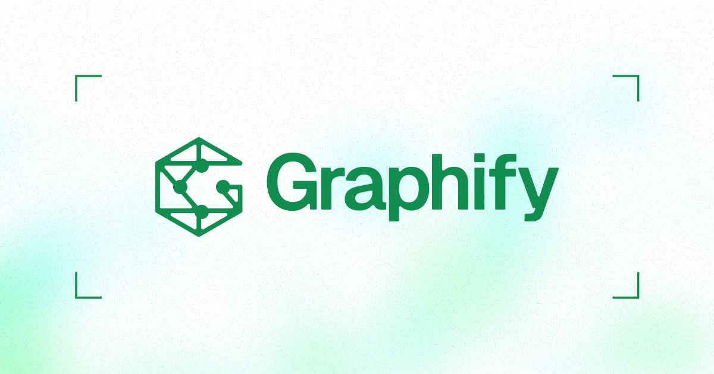

<p align="center">
  <a href="https://graphify.com"></a>
</p>

<p align="center">
  <a href="https://trendshift.io/repositories/25296?utm_source=repository-badge&amp;utm_medium=badge&amp;utm_campaign=badge-repository-25296" target="_blank" rel="noopener noreferrer"></a>
</p>

<div align="center">
<details><summary><b>Read this in other languages</b></summary>

<a href="README.md">English</a> | <a href="docs/translations/README.zh-CN.md">简体中文</a> | <a href="docs/translations/README.ja-JP.md">日本語</a> | <a href="docs/translations/README.ko-KR.md">한국어</a> | <a href="docs/translations/README.de-DE.md">Deutsch</a> | <a href="docs/translations/README.fr-FR.md">Français</a> | <a href="docs/translations/README.es-ES.md">Español</a> | <a href="docs/translations/README.hi-IN.md">हिन्दी</a> | <a href="docs/translations/README.pt-BR.md">Português</a> | <a href="docs/translations/README.ru-RU.md">Русский</a> | <a href="docs/translations/README.ar-SA.md">العربية</a> | <a href="docs/translations/README.fa-IR.md">فارسی</a> | <a href="docs/translations/README.it-IT.md">Italiano</a> | <a href="docs/translations/README.pl-PL.md">Polski</a> | <a href="docs/translations/README.nl-NL.md">Nederlands</a> | <a href="docs/translations/README.tr-TR.md">Türkçe</a> | <a href="docs/translations/README.uk-UA.md">Українська</a> | <a href="docs/translations/README.vi-VN.md">Tiếng Việt</a> | <a href="docs/translations/README.id-ID.md">Bahasa Indonesia</a> | <a href="docs/translations/README.sv-SE.md">Svenska</a> | <a href="docs/translations/README.el-GR.md">Ελληνικά</a> | <a href="docs/translations/README.ro-RO.md">Română</a> | <a href="docs/translations/README.cs-CZ.md">Čeština</a> | <a href="docs/translations/README.fi-FI.md">Suomi</a> | <a href="docs/translations/README.da-DK.md">Dansk</a> | <a href="docs/translations/README.no-NO.md">Norsk</a> | <a href="docs/translations/README.hu-HU.md">Magyar</a> | <a href="docs/translations/README.th-TH.md">ภาษาไทย</a> | <a href="docs/translations/README.uz-UZ.md">Oʻzbekcha</a> | <a href="docs/translations/README.zh-TW.md">繁體中文</a> | <a href="docs/translations/README.fil-PH.md">Filipino</a> | <a href="docs/translations/README.he-IL.md">עברית</a>

</details>
</div>

<p align="center">
  <a href="https://pypi.org/project/graphifyy/"></a>
  <a href="https://github.com/Graphify-Labs/graphify/actions/workflows/ci.yml"></a>
  <a href="LICENSE"></a>
  <a href="https://pepy.tech/project/graphifyy"></a>
  <a href="https://docs.graphify.com"></a>
  <a href="https://app.graphify.com/signup?utm_source=github&utm_medium=readme&utm_campaign=oss"></a>
  <a href="https://discord.gg/graphify"></a>
  <a href="https://www.youtube.com/@graphifylabs"></a>
  <a href="https://www.linkedin.com/company/graphify-labs"></a>
  <a href="https://www.ycombinator.com/companies/graphify-labs"></a>
</p>

<p align="center">
  <a href="https://app.graphify.com/signup?utm_source=github&utm_medium=readme&utm_campaign=oss"><b>Start free, no card required &rarr;</b></a>
  <br/>
**Punguza matumizi ya tokeni za ejenti kwa 80%.** Graphify Cloud ni kumbukumbu inayowaka wakati wote ambayo inasimamia ejenti zako, huweka ubora wa kodi ukiwa juu, na kuthibitisha usahihi kupitia uthibitishaji rasmi.

Andika `/graphify` katika msaidizi wako wa AI wa kodi na itatoa ramani ya mradi wako wote (kodi, nyaraka, faili za PDF, picha, video) na kuiweka katika **grafu ya maarifa (knowledge graph)** ambayo unaweza **kuiuliza maswali badala ya kutafuta neno kwa neno (grepping)** kwenye faili.

* **Ramani za kodi ni za bure, na zinabaki kwenye kompyuta yako pekee (fully local).** Kodi inachanganuliwa kwa kutumia tree-sitter AST: ni thabiti, hakuna matumizi ya LLM, na hakuna data inayoondoka kwenye mashine yako. (Nyaraka, PDF, picha na video hutumia modeli ya msaidizi wako, au ufunguo wa API ulioidhinishwa, kwa ajili ya usomaji wa kisemantiki).


* **Kila kiungo (edge) kinaelezwa.** Kila muunganisho umetiwa alama ya `EXTRACTED` (imetolewa moja kwa moja kwenye chanzo) au `INFERRED` (imetatuliwa na graphify), hivyo unaweza kujua nini kilisomwa moja kwa moja na nini kilikisiwa.


* **Sio faharasa ya vekta (vector index).** Hakuna upachikaji (embeddings), hakuna hifadhi ya vekta: ni grafu halisi unayoweza kuipitia. Uliza swali, fuatilia njia kati ya vitu viwili, au eleza dhana moja.


`[Inahitaji Uhariri: Istilahi za kiufundi kama "tree-sitter AST", "formal verification", "vector index", na "embeddings" zinaweza kukosa fasiri sanifu ya Kiswahili; inashauriwa zibaki katika muundo wa Kiingereza au zifafanuliwe kulingana na muktadha wa uhandisi wa programu.]`

> [!NOTE]
> **Unataka hii iwe inafanya kazi wakati wote?** Graphify Cloud huweka grafu ikiwa hai katika mzunguko mzima wa uundaji programu (SDLC): inasaidia hifadhi moja (monorepo) na hifadhi-mtambuka (cross-repo), uthibitishaji rasmi, na ukaguzi wa kodi ukiwa na mwonekano wa juu wa SDLC yako. Pia inajumuisha viunganishi vya Sentry, Jira, na zaidi ili matukio na tiketi zikae kwenye grafu sawa na kodi yako. **Anza bila malipo, hakuna kadi inayohitajika.**
> 
> 

**Anza (sekunde 30).** Inahitaji Python 3.10+ na uv (au pipx):

```bash
uv tool install graphifyy      # sasisha CLI (au: pipx install graphifyy)
graphify install               # hugundua msaidizi wako na kusajili ujuzi

```

Kisha, kwenye msaidizi wako wa AI:

```
/graphify .

```

Unapata **faili tatu**:

```
graphify-out/
├── graph.html       fungua kwenye kivinjari chochote: bofya nodi, chuja, tafuta
├── GRAPH_REPORT.md  mambo muhimu: dhana kuu, miunganisho ya kushangaza, maswali yaliyopendekezwa
└── graph.json       grafu kamili: iulize maswali wakati wowote bila kusoma upya faili zako

```

**Usakinishaji Mmoja, msaidizi yeyote, mfumo wa uendeshaji wowote (OS).** Inafanya kazi na Claude Code, Cursor, Codex, Gemini CLI, GitHub Copilot, na wasaidizi wengine zaidi ya 20 kwenye macOS, Linux, na Windows.

---

### Ione Ikifanya Kazi

Baada ya grafu kuundwa, unaiuliza maswali badala ya kusoma faili nzima. Kila kiungo kinabeba **lebo ya uhakika** (`EXTRACTED` au `INFERRED`), ili uweze kujua nini kilisomwa tofauti na kile kilichokisiwa. Amri ya `graphify query "<swali>"` inarejesha sehemu ya grafu kwa swali la lugha ya kawaida, na `graphify path A B` inafuatilia jinsi vitu viwili vinavyoungana, ikimalizia na uhakika wa njia nzima.

### Inachofanya

* **Nodi Kuu (God nodes):** Dhana zilizounganishwa zaidi, ili uone kila kitu kinapitia wapi.


* **Jumuiya (Communities):** Grafu iliyogawanywa katika mifumo midogo (kwa algoriti ya Leiden), bila matumizi ya LLM.


* **Viungo vya faili-mtambuka:** Inatatua `calls` / `imports` / `inherits` kupitia lugha ~40 kwa kutumia tree-sitter AST.


* **Sababu na marejeleo:** Maoni ya `# NOTE:` / `# WHY:` yanakuwa nodi zilizounganishwa na kodi.


* **Zaidi ya kodi:** Nyaraka, PDF, picha, na video/sauti zote zinawekwa kwenye grafu moja.


`[Inahitaji Uhariri: Neno "God nodes" limetafsiriwa kama "Nodi Kuu" ili kuleta maana ya kitovu cha mawasiliano, lakini inaweza kubadilishwa kulingana na mapendeleo ya timu yako.]`

### Usakinishaji

> [!IMPORTANT]
> **Kifurushi rasmi:** Kifurushi cha PyPI ni `graphifyy` (y mbili). Vifurushi vingine vya `graphify*` havihusiani. Amri ya CLI bado ni `graphify`.
> 
> 

Njia za usakinishaji (chagua moja):

```bash
uv tool install graphifyy   # inashauriwa
pipx install graphifyy      # mbadala
pip install graphifyy       # inaweza kuhitaji mpangilio wa PATH

```

Kisha endesha `graphify install` mara moja. Inatambua msaidizi gani unatumia na kusajili ujuzi kiotomatiki.

### Mfanye Msaidizi Wako Atumie Grafu Kila Wakati

Endesha `graphify <platform> install` mara moja kwenye mradi wako (mfano: `graphify claude install`). Hii inaandika faili dogo la usanidi linalomwambia msaidizi wako ashauriane na grafu kwa maswali ya kodi, akipendelea maswali yaliyolengwa badala ya kusoma faili zote.

### Faragha

* **Faili za kodi:** Zinachakatwa ndani ya kompyuta yako. Hakuna kinachotoka nje.


* **Video / sauti:** Zinanukuliwa (transcribed) ndani ya kompyuta yako na faster-whisper.


* **Nyaraka, PDF, picha:** Zinatuma kwa msaidizi wako wa AI kwa uchimbaji wa kisemantiki (semantic extraction) kupitia ufunguo wa API ulioidhinishwa.


* **Ukaazi wa Data:** Ikiwa una mahitaji makali ya ukaazi wa data, tumia `GRAPHIFY_BACKEND=ollama` kuendesha kila kitu ndani ya mashine yako kikamilifu.


* **Hakuna ufuatiliaji (telemetry),** hakuna uchanganuzi wa matumizi wala ufuatiliaji unaofanywa.
