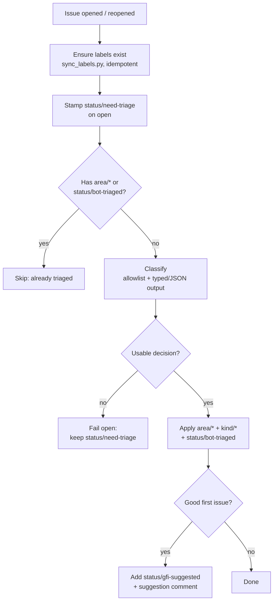
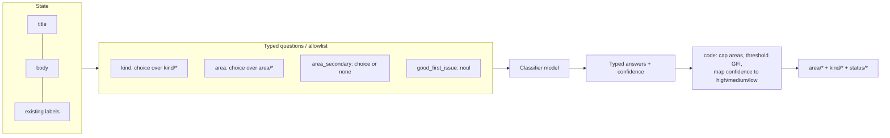
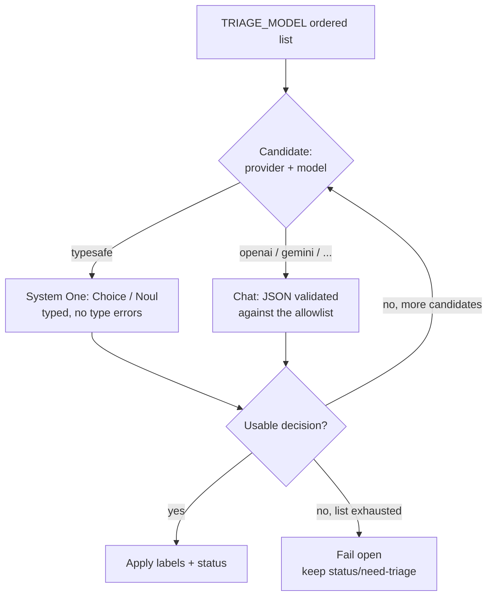

# Implementing issue triage in `Graphify-Labs/graphify`

How to adopt this automation in the main repository. It is designed to be a small,
reversible addition that rides the same rails as the existing bots
(`welcome.yml`, `pr-management.yml`, the Graphify Cloud reviewer).

## What it adds

Ten new files, all additive:

| File | Role |
|---|---|
| `.github/workflows/issue-triage.yml` | The bot: ensure labels → `status/need-triage` → classify → apply |
| `.github/workflows/labels-sync.yml` | Create/update the labels when `taxonomy.py` changes |
| `.github/workflows/workflow-lint.yml` | `actionlint` on the two workflows |
| `tools/triage/taxonomy.py` | **Single source of truth** for the label set |
| `tools/triage/classify.py` | Model call → allowlisted JSON → labels; fail-open; fallback chain |
| `tools/triage/sync_labels.py` | Idempotent label creation via the REST API |
| `tools/triage/__init__.py` | Package marker |
| `tools/triage/README.md` | Operator/config reference |
| `tests/test_triage.py` | Unit + provider + fallback tests (run by existing CI) |

Nothing existing is modified. Reliability comes from two things that production
issue pipelines converge on: a **fixed label allowlist** the model may choose from,
and **typed output** (or JSON validated against the allowlist), so a hallucinated
label can never reach the repository. Modern classifier models — TypeSafe's System
One (Jev) and the fast/cheap tier generally — make this accurate and inexpensive
enough to run on every issue.

## Flow (one job, ordered, no race)

```
issues: [opened, reopened]
  └─ job "triage"
       1. ensure labels exist        (sync_labels.py, idempotent, best-effort)
       2. stamp status/need-triage    (on "opened")
       3. skip if area/* or status/bot-triaged already present
       4. classify (classify.py)      allowlist + JSON; fallback chain; fail-open
       5. apply (github-script)       area/* + kind/* + status/bot-triaged,
                                       remove status/need-triage, suggest GFI
```



### Classification method

The classifier never asks one broad "label this issue" question. It decomposes
into atomic, allowlisted decisions and the **code** composes them — the pattern
that keeps model output reliable:



### Model capabilities and the fallback chain

`TRIAGE_MODEL` is an ordered list; each entry is `[provider:]model`. The first one
that returns a usable decision wins, so a slow or rate-limited provider never
blocks triage:



Untrusted issue text reaches the model but never a `run:` shell (it travels via
the `ISSUE_JSON` env var into the classifier's stdin). Model output is filtered to
the allowlist; the only text posted outward is fixed wording.

## Prerequisites (one-time, on the repo)

1. **Workflow files on the default branch.** `issues`-triggered workflows are read
   from the default branch (`v8`), so this change must land there.
2. **Actions workflow token = read/write.**
   `Settings → Actions → General → Workflow permissions → Read and write`
   (the workflow also declares `permissions: contents: read, issues: write`).
3. **Issues enabled** on the repo.
4. **Labels.** `labels-sync.yml` creates all 22 `area/`/`kind/`/`status/` labels on
   the first push that touches `taxonomy.py`; `issue-triage.yml` also ensures them
   per run, so a fresh repo cannot fail on a missing label.

## Wiring the model

Graphify is standardising on TypeSafe's **System One** models (**Jev**) for
classification, so the recommended setup routes the triage through the same
decision API as the bot. Jev is not a chat model: it takes typed `questions` and
returns typed `answers`, which is exactly a classifier's shape. Add one secret:

| Settings → | Name | Value |
|---|---|---|
| Secrets | `TYPESAFE_API_KEY` | your TypeSafe key (`JEV_API_KEY` also works) |

Defaults are right out of the box: base URL `https://api.typesafe.ai`, model
`jev-latest`, endpoint `POST /v1/systemone`. The triage maps onto Jev primitives:

| Jev question | Type | Maps to |
|---|---|---|
| `kind` | `choice`, criteria = `kind/*` | the issue's `kind/*` label |
| `area` | `choice`, criteria = `area/*` | the primary `area/*` label |
| `area_secondary` | `choice`, `area/*` + `none` | an optional second `area/*` |
| `good_first_issue` | `noul` | GFI suggestion (probability ≥ 0.5) |

Because the Choice options *are* the allowlist, Jev cannot return a label we did
not define — that is stronger than parsing JSON from a chat model. Each answer's
calibrated `confidence` becomes our `high`/`medium`/`low`. Override with
`TRIAGE_MODEL` (e.g. pin `jev-1.13.0` instead of the alias) or `TRIAGE_BASE_URL`
if you front it with a gateway. See <https://docs.typesafe.ai/api>.

### Fallback to chat providers

Any OpenAI-compatible provider also works and is useful as a backup in the chain:
`OPENAI_API_KEY`, `GEMINI_API_KEY`/`GOOGLE_API_KEY`, `DEEPSEEK_API_KEY`,
`GROQ_API_KEY`, `OPENROUTER_API_KEY`, `MOONSHOT_API_KEY` — auto-detected, no other
config. `TRIAGE_MODEL` accepts a comma-separated list tried in order, mixing
providers, so you can put Jev first and a chat model behind it:

```
TRIAGE_MODEL = "typesafe:jev-latest, openai:gpt-4.1-mini"
```

The first model that returns a usable decision wins; transient `429`/`529` (Jev)
and `429`/`503` (chat providers) fall through. If every model fails the issue
keeps `status/need-triage` (fail-open, never mislabelled). Reasoning chat models
(e.g. `gemini-3.x-flash`) need room for thinking tokens: `TRIAGE_MAX_TOKENS`
defaults to 2048. Jev bills input only and has no such cap.

## Rollout (phased, reversible)

**Phase 0 — prove it in a fork.** Push the files to a fork's default branch, add
the secret, open a few demo issues, confirm labels + GFI comment. (Done: issues
#1–#4 in a test fork triaged correctly, including a live fallback from a
rate-limited model to a working one.)

**Phase 1 — dry run on the main repo.** Set repo variable `TRIAGE_DRY_RUN=true`.
The bot then posts the *proposed* labels in a comment and changes nothing. Let it
run on a batch of real issues and compare against maintainer judgement.

**Phase 2 — live, GFI still suggested-only.** Unset `TRIAGE_DRY_RUN`. The bot
applies `area/`+`kind/`+`status/bot-triaged` and *suggests* `good first issue`.

**Phase 3 — optional.** Promote `good first issue` to auto-apply only if the
suggestion rate is trusted; the default stays human-confirmed on purpose, because
a wrong beginner task is worse than none.

**Rollback** is trivial and non-destructive: set `TRIAGE_DRY_RUN=true` (silent) or
delete `issue-triage.yml`. Labels already applied are harmless and can be removed
in bulk.

## Governance & maintenance

- **Labels** live in `tools/triage/taxonomy.py`. Editing it updates both the model
  allowlist and the created labels — one source, no drift. The status names the
  workflow uses are checked against `taxonomy.STATUS_NAMES` by a test.
- **GFI definition** is `taxonomy.GFI_DEFINITION`; keep it strict.
- **Re-triage**: remove `area/*` **and** `status/bot-triaged`, then reopen.
- **Cost/limits**: one small call per untriaged issue; the fallback chain and a
  60s per-call timeout bound the worst case.

## Security

- Token scopes are minimal: `contents: read` + `issues: write`.
- The API key is a repo secret, read only inside the classifier process.
- Prompt injection is contained: untrusted text never reaches a shell, the model
  can only pick from the allowlist, and the bot never echoes model-authored text
  into a comment (the GFI note is fixed wording).
- `good first issue` is never auto-applied.

## Verifying a change

```bash
python -m pytest tests/test_triage.py -q          # unit + provider + fallback
python -m ruff check tools/triage tests/test_triage.py --config pyproject.toml
# workflow lint (CI runs this): actionlint on the two workflows
```

The triage tests run inside the existing `ci.yml` matrix with no extra setup.

## Open decisions for the maintainers

1. **Backend**: reuse the bot's gateway (Option A) or a dedicated key (Option B)?
2. **GFI policy**: keep suggested-only, or auto-apply after a trusted period?
3. **Priority labels**: out of scope for v1 (the bot sets `area/` + `kind/` only);
   add a `priority/*` group later if wanted.
4. **PRs**: this covers issues only; the same classifier could be extended to PR
   labels (the existing `pr-management.yml` already handles PR metadata).

## Ownership

Add to `.github/CODEOWNERS`:

```
.github/workflows/issue-triage.yml  @<maintainer>
.github/workflows/labels-sync.yml   @<maintainer>
tools/triage/                       @<maintainer>
```
